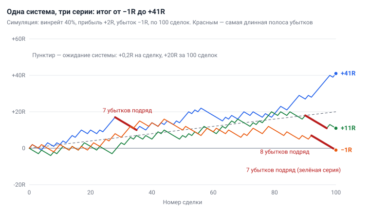

# Глава 1. Что такое трейдинг на самом деле

> После этой главы вы умеете: отличить трейдинг от инвестирования и от азартной игры; посчитать математическое ожидание системы в R; выбрать стиль торговли под своё время; назвать, что считать успехом в первый год; подготовить всё нужное для учёбы.

**Связь с курсом:** [README курса](../README.md); [ступень 01, урок 1 «Криптовалюта и биржа»](../01_Основы/01_Криптовалюта_и_биржа.md); [ступень 01, урок 5 «Свечи и таймфреймы»](../01_Основы/05_Свечи_и_таймфреймы.md); [ступень 05, урок 1 «Почему новички сливают»](../05_Психология/01_Ошибки_новичков.md); [ступень 06 «Когда можно переходить на реальные деньги»](../06_Своя_система/03_Критерии_перехода_на_реальные_деньги.md); [уровень профи, урок 1 «Математическое ожидание»](../09_Уровень_профи/01_Математическое_ожидание.md).

## 1.1. Трейдинг, инвестирование и азартная игра

**Трейдинг** — это заработок на изменении цены по правилам, записанным до сделки. **Сделка** — покупка и продажа одного актива, например биткоина; пока сделка открыта, у вас есть **позиция**. Заработать можно на росте цены (**лонг**) и на падении (**шорт**); механику объясняет [глава 2](02_Рынок_и_механика_торгов.md).

Одна и та же кнопка «Купить» запускает три разных занятия.

| Признак | Инвестирование | Трейдинг | Азартная игра |
|---|---|---|---|
| Горизонт | годы | от минут до нескольких месяцев | одна ставка |
| Источник результата | рост стоимости самого актива | разница цен входа и выхода в серии сделок | случай |
| Роль правил | что купить и сколько держать | вход, выход и риск записаны до сделки | правил нет, или они не меняют шансы |
| Что вы контролируете | выбор актива и срок | размер убытка в каждой сделке | только размер ставки |

Инвестор покупает биткоин, потому что ждёт более высокой цены через пять лет. Трейдеру нужны движение цены в ближайшие дни и цена, на которой он признает ошибку и выйдет.

От игры трейдинг отличают два признака. Первый — проверенное **преимущество** (edge): правила, которые на длинной серии сделок дают плюс. Второй — ограниченный убыток в каждой сделке. Сделка «по ощущению», без цены выхода и без записи, — это ставка, каким бы серьёзным ни выглядел график. Если ставка в среднем приносит минус, длинная серия ведёт к потере денег. Если сделка в среднем приносит плюс, длинная серия работает на вас; расчёт — в разделе 1.3.

**Вывод:** занятие определяют правила, а не инструмент. Нет записанных правил — вы играете.

## 1.2. Честная статистика: большинство теряет деньги

Большинство частных трейдеров теряет деньги; это показывают данные регулятора и академические исследования. **Розничный трейдер** (retail) — частное лицо, которое торгует своими деньгами.

- **CFD в Европе.** CFD — контракт на разницу цен: как и фьючерс на криптобирже ([глава 2](02_Рынок_и_механика_торгов.md)), это ставка на движение цены с **плечом**, то есть с заёмными средствами. В 2018 году европейский регулятор ESMA сообщил, что деньги теряют 74–89% розничных счетов, а средний убыток клиента — от 1 600 до 29 000 евро. ESMA обязал брокеров указывать в предупреждении свою долю убыточных счетов за последние 12 месяцев.
- **Тайвань, 1992–2006.** **Дейтрейдинг** — сделки, открытые и закрытые в один день. Предсказуемо зарабатывать после комиссий удавалось менее чем 1% дейтрейдеров (Barber, Lee, Liu, Odean, 2014).
- **Бразилия, фьючерсы.** Среди начавших в 2013–2015 годах и торговавших не меньше 300 дней деньги потеряли 97%. Больше банковского кассира (54 $ в день) заработали 0,4% (Chague, De-Losso, Giovannetti, 2019).
- **Биткоин.** По оценке Банка международных расчётов, с августа 2015 по декабрь 2022 года большинство пользователей криптоприложений почти во всех странах оказались в убытке по биткоину.

Эти данные описывают дневную торговлю, счета с плечом и розничных покупателей биткоина. Проверенной статистики по тем, кто держит сделки на крипторынке днями, мы не нашли. Считайте, что без подготовки ваши шансы такие же.

Источники называют три причины потерь:

1. **Плечо.** Обязательное предупреждение ESMA начинается с того, что деньги быстро теряются из-за плеча.
2. **Частая торговля и самоуверенность.** Из 66 465 семей — клиентов дисконтного брокера за 1991–1996 годы самые активные получили 11,4% годовых при 17,9% у рынка; авторы объясняют это самоуверенностью (Barber, Odean, 2000).
3. **Опыт сам по себе не учит.** В бразильских данных нет признаков того, что трейдеры торгуют лучше со временем.

Курс добавляет ошибки поведения: торговля без **стоп-лосса** (заранее выставленной заявки, которая закрывает убыточную сделку), отыгрыш (новая, более крупная сделка сразу после убытка), вход вдогонку за ценой, смена стратегии каждую неделю, сделки по чужим сигналам ([ступень 05, урок 1](../05_Психология/01_Ошибки_новичков.md)). Правила против них даёт [глава 14](14_Психология.md).

**Вывод:** статистика — причина начинать с **демосчёта** (счёта с виртуальными деньгами), малого риска и журнала, где записана каждая сделка. Опыт без записей не помогает.

## 1.3. Откуда берётся прибыль: преимущество и серия сделок

Прибыль трейдера — это небольшое преимущество, повторённое много раз. **Торговая система** — записанные правила: когда входить, где выходить с убытком и с прибылью, сколько рисковать. Исход одной сделки близок к случайному; результат системы виден только на серии.

Сделки разного размера сравнивают в **R**. 1R — сумма, которую вы теряете, когда срабатывает стоп-лосс (коротко — стоп). **Депозит** (деньги на торговом счёте) 1 000 $, риск 1% на сделку: 1R = 10 $. Прибыль 20 $ — это +2R. Сработал стоп — это −1R.

**Математическое ожидание** (expectancy) — средний результат одной сделки в R:

```
E = p × W − (1 − p) × L
```

Здесь p — **винрейт** (win rate), доля прибыльных сделок; W — средняя прибыль в R; L — средний убыток в R.

Пример. Из 10 сделок 4 закрылись по +2R и 6 по −1R. Итог: 4 × 2 − 6 × 1 = +2R, или +0,2R на сделку. По формуле: 0,4 × 2 − 0,6 × 1 = +0,2R. Система зарабатывает, хотя ошибается в 6 сделках из 10. При депозите 1 000 $ и риске 1% эти 10 сделок дают 20 $.

По своему журналу ожидание считают в четыре шага:

1. Выпишите результат каждой сделки в R.
2. Разделите число прибыльных сделок на число всех сделок — это p.
3. Найдите среднее по прибыльным сделкам (W) и среднее по убыточным (L).
4. Подставьте числа в формулу.

У ожидания три рычага: винрейт, отношение средней прибыли к среднему убытку, число сделок вместе с дисциплиной исполнения.

| Что изменилось | p | W | L | E на сделку |
|---|---|---|---|---|
| Исходная система | 40% | 2R | 1R | +0,20R |
| Рычаг 1: винрейт выше | 45% | 2R | 1R | +0,35R |
| Рычаг 2: средняя прибыль больше | 40% | 2,5R | 1R | +0,40R |
| Рычаг 3 сломан: стоп отодвигали, прибыль забирали раньше плана | 40% | 1,6R | 1,3R | −0,14R |

В последней строке правила входа те же, что в первой. Изменилось исполнение, и прибыльная система стала убыточной. Третий рычаг полностью в ваших руках: сделок должно быть много, и каждая исполняется одинаково.



*Рис. 1.1. Симуляция, а не реальные сделки: винрейт 40%, прибыль +2R, убыток −1R, три случайные серии по 100 сделок. Красным выделена самая длинная полоса убытков в каждой серии: 7–8 сделок подряд.*

Ожидание этой системы за 100 сделок — +20R. Три случайные серии дали +41R, +11R и −1R, и в каждой была полоса из 7–8 убытков подряд. Точный расчёт: такая система заканчивает в минусе 38% серий из 10 сделок, 25% серий из 20, 9% серий из 100 и 2,5% серий из 200. Поэтому курс требует минимум 100 сделок на демосчёте, прежде чем судить о системе. Серии убытков и размер риска разбирает [глава 11](11_Риск_менеджмент.md).

**Вывод:** оценивайте серию, а не сделку. Убыток по правилам — нормальная часть серии.

## 1.4. Четыре стиля и почему учебник учит свингу

Стиль торговли задают таймфрейм и срок жизни сделки. **Таймфрейм** — время, которое показывает одна **свеча**, столбик на графике цены ([глава 3](03_График_свечи_и_таймфреймы.md)). Обозначения: 1m, 5m, 15m — минуты; 1H, 4H — часы; 1D — день; 1W — неделя.

| Стиль | Таймфреймы | Сделка длится | Время у экрана | Вес комиссий | Кому подходит |
|---|---|---|---|---|---|
| **Скальпинг** (scalping) | 1m–5m | минуты | часы подряд без отрыва | очень высокий | опытным, с отлаженным исполнением |
| **Внутри дня** (intraday) | 15m–1H | часы | несколько часов в день | высокий | тем, кто свободен днём и уже торгует по системе |
| **Свинг** (swing) | 4H–1D | дни–недели | 30–60 минут в день | низкий | работающим людям; лучший старт |
| **Позиционный** (position) | 1D–1W | недели–месяцы | 1–2 часа в неделю | минимальный | терпеливым; ближе к инвестированию |

Время у экрана — ориентир, а не норма. Учебник учит свингу: направление рынка вы определяете на 1D, вход ищете на 4H. Причин четыре.

1. **Комиссии.** Комиссию берут от размера позиции (суммы сделки), а 1R зависит от расстояния до стопа: чем ближе стоп, тем больше доля комиссии в R. При комиссии 0,1% за сделку вход и выход стоят 0,2% позиции (актуальные ставки смотрите на своей бирже; подробно — [глава 2](02_Рынок_и_механика_торгов.md)). При стопе в 0,5% от цены входа это 0,2 / 0,5 = 0,40R: система с ожиданием +0,2R уходит в −0,2R. При стопе 2% это 0,10R. На минутных графиках стопы короткие. На 4H они измеряются процентами: у половины свечей 4H по BTC/USDT за 2024–2025 годы расстояние от минимума до максимума было больше 1,15% цены.
2. **Время.** Свеча 4H закрывается шесть раз в сутки. Решения принимаются после закрытия свечи, между закрытиями можно работать и спать.
3. **Шум.** Чем старше таймфрейм, тем меньше случайных движений и надёжнее сигналы ([ступень 01, урок 5](../01_Основы/05_Свечи_и_таймфреймы.md)).
4. **Ошибки.** На решение есть часы, а не секунды. Самая жёсткая статистика раздела 1.2 относится к дневной торговле.

Свинг не делает систему прибыльной. Он убирает то, что губит новичка до появления системы: комиссии, спешку и усталость.

**Действие:** запишите, сколько минут в день вы можете уделять рынку. Если меньше двух часов подряд, скальпинг и торговля внутри дня вам не подходят.

## 1.5. Реалистичные ожидания

Первый год — это учёба, а не заработок. Сроки курса при 30–60 минутах в день: основы и анализ — 3–4 недели, риск — 1 неделя, стратегии — 2–3 месяца практики, своя система — от 1–2 месяцев. В сумме это 4–6 месяцев и больше. Быстрых путей нет.

Обещать доходность нельзя по трём причинам. Большинство трейдеров остаётся в минусе (раздел 1.2). Ожидание вашей системы неизвестно, пока в журнале нет около 100 сделок. Результат зависит от исполнения, а оно у каждого своё. Учебник не обещает прибыль. Это учебный материал, а не финансовая консультация.

Успех первого года — выполненные критерии перехода на реальные деньги:

- тесты курса сданы на 80% и выше;
- 100 сделок на демосчёте по торговому плану — вашей системе, записанной на одной странице ([глава 13](13_Торговый_план_бэктест_журнал.md));
- правила соблюдены минимум в 95% сделок;
- итог за последние 2 месяца положительный;
- за последний месяц нет нарушений дневного лимита потерь (3% депозита).

**Вывод:** цель года — целый счёт, 100 записанных сделок и привычка исполнять правила. План по месяцам даёт [глава 15](15_Дорожная_карта.md).

## 1.6. Что нужно для старта

Для учёбы нужны четыре вещи и ни одного реального доллара.

1. **Демосчёт** (demo trading). Цены и кнопки в нём как на настоящем счёте, деньги виртуальные, потерять ничего нельзя. Такой режим есть у крупных бирж, например у Binance, Bybit и OKX.
2. **TradingView** — сервис графиков. Начать можно на бесплатном тарифе Basic. На момент написания его ограничение — два индикатора (расчётные линии поверх цены, [глава 7](07_Индикаторы_и_объём.md)) на график. Настройку графика показывает [глава 3](03_График_свечи_и_таймфреймы.md).
3. **Журнал сделок** — таблица по [шаблону курса](../06_Своя_система/02_Журнал_сделок_шаблон.md).
4. **30–60 минут в день**, каждый день. Час ежедневно полезнее семи часов в воскресенье.

Реальные деньги понадобятся не раньше выполнения критериев из раздела 1.5. В торговлю идут только деньги, потеря которых не изменит вашу жизнь: не кредит, не резерв на чёрный день, не плата за жильё.

**Действие:** выполните первые три пункта сегодня по заданиям раздела 1.10.

## 1.7. Как устроен учебник

В учебнике 15 глав в пяти частях; каждая часть заканчивается навыком.

| Часть | Главы | Что вы умеете в конце |
|---|---|---|
| I. Фундамент | 1–3 | понимаете сделку, биржу и график |
| II. Технический анализ | 4–7 | определяете направление рынка, отмечаете уровни цены, проверяете паттерны и индикаторы |
| III. Поиск входа | 8–10 | знаете, что делать на каждом таймфрейме, и входите по трём моделям |
| IV. Риск и деньги | 11–12 | считаете размер позиции, ставите стоп и цель, ведёте сделку |
| V. Система и профессия | 13–15 | пишете торговый план, проверяете его на истории, ведёте журнал |

Учебник объясняет, курс и приложение тренируют. После главы пройдите уроки из строки «Связь с курсом», затем практику и тест ступени в приложении: урок → практика → тест. Следующая ступень открывается, когда практика выполнена, а тест сдан минимум на 80%.

Темп — одна глава в неделю: 2–3 дня на чтение и вопросы, остальные дни на практику. Все 15 глав займут 15 недель, то есть 3–4 месяца. Читайте по порядку: главы 8–10 о входах не работают без глав 4–5 о структуре рынка и уровнях.

## 1.8. Типичные ошибки

- **Начать с реальных денег, «чтобы почувствовать рынок».** Эмоции на реальных деньгах сильнее, а навыка ещё нет. Так пополняют статистику раздела 1.2.
- **Судить о системе по 5–10 сделкам.** Прибыльная система из раздела 1.3 заканчивает в минусе 38% серий из 10 сделок.
- **Гнаться за винрейтом.** Винрейт 60% при средней прибыли 0,5R и убытке 1R даёт −0,1R на сделку.
- **Выбрать скальпинг, потому что он «быстрее».** Быстрее растут только число решений и сумма комиссий.
- **Верить обещанию фиксированного процента в месяц.** Ожидание системы неизвестно до 100 сделок, чужой системы — тем более.

## 1.9. Запомнить

- Трейдинг — это правила до сделки, ограниченный убыток и результат на серии.
- По данным ESMA, деньги теряют 74–89% розничных счетов CFD. В дневной торговле на Тайване предсказуемо зарабатывали меньше 1% трейдеров.
- `E = p × W − (1 − p) × L`. При винрейте 40%, W = 2R, L = 1R ожидание равно +0,2R.
- Три рычага: винрейт, отношение прибыли к убытку, число одинаково исполненных сделок.
- Учебная связка: 1D — направление, 4H — вход.
- Первый год: демосчёт, 100 сделок, журнал. Доходность — не цель.

## 1.10. Практика на демосчёте

- [ ] Зарегистрируйтесь на TradingView, откройте график BTCUSDT биржи Binance, включите таймфрейм 1D, затем 4H. Результат: два снимка экрана в папке «Журнал».
- [ ] Включите демосчёт на своей бирже и запишите стартовый баланс. Сделок не открывайте: ордера (заявки на покупку и продажу) разбирает глава 2.
- [ ] Создайте журнал по шаблону курса. Результат: пустая таблица с 15 столбцами.
- [ ] В приложении курса откройте «Риск» → «Монте-Карло». Введите: винрейт 40, прибыль 2, убыток 1, риск 1, сделок 100. Запишите «Шанс закончить в минусе» и ожидаемую серию убытков. Сверьте с разделом 1.3: около 9% и около 9 сделок.
- [ ] На первой странице журнала запишите: сколько минут в день и в какие часы вы учитесь; сумму, потеря которой не изменит вашу жизнь.

## 1.11. Вопросы для самопроверки

1. Чем трейдер отличается от инвестора по горизонту и источнику результата?
2. Какие два признака отличают торговлю по системе от азартной игры?
3. Какая доля розничных счетов CFD теряет деньги по данным ESMA?
4. Депозит 10 000 $, риск 1% на сделку. Чему равен 1R? Сколько долларов приносит сделка +2,5R?
5. Винрейт 35%, средняя прибыль 3R, средний убыток 1R. Найдите ожидание на сделку и за 100 сделок.
6. Комиссия за вход и выход — 0,2% позиции. Сколько это в R при стопе 0,5% и при стопе 2%?
7. Назовите три рычага математического ожидания.
8. Почему учебник учит свингу на 4H и 1D? Назовите три причины.
9. Система с ожиданием +0,2R после 10 сделок в минусе. Что это говорит о системе?
10. Что считать успехом в первый год?

## 1.12. Ответы

1. Инвестор держит актив годами и зарабатывает на росте его стоимости. Трейдер держит позицию от минут до нескольких месяцев и зарабатывает на разнице цен входа и выхода в серии сделок.
2. Проверенное преимущество (в среднем сделка даёт плюс) и ограниченный убыток в каждой сделке.
3. 74–89%.
4. 1R = 10 000 × 0,01 = 100 $. Сделка +2,5R приносит 250 $.
5. E = 0,35 × 3 − 0,65 × 1 = +0,40R на сделку; за 100 сделок ожидание +40R.
6. 0,2 / 0,5 = 0,40R и 0,2 / 2 = 0,10R.
7. Винрейт; отношение средней прибыли к среднему убытку; число сделок и дисциплина исполнения.
8. Комиссии малы в R; хватает 30–60 минут в день; на старших таймфреймах меньше шума; на решение есть часы.
9. Ничего: 38% серий из 10 сделок такой системы заканчиваются в минусе. Нужна выборка около 100 сделок.
10. Выполнение критериев перехода: тесты на 80%+, 100 сделок на демосчёте по плану, правила соблюдены в 95%+ сделок, положительный итог за 2 месяца, нет нарушений дневного лимита за месяц.

## Источники

- ESMA, пресс-релиз от 27 марта 2018: [ESMA agrees to prohibit binary options and restrict CFDs](https://www.esma.europa.eu/node/84933); текст предупреждения и правило расчёта за 12 месяцев: [Notice of ESMA's product intervention decisions](https://www.esma.europa.eu/sites/default/files/library/esma35-43-1135_notice_of_pi_decisions_on_cfds_and_binary_options.pdf).
- Barber B., Lee Y.-T., Liu Y.-J., Odean T. [The cross-section of speculator skill: Evidence from day trading](https://ideas.repec.org/a/eee/finmar/v18y2014icp1-24.html). Journal of Financial Markets, 2014.
- Chague F., De-Losso R., Giovannetti B. [Day trading for a living?](https://ideas.repec.org/p/spa/wpaper/2019wpecon47.html). Working paper FEA-USP, 2019.
- Barber B., Odean T. [Trading Is Hazardous to Your Wealth](https://ideas.repec.org/a/bla/jfinan/v55y2000i2p773-806.html). Journal of Finance, 2000.
- Cornelli G., Doerr S., Frost J., Gambacorta L. [Crypto shocks and retail losses](https://www.bis.org/publ/bisbull69.htm). BIS Bulletin No 69, 2023.
- Демосчёт: [Binance](https://www.binance.com/en-NG/blog/markets/3069727559670290954), [Bybit](https://bybit-exchange.github.io/docs/v5/demo), [OKX](https://www.okx.com/help/how-to-conduct-contract-simulation-trading-transactions). Тарифы TradingView: [tradingview.com/pricing](https://www.tradingview.com/pricing/).
