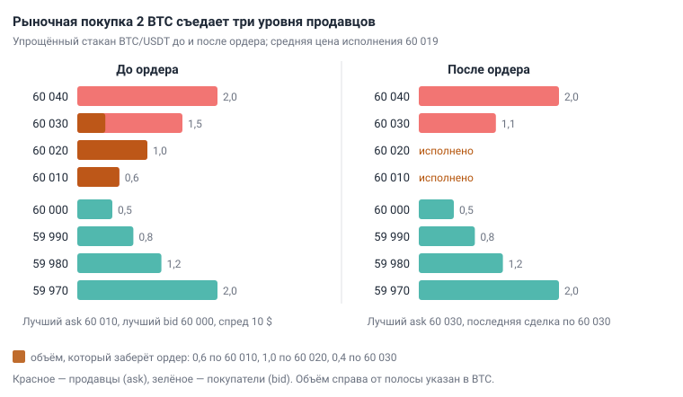
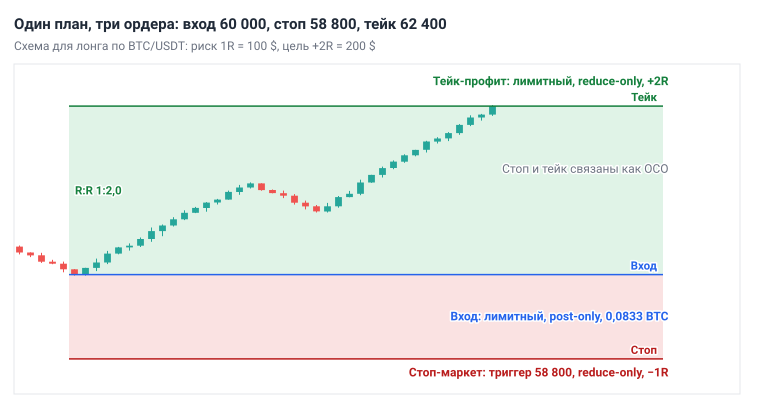
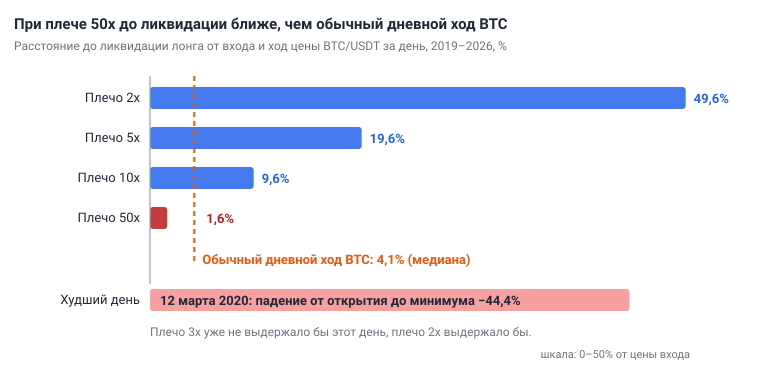

# Глава 2. Рынок, инструменты и механика торгов

> После этой главы вы умеете: читать стакан и считать среднюю цену исполнения рыночного ордера; оформлять сделку тремя ордерами — вход, стоп, тейк; оценивать цену ликвидации, платёж по фандингу и комиссию в R; защищать аккаунт и узнавать мошенничество.

**Связь с курсом:** ступень 01 — [биржа](../01_Основы/01_Криптовалюта_и_биржа.md), [спот и фьючерсы](../01_Основы/02_Спот_и_фьючерсы.md), [ордера](../01_Основы/03_Ордера.md), [комиссии и спред](../01_Основы/04_Комиссии_и_спред.md); ступень 03 — [плечо и ликвидация](../03_Риск_менеджмент/05_Плечо_и_ликвидация.md); ступень 09 — [математическое ожидание](../09_Уровень_профи/01_Математическое_ожидание.md), [микроструктура](../09_Уровень_профи/05_Микроструктура_и_деривативы.md), [исполнение и безопасность](../09_Уровень_профи/08_Исполнение_и_безопасность.md).

## 2.1. Крипторынок: что и где торгуется

Криптовалютой торгуют на **бирже** (exchange) — площадке, которая принимает заявки покупателей и продавцов и сводит их в сделки. Примеры крупных бирж: Binance, Bybit, OKX. Цена на графике — это цена последней сделки.

Товар на бирже — **торговая пара**. В паре BTC/USDT первая монета — **базовая валюта**: её покупают и продают. Вторая — **котируемая валюта**: в ней выражена цена. Цена 60 000 означает, что за 1 BTC дают 60 000 USDT. USDT — **стейблкоин** (stablecoin), токен с привязкой к доллару: 1 USDT ≈ 1 $.

Bitcoin (BTC) и Ethereum (ETH) — две самые крупные монеты, остальные называют **альткоинами**. Для трейдера разница между ними — в **ликвидности**: так называют объём заявок рядом с текущей ценой. У BTC и ETH ликвидность высокая, и сделку на 1 000 $ или 10 000 $ рынок не замечает. У мелких монет заявок мало: цена двигается резче, вход и выход обходятся дороже. Учебник работает только с BTC/USDT и ETH/USDT.

От других рынков крипторынок отличается расписанием, доступным плечом и надзором. **Плечо** (leverage) — возможность открыть позицию больше собственных денег; оно разобрано в разделе 2.6.

| Рынок | Часы торгов | Плечо для частного трейдера | Надзор |
|---|---|---|---|
| Акции | основная сессия NYSE — с 9:30 до 16:00 по времени Нью-Йорка | в ЕС по CFD на акции — до 5:1 | государственный регулятор, торговля через брокера |
| Форекс (валюты) | круглосуточно с вечера воскресенья до вечера пятницы | в ЕС по CFD на основные валютные пары — до 30:1 | регулятор страны, где зарегистрирован брокер |
| Срочный рынок (фьючерсы и опционы) | по расписанию биржи | размер залога задаёт биржа | биржа и государственный регулятор |
| Криптобиржа | круглосуточно, без выходных | до 125x на BTC/USDT (пример: Binance) | зависит от страны; защита клиента слабее |

Лимиты для ЕС ввёл в 2018 году регулятор ESMA для CFD — контрактов на разницу цен, которые брокеры предлагают частным клиентам. Для CFD на криптовалюты он установил 2:1. Криптобиржа даёт в десятки раз больше, и ограничивать это плечо вам придётся самостоятельно.

Приёмы анализа графика переносятся между рынками, потому что график везде строится из одного материала: из сделок между покупателями и продавцами. Тренд, уровень и свеча описывают поведение людей с деньгами, а оно мало зависит от того, чем именно торгуют. Различаются параметры: размах движений, часы работы, комиссии. Поэтому метод переносится, а числа — обычный ход за день, размер стопа — на новом рынке измеряют заново.

**Вывод:** ваш рынок — BTC/USDT и ETH/USDT на крупной бирже; он работает без перерывов и почти не ограничивает плечо.

## 2.2. Кто торгует и откуда берётся ликвидность

В каждой сделке две стороны: одна заранее выставила заявку и ждёт, другая приходит и забирает её. Участников удобно делить на четыре группы.

- **Маркет-мейкеры** (market makers) постоянно держат заявки и на покупку, и на продажу и зарабатывают на разнице между ними. Они дают рынку ликвидность.
- **Фонды** и другие крупные участники открывают большие позиции. Им нужна чужая ликвидность, поэтому объём они исполняют частями и там, где заявок много.
- **Арбитражёры** покупают там, где дешевле, и продают там, где дороже: между биржами, между спотом и фьючерсом. Благодаря им цены на разных площадках почти совпадают.
- **Розница** — частные трейдеры с небольшими счетами. Вы в этой группе.

Тот, чья заявка стояла и ждала, называется **мейкер** (maker): он дал ликвидность. Тот, кто исполнил её немедленно, — **тейкер** (taker): он ликвидность забрал. Роль зависит от ордера, а не от участника: один и тот же трейдер входит лимитной заявкой как мейкер и выходит по стопу как тейкер. За срочность тейкер платит трижды: спредом, проскальзыванием и повышенной комиссией (разделы 2.3 и 2.8).

**Вывод:** перед каждым ордером решайте, кем вы будете. Можете ждать — будьте мейкером. Нужно исполниться сейчас — платите как тейкер и учитывайте эту цену.

## 2.3. Стакан, спред и проскальзывание

**Стакан** (order book) — список заявок, которые ждут исполнения: выше текущей цены стоят продавцы, ниже — покупатели. Вот упрощённый стакан BTC/USDT; в реальном стакане уровней больше, а шаг цены мельче.

| Сторона | Цена, USDT | Объём, BTC |
|---|---|---|
| Продажа (ask) | 60 040 | 2,0 |
| Продажа (ask) | 60 030 | 1,5 |
| Продажа (ask) | 60 020 | 1,0 |
| Продажа, лучший ask | 60 010 | 0,6 |
| Покупка, лучший bid | 60 000 | 0,5 |
| Покупка (bid) | 59 990 | 0,8 |
| Покупка (bid) | 59 980 | 1,2 |
| Покупка (bid) | 59 970 | 2,0 |

- **Bid** — цена заявки на покупку. Лучший bid — самая высокая из них.
- **Ask** — цена заявки на продажу. Лучший ask — самая низкая из них.
- **Спред** (spread) — разница между лучшим ask и лучшим bid: 60 010 − 60 000 = 10 $, или 0,017% цены.
- **Глубина** (depth) — суммарный объём заявок в заданном диапазоне цен. Здесь на четырёх уровнях продажи стоит 5,1 BTC.

Рыночный ордер забирает заявки по очереди, начиная с лучшей цены. Покупка 0,5 BTC целиком пройдёт по 60 010. Покупка 2 BTC съест три уровня:

```
0,6 × 60 010 + 1,0 × 60 020 + 0,4 × 60 030 = 120 038 $
Средняя цена = 120 038 / 2 = 60 019 $ за 1 BTC
```

**Проскальзывание** (slippage) — разница между ценой, на которую вы рассчитывали, и ценой исполнения. Здесь это 60 019 − 60 010 = 9 $, или 0,015%.



*Рис. 2.1. Упрощённый стакан до и после рыночной покупки 2 BTC. Заявки по 60 010 и 60 020 исполнены полностью, по 60 030 — на 0,4 BTC. Средняя цена — 60 019, лучший ask сдвинулся на 60 030.*

Этот же пример показывает, почему цена двигается. После покупки лучшая заявка на продажу стоит на 60 030, и последняя сделка прошла по 60 030: на 20 $ выше прежнего лучшего ask. Цена растёт, когда рыночные покупки съедают заявки продавцов быстрее, чем появляются новые. Падает она, когда рыночные продажи так же съедают заявки покупателей.

Сдвинуть цену можно большим рыночным объёмом или обычным объёмом в тонком стакане. На резких движениях мейкеры снимают заявки, стакан редеет, и проскальзывание растёт. Поэтому стоп на обвале исполняется хуже, чем указано в ордере.

Перед рыночным ордером сверяйте его со стаканом:

1. Запишите лучший bid и лучший ask, посчитайте спред в процентах от цены.
2. Сложите объём заявок на своей стороне в пределах 0,1% от цены. В примере 0,1% — это 60 $, и в этот диапазон попадают все 5,1 BTC.
3. Правило курса: рыночный ордер — не больше 5–10% этой глубины. В примере это 0,26–0,51 BTC. Объём больше дробят на части или выставляют лимитной заявкой.

Крупную заявку в стакане могут снять до исполнения, поэтому решение о сделке на ней одной не строят. Где на графике скапливаются чужие стопы, показывает [глава 5](05_Уровни_и_зоны.md).

## 2.4. Ордера: что, когда и чем опасно

**Ордер** (order) — распоряжение бирже купить или продать. Тип ордера определяет, что для вас важнее: исполниться сразу или исполниться по своей цене.

| Ордер | Что делает | Когда применять | Типичная ошибка |
|---|---|---|---|
| **Рыночный** (Market) | исполняется сразу по лучшим ценам стакана | срочный выход; вход, когда попасть в сделку важнее цены | большой объём в тонкий стакан: проскальзывание |
| **Лимитный** (Limit) | встаёт в стакан и исполняется по вашей цене или лучше | плановый вход от уровня; фиксация прибыли | лимит на покупку выше рынка исполнится сразу, как рыночный; далёкий лимит может не исполниться |
| **Стоп-маркет** (Stop Market) | при достижении цены-триггера отправляет рыночный ордер | стоп-лосс; вход на пробое выше текущей цены | ждать исполнения ровно по триггеру: на резком движении цена будет хуже |
| **Стоп-лимит** (Stop Limit) | при достижении триггера выставляет лимитный ордер | вход на пробое с потолком цены | использовать как стоп-лосс: цена проскочит лимит, позиция останется без защиты |
| **Тейк-профит** (Take Profit) | закрывает позицию на цене цели | фиксация прибыли по плану | не выставить заранее и решать «по ходу» |
| **OCO** (One-Cancels-the-Other) | связывает два ордера: исполнение одного отменяет другой | стоп и тейк на одну позицию | выставить их раздельно: лишний ордер останется активным |
| **Post-only** | флаг лимитного ордера: биржа отклонит его, если он исполнился бы сразу | вход с комиссией мейкера | ставить флаг на срочный выход: ордер отклонён, позиция открыта |
| **Reduce-only** | флаг: ордер может только уменьшить позицию | стоп и тейк на фьючерсах | забыть флаг: оставшийся ордер откроет встречную позицию |

Из таблицы следуют два правила курса. Вход — лимитным ордером, если сетап позволяет ждать: так вы экономите спред и комиссию тейкера. Стоп-лосс — стоп-маркетом: он исполнится, пусть и с проскальзыванием, а стоп-лимит на обвале может не исполниться совсем.

Сделку оформляют сразу тремя ордерами. Пример: депозит 10 000 $, риск на сделку 1%, то есть 1R = 100 $. План — лонг (сделка на рост) по BTC/USDT от 60 000 со стопом 58 800 и целью 62 400. До стопа 2%, поэтому позиция равна 100 / 0,02 = 5 000 $, или 0,0833 BTC; расчёт размера позиции разбирает [глава 11](11_Риск_менеджмент.md).

1. Лимитный ордер на покупку 0,0833 BTC по 60 000 с флагом post-only.
2. Стоп-маркет на продажу 0,0833 BTC с триггером 58 800 и флагом reduce-only. Результат при исполнении: 0,0833 × 1 200 ≈ −100 $, то есть −1R.
3. Лимитный тейк-профит на продажу 0,0833 BTC по 62 400 с флагом reduce-only. Результат: 0,0833 × 2 400 ≈ +200 $, то есть +2R.

Ордера 2 и 3 связаны как OCO: сработал один — биржа сняла второй. В форме ордера эта связка обычно называется TP/SL. Если лимитный вход исполнился частично, объём стопа и тейка должен совпадать с фактической позицией.



*Рис. 2.2. Лимитный вход по 60 000, стоп-маркет на 58 800 (−1R) и лимитный тейк-профит на 62 400 (+2R). Стоп и тейк связаны как OCO и помечены reduce-only.*

Без связки ошибка стоит дорого. Позиция без стопа превращает убыток в 1R в убыток произвольного размера. Стоп без OCO и reduce-only после срабатывания тейка остаётся активным и при возврате цены продаёт 0,0833 BTC, которых у вас уже нет: на фьючерсах это откроет шорт. Где ставить стоп и цель, объясняет [глава 12](12_Сопровождение_и_выход.md).

## 2.5. Спот и бессрочные фьючерсы

На **споте** (spot) вы покупаете саму монету, на **бессрочном фьючерсе** (perpetual futures) — заключаете контракт на её цену.

Спот устроен просто. Монета ваша, её можно вывести с биржи. Заработать можно только на росте. Цена упала — монета остаётся у вас, принудительного закрытия нет.

Бессрочный фьючерс — контракт без даты истечения. Монеты у вас нет, вы получаете или платите разницу цен. Он даёт три возможности, и у каждой есть цена:

- **лонг** (long) — позиция на рост и **шорт** (short) — позиция на падение;
- плечо, а вместе с ним ликвидация (раздел 2.6);
- фандинг — регулярный платёж между лонгами и шортами (раздел 2.7).

Результат позиции считается от количества монет в контракте:

```
Результат лонга = Количество × (Цена выхода − Цена входа)
Результат шорта = Количество × (Цена входа − Цена выхода)
```

Шорт 0,1 BTC от 60 000: цена упала до 57 000 — результат 0,1 × 3 000 = +300 $; цена выросла до 61 200 — результат 0,1 × (−1 200) = −120 $.

**Вывод:** первые месяцы торгуйте на споте или на фьючерсах с плечом 1x. Спота достаточно, чтобы учиться на лонгах; фьючерс 1x нужен, когда план требует шорта.

## 2.6. Маржа, плечо и ликвидация

**Маржа** (margin) — залог, который биржа блокирует под позицию. Плечо показывает, во сколько раз позиция больше залога:

```
Залог = Размер позиции / Плечо
```

Позиция 0,1 BTC по 60 000 стоит 6 000 $. При плече 1x залог равен 6 000 $, при 10x — 600 $. Прибыль и убыток считаются от всей позиции: движение цены на 1% — это 60 $ при любом плече. Плечо меняет две вещи: сколько денег заблокировано и как далеко находится ликвидация.

**Ликвидация** (liquidation) — принудительное закрытие позиции биржей. Она наступает, когда залог с учётом убытка становится меньше **поддерживающей маржи** (maintenance margin) — минимума, который биржа требует для удержания позиции. Ставка зависит от биржи и размера позиции. На Binance для позиций по BTC/USDT до 50 000 $ она равна 0,4% стоимости позиции (таблица биржи на январь 2024); свою ставку проверяйте в правилах биржи.

```
Цена ликвидации лонга ≈ Цена входа × (1 − 1/Плечо + Ставка поддерживающей маржи)
Цена ликвидации шорта ≈ Цена входа × (1 + 1/Плечо − Ставка поддерживающей маржи)
```

Лонг от 60 000 с плечом 10x: 60 000 × (1 − 0,1 + 0,004) = 54 240. До ликвидации 9,6%. Шорт с теми же условиями: 60 000 × (1 + 0,1 − 0,004) = 65 760. Формула приближённая: она не учитывает комиссии и фандинг. Точное значение биржа показывает в строке открытой позиции.

Ликвидацию запускает не цена последней сделки, а **маркировочная цена** (mark price) — расчётная справедливая цена контракта. Биржа считает её от индекса: средневзвешенной спотовой цены на нескольких крупных площадках. Так короткий выброс цены на одной бирже не закрывает позиции. Когда маркировочная цена доходит до цены ликвидации, биржа отменяет ваши ордера по контракту, закрывает позицию и удерживает ликвидационный сбор.

Сколько вы при этом теряете, зависит от режима маржи.

- **Изолированная маржа** (isolated): под позицию выделена фиксированная сумма, и ликвидация забирает только её.
- **Кросс-маржа** (cross): залогом служит весь баланс фьючерсного счёта. Ликвидация наступает позже, но может забрать весь баланс.

Новичку подходит изолированная маржа: потолок потерь по позиции известен заранее.

Теперь сравним расстояние до ликвидации с тем, как цена двигается на самом деле. Обычный дневной ход — на сколько процентов цена проходит за сутки от минимума до максимума. Мы измерили его индикатором ATR(14) на дневном графике (1D), делённым на цену, и взяли медиану за год: значение, выше и ниже которого лежит половина дней. Сам индикатор разбирает [глава 7](07_Индикаторы_и_объём.md).

| Год | BTC/USDT | ETH/USDT |
|---|---|---|
| 2019 | 4,75% | 6,17% |
| 2020 | 4,22% | 5,86% |
| 2021 | 6,14% | 7,46% |
| 2022 | 5,03% | 6,96% |
| 2023 | 3,18% | 3,46% |
| 2024 | 3,90% | 4,80% |
| 2025 | 3,40% | 5,77% |
| 2026, до 25 октября | 2,96% | 4,03% |
| Весь период | 4,09% | 5,54% |

Следующая таблица построена по дневным свечам BTC/USDT с 1 января 2019 по 25 октября 2026 — это 2 855 дней. Четвёртый столбец: в скольких днях цена падала от открытия дня до его минимума на расстояние до ликвидации. Пятый: какая доля лонгов, открытых по цене открытия дня и оставленных на 7 дней без стопа, дошла бы до ликвидации.

| Плечо | Залог под 6 000 $ | До ликвидации | Дней с таким падением | Ликвидировано за 7 дней |
|---|---|---|---|---|
| 2x | 3 000 $ | 49,6% | 0 | 0,2% |
| 5x | 1 200 $ | 19,6% | 7 | 3,9% |
| 10x | 600 $ | 9,6% | 55 | 16,9% |
| 20x | 300 $ | 4,6% | 336 | 45,8% |
| 50x | 120 $ | 1,6% | 1 353 | 78,5% |
| 100x | 60 $ | 0,6% | 2 242 | 91,8% |

Это оценка по ценам спота, а не по маркировочной цене, но порядок чисел она передаёт. При плече 50x до ликвидации 1,6% — меньше половины обычного дневного хода, и такого падения хватало почти каждый второй день. При 10x каждый шестой недельный лонг без стопа был бы ликвидирован. Самый тяжёлый день в данных — 12 марта 2020: BTC открылся на 7 934,58 и упал до 4 410, это −44,4%. Лонг с плечом 3x, открытый в начале дня, был бы ликвидирован; лонг с плечом 2x уцелел бы, потеряв на минимуме 89% залога.



*Рис. 2.3. Расстояние до ликвидации при плече 2x, 5x, 10x и 50x рядом с обычным дневным ходом BTC/USDT (медиана за 2019–2026 — 4,1%) и худшим днём в данных (12 марта 2020, −44,4%).*

Плечо не меняет риск сделки: риск задаёт стоп. Позиция 5 000 $ со стопом в 2% теряет 100 $ и при плече 1x, и при 10x. Но при 50x ликвидация на 1,6% окажется ближе стопа на 2%, и стоп не успеет сработать. Отсюда правило курса: стоп стоит намного раньше цены ликвидации, а первые месяцы плечо равно 1x. Как выбирать плечо под размер позиции, показывает [глава 11](11_Риск_менеджмент.md).

## 2.7. Фандинг

**Фандинг** (funding) — регулярный платёж между держателями лонгов и шортов, который удерживает цену бессрочного контракта рядом со спотовой. У контракта нет даты истечения, и без такого механизма его цена могла бы надолго уйти от цены монеты.

При положительной ставке лонги платят шортам, при отрицательной — шорты лонгам. Платёж идёт между трейдерами; Binance, например, не берёт с него комиссию. На Binance расчёт по умолчанию происходит каждые 8 часов: в 00:00, 08:00 и 16:00 UTC. Платит и получает только тот, у кого в этот момент открыта позиция.

```
Платёж = Размер позиции по маркировочной цене × Ставка фандинга
```

Лонг 0,1 BTC при маркировочной цене 60 000 — это позиция 6 000 $. При ставке +0,01% вы платите 6 000 × 0,0001 = 0,60 $ каждые 8 часов, 1,80 $ в сутки, 54 $ за 30 дней. Это 0,9% позиции, а при плече 10x — 9% залога. При ставке +0,05% платёж вырастает до 3 $ за раз и 270 $ за 30 дней.

Для сделки на несколько дней обычный фандинг невелик. Пять дней — 15 платежей по 0,60 $, всего 9 $. При стопе 2% риск этой позиции равен 120 $, значит, фандинг стоит 0,075R. Ставка в несколько раз выше обычной означает, что на одной стороне собралась толпа; курс советует не входить вместе с ней.

**Действие:** перед сделкой на фьючерсах найдите в интерфейсе ставку фандинга и время до расчёта и посчитайте платёж для своей позиции.

## 2.8. Комиссии: сколько стоит круг

Комиссию берут от размера позиции, а риск сделки задаёт расстояние до стопа, поэтому при близком стопе комиссия съедает заметную часть R. Ориентиры курса: на споте около 0,1% за сделку, на фьючерсах около 0,02% для мейкера и 0,05% для тейкера. Актуальные ставки смотрите на своей бирже.

**Круг** — вход и выход вместе. Его стоимость в R:

```
Комиссия в R = Комиссия за круг в % / Расстояние до стопа в %
```

| Стоп от входа | Спот: 0,1% + 0,1% = 0,2% | Фьючерсы, оба ордера рыночные: 0,1% | Фьючерсы, лимитный вход и стоп-маркет: 0,07% |
|---|---|---|---|
| 0,5% | 0,40R | 0,20R | 0,14R |
| 1% | 0,20R | 0,10R | 0,07R |
| 2% | 0,10R | 0,05R | 0,035R |
| 4% | 0,05R | 0,025R | 0,018R |

Проверим первый столбец в деньгах. Депозит 10 000 $, риск 100 $. При стопе 0,5% позиция равна 100 / 0,005 = 20 000 $, комиссия спота за круг — 0,2% от неё, то есть 40 $, или 0,40R. При стопе 2% позиция 5 000 $, комиссия 10 $, или 0,10R.

Курс приводит пример системы со средним результатом +0,28R на сделку. Со стопами 0,5% на споте от него остаётся 0,28 − 0,40 = −0,12R: система, прибыльная на графике, теряет деньги на счёте. Отсюда правило: стоп не ближе, чем комиссия за круг, умноженная на 10. Для спота это 2%, для фьючерсов с рыночными ордерами — 1%, с лимитным входом — 0,7%.

К комиссии добавьте спред и проскальзывание: это та же плата за исполнение. Записывайте в журнал цену плана и цену факта, и вы увидите эту плату в R.

## 2.9. Выбор биржи и безопасность

Биржа хранит ваши деньги на своих счетах, поэтому она сама — источник риска: может остановить вывод или обанкротиться. В ноябре 2022 года биржа FTX сообщила о проблемах с ликвидностью и приостановила вывод средств. 11 ноября 2022 она и около 130 связанных компаний подали заявление о банкротстве. Клиент, торговавший без единой ошибки, не мог вывести деньги так же, как все остальные.

Биржу выбирайте по четырём признакам:

- высокая ликвидность по BTC/USDT и ETH/USDT: узкий спред и глубокий стакан;
- демосчёт для спота и фьючерсов;
- легальная работа с жителями вашей страны;
- полный набор защиты аккаунта из списка ниже.

Аккаунт защищают до первого пополнения:

1. **Двухфакторная защита** (2FA) через приложение-аутентификатор, а не через SMS: SIM-карту могут перевыпустить без вас.
2. **Антифишинговый код** — слово, которое вы задаёте сами и которое биржа вставляет в каждое своё письмо. Письмо без кода — подделка.
3. **Белый список адресов вывода**: вывести деньги можно только на адреса из списка, а его изменение на время блокирует вывод.
4. Отдельная почта для бирж и уникальный пароль из менеджера паролей.

На бирже держите только торговый капитал — сумму, полную потерю которой вы переживёте.

Мошенничество узнаётся по четырём признакам:

- **Обещанная доходность.** Фиксированный процент в месяц «без риска» на рынке не может обещать никто.
- **Платные сигналы.** Продавец зарабатывает на подписке, а не на сделках, и за ваш убыток не отвечает.
- **«Управляющие».** Просят перевести деньги или дать доступ к аккаунту. Перевод в криптовалюте нельзя отменить.
- **Памп-группы.** Организаторы покупают мелкую монету заранее и продают её участникам, которые пришли по команде «покупаем».

Общий признак один: вас торопят и просят деньги, доступ или код. Коды 2FA и антифишинговый код не сообщайте никому, включая людей, которые называют себя сотрудниками биржи.

## 2.10. Типичные ошибки

- **Рыночный ордер без взгляда в стакан.** Объём больше 10% глубины даёт проскальзывание, которое в журнале выглядит как необъяснимый минус.
- **Стоп-лосс стоп-лимитом.** На обвале цена проскакивает лимит, и позиция остаётся без защиты в худший момент.
- **Стоп и тейк без OCO и reduce-only.** Оставшийся ордер открывает встречную позицию, которой нет в плане.
- **Плечо как способ заработать больше.** Плечо 20x или 50x ставит ликвидацию внутри обычного дневного хода BTC; результат определяет случай.
- **Кросс-маржа и позиция без стопа.** Одна сделка забирает весь фьючерсный баланс.
- **Короткий стоп без учёта комиссий.** При стопе 0,5% на споте круг стоит 0,40R.
- **Все деньги на одной бирже, вход без 2FA.** Эти потери не связаны с торговлей и не возвращаются.

## 2.11. Запомнить

- Цена двигается, когда рыночные ордера съедают лимитные заявки; тейкер платит спред, проскальзывание и повышенную комиссию.
- Рыночный ордер — не больше 5–10% глубины стакана в пределах 0,1% от цены.
- Сделка — это три ордера сразу: вход, стоп-маркет и тейк-профит, связанные OCO, с флагом reduce-only.
- Первые месяцы — спот или фьючерсы с плечом 1x, изолированная маржа.
- До ликвидации примерно 1/плечо минус ставка поддерживающей маржи; обычный дневной ход BTC — около 4%, ETH — около 5,5%.
- Фандинг: при положительной ставке лонги платят шортам; платёж = позиция × ставка.
- Комиссия в R = комиссия за круг / расстояние до стопа; стоп не ближе комиссии за круг × 10.
- 2FA через приложение, антифишинговый код, белый список вывода; на бирже только торговый капитал.

## 2.12. Практика на демосчёте

- [ ] Откройте стакан BTC/USDT. Запишите лучший bid и лучший ask, посчитайте спред в долларах и в процентах от цены.
- [ ] Сложите объём заявок на продажу в пределах 0,1% выше цены. Запишите, какой рыночный ордер на покупку проходит по правилу 5–10%.
- [ ] Купите минимальный объём рыночным ордером. Запишите цену перед нажатием и цену исполнения, посчитайте проскальзывание.
- [ ] На демосчёте фьючерсов включите изолированную маржу и плечо 1x. Откройте минимальный лонг тремя ордерами: лимитный вход, стоп-маркет на 2% ниже, тейк-профит на 4% выше, оба с reduce-only. Сохраните снимок экрана со списком ордеров.
- [ ] В строке позиции найдите цену ликвидации, маркировочную цену, ставку фандинга и время до расчёта. Посчитайте платёж по фандингу и сравните с тем, что спишет или начислит биржа.
- [ ] Откройте таблицу комиссий своей биржи. Посчитайте стоимость круга в R для стопа 1% и для стопа 2%.
- [ ] Включите 2FA через приложение, антифишинговый код и белый список адресов вывода.

## 2.13. Вопросы для самопроверки

1. Что означает запись ETH/USDT? Какая валюта базовая, какая котируемая?
2. Кто такие мейкер и тейкер? Может ли один трейдер быть и тем и другим в одной сделке?
3. В стакане ETH/USDT на продажу стоят 4 ETH по 3 000,0, 6 ETH по 3 000,5 и 10 ETH по 3 001,0. Вы покупаете 15 ETH рыночным ордером. Какими будут средняя цена и проскальзывание относительно лучшего ask?
4. Почему стоп-лосс ставят стоп-маркетом, а не стоп-лимитом?
5. Вы в лонге на фьючерсах. Стоп и тейк выставлены отдельными ордерами без OCO и без reduce-only. Цена дошла до тейка, затем упала до уровня стопа. Что произойдёт?
6. Шорт по ETH/USDT открыт на 3 000 с плечом 5x, ставка поддерживающей маржи 0,5%. Оцените цену ликвидации.
7. У вас лонг 0,5 BTC, маркировочная цена 64 000, ставка фандинга +0,01%. Кто платит и сколько за один расчёт?
8. На фьючерсах вы входите лимитным ордером (0,02%) и выходите стоп-маркетом (0,05%). Стоп стоит в 0,7% от входа. Сколько стоит круг в R? Проходит ли сделка правило «комиссия за круг × 10»?
9. Чем изолированная маржа отличается от кросс-маржи и какую выбрать новичку?
10. Назовите три признака мошенничества и три настройки защиты аккаунта.

## 2.14. Ответы

1. Цена одного ETH в USDT. ETH — базовая валюта, USDT — котируемая.
2. Мейкер выставил заявку, которая ждала в стакане, и дал ликвидность. Тейкер исполнил чужую заявку немедленно. Да: вход лимитным ордером — мейкер, выход по стоп-маркету — тейкер.
3. 4 × 3 000,0 + 6 × 3 000,5 + 5 × 3 001,0 = 45 008 $. Средняя цена 45 008 / 15 = 3 000,53. Проскальзывание 0,53 $, или 0,018%.
4. Стоп-маркет исполняется по рынку: с проскальзыванием, но исполняется. Стоп-лимит на резком движении может остаться неисполненным, и позиция окажется без защиты.
5. Тейк закроет лонг. Стоп останется активным и при падении цены продаст тот же объём: откроется шорт, которого не было в плане.
6. 3 000 × (1 + 1/5 − 0,005) = 3 000 × 1,195 = 3 585. До ликвидации 19,5%.
7. Ставка положительная, платят лонги: 0,5 × 64 000 × 0,0001 = 3,20 $ за расчёт.
8. Круг стоит 0,02% + 0,05% = 0,07% позиции, в R это 0,07 / 0,7 = 0,10R. Минимальный стоп по правилу — 0,07% × 10 = 0,7%. Стоп стоит ровно на границе: сделка проходит, ближе ставить нельзя.
9. При изолированной марже ликвидация забирает только залог позиции, при кросс-марже — может забрать весь баланс фьючерсного счёта. Новичку — изолированная.
10. Признаки: обещанный доход без риска, платные сигналы, «управляющие», памп-группы. Защита: 2FA через приложение, антифишинговый код, белый список адресов вывода.

## Источники

- Binance, справочный центр: [фандинг](https://www.binance.com/en/support/faq/360033525031), [маркировочная цена и индекс](https://www.binance.com/en/support/faq/360033525071), [ликвидация](https://www.binance.com/en-AE/support/faq/360033525271), [поддерживающая маржа](https://www.binance.com/en/support/faq/360033162192), [ставки маржи и плечо по BTC/USDT, объявление от 2 января 2024](https://www.binance.com/en/support/announcement/detail/d75c5ca94f704e96a6a4e55ffddfd65d).
- OKX: [принудительная ликвидация при изолированной и кросс-марже](https://www.okx.com/en-us/help/liquidation-faq).
- CoinDesk, 11 ноября 2022: [банкротство FTX](https://www.coindesk.com/policy/2022/11/11/ftx-files-for-bankruptcy-protections-in-us).
- Часы торгов: [NYSE](https://www.nyse.com/markets/hours-calendars), [FOREX.com](https://www.forex.com/en-us/help-and-support/market-trading-hours/). Лимиты плеча в ЕС: [ESMA, 1 июня 2018](https://www.esma.europa.eu/press-news/esma-news/esma-adopts-final-product-intervention-measures-cfds-and-binary-options).
- Дневной ход и статистика ликвидаций посчитаны по дневным свечам Binance из приложения курса за 1 января 2019 — 25 октября 2026.
