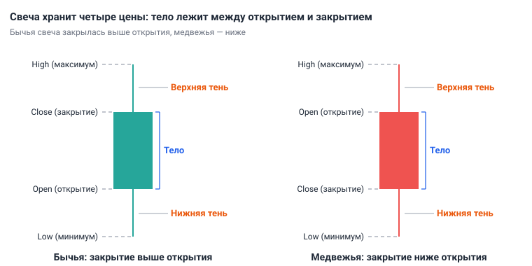
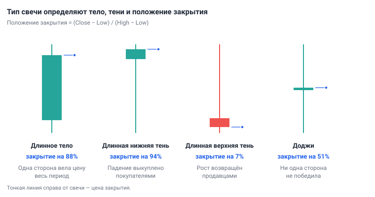
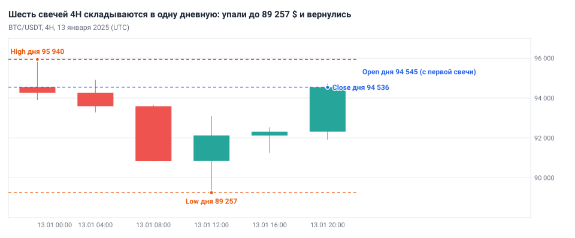
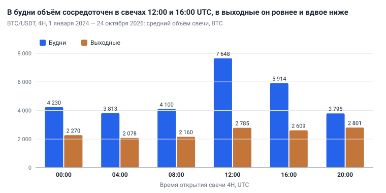

# Глава 3. График: свечи и таймфреймы

> После этой главы вы умеете: назвать четыре цены свечи и прочитать по ним, кто был сильнее за период; посчитать, в какой части диапазона свеча закрылась; собрать дневную свечу из шести свечей 4H; перевести время закрытия свечей из UTC в своё; настроить график в TradingView для работы на 1D и 4H.

**Связь с курсом:** [ступень 01, урок 5 «Свечи и таймфреймы»](../01_Основы/05_Свечи_и_таймфреймы.md), [практика ступени 01](../01_Основы/Практика.md), [шпаргалка «Таймфреймы и индикаторы»](../07_Справочник/Таймфреймы_и_индикаторы.md).

## 3.1. Три типа графика

График записывает цену во времени: по горизонтали время, по вертикали цена. Сделок слишком много, чтобы показать каждую, поэтому время режут на равные отрезки и от каждого оставляют несколько цен. Типы графиков различаются числом этих цен.

- **Линейный график** (line) оставляет одну цену, последнюю в отрезке, и соединяет такие точки линией. Направление видно, события внутри отрезка — нет.
- **Бар** (bar) оставляет четыре цены: первую, самую высокую, самую низкую и последнюю. Вертикальная черта идёт от минимума к максимуму, засечка слева отмечает первую цену, засечка справа — последнюю.
- **Японская свеча** (candlestick) показывает те же четыре цены, но промежуток между первой и последней закрашен прямоугольником. Его цвет говорит, выросла цена за отрезок или упала.

Разницу видно на одном дне. 13 января 2025 BTC/USDT закончил сутки на 94 536 $, на 9 $ ниже, чем начал. На линейном графике это ровный участок. Свеча того же дня показывает, что цена опускалась до 89 257 $, на 5,6% ниже открытия, и вернулась. Крайние цены трейдеру нужны: по ним строят уровни ([глава 5](05_Уровни_и_зоны.md)) и за ними ставят стоп-лосс ([глава 12](12_Сопровождение_и_выход.md)).

Учебник работает со свечами. Свеча и бар содержат одно и то же, но свеча читается быстрее: цвет и размер прямоугольника видны даже на мелком графике. На свечах построены паттерны — повторяющиеся фигуры из [главы 6](06_Паттерны.md).

Свечной график пришёл из Японии. Его изобретение часто приписывают торговцу рисом Мунэхисе Хомме (XVIII век). Стив Нисон, который в 1991 году познакомил со свечами западных трейдеров, считал, что они появились позже, в конце XIX века (см. «Источники»).

**Действие:** откройте график BTC/USDT и переключите тип на линию, на бары, затем на свечи. Найдите один и тот же день в трёх видах.

## 3.2. Анатомия свечи

Свеча показывает четыре цены за свой отрезок времени:

- **открытие** (Open, O) — цена первой сделки;
- **максимум** (High, H) — самая высокая цена;
- **минимум** (Low, L) — самая низкая цена;
- **закрытие** (Close, C) — цена последней сделки.

По первым буквам эти числа называют OHLC. Наведите курсор на свечу, и график покажет их строкой над свечами.

**Тело** (body) — прямоугольник между открытием и закрытием. **Тени** (shadows, wicks; также фитили) — тонкие линии от тела до максимума и до минимума. Если закрытие выше открытия, свеча **бычья** (bullish): цена за период выросла, тело обычно зелёное. Если закрытие ниже открытия, свеча **медвежья** (bearish): цена упала, тело обычно красное. Цвет — настройка графика; смысл задаёт соотношение открытия и закрытия.



*Рис. 3.1. У бычьей свечи открытие внизу тела, у медвежьей — вверху.*

Из четырёх цен получают четыре размера:

```
Диапазон     = High − Low
Тело         = |Close − Open|
Верхняя тень = High − большее из (Open, Close)
Нижняя тень  = меньшее из (Open, Close) − Low
```

**Диапазон** (range), или размах, — весь путь цены за свечу. Тело и две тени в сумме дают диапазон: так проверяют расчёт.

Криптовалюта торгуется без перерывов, поэтому новая свеча открывается там, где закрылась предыдущая. 12 января 2025 дневная свеча BTC/USDT закрылась на 94 545,06, свеча 13 января открылась на 94 545,07. Разрывов цены между свечами (gap) здесь почти нет.

**Действие:** наведите курсор на любую закрытую свечу 1D и запишите её O, H, L, C. Посчитайте диапазон, тело и обе тени, проверьте сумму.

## 3.3. Как читать одну свечу

Свеча — протокол борьбы покупателей и продавцов за один период. Чтобы его прочитать, задайте три вопроса.

1. **Какую часть диапазона занимает тело?** Большое тело: одна сторона вела цену почти весь период. Маленькое: сколько цена прошла в одну сторону, столько и вернула.
2. **Какая тень длиннее?** Тень — цена, которую рынок попробовал и отверг.
3. **Где закрытие внутри диапазона?** Закрытие — итог периода: цена, на которой стороны сошлись к его концу.

Ответ на третий вопрос — число:

```
Положение закрытия = (Close − Low) / (High − Low) × 100%
```

0% — свеча закрылась на минимуме, 100% — на максимуме. Закрытие в верхней трети говорит о перевесе покупателей к концу периода, в нижней трети — о перевесе продавцов.

| Свеча | Как выглядит | Что произошло |
|---|---|---|
| Длинное тело | тело занимает большую часть диапазона, тени короткие | одна сторона вела цену весь период и удержала результат |
| Длинная нижняя тень | нижняя тень больше половины диапазона, закрытие в верхней части | цену продавили вниз, покупатели выкупили падение |
| Длинная верхняя тень | верхняя тень больше половины диапазона, закрытие в нижней части | цену подняли, продавцы вернули её обратно |
| **Доджи** (doji) | открытие и закрытие почти совпали, тени в обе стороны | ни одна сторона не победила |



*Рис. 3.2. Четыре типа свечей. Под каждой — положение закрытия внутри диапазона.*

Расчёт на примере. BTC/USDT, 1D, 13 января 2025: O 94 545,07, H 95 940,00, L 89 256,69, C 94 536,10.

```
Диапазон           = 95 940,00 − 89 256,69 = 6 683,31
Тело               = 94 545,07 − 94 536,10 = 8,97
Верхняя тень       = 95 940,00 − 94 545,07 = 1 394,93
Нижняя тень        = 94 536,10 − 89 256,69 = 5 279,41
Положение закрытия = 5 279,41 / 6 683,31 = 79,0%
```

Тело почти нулевое, нижняя тень занимает 79% диапазона, закрытие в верхней четверти. Цена упала от открытия на 5 288 $ и к концу суток вернула почти всё падение: закрытие лишь на 9 $ ниже открытия. Это доджи с длинной нижней тенью: серединой дня владели продавцы, итогом — покупатели.

Свеча описывает прошедший период и не предсказывает следующий. После 13 января цена росла: через три дня закрытие было 99 987. Но 1 августа 2024 дневная свеча BTC/USDT тоже оставила длинную нижнюю тень и закрылась на 91% диапазона, а следующий день закончился на 5,9% ниже, и через три дня цена потеряла 11%. За 2019–2026 годы на 1D было 276 свечей BTC/USDT с нижней тенью не меньше 60% диапазона. Следующий день закрылся выше после 48% из них, после произвольной дневной свечи — в 51% случаев. Сама по себе тень перевеса не даёт. Вес свеча получает от места: у уровня (глава 5), по направлению тренда ([глава 4](04_Структура_рынка.md)), в составе паттерна (глава 6).

**Действие:** посчитайте положение закрытия последней закрытой свечи 1D и определите её тип по таблице.

## 3.4. Как читать несколько свечей подряд

Смысл свеча получает рядом с соседними: «большая» значит «больше обычной». Мерой обычного служит индикатор ATR — средний размах свечи за последние 14 периодов ([глава 7](07_Индикаторы_и_объём.md)). Пока индикатора на графике нет, сравнивайте свечу с десятью предыдущими на глаз.

В последовательности ищут три вещи.

- **Импульсные свечи.** Тело занимает большую часть диапазона (ориентир — от двух третей), диапазон заметно больше обычного, закрытие у края. Несколько таких свечей подряд в одну сторону показывают, что эта сторона контролирует рынок.
- **Свечи нерешительности.** Маленькие тела, тени в обе стороны, диапазон меньше обычного. Рынок отдыхает после движения или ждёт события.
- **Смена характера.** После импульсных свечей появляются свечи с маленькими телами и длинными тенями против движения, затем импульсная свеча в обратную сторону. Сторона, которая вела цену, потеряла контроль.

Все три вещи есть внутри того же 13 января 2025 на 4H (рис. 3.3 и таблица в разделе 3.6).

- Свеча 08:00 UTC: тело 2 739 $ при диапазоне 2 828 $, то есть 97%. ATR перед ней был 1 213 $: свеча в 2,3 раза больше обычной. Импульс вниз.
- Свеча 12:00: цена обновила минимум, 89 256,69, но закрылась на 92 123,75 — на 75% своего диапазона. Нижняя тень 1 595 $. Продавцы не удержали новый минимум.
- Свеча 16:00: тело 188 $ при диапазоне 1 284 $, 15%. Нерешительность.
- Свеча 20:00: тело 2 224 $ при диапазоне 2 819 $, 79%, закрытие на 93% диапазона. Импульс вверх.

Последовательность читается так: давление продавцов, отказ от минимума, пауза, ответ покупателей. Это описание одного дня. Сменился ли тренд, по четырём свечам не решают: для этого нужны экстремумы и структура (глава 4).

**Действие:** на 4H возьмите десять последних закрытых свечей и отметьте импульсные свечи и свечи нерешительности. Запишите одной фразой, кто контролировал цену.

## 3.5. Закрытие свечи

Свеча становится фактом в момент закрытия. Пока период не закончился, каждая сделка меняет её закрытие, а иногда цвет, тени и тип.

13 января 2025 в 12:00 UTC, через 12 часов после открытия, дневная свеча BTC/USDT выглядела так: O 94 545,07, H 95 940,00, L 90 833,12, текущая цена 90 851,22. Красное тело 3 694 $, цена у самого минимума: сильная медвежья свеча. К концу суток она стала доджи с закрытием на 94 536,10. Тот, кто продал в полдень по незакрытой свече, продал на 3 685 $ дешевле итоговой цены дня.

Правило учебника: **сигнал считается только по закрытой свече рабочего таймфрейма**. У правила есть цена: вход получается позже и иногда по худшей цене. Взамен отсекаются сигналы, которые исчезли до конца периода. Правило относится к решению о входе. Стоп-лосс стоит на бирже заранее и срабатывает в любой момент (глава 12).

Время закрытия привязано к **UTC** — всемирному координированному времени, единому для всех стран и без перехода на летнее время. На Binance, откуда взяты свечи учебника, свеча 1D открывается в 00:00 UTC и закрывается через сутки. Свечи 4H открываются в 00:00, 04:00, 08:00, 12:00, 16:00 и 20:00 UTC. Свеча 1W открывается в понедельник в 00:00 UTC.

Местное время получают, прибавив к UTC своё смещение. Москва — это UTC+3.

| Свеча 4H открылась (UTC) | Закрылась (UTC) | Закрылась по Москве (UTC+3) |
|---|---|---|
| 00:00 | 04:00 | 07:00 |
| 04:00 | 08:00 | 11:00 |
| 08:00 | 12:00 | 15:00 |
| 12:00 | 16:00 | 19:00 |
| 16:00 | 20:00 | 23:00 |
| 20:00 | 00:00 | 03:00 |

В последней строке вместе со свечой 4H закрывается и дневная. В Москве это 03:00. Вставать к этому времени не нужно: утром свеча уже закрыта, анализ 1D можно сделать до работы. Из шести закрытий 4H работающему человеку в Москве удобны три: 07:00, 19:00 и 23:00. Расписание по закрытиям разбирает [глава 8](08_Таймфреймы_анализ_и_вход.md).

Если в вашей стране переводят часы, местное время закрытия дважды в год сдвигается на час. На другой бирже сутки могут начинаться в другое время: сверьте время открытия дневной свечи на своей.

**Действие:** запишите время закрытия дневной свечи и шести свечей 4H по своим часам. Отметьте закрытия, к которым вы можете быть у графика.

## 3.6. Таймфрейм: одна цена в разном масштабе

**Таймфрейм** (timeframe) — отрезок времени, который занимает одна свеча. Обозначения: 1m, 5m, 15m — минуты; 1H, 4H — часы; 1D — день; 1W — неделя. Таймфрейм не меняет цену, он меняет подробность записи.

Неделя 13–19 января 2025 на BTC/USDT — это одна свеча 1W, семь свечей 1D или 42 свечи 4H. Старшая свеча собирается из младших по одному правилу:

```
Open  старшей = Open первой младшей
High  старшей = самый высокий High среди младших
Low   старшей = самый низкий Low среди младших
Close старшей = Close последней младшей
```

Дневная свеча 13 января 2025 состоит из шести свечей 4H:

| Свеча (UTC) | Открытие | Максимум | Минимум | Закрытие |
|---|---|---|---|---|
| 4H, 00:00 | **94 545,07** | **95 940,00** | 93 899,99 | 94 269,23 |
| 4H, 04:00 | 94 269,23 | 94 913,03 | 93 281,00 | 93 590,24 |
| 4H, 08:00 | 93 590,24 | 93 661,55 | 90 833,12 | 90 851,22 |
| 4H, 12:00 | 90 851,23 | 93 100,00 | **89 256,69** | 92 123,75 |
| 4H, 16:00 | 92 123,75 | 92 534,10 | 91 250,00 | 92 312,18 |
| 4H, 20:00 | 92 312,18 | 94 727,15 | 91 908,20 | **94 536,10** |
| 1D, 13 января | 94 545,07 | 95 940,00 | 89 256,69 | 94 536,10 |



*Рис. 3.3. BTC/USDT, 13 января 2025. Открытие дня даёт первая свеча 4H, закрытие — последняя, максимум и минимум — крайние цены шести свечей.*

Дневная свеча сообщает: упали и вернулись. Свечи 4H добавляют порядок событий: максимум в первые часы, снижение до полудня, минимум после полудня, возврат в последние четыре часа.

Младший таймфрейм в ответ теряет масштаб. Свеча 08:00 на 4H выглядела началом обвала. На 1W весь этот день — нижняя тень бычьей недельной свечи: неделя открылась на 94 545,07 и закрылась на 101 331,57. Поэтому график смотрят сверху вниз, от старшего таймфрейма к младшему ([глава 9](09_Алгоритм_анализа_сверху_вниз.md)).

За подробность младшие таймфреймы берут две платы.

**Шум.** Чем короче свеча, тем меньше сделок её формирует и тем чаще движение оказывается случайным: следующая свеча его не подтверждает.

**Комиссии.** Комиссию берут от суммы сделки, от таймфрейма она не зависит. Размах свечи зависит. В таблице — медианный размах свечи BTC/USDT за 2024–2025 годы; **медиана** — значение, больше которого ровно половина свечей.

| Таймфрейм | Медианный размах свечи | Комиссия за круг 0,2% как доля размаха |
|---|---|---|
| 1W | 9,64% | 2% |
| 1D | 3,33% | 6% |
| 4H | 1,15% | 17% |

Комиссия за круг — вход и выход по 0,1% ([глава 2](02_Рынок_и_механика_торгов.md)). На минутных графиках свечи ещё меньше, а комиссия та же: она сравнима со всем движением, на котором трейдер хочет заработать.

Учебная связка курса: 1D — направление и уровни, 4H — поиск входа, 1W — общая картина. Выбор набора таймфреймов — тема главы 8.

**Действие:** переключите график 1W → 1D → 4H. На каждом найдите неделю 13–19 января 2025 и посчитайте свечи: одна, семь, сорок две.

## 3.7. Время на крипторынке

Крипторынок работает круглосуточно и без выходных. Граница дневной свечи в 00:00 UTC — договорённость, а не событие. Но торгуют люди и компании с рабочим днём, поэтому активность внутри суток и недели неравномерна.

Проверка по данным: BTC/USDT, 4H, с 1 января 2024 по 24 октября 2026, 6 168 свечей. Для каждого времени открытия посчитаны средний **объём** — количество монет, сменивших владельца за свечу (глава 7), — и медианный размах.

| Свеча 4H (UTC) | Будни: объём, BTC | Будни: размах | Выходные: объём, BTC |
|---|---|---|---|
| 00:00 | 4 230 | 1,24% | 2 270 |
| 04:00 | 3 813 | 1,01% | 2 078 |
| 08:00 | 4 100 | 1,05% | 2 160 |
| 12:00 | 7 648 | 1,95% | 2 785 |
| 16:00 | 5 914 | 1,51% | 2 609 |
| 20:00 | 3 795 | 1,10% | 2 801 |



*Рис. 3.4. BTC/USDT, 4H, 1 января 2024 — 24 октября 2026.*

- В будни самая активная свеча открывается в 12:00 UTC (15:00 по Москве): её средний объём вдвое больше, чем у свечи 04:00. На свечи 12:00 и 16:00 приходится 46% объёма будних суток. В эти часы в Европе вторая половина дня, на востоке США — утро и день.
- В выходные объём суток вдвое меньше: 14 703 BTC против 29 500 в будни. Медианный размах дневной свечи в субботу и воскресенье — 1,93%, в будни — 3,59%.

Для практики отсюда два вывода. Объём и размах свечи сравнивают с тем же временем суток и тем же типом дня: 5 000 BTC для свечи 04:00 — оживление, для свечи 12:00 в будний день — заметно ниже обычного. Средние не запрещают исключений: 13 января 2025 падение началось в свече 08:00 UTC, в среднем спокойной, и её объём, 10 071 BTC, был в 2,5 раза выше обычного для этого времени.

Это данные одной биржи и одной пары, но порядок устойчив: в 2024, 2025 и 2026 годах в будни лидировала свеча 12:00, а объём выходных составлял 47–55% будничного.

**Действие:** переведите часы 12:00–20:00 UTC в своё время и запишите их в журнал как часы наибольшей активности.

## 3.8. Настройка графика в TradingView

Настройка делается один раз и занимает десять минут. Названия кнопок меняются, поэтому ищите по смыслу.

1. **Инструмент.** В поиске наберите BTCUSDT и выберите спот биржи Binance. У разных бирж цены немного различаются.
2. **Тип графика.** Выберите «Свечи» (Candles). Heikin Ashi и Renko не включайте: они строятся по пересчитанным ценам, их открытие и закрытие не совпадают с реальными.
3. **Шкала цены.** На линейной шкале равные расстояния по вертикали — равные суммы в долларах, на логарифмической (log) — равные проценты. Рост с 10 000 до 20 000 и рост с 50 000 до 100 000 — оба +100%; на линейной шкале второй отрезок впятеро выше первого, на логарифмической они равны. На 4H и 1D оставьте линейную: расстояния в долларах читаются прямо. На 1W и многолетней истории включите логарифмическую: с 2019 года BTC стоил от 3 350 до 126 200 $, и на линейной шкале первые годы сжаты в полоску внизу. Переключение — Alt + L (на Mac — Option + L) или кнопка log у правого нижнего угла графика.
4. **Часовой пояс.** Выберите в настройках графика свой пояс или UTC и больше не меняйте. Пояс меняет подписи времени, а не свечи: дневная свеча Binance открывается в 00:00 UTC при любой настройке. Учебник называет свечи по UTC; «свеча 08:00» на графике с московским временем подписана 11:00.
5. **Таймер.** Включите в настройках шкалы обратный отсчёт до закрытия свечи.
6. **Два таймфрейма.** На бесплатном тарифе Basic на вкладке помещается один график, на платных — от двух (на момент написания). Откройте два окна браузера рядом: в одном 1D, в другом 4H. Второй способ — один график и переключение всегда в одном порядке: сначала 1D, потом 4H.
7. **Проверка.** На 1D найдите 13 января 2025 и сверьте O, H, L, C с разделом 3.3. Числа совпали — график показывает те же данные, что и учебник.

**Действие:** выполните семь шагов и сохраните снимок экрана с двумя окнами.

## 3.9. Типичные ошибки

- **Реагировать на незакрытую свечу.** В полдень 13 января 2025 дневная свеча была сильной медвежьей, к закрытию стала доджи.
- **Считать одну свечу прогнозом.** После длинной нижней тени следующий день закрывался выше примерно в половине случаев.
- **Уходить на минутные графики за точностью.** Подробностей больше, шума и доли комиссий тоже.
- **Путать местное время и UTC.** Дневная свеча закрывается в 00:00 UTC, а не в полночь по вашим часам.
- **Сравнивать объём ночной свечи с дневной.** Свеча 04:00 UTC в будни в среднем вдвое меньше свечи 12:00 без всякого события.

## 3.10. Запомнить

- Свеча хранит четыре цены: открытие, максимум, минимум, закрытие. Тело — между открытием и закрытием, тени — до максимума и минимума.
- В свече читают долю тела в диапазоне, длинную тень и положение закрытия: `(Close − Low) / (High − Low)`.
- Свеча описывает прошлый период; вес ей даёт место на графике. Размер оценивают относительно соседних свечей.
- Сигнал считается только по закрытой свече. 1D закрывается в 00:00 UTC, 4H — каждые четыре часа от 00:00 UTC; в Москве прибавьте три часа.
- В свече 1D шесть свечей 4H, в свече 1W семь свечей 1D. Чем младше таймфрейм, тем больше шума и тем дороже комиссия относительно движения.
- В будни объём сосредоточен в свечах 12:00 и 16:00 UTC, в выходные он вдвое ниже.

## 3.11. Практика на демосчёте

- [ ] Настройте график по разделу 3.8. Результат: снимок экрана с окнами 1D и 4H; цены свечи 13 января 2025 совпали с учебником.
- [ ] Выберите любые закрытые сутки прошлой недели, выпишите шесть свечей 4H и соберите из них дневную. Результат: четыре числа совпали с графиком 1D.
- [ ] Для пяти последних закрытых свечей 1D посчитайте диапазон, тело, тени и положение закрытия. Результат: таблица с типом каждой свечи.
- [ ] Найдите на 1D три свечи с длинной нижней тенью. Результат: для каждой записано, выше или ниже закрылся следующий день и день через три дня.
- [ ] За 15 минут до закрытия свечи 4H сделайте снимок экрана, после закрытия — второй. Результат: запись о том, что изменилось в свече.

## 3.12. Вопросы для самопроверки

1. Какие четыре цены хранит свеча? Чем тело отличается от тени?
2. Что теряет линейный график по сравнению со свечным и почему это важно трейдеру?
3. BTC/USDT, 1D, 1 августа 2024: O 64 628,01, H 65 659,78, L 62 302,00, C 65 354,02. Найдите диапазон, тело, обе тени и положение закрытия. Какой это тип свечи?
4. Свеча из вопроса 3 закрылась почти на максимуме после глубокого падения. Достаточно ли этого для покупки?
5. По каким признакам свечу называют импульсной?
6. Почему решение принимают по закрытой свече? Чем за это платят?
7. Вы живёте в поясе UTC+5. Во сколько по вашим часам закроется свеча 4H, открывшаяся в 16:00 UTC? Во сколько закрывается дневная свеча?
8. Сколько свечей 4H в одной свече 1D, в одной свече 1W и в 30 сутках?
9. Комиссия за круг 0,2%. Медианный размах свечи 4H — 1,15%, свечи 1D — 3,33%. Какую долю размаха занимает комиссия? Что это говорит о младших таймфреймах?
10. Вы поменяли часовой пояс графика с UTC на московский. Что изменилось и что осталось прежним?

## 3.13. Ответы

1. Открытие, максимум, минимум, закрытие. Тело — прямоугольник между открытием и закрытием; тени — линии от тела до максимума и до минимума.
2. Он оставляет только закрытия и скрывает максимумы и минимумы. По крайним ценам строят уровни и ставят стопы.
3. Диапазон 3 357,78. Тело 726,01, свеча бычья. Верхняя тень 305,76. Нижняя тень 2 326,01, это 69% диапазона. Положение закрытия 3 052,02 / 3 357,78 = 90,9%. Свеча с длинной нижней тенью.
4. Нет. Следующий день закрылся на 5,9% ниже, через три дня цена потеряла 11%. Нужно знать место свечи: уровень, тренд, старший таймфрейм.
5. Тело занимает большую часть диапазона (ориентир — от двух третей), диапазон заметно больше обычного, закрытие у края.
6. До закрытия свеча меняется: 13 января 2025 дневная свеча в полдень была медвежьей, а закрылась доджи. Плата — более поздний вход, иногда по худшей цене.
7. Свеча закроется в 20:00 UTC, это 01:00 следующих суток. Дневная закрывается в 00:00 UTC, это 05:00.
8. 6; 7 × 6 = 42; 30 × 6 = 180.
9. 0,2 / 1,15 = 17% и 0,2 / 3,33 = 6%. Чем младше таймфрейм, тем большую часть движения забирает комиссия.
10. Изменились подписи времени: свеча 4H, открытая в 08:00 UTC, подписана 11:00. Свечи и цены прежние, дневная по-прежнему открывается в 00:00 UTC.

## Источники

- [Candlestick chart — Wikipedia](https://en.wikipedia.org/wiki/Candlestick_chart): Хомма, книга Нисона 1991 года, время появления свечей.
- [TradingView: How to use log charts](https://www.tradingview.com/chart/TSLA/9LwmqYq2-How-to-use-log-charts-and-why-they-re-important/), 2020: логарифмическая шкала, клавиши и кнопка log.
- [Тарифы TradingView](https://www.tradingview.com/pricing/): число графиков на вкладке.
- Свечи BTC/USDT, Binance, 1D и 4H: все цены и расчёты главы.
