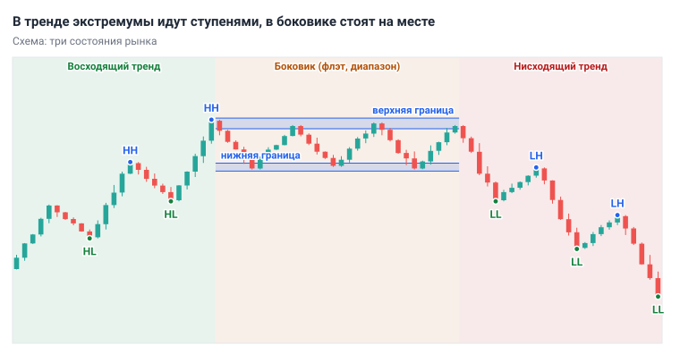
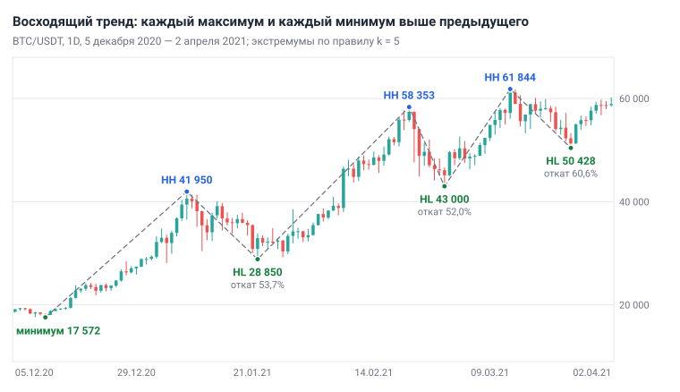
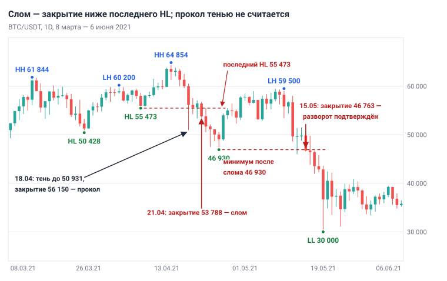
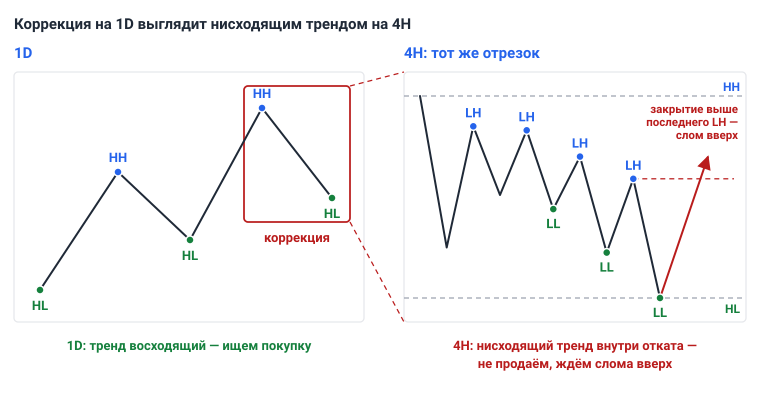

# Глава 4. Структура рынка

> После этой главы вы умеете: определять состояние рынка — восходящий тренд, нисходящий тренд или боковик; находить значимые экстремумы по правилу «k свечей слева и справа» и подписывать их HH, HL, LH, LL; считать глубину коррекции в процентах от импульса; отличать слом структуры от прокола тенью; каждый день размечать график 1D по одному алгоритму.

**Связь с курсом:** [ступень 02, урок 1 «Тренд»](../02_Анализ_графика/01_Тренд.md), [ступень 02, урок 7 «Анализ на нескольких таймфреймах»](../02_Анализ_графика/07_Несколько_таймфреймов.md), [ступень 09, урок 6 «Режимы рынка и фильтры»](../09_Уровень_профи/06_Режимы_рынка_и_фильтры.md).

## 4.1. Три состояния рынка

Цена в любой момент находится в одном из трёх состояний, и первый вопрос анализа — в каком. **Структура рынка** — это последовательность максимумов и минимумов цены, по которой состояние определяют.

- **Восходящий тренд** (uptrend): каждый новый максимум и каждый новый минимум выше предыдущего.
- **Нисходящий тренд** (downtrend): каждый новый максимум и каждый новый минимум ниже предыдущего.
- **Боковик**, он же флэт, он же диапазон (range): цена ходит между верхней и нижней границей, максимумы и минимумы не выстраиваются в ступени.



*Рис. 4.1. Схема. В тренде максимумы и минимумы идут ступенями в одну сторону. В боковике цена разворачивается у одних и тех же границ.*

Состояние определяют первым, потому что от него зависит, какие сделки разрешены. В восходящем тренде ищут покупки на откатах, то есть на временных снижениях внутри роста, в нисходящем — продажи или ждут, в боковике работают от границ или не торгуют. Один и тот же приём в чужом состоянии теряет деньги: курс называет состояния режимами рынка и советует выключать систему там, где она не работает.

Определение тренда через максимумы и минимумы восходит к теории Доу. Её основу в конце XIX века заложил Чарльз Доу, редактор The Wall Street Journal, а оформили последователи. По ней восходящий тренд — ряд растущих вершин и растущих впадин, и однажды определённый тренд считается действующим, пока не доказано обратное ([StockCharts, Dow Theory](https://chartschool.stockcharts.com/table-of-contents/market-analysis/dow-theory)).

Чистый тренд бывает реже, чем кажется. На BTC/USDT 1D с 2019 года по октябрь 2026 структура была восходящей 40% дней, нисходящей 25% и смешанной 35%. Правило подсчёта: два последних значимых максимума и два последних значимых минимума смотрят в одну сторону. Ответ «направления сейчас нет» — обычный результат анализа, и в такие дни сделок по тренду не открывают.

## 4.2. Значимые экстремумы

Структуру строят только по значимым разворотам: свой максимум и минимум есть у каждой свечи, и большинство из них — шум. **Экстремум** — точка, в которой цена развернулась. Его цену берут по тени: это максимум или минимум свечи, а не цена закрытия. Отбирают экстремумы по формальному правилу:

- **значимый максимум** (swing high) — свеча, максимум которой выше максимумов k свечей слева и k свечей справа;
- **значимый минимум** (swing low) — свеча, минимум которой ниже минимумов k свечей слева и k свечей справа.

Число k задаёт масштаб разметки. Проверка на BTC/USDT 1D, 11 декабря 2020 — 25 марта 2021, 105 свечей; для крайних свечей отрезка учтены соседние свечи до и после него. Последняя колонка с точками — после правила чередования, о нём ниже.

| k | Экстремумов по правилу k | После чередования | Один экстремум на | Когда экстремум становится известен |
|---|---|---|---|---|
| 2 | 25 | 23 | 4,6 свечи | через 2 дня |
| 3 | 19 | 17 | 6,2 свечи | через 3 дня |
| 5 | 11 | 7 | 15 свечей | через 5 дней |
| 8 | 7 | 7 | 15 свечей | через 8 дней |

При k = 2 даже после чередования остаются 23 точки, по которым тренд не читается. При k = 5 и k = 8 после чередования остаются одни и те же семь крупных разворотов. За чистоту платят задержкой: экстремум подтверждается только после k закрытых свечей справа. Максимум 41 950 от 8 января 2021 подтвердился закрытием 13 января на 37 371, на 10,9% ниже. В этой главе везде k = 5: меньшее значение даёт шум, большее — те же точки с большей задержкой. Другие главы для своих задач могут брать меньшее k, например k = 3 на 4H при переносе стопа ([глава 12](12_Сопровождение_и_выход.md)); там это сказано явно.

Второе правило — **чередование**: за максимумом идёт минимум, за минимумом — максимум. Если правило k дало два максимума подряд, оставьте более высокий; из двух минимумов подряд — более низкий. На том же отрезке правило k = 5 даёт 11 точек, после чередования остаётся 7. Минимум 30 420 от 11 января уступил место минимуму 28 850 от 22 января: значимого максимума между ними не было, значит, это одна коррекция.

Проверка глазами простая: значимый экстремум виден на графике из 100–120 свечей без увеличения. Если разворот приходится искать, это шум.

## 4.3. HH, HL, LH, LL: тренд как последовательность

Каждый экстремум сравнивают с предыдущим экстремумом того же вида и подписывают.

| Подпись | Английское название | Что значит |
|---|---|---|
| HH | higher high | максимум выше предыдущего максимума |
| HL | higher low | минимум выше предыдущего минимума |
| LH | lower high | максимум ниже предыдущего максимума |
| LL | lower low | минимум ниже предыдущего минимума |

Состояние читают по двум последним подписям:

- последний максимум HH и последний минимум HL — восходящий тренд;
- последний максимум LH и последний минимум LL — нисходящий тренд;
- любая другая пара — смешанная структура: тренд под вопросом или рынок в боковике.

Логика подписей такая. HL означает, что покупатели остановили падение на более высокой цене, чем в прошлый раз. HH означает, что они подняли цену выше прошлой вершины. Пока выполняются оба условия, перевес у покупателей. Это наблюдение о прошлом, а не обещание: следующий максимум может оказаться ниже, и тогда вывод меняется.



*Рис. 4.2. BTC/USDT, 1D, 5 декабря 2020 — 2 апреля 2021. Экстремумы по правилу k = 5 с чередованием: три HH и три HL подряд.*

На рисунке 4.2 максимумы 41 950, 58 353, 61 844 и минимумы 17 572, 28 850, 43 000, 50 428 идут ступенями вверх. Вывод из такой разметки один: тренд восходящий, ищем только покупки. Максимумы при этом росли всё медленнее: +39,1%, затем +6,0%. Замедление — повод быть внимательнее, но отменяет тренд только слом (раздел 4.5).

## 4.4. Импульс и коррекция

Тренд состоит из движений двух видов. **Импульс** — движение по тренду, которое обновляет предыдущий экстремум. **Коррекция** (откат, pullback) — движение против тренда, которое не доходит до начала импульса. Глубину коррекции измеряют в процентах от импульса:

```
Глубина коррекции = (Максимум импульса − Минимум коррекции) / (Максимум импульса − Начало импульса) × 100%
```

Три импульса и три коррекции с рисунка 4.2:

| Импульс | Рост | Дней | Коррекция до | Снижение | Дней | Глубина |
|---|---|---|---|---|---|---|
| 17 572 → 41 950 (11 декабря — 8 января) | +138,7% | 28 | 28 850 (22 января) | −31,2% | 14 | 53,7% |
| 28 850 → 58 353 (22 января — 21 февраля) | +102,3% | 30 | 43 000 (28 февраля) | −26,3% | 7 | 52,0% |
| 43 000 → 61 844 (28 февраля — 13 марта) | +43,8% | 13 | 50 428 (25 марта) | −18,5% | 12 | 60,6% |

Расчёт первой строки: (41 950 − 28 850) / (41 950 − 17 572) = 13 100 / 24 378 = 53,7%. Цена вернула больше половины роста и потеряла 31,2% от вершины, а тренд остался восходящим: минимум 28 850 выше начала импульса.

Такая глубина обычна. На BTC/USDT 1D за 2019–2026 годы при k = 5 нашлось около 80 откатов после импульса, обновившего максимум (80 или 81 в зависимости от деталей подсчёта). Примерно в двух третях случаев откат остановился выше начала импульса; у половины из них глубина лежала между 40% и 74%, медиана — около 57%. В 28 случаях, примерно в каждом третьем, цена ушла ниже начала импульса. Разметка сделана задним числом по всей истории: в реальном времени конец коррекции виден только через k свечей. Правило «коррекция заканчивается на 50%» данные не подтверждают: это широкая область, а не точка.

По учебникам импульс узнают по трём признакам: он быстрее, свечи в нём крупнее, объём выше. Проверка на тех же движениях:

| Движение | Свечей | Из них растущих | Средний размах свечи | Средний объём за день |
|---|---|---|---|---|
| Импульс 1 | 28 | 23 | 7,9% | 97 400 BTC |
| Коррекция 1 | 14 | 4 | 11,5% | 114 900 BTC |
| Импульс 2 | 30 | 18 | 8,1% | 88 400 BTC |
| Коррекция 2 | 7 | 1 | 11,2% | 105 300 BTC |
| Импульс 3 | 13 | 10 | 7,2% | 73 300 BTC |
| Коррекция 3 | 12 | 5 | 6,6% | 67 400 BTC |

Размах — расстояние от минимума свечи до максимума в процентах от цены открытия. Признаки «крупные свечи» и «высокий объём» сработали только в третьей паре. В первых двух коррекции были короче и резче роста: свечи крупнее, объём выше. В этом тренде рост шёл неделями, а откаты укладывались в дни; насколько это типично, по одному тренду судить нельзя.

Надёжно различаются две вещи. В импульсе преобладают свечи по тренду: 23 из 28 против 4 из 14. И импульс обновляет экстремум, а коррекция не доходит до его начала. Поэтому вид движения определяют по структуре, а размер свечей и объём ([глава 7](07_Индикаторы_и_объём.md)) служат дополнением.

Практический вывод: покупка в конце импульса — худшая цена в тренде. Купивший 21 февраля у максимума 58 353 через неделю видел 43 000, на 26,3% ниже. Вход по тренду ищут в коррекции; как именно — [глава 10](10_Модели_входа.md).

## 4.5. Слом структуры

**Слом структуры** (break of structure) — закрытие свечи ниже последнего HL в восходящем тренде или выше последнего LH в нисходящем. После слома тренд больше не считается действующим.

В правиле два уточнения, и оба защищают от ложных сигналов.

Первое: считается закрытие свечи, а не тень. Тень ниже уровня показывает, что цена там побывала и её выкупили до конца периода. Закрытие ниже уровня показывает, что продавцы цену удержали (о закрытии свечи — [глава 3](03_График_свечи_и_таймфреймы.md)). Прокол тенью без закрытия — не слом.

Второе: HL считается состоявшимся, когда после него появился значимый максимум или цена закрылась выше предыдущего максимума. До этого коррекция не закончена, и её минимум может сместиться ниже. 16 марта 2021 BTC сделал минимум 53 271, а 24 марта закрылся ниже него, на 52 304. Слома не было: после 16 марта значимого максимума не появилось, это была та же коррекция. Она закончилась 25 марта на 50 428, и 13 апреля цена закрылась на новом максимуме. Уровнем слома всё это время оставался минимум 43 000.



*Рис. 4.3. BTC/USDT, 1D, 8 марта — 6 июня 2021. 18 апреля тень ушла ниже HL 55 473, свеча закрылась выше. 21 апреля закрытие 53 788 — слом. 15 мая закрытие ниже 46 930 подтвердило нисходящий тренд.*

Разбор по рисунку 4.3. От минимума 55 473 (7 апреля) цена 13 апреля закрылась на 63 575, выше прежнего максимума 61 844, и 14 апреля поставила вершину 64 854. Последний состоявшийся HL и уровень слома — 55 473.

- 18 апреля: минимум свечи 50 931, на 8,2% ниже уровня; закрытие 56 150, на 677 $ выше. Прокол, не слом.
- 19 и 20 апреля: минимумы снова ниже уровня, закрытия 55 633 и 56 425 — выше.
- 21 апреля: закрытие 53 788. Слом, на 17,1% ниже вершины.

В этом примере прокол оказался предвестником слома, и ожидание закрытия стоило 2 362 $ — разницу между закрытиями 18 и 21 апреля. Правило всё равно оправдано. По подсчёту [главы 5](05_Уровни_и_зоны.md), на 1D по BTC и ETH цена 212 раз впервые опускалась под значимый минимум, и в 111 случаях день закрывался выше него. Там же объяснено, почему проколы случаются именно за очевидными минимумами.

Слом отменяет восходящий тренд, но ещё не означает нисходящий. **Подтверждение разворота** — первый LH и следом новый LL. После слома цена упала до 46 930 (25 апреля), затем вернула 70% падения и остановилась на 59 500, на 8,3% ниже вершины: это LH. 15 мая свеча закрылась на 46 763, ниже 46 930: это LL, тренд нисходящий. 19 мая минимум был на 30 000, на 53,7% ниже вершины.

Максимум 59 500 цена показала дважды, 8 и 10 мая. Правило k его не отметит: ни один из двух равных максимумов не выше другого. Равные максимумы считайте одним экстремумом.

Что делать после слома:

1. Прекратить искать покупки по сломанному тренду. Открытые позиции ведут по своему плану ([глава 12](12_Сопровождение_и_выход.md)).
2. Не продавать на свече слома. Слом — не сигнал на вход.
3. Отметить вершину тренда и ждать. LH и закрытие ниже минимума, сложившегося после слома, — тренд нисходящий. Закрытие выше вершины — восходящий тренд возобновился. Ни того ни другого — рынок в боковике.

Второй пункт опирается на подсчёт. На BTC/USDT 1D за 2019–2026 годы по правилам этой главы набралось 21–22 закрытия ниже последнего состоявшегося HL; точное число зависит от деталей подсчёта. Исход проверяли так: что случится раньше — возврат цены к вершине тренда или падение от закрытия слома ещё на такое же расстояние, как от вершины до закрытия. Падение продолжилось примерно в половине случаев (10–11), в остальных цена раньше вернулась к вершине. На ETH/USDT из 18–21 слома падение продолжилось в 5, а возврат к вершине был в 12–15. Выборка мала, но вывод ясен: слом говорит «перестаньте покупать», а не «продавайте».

Для нисходящего тренда всё зеркально: слом — закрытие выше последнего состоявшегося LH, подтверждение — первый HL и новый HH.

## 4.6. Боковик: когда тренд сменился диапазоном

Боковик узнают по трём признакам: подписи экстремумов идут вперемешку, закрытия остаются между двумя уровнями, развороты повторяются у одних и тех же цен.

Пример — BTC/USDT 1D после падения в мае 2021. С 20 мая по 25 июля, 67 дней, все закрытия лежали между 29 790 и 40 527. Экстремумы k = 5 за это время: LH 39 476, HL 31 000, HH 41 330, LL 28 805, LH 36 600, HL 29 278. Все четыре подписи, и никакого порядка.

**Границы диапазона** строят по его экстремумам. Нижняя граница: минимумы 30 000, 31 000, 28 805, 29 278, то есть область 28 800–31 000. Верхняя: максимумы 42 452 (20 мая), 39 476, 41 330, то есть область 39 500–42 450. Граница — полоса шириной в несколько процентов, а не линия; как строить такие зоны — [глава 5](05_Уровни_и_зоны.md). Диапазон считают сложившимся, когда у каждой границы было не меньше двух разворотов. До этого вы видите только остановку после тренда. В примере это произошло 20 июня, когда подтвердился максимум 41 330 от 15 июня: сверху к этому дню были значимые развороты от 39 476 и 41 330, снизу — от 30 000 и 31 000.

Внутри диапазона правила тренда дают ложные сигналы. 20 июля свеча закрылась на 29 790 — единственное за 67 дней закрытие ниже 30 000. На следующий день закрытие было 32 145. HH и LL внутри диапазона означают только движение от границы к границе.

Диапазон заканчивается закрытием свечи за пределами всей пограничной области. 6 августа 2021 свеча закрылась на 42 837, выше самого высокого максимума диапазона 42 452. 23 августа цена была на 50 500.

## 4.7. Фазы рынка

Тренды и диапазоны сменяют друг друга, и эту смену описывают четырьмя фазами.

| Фаза | Состояние | Что было до неё |
|---|---|---|
| **Накопление** (accumulation) | боковик | снижение |
| **Рост** (markup) | восходящий тренд | накопление |
| **Распределение** (distribution) | боковик | рост |
| **Снижение** (markdown) | нисходящий тренд | распределение |

Модель связана с именем Ричарда Вайкоффа (1873–1934), одного из первых технических аналитиков фондового рынка. В его методе диапазоны накопления и распределения готовят рост и снижение цены: в первом крупные участники покупают, во втором продают ([StockCharts, The Wyckoff Method](https://chartschool.stockcharts.com/table-of-contents/market-analysis/wyckoff-analysis-articles/the-wyckoff-method-a-tutorial)). Кто и что покупает, по графику проверить нельзя. Поэтому в учебнике фаза — короткое имя для пары «состояние и то, что было до него».

У модели есть предел: название фазы известно только после выхода из диапазона. Диапазон мая — июля 2021 сложился после падения и закончился ростом; задним числом это накопление. В мае 2022 BTC упал с 40 024 (4 мая) до 26 700 (12 мая) и затем 29 дней закрывался между 28 630 и 31 801. Это тоже диапазон после снижения. Но 12 июня свеча закрылась на 26 575, ниже всех его минимумов, а 18 июня цена была на 17 622.

Торгуют состояние, а не название фазы: в диапазоне ждут закрытия за границей и не угадывают сторону.

## 4.8. Вложенность: у каждого таймфрейма своя структура

Структура есть на каждом таймфрейме, и структуры вложены одна в другую: коррекция старшего таймфрейма на младшем выглядит самостоятельным трендом.

Коррекция 13–25 марта 2021 на 1D — одно движение от HH 61 844 до HL 50 428 глубиной 60,6%. На 4H от свечи максимума до свечи минимума 71 свеча. Экстремумы 4H при k = 5 после первого падения до 53 271: максимумы 60 130, 59 880, 58 431, 57 200 и минимумы 56 271, 55 450, 53 000, 50 428. Каждый максимум ниже предыдущего, а минимумы после 56 271 снижаются: четыре LH и три LL подряд. На 4H это нисходящий тренд.



*Рис. 4.4. Схема. Слева 1D: восходящий тренд, одна коррекция выделена. Справа тот же отрезок на 4H: ряд LH и LL.*

Вопрос «тренд вверх или вниз?» без таймфрейма не имеет ответа. В учебной связке направление задаёт 1D, а 4H показывает, где внутри этого направления искать вход. Нисходящий тренд на 4H внутри восходящего 1D — откат, в котором ждут покупку. Продавать его значит торговать против старшего таймфрейма.

Конец коррекции младший таймфрейм показывает раньше старшего. Свеча 4H, открывшаяся 29 марта в 08:00 UTC, закрылась на 57 854, выше двух последних LH, 57 200 и 56 700: нисходящая структура 4H сломана. На 1D минимум 50 428 подтвердился только закрытием 30 марта. Роли таймфреймов и их согласование — [глава 8](08_Таймфреймы_анализ_и_вход.md).

## 4.9. Алгоритм разметки и полный разбор

Разметку делают раз в день, после закрытия свечи 1D в 00:00 UTC, по одним и тем же шагам.

1. Откройте BTC/USDT 1D так, чтобы на экране было 100–120 свечей.
2. Отметьте значимые экстремумы по правилу k = 5: встаньте на свечу и отсчитайте по пять свечей влево и вправо. Учитывайте только закрытые свечи; среди пяти последних подтверждённых экстремумов нет.
3. Примените чередование: из двух максимумов подряд оставьте высший, из двух минимумов — низший.
4. Подпишите каждую точку: HH, HL, LH или LL.
5. Определите состояние по двум последним подписям. Если структура смешанная, проверьте признаки диапазона и отметьте его границы.
6. Отметьте уровень слома: в восходящем тренде — последний состоявшийся HL, в нисходящем — последний состоявшийся LH.
7. Проверьте последнюю закрытую свечу: закрылась ли она за уровнем слома или за границей диапазона.
8. Запишите одну строку: дата, состояние, уровень слома, что изменилось со вчерашнего дня.

Пример строки: «21 апреля 2021. Слом: закрытие 53 788 ниже HL 55 473. Покупок не ищу. Жду LH и закрытия ниже нового минимума либо закрытия выше 64 854».

Полный разбор: BTC/USDT 1D с декабря 2020 по май 2021 глазами человека, который выполнял эти шаги каждый день. В таблице только дни, когда разметка менялась.

| Дата закрытия | Что изменилось | Состояние | Уровень слома |
|---|---|---|---|
| 16 декабря 2020 | Подтверждён минимум 17 572 (HL); закрытие 21 336 выше прежнего максимума 19 888 | восходящий | 17 572 |
| 13 января 2021 | Подтверждён HH 41 950 | восходящий | 17 572 |
| 27 января | Подтверждён минимум 28 850; максимума после него ещё нет | восходящий, коррекция | 17 572 |
| 3 февраля | Подтверждён максимум 38 532 (LH); минимум 28 850 состоялся | смешанная | 28 850 |
| 8 февраля | Закрытие 46 375 выше 41 950 | восходящий | 28 850 |
| 8 марта | После HH 58 353 и минимума 43 000 подтверждён LH 52 640 | смешанная | 43 000 |
| 13 марта | Закрытие 61 188 выше 58 353 | восходящий | 43 000 |
| 24 марта | Закрытие 52 304 ниже несостоявшегося минимума 53 271 | восходящий, коррекция | 43 000 |
| 7 апреля | После минимума 50 428 подтверждён LH 60 200 | смешанная | 50 428 |
| 13 апреля | Закрытие 63 575 выше 61 844; минимум 55 473 состоялся | восходящий | 55 473 |
| 21 апреля | Закрытие 53 788 ниже 55 473 | слом, покупки прекращены | — |
| 15 мая | После LH 59 500 закрытие 46 763 ниже 46 930 | нисходящий | 59 500 |

Из разбора следуют три наблюдения.

- Уровень слома поднимался четыре раза, от 17 572 до 55 473, и ни разу не был пробит закрытием до 21 апреля. Правило удержало в тренде через три коррекции глубиной 52–61%.
- LH внутри тренда появлялся трижды, и каждый раз цена после него обновляла максимум. Смешанная структура — пауза в покупках, а не разворот.
- Слом пришёл на 17,1% ниже вершины. Структура не ловит максимум: она сообщает о смене состояния с опозданием и за счёт этого отсекает большую часть ложных тревог.

Разметка в реальном времени отличается от разметки задним числом. Максимумы 38 532 и 52 640 через несколько дней исчезли из неё по правилу чередования: цена ушла выше без значимого минимума. На истории график выглядит чище, чем он был для того, кто размечал его день за днём.

## 4.10. Типичные ошибки

- **Размечать каждый зубец.** При k = 2 на 105 свечах 23 экстремума, и состояние «меняется» каждые несколько дней. Держитесь одного k.
- **Считать сломом прокол тенью.** 18 апреля 2021 тень ушла на 8,2% ниже уровня, а закрытие осталось выше. Решает закрытие.
- **Принимать минимум незаконченной коррекции за HL.** Закрытие 24 марта 2021 ниже 53 271 выглядело сломом, а через три недели тренд обновил максимум.
- **Продавать на сломе.** На BTC падение после слома продолжилось примерно в половине случаев, на ETH — реже. Слом прекращает покупки; для продажи нужен подтверждённый нисходящий тренд и своя модель входа.
- **Размечать незакрытую свечу.** До закрытия нет ни экстремума, ни слома.
- **Определять направление по 4H.** Нисходящий тренд 4H внутри восходящего 1D — откат.
- **Искать тренд в боковике.** HH и LL внутри диапазона — движение между границами.
- **Подгонять разметку под желаемую сделку.** Сначала разметка по правилам, потом вывод.

## 4.11. Запомнить

- Состояний три: восходящий тренд (HH и HL), нисходящий тренд (LH и LL), боковик. Анализ начинается с состояния.
- Значимый экстремум выше или ниже k свечей с каждой стороны; в этой главе k = 5. Экстремумы чередуются.
- Экстремум становится известен через k свечей: разметка запаздывает.
- Глубина коррекции — её размер, делённый на размер импульса. Удержавшиеся откаты BTC на 1D чаще всего занимали 40–74% импульса.
- Слом — закрытие свечи за последним состоявшимся HL или LH. Прокол тенью — не слом.
- После слома покупки прекращают; разворот подтверждают LH и новый LL.
- Диапазон: смешанные подписи, закрытия между границами, по два разворота у каждой. Заканчивает его закрытие за границей.
- Фаза — имя для пары «состояние и что было до него». Название фазы известно после выхода из диапазона.
- Коррекция 1D — тренд на 4H. Направление задаёт 1D.

## 4.12. Практика на демосчёте

- [ ] Откройте BTC/USDT 1D, 120 последних свечей. Отметьте экстремумы по правилу k = 5 с чередованием и выпишите их: дата, цена, подпись. Результат — список из 6–12 точек.
- [ ] По списку запишите одной строкой состояние и уровень слома.
- [ ] Посчитайте глубину двух последних завершённых коррекций по формуле из раздела 4.4.
- [ ] Повторите разметку на ETH/USDT 1D и сравните состояние с BTC.
- [ ] Откройте 4H на отрезке последней коррекции 1D, разметьте его и запишите, совпадает ли структура 4H с направлением 1D.
- [ ] Найдите на истории BTC/USDT 1D апрель 2021 и проверьте по свечам числа раздела 4.5: уровень 55 473, минимум и закрытие 18 апреля, закрытие 21 апреля.
- [ ] Десять дней подряд после закрытия 1D записывайте строку журнала: дата, состояние, уровень слома, что изменилось. В конце отметьте дни, когда разметка менялась.

## 4.13. Вопросы для самопроверки

1. Какие три состояния рынка различает структура и почему анализ начинают с состояния?
2. Сформулируйте правило значимого максимума для k = 5. Минимум на 1D пришёлся на 10-е число; закрытие какой свечи его подтвердит?
3. Экстремумы по порядку: минимум 100, максимум 130, минимум 115, максимум 150, минимум 128, максимум 145. Подпишите их, начиная с третьего, и назовите состояние.
4. В условиях вопроса 3 свеча закрылась на 126. Что это значит?
5. Импульс от 60 000 до 72 000, коррекция до 66 600. Какова глубина коррекции?
6. Импульс ETH от 3 000 до 3 600. На какой цене глубина коррекции составит 50% и на какой 75%?
7. Последний состоявшийся HL — 55 473. Свеча: минимум 50 931, закрытие 56 150. Это слом? Что изменится при закрытии 53 788?
8. Тренд сломан. Что нужно увидеть, чтобы назвать тренд нисходящим, и что — чтобы признать восходящий тренд возобновившимся?
9. По каким признакам диапазон считают сложившимся и какое событие его заканчивает?
10. На 1D восходящий тренд, на 4H четыре LH и три LL подряд. Что происходит и какие сделки допустимы?

## 4.14. Ответы

1. Восходящий тренд, нисходящий тренд, боковик. Состояние определяет разрешённые сделки: покупки на откатах, продажи или ожидание, работа от границ.
2. Максимум свечи выше максимумов пяти свечей слева и пяти справа. Минимум 10-го числа подтвердит закрытие свечи 15-го.
3. 115 — HL, 150 — HH, 128 — HL, 145 — LH. Последний максимум LH, последний минимум HL: структура смешанная, слома нет.
4. Минимум 128 состоялся: после него есть значимый максимум 145. Закрытие 126 ниже 128 — слом, покупки прекращают. Последний максимум уже LH (145): если снижение продолжится и новый минимум закрепится ниже 128, это LL, и тренд станет нисходящим. Закрытие выше 150 возобновит восходящий тренд.
5. (72 000 − 66 600) / (72 000 − 60 000) = 5 400 / 12 000 = 45%.
6. Импульс равен 600 $. Глубина 50%: 3 600 − 300 = 3 300. Глубина 75%: 3 600 − 450 = 3 150.
7. Нет: закрытие 56 150 выше уровня, это прокол тенью. Закрытие 53 788 ниже 55 473 — слом.
8. Нисходящий: первый LH и закрытие ниже минимума, сложившегося после слома. Возобновление: закрытие выше вершины тренда.
9. Смешанные подписи, закрытия между двумя уровнями, не меньше двух разворотов у каждой границы. Заканчивает диапазон закрытие свечи за пределами пограничной области.
10. На 1D идёт коррекция, на 4H она выглядит нисходящим трендом. Продавать нельзя: это против 1D. Ждут слома нисходящей структуры 4H и ищут покупку.

## Источники

- StockCharts ChartSchool, «Dow Theory»: https://chartschool.stockcharts.com/table-of-contents/market-analysis/dow-theory
- StockCharts ChartSchool, «The Wyckoff Method: A Tutorial»: https://chartschool.stockcharts.com/table-of-contents/market-analysis/wyckoff-analysis-articles/the-wyckoff-method-a-tutorial
