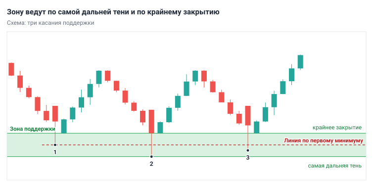
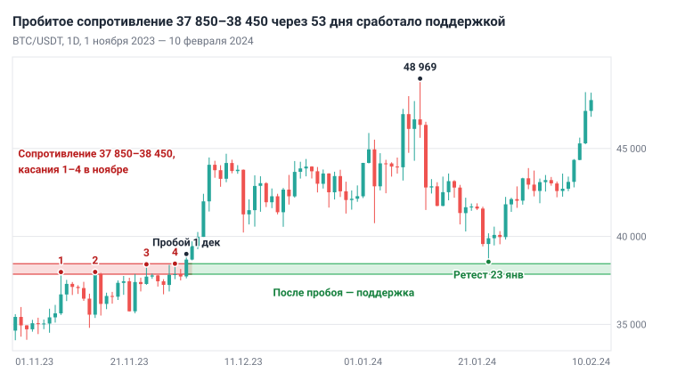
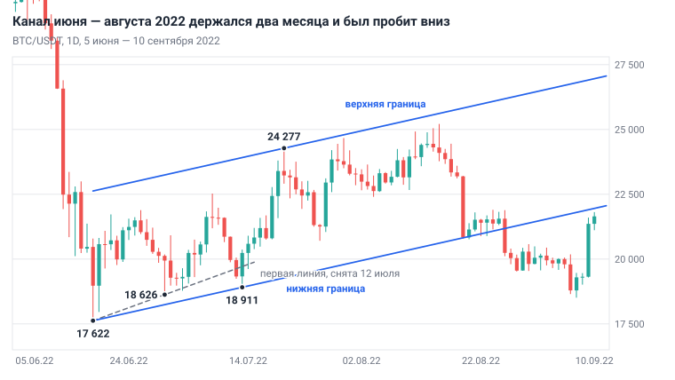
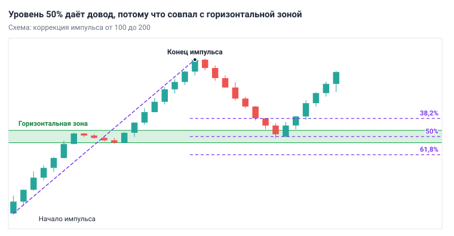
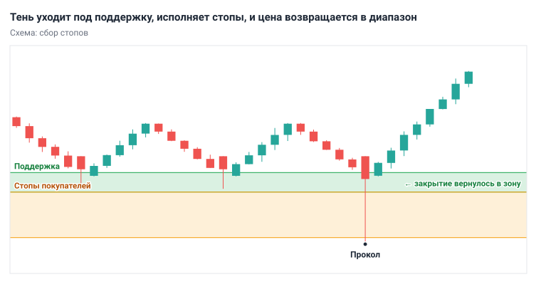

# Глава 5. Уровни и зоны

> После этой главы вы умеете: находить на 1W и 1D поддержку и сопротивление и строить их зонами; оценивать силу зоны и отличать пробой от прокола; строить трендовую линию, канал и сетку Фибоначчи и понимать, чего от них ждать нельзя; обновлять разметку уровней каждый день за 10 минут.

**Связь с курсом:** [ступень 02, урок 2 «Поддержка и сопротивление»](../02_Анализ_графика/02_Уровни.md); [стратегия 2 «Отскок от уровня»](../04_Стратегии/02_Отскок_от_уровня.md); [стратегия 3 «Пробой и ретест»](../04_Стратегии/03_Пробой_и_ретест.md); [ступень 09, урок 5 «Микроструктура рынка и деривативы»](../09_Уровень_профи/05_Микроструктура_и_деривативы.md).

## 5.1. Что такое уровень и почему цена на него реагирует

**Уровень** — это область цен, где движение уже останавливалось и разворачивалось. **Поддержка** (support) лежит под ценой: там покупатели раньше останавливали падение. **Сопротивление** (resistance) лежит над ценой: там продавцы останавливали рост. На графике это значимые минимумы и максимумы из [главы 4](04_Структура_рынка.md).

Цена реагирует на уровень, потому что вокруг него собраны ордера участников. Причин четыре.

1. **Память рынка.** Кто купил у минимума и заработал, готов купить там снова. Кто купил на максимуме и сидит в убытке, ждёт возврата цены, чтобы выйти без потерь, и его продажи тормозят рост.
2. **Лимитные заявки.** Крупный участник не может купить весь объём по рынку без проскальзывания ([глава 2](02_Рынок_и_механика_торгов.md)). Он выставляет лимитные ордера под ценой, обычно у заметных минимумов. Пока они не исполнены, падение тормозится.
3. **Стоп-ордера.** За заметным минимумом стоят стоп-лоссы покупателей, за максимумом — стоп-лоссы продавцов. Сработавший стоп становится рыночным ордером и толкает цену дальше. Поэтому у уровня два исхода: разворот или резкий проход.
4. **Самоисполнение.** Уровни старших таймфреймов видят все. Когда тысячи людей ждут реакции у одной цены и ставят там ордера, реакция возникает из самих ожиданий.

Этот механизм измеряли на валютном рынке. Кэрол Ослер изучила данные о стоп-лоссах и тейк-профитах: тейк-профиты скапливаются на круглых числах, стоп-лоссы — сразу за ними (Osler, 2003). В другой её работе уровни, которые шесть компаний рассылали клиентам, помогали предсказывать внутридневные остановки тренда, но с разной точностью у разных компаний и валютных пар (Osler, 2000).

Отсюда два вывода. Уровень — это **зона**: ордера стоят не на одной цене, а в полосе цен, поэтому разворот случается то чуть раньше, то чуть позже. И уровень даёт вероятность реакции, а не обещание: каждое касание исполняет часть заявок, и однажды их не хватит.

## 5.2. Где искать уровни

Сильные уровни стоят там, где разворот видело больше всего участников. Ищите их в таком порядке, от сильных к слабым.

| № | Источник уровня | Почему он значим | Пример на BTC/USDT, 1D |
|---|---|---|---|
| 1 | Экстремумы 1W и 1D | Их видят все, от инвесторов до внутридневных трейдеров | Максимум 28 марта 2022 — 48 190. 11 января 2024 цена дошла до 48 969 и закрыла день на 46 339 |
| 2 | Начало сильного импульса | Цена ушла оттуда резко, часть заявок осталась неисполненной | 8 мая 2025 цена за день выросла с 97 030 до 103 262. Глубокий откат 22 июня остановился на 98 200 |
| 3 | Границы долгого диапазона | На них цена разворачивалась много раз | Верх диапазона марта — октября 2024: пять максимумов от 71 979 до 73 777 (14 марта, 8 апреля, 21 мая, 7 июня, 29 октября) |
| 4 | Уровень со сменой ролей | Его помнят и покупатели, и продавцы | 37 850–38 450: сопротивление в ноябре 2023, поддержка в январе 2024 (раздел 5.5) |
| 5 | Круглые числа | На них удобно ставить ордера | 100 000: минимумы 12 мая, 5 июня и 21 июня 2025 — 100 718, 100 372 и 100 838 |

Диапазон (он же боковик, флэт) описан в главе 4. Круглое число в одиночку — слабый уровень: оно усиливает зону, найденную по экстремумам, но не заменяет её.

Начинайте разметку с 1W, затем переходите на 1D. Уровни с 4H и младше добавляйте только рядом с текущей ценой и не ставьте их в один ряд с дневными.

## 5.3. Как построить зону

Зону строят по касаниям: одна граница идёт по теням свечей, другая — по телам. **Касание** — подход цены к уровню, после которого она откатилась не меньше чем на 1 ATR. **ATR** (Average True Range) — средний размах свечи за последние 14 свечей. Он разобран в [главе 7](07_Индикаторы_и_объём.md), а пока добавьте на график 1D индикатор ATR с периодом 14 и читайте его значение.

1. Откройте 1D и сожмите график, чтобы видеть 6–12 месяцев. Найдите цену, у которой было не меньше двух разворотов.
2. Внешнюю границу ведите по самой дальней тени среди касаний: для сопротивления это самый высокий максимум, для поддержки — самый низкий минимум.
3. Внутреннюю границу ведите по телам: для сопротивления это самое высокое закрытие среди свечей касаний, для поддержки — самое низкое.
4. Сравните ширину с ATR. Рабочая ширина зоны на 1D — 0,5–1 ATR. Зона шире 1,5 ATR обычно склеена из двух уровней: разделите её или оставьте часть, где касаний больше.
5. Нарисуйте прямоугольник (в TradingView — инструмент Rectangle) и продлите его вправо.



*Рис. 5.1. Внешняя граница зоны идёт по самой дальней тени, внутренняя — по крайнему закрытию. Линия по первому минимуму вместила бы только одно касание из трёх.*

Пример: BTC/USDT, 1D, ноябрь 2023. Цена четыре раза подходила к одной области и откатывалась.

| Касание | Дата | Максимум | Закрытие |
|---|---|---|---|
| 1 | 9 ноября 2023 | 37 972 | 36 701 |
| 2 | 15 ноября 2023 | 37 980 | 37 858 |
| 3 | 24 ноября 2023 | 38 414 | 37 714 |
| 4 | 29 ноября 2023 | 38 450 | 37 855 |

Самая высокая тень — 38 450, самое высокое закрытие — 37 858. Зона сопротивления: 37 850–38 450. Её ширина 600 $ при ATR 1 168 $, то есть 0,5 ATR. Линия по первому максимуму, 37 972, показала бы «пробой» 24 и 29 ноября, хотя ни одна свеча не закрылась выше 37 858.



*Рис. 5.2. BTC/USDT, 1D, 1 ноября 2023 — 10 февраля 2024. Четыре касания сопротивления в ноябре, пробой 1 декабря, возврат к зоне 23 января.*

Оставляйте на графике 3–5 зон: по две ближайшие над ценой и под ценой. Десять зон означают, что уровень найдётся у любой цены, и разметка перестаёт что-либо сообщать.

## 5.4. Сила уровня

Сила зоны — это оценка того, сколько ордеров вокруг неё ещё осталось. Её оценивают по четырём признакам.

| Признак | Зона сильнее | Зона слабее |
|---|---|---|
| Таймфрейм | Видна на 1W и 1D | Видна только на 4H и младше |
| Отход от зоны | Резкий: за 1–3 свечи цена ушла на 2 ATR и дальше | Вялый: цена долго стояла рядом |
| Число касаний | Два-три, каждое с заметным откатом | Одно (уровень не подтверждён) или много подряд |
| Давность | Касания разделены неделями; после пробоя зона ещё не тестировалась | Касания идут каждые несколько дней |

Частые тесты ослабляют уровень: каждое касание исполняет часть лимитных заявок, а новые появляются не всегда. Одновременно за уровнем копятся стоп-ордера, которые при пробое ускорят движение. На графике это видно по откатам: они становятся короче. В ноябре 2023 после первого касания цена откатилась до 34 800, после второго — до 35 500, после третьего — только до 36 707. Четвёртое касание закончилось пробоем. Курс формулирует это как запрет: не входить на отскок, если уровень тестировался много раз подряд.

Число касаний ничего не решает без пауз между ними. Верх диапазона 2024 года выдержал пять подходов за семь с половиной месяцев, потому что между ними цена уходила далеко вниз, в августе — до 49 000.

Запишите рядом с каждой зоной оценку: «сильная», «средняя» или «слабая». От слабой зоны сделку на отскок не планируют.

## 5.5. Смена ролей

**Смена ролей** — пробитое сопротивление становится поддержкой, а пробитая поддержка — сопротивлением. Причина в позициях участников. Продавцы, которые открывали шорт от сопротивления, после пробоя сидят в убытке и ждут возврата, чтобы закрыться без потерь, то есть купить. Те, кто пропустил пробой, ждут отката к той же цене. Обе группы покупают в одном месте.

Разметку обновляют по двум определениям. **Пробой** — свеча закрылась за дальней границей зоны; для разметки смотрите закрытие 1D. Тень за границей при закрытии внутри зоны — это прокол (раздел 5.9). **Ретест** — возврат цены к пробитой зоне с другой стороны.

На рис. 5.2 зона 37 850–38 450 прошла весь путь. 1 декабря 2023 день закрылся на 38 683, над зоной. К 11 января 2024 цена дошла до 48 969. Затем началась коррекция, и 23 января минимум дня составил 38 555: на 105 $ выше верхней границы зоны. День закрылся на 39 898, а 14 марта цена была на 73 777.

К этому примеру есть три оговорки.

- Ретест случился через 53 дня после пробоя. Часто его нет вовсе, и правило курса для таких случаев: цена ушла без ретеста — не догонять.
- Цена развернулась, не дойдя до зоны. Лимитный ордер внутри зоны остался бы неисполненным.
- Рядом есть обратный случай. Поддержка 40 200–41 250 (минимумы 11 и 18 декабря, 3 и 19 января) была пробита 22 января закрытием на 39 568. Три дня она работала как сопротивление: максимумы 40 177, 40 555 и 40 300. 26 января цена прошла её одной свечой, от 39 961 до 41 824.

Пробитую зону не удаляйте: поменяйте подпись на противоположную роль и наблюдайте, как цена поведёт себя при возврате. Вход на ретесте разбирает [глава 10](10_Модели_входа.md).

## 5.6. Трендовые линии и каналы

**Трендовая линия** (trend line) — наклонная прямая по минимумам восходящего тренда или по максимумам нисходящего. **Канал** (parallel channel) — трендовая линия и параллельная ей прямая с другой стороны цены.

1. Найдите два значимых минимума, второй выше первого.
2. Проведите через их тени прямую и продлите вправо.
3. Считайте линию гипотезой до третьего касания.
4. Для канала скопируйте линию и перенесите копию на максимум между опорными минимумами или на первый максимум после них.

Наклонная линия субъективнее горизонтальной зоны. Горизонтальный уровень задаёт одна цена, и её одинаково видят все. Линию задают две точки, и результат зависит от того, какие минимумы вы выбрали, вели по теням или по телам, включена ли логарифмическая шкала. У разных трейдеров линии разные, поэтому ордера вокруг них не собираются так плотно, как у экстремума.



*Рис. 5.3. BTC/USDT, 1D, 5 июня — 10 сентября 2022. Первую линию пришлось перестроить; канал продержался два месяца и был пробит вниз.*

На рис. 5.3 первая линия шла через минимумы 18 июня (17 622) и 30 июня (18 626). 12 июля день закрылся на 19 329 при линии на 19 630, и её пришлось перестроить через минимум 13 июля (18 911). Параллель легла на максимум 20 июля (24 277), ширина канала — 5 005 $. Максимумы 30 июля (24 668) и 15 августа (25 211) остановились под верхней границей, в 124 $ и 406 $ от неё. 19 августа цена за день упала на нижнюю границу, неделю держалась на ней и 26 августа закрылась на 20 241 при линии на 21 179.

Этот канал был коррекцией внутри нисходящего тренда 1W: с марта по июнь цена упала с 48 190 до 17 622. Пробой нижней границы вернул цену в старший тренд.

Используйте линии так:

- линия показывает скорость тренда: пока цена над ней, тренд идёт в прежнем темпе;
- касание линии — довод для сделки только там, где линия пересекает горизонтальную зону;
- закрытие за линией — предупреждение, а не сигнал: тренд меняет слом структуры (глава 4), а не пробой линии;
- верхняя граница восходящего канала — место для фиксации прибыли, а не повод для шорта.

## 5.7. Уровни Фибоначчи

**Уровни Фибоначчи** (Fibonacci retracement) делят импульс на доли 38,2%, 50% и 61,8% и показывают цены, где коррекция может закончиться.

Числа Фибоначчи — ряд 1, 1, 2, 3, 5, 8, 13…, где каждое число равно сумме двух предыдущих. Отношение соседних чисел стремится к 0,618, отношение чисел через одно — к 0,382. Уровень 50% к этому ряду не относится: это середина хода, её добавляют в сетку отдельно. Ральф Эллиотт, автор волновой теории (книга «Волновой принцип», 1938), считал, что движения цен можно измерять и прогнозировать с помощью чисел Фибоначчи.

1. Дождитесь, пока импульс закончится: началась коррекция, и максимум стал значимым.
2. Возьмите инструмент Fibonacci retracement. Первая точка — начало импульса, вторая — его конец, обе по теням.
3. Оставьте уровни 38,2%, 50% и 61,8%, остальные отключите.

```
Уровень = Максимум − (Максимум − Минимум) × Доля
```

Пример: рост BTC/USDT от 26 539 (11 октября 2023) до 48 969 (11 января 2024), ход 22 430 $. Уровни: 38,2% — 40 401, 50% — 37 754, 61,8% — 35 107. Коррекция закончилась на 38 555, это 46,4% хода: между уровнями, не коснувшись ни одного. Уровень 38,2% лежал внутри поддержки 40 200–41 250, и она не устояла. Уровень 50% лежал на 96 $ ниже зоны 37 850–38 450, и цена развернулась над ней. Перенесите начало сетки на предыдущий минимум, 24 901 (11 сентября 2023), и уровень 50% съедет на 36 935.

Надёжность проверяли на данных. Рене Кемпен (2016) статистически разобрал коррекции на истории нескольких фондовых рынков. Глубина коррекций распределена плавно, по логнормальному закону, и статистически значимых уровней коррекции в данных нет. Особой силы у уровней Фибоначчи данные не показали.



*Рис. 5.4. Сетка натянута от начала импульса к его концу. Довод даёт только тот уровень, который совпал с горизонтальной зоной.*

Правило учебника: сетка Фибоначчи — только дополнительный довод там, где уже есть горизонтальная зона. Уровень сетки в пустом месте графика уровнем не считается.

## 5.8. Совпадение факторов

**Совпадение факторов** (confluence) — несколько независимых причин для реакции цены в одной узкой области. Чем больше участников с разными методами смотрят на одну цену, тем больше там ордеров.

Горизонтальная зона 1D или 1W обязательна, остальные факторы её дополняют:

- круглое число;
- скользящая средняя EMA 50 или EMA 200 (глава 7);
- уровень Фибоначчи;
- трендовая линия.

Область совпадения не должна быть шире 1 ATR, иначе это разные места графика.

Пример: BTC/USDT, 1D, 5 июня 2025. Минимум дня — 100 372. В полосе шириной 1 350 $, меньше половины ATR, сошлись три фактора: круглое число 100 000; EMA 50 на 100 827; бывшее сопротивление — максимумы 22 ноября 2024 (99 588) и 21 февраля 2025 (99 475), пробитые 8 мая. За четыре дня цена поднялась до 110 530, на 10,1%.

Совпадение повышает шансы на реакцию, но не отменяет стоп: 22 июня ту же область цена проколола до 98 200. Отмечайте рядом с зоной все совпавшие факторы. Зона с двумя-тремя дополнительными доводами — первый кандидат для поиска входа.

## 5.9. Ликвидность и сбор стопов

**Ликвидность** — это объём встречных ордеров, об который можно исполнить крупную заявку. Больше всего её там, где стоят чужие стопы: стоп-лосс покупателя — это будущая продажа по рынку.

Стопы стоят в предсказуемых местах:

- под очевидными минимумами и над очевидными максимумами 1D и 1W;
- за равными вершинами и равными минимумами — несколькими экстремумами почти на одной цене;
- сразу за круглыми числами;
- за границами диапазона.

**Сбор стопов** (sweep, stop hunt), или **прокол**, — цена заходит за уровень, исполняет стопы и возвращается. Заговора здесь нет. Крупному покупателю нужны продавцы, а сработавшие стопы покупателей — это продажи по рынку. Когда они исполнены, продавать больше некому, и цена возвращается. На графике прокол выглядит как свеча с длинной тенью за зоной и закрытием внутри неё.



*Рис. 5.5. Тень свечи уходит под зону и исполняет стопы покупателей, закрытие возвращается в диапазон.*

Пример: BTC/USDT, 1D, июнь 2025. Три минимума — 100 718, 100 372 и 100 838 — стояли прямо над круглым числом 100 000. 22 июня цена опустилась до 98 200: на 2 172 $ ниже минимума 100 372, это 2,2%, или 0,75 ATR (ATR накануне — 2 912 $). День закрылся на 100 964, выше всех трёх минимумов. На следующий день закрытие было 105 334, а 14 июля цена дошла до 123 218.

Глубину проколов можно измерить. Возьмём значимым минимумом свечу 1D, ниже которой не было цены за 7 дней до неё и 7 дней после. На свечах 1D по BTC и ETH с 2019 года цена 205 раз впервые опускалась под такой минимум, и в 113 случаях день закрывался выше него. Из этих 113 проколов 80 (71%) были мельче 0,5 ATR, 98 (87%) — мельче 1 ATR; медианная глубина — 0,34 ATR. Это подсчёт на одном наборе данных: другое определение значимого минимума даст другие числа, но порядок величин тот же.

Обратный пример: 29 января 2026 BTC опустился до 83 383, на 440 $ ниже минимума 1 декабря 2025 (83 823), и закрыл день выше него, на 84 650. К 6 февраля цена упала до 60 000. Из тех же проколов 111 имеют 10 дней истории после себя. Через 10 дней цена была выше закрытия дня прокола в 56 случаях (50%), а после произвольного дня — в 54%. Прокол сам по себе не сигнал.

Вывод для стопа. Не ставьте стоп на сам уровень, сразу под очевидный минимум или под круглое число: там он исполнится вместе с остальными. Правило учебника — стоп за экстремумом сетапа с запасом 0,5 × ATR(14) рабочего таймфрейма ([глава 12](12_Сопровождение_и_выход.md)). Запас отсчитывают от экстремума, который цена оставила при реакции на зону, а не от самого уровня. В единицах ATR 4H медианный прокол дневного минимума — 0,74 ATR, и запас 0,5 ATR от уровня пережил бы только 38 проколов из 113.

Вывод для входа. Не покупайте лимитным ордером вплотную к очевидному минимуму. Дождитесь реакции: цена заходит в зону или за неё и закрывается обратно. Условия, при которых прокол становится сетапом, описывает модель «Ложный пробой» в главе 10.

## 5.10. Ежедневная разметка: алгоритм и разбор

Разметку обновляют раз в день, после закрытия свечи 1D в 00:00 UTC; на это уходит 10 минут.

1. На 1W найдите ближайший значимый экстремум над ценой и под ценой. Этот шаг достаточно повторять раз в неделю.
2. На 1D за последние 6–12 месяцев отметьте экстремумы с резким отходом, границы диапазонов, пробитые зоны и круглые числа рядом с ними.
3. Постройте зоны по правилам раздела 5.3.
4. Оставьте по две ближайшие зоны над ценой и под ценой.
5. Подпишите каждую: источник, число касаний, дата последнего, оценка силы, совпавшие факторы.
6. Обновите вчерашнюю разметку: зона пробита закрытием 1D — поменяйте роль; пробита обратно — удалите.
7. Запишите вывод одной фразой: где цена относительно зон и при каком событии вы откроете 4H.

Разбор: BTC/USDT, вечер 21 января 2024. На рис. 5.2 закройте всё правее этой даты. Закрытие дня — 41 580.

| Зона | Источник | Касания | Оценка |
|---|---|---|---|
| 47 100–49 000, сопротивление | Максимум 1W марта 2022 (48 190) и максимум 11 января 2024 (48 969) | 2 | Сильная |
| 40 200–41 250, поддержка | Минимумы диапазона декабря — января | 4 за 39 дней | Слабая: частые тесты |
| 37 850–38 450, поддержка | Сопротивление ноября 2023, пробито 1 декабря | После пробоя не тестировалась | Сильная; рядом уровень Фибоначчи 50% |

Вывод на 22 января: «Цена на 0,8% выше слабой поддержки, покупку от неё не планирую. Если 1D закроется ниже 40 200, жду цену у 37 850–38 450 и там открываю 4H».

Дальше было так. 22 января день закрылся на 39 568, под слабой зоной. 23 января цена развернулась от 38 555. 12 февраля день закрылся на 49 917, выше сопротивления.

Разметка не предсказала разворот. Она заранее назвала место, где его стоило искать, и место, где покупать не стоило. Пример выбран задним числом и показывает порядок действий, а не точность метода: её вы измерите бэктестом в [главе 13](13_Торговый_план_бэктест_журнал.md). Действия на 4H, когда цена пришла в зону, описывают [глава 8](08_Таймфреймы_анализ_и_вход.md) и глава 10.

## 5.11. Типичные ошибки

- **Десятки линий.** Уровень находится у любой цены, и выбрать нечего. Оставьте 3–5 зон.
- **Уровень как точная цена.** Лимитный ордер ровно на 60 000 не исполняется, потому что цена разворачивается на 60 150; стоп ровно на 59 990 выбивает прокол.
- **Уровни с младших таймфреймов наравне с дневными.** Минимум на 5m видят немногие, и ордеров за ним мало.
- **Покупка от поддержки после пятого теста подряд.** Заявки покупателей уже исполнены, под зоной копятся стопы.
- **Тень принята за пробой.** Вход вдогонку за тенью заканчивается покупкой на максимуме прокола. Ждите закрытия свечи.
- **Стоп под очевидным минимумом или под круглым числом.** Это место, где цена собирает ликвидность.
- **Подгонка.** Линию или сетку Фибоначчи двигают, пока она не совпадёт с прошлыми разворотами. Опорные точки выбирают до того, как цена подошла к уровню.
- **Фибоначчи без зоны.** Уровень 61,8% в пустом месте графика — это арифметика, а не скопление ордеров.

## 5.12. Запомнить

- Уровень работает, потому что вокруг него стоят ордера: лимитные заявки, стопы и ожидания тех, кто помнит эту цену.
- Уровень — зона шириной 0,5–1 ATR на 1D. Внешняя граница — по дальней тени, внутренняя — по крайнему закрытию.
- Порядок поиска: экстремумы 1W и 1D, начало импульса, границы диапазона, смена ролей, круглые числа.
- Зона сильнее, если она со старшего таймфрейма, отход от неё был резким, касаний два-три и между ними есть паузы. Частые тесты ослабляют зону.
- Пробой — закрытие за дальней границей зоны. Тень за зоной с закрытием внутри — прокол.
- Пробитая зона меняет роль, но ретеста может не быть, а смена ролей может не удержаться.
- Трендовые линии и уровни Фибоначчи — дополнительные доводы к горизонтальной зоне, отдельно от неё по ним не торгуют.
- Стопы толпы стоят за очевидными экстремумами и круглыми числами. Свой стоп ставьте за экстремумом сетапа с запасом, вход ищите после реакции цены.
- На графике 3–5 зон, обновление — раз в день после закрытия 1D.

## 5.13. Практика на демосчёте

- [ ] На BTC/USDT, 1D постройте зону по максимумам 9, 15, 24 и 29 ноября 2023. Результат: ваши границы отличаются от 37 850–38 450 не больше чем на 100 $.
- [ ] На ETH/USDT, 1D разметьте по алгоритму раздела 5.10 четыре зоны на сегодня. Результат: таблица с границами, шириной в ATR, числом касаний, датой последнего и оценкой силы; ни одна зона не шире 1,5 ATR.
- [ ] Найдите на истории BTC/USDT или ETH/USDT, 1D пять смен ролей: три удержавшихся и две неудавшихся. Результат: пять скриншотов с датами пробоя и ретеста.
- [ ] Найдите пять проколов значимых минимумов на 1D. Результат: таблица с датой, глубиной прокола в процентах и в долях ATR и ценой через 10 дней.
- [ ] Натяните сетку Фибоначчи на три завершённых импульса 1D. Результат: для каждого записано, на каком проценте хода закончилась коррекция и была ли там горизонтальная зона.
- [ ] Десять дней подряд обновляйте разметку после закрытия 1D и записывайте вывод одной фразой. Результат: десять записей и подсчёт, сколько раз цена отошла от вашей зоны на 1 ATR и сколько раз прошла её насквозь.

## 5.14. Вопросы для самопроверки

1. Почему уровень рисуют зоной, а не линией?
2. Назовите пять источников уровней в порядке убывания силы.
3. По каким точкам ведут внешнюю и внутреннюю границы зоны сопротивления?
4. Расчёт. ETH/USDT, 1D: минимумы трёх касаний поддержки — 2 412, 2 398 и 2 425, самое низкое закрытие среди этих свечей — 2 446, ATR(14) равен 80 $. Найдите границы зоны и её ширину в ATR. Годится ли такая ширина?
5. Почему уровень слабеет от частых тестов и как это видно на графике?
6. Чем пробой отличается от прокола?
7. Расчёт. Импульс BTC/USDT от 60 000 до 70 000. Найдите цены уровней 38,2%, 50% и 61,8%. Какой из них совпал с горизонтальной зоной 64 800–65 300?
8. Расчёт. Значимый минимум ETH/USDT — 2 400. Свеча 1D: минимум 2 364, закрытие 2 418, ATR(14) накануне — 80 $. Найдите глубину захода под минимум в процентах и в долях ATR. Это пробой или прокол?
9. Почему трендовая линия субъективнее горизонтальной зоны?
10. Где нельзя ставить стоп и откуда отсчитывать запас?

## 5.15. Ответы

1. Ордера участников стоят в полосе цен, а не на одной цене, поэтому развороты происходят то чуть выше, то чуть ниже. Линия даёт ложные «пробои» и «недолёты».
2. Экстремумы 1W и 1D; начало сильного импульса; границы долгого диапазона; уровень со сменой ролей; круглые числа.
3. Внешнюю — по самой высокой тени среди касаний, внутреннюю — по самому высокому закрытию среди свечей касаний.
4. Внешняя граница — 2 398, внутренняя — 2 446. Ширина 48 $, это 48 / 80 = 0,6 ATR. Годится: рабочая ширина 0,5–1 ATR.
5. Каждое касание исполняет часть лимитных заявок, а за уровнем копятся стопы. На графике откаты от зоны становятся короче, касания — чаще.
6. Пробой — свеча закрылась за дальней границей зоны. Прокол — за границу ушла только тень, закрытие осталось внутри зоны или по прежнюю сторону от неё.
7. Ход 10 000 $. Уровень 38,2%: 70 000 − 3 820 = 66 180. Уровень 50%: 65 000. Уровень 61,8%: 70 000 − 6 180 = 63 820. С зоной совпал уровень 50%.
8. Заход 2 400 − 2 364 = 36 $. Это 36 / 2 400 = 1,5% и 36 / 80 = 0,45 ATR. Закрытие 2 418 выше минимума 2 400, значит, это прокол.
9. Горизонтальный уровень задан одной ценой, которую все видят одинаково. Линию задают две точки, и она зависит от выбора экстремумов, от того, вести по теням или по телам, и от шкалы. Линии у трейдеров разные, ордера вокруг них собираются слабее.
10. Нельзя ставить стоп на сам уровень, сразу под очевидный минимум или над очевидным максимумом и сразу за круглое число: там стоят стопы большинства. Запас 0,5 × ATR(14) рабочего таймфрейма отсчитывают от экстремума сетапа, который цена оставила при реакции на зону.

## Источники

- Osler C. L. Currency Orders and Exchange Rate Dynamics: An Explanation for the Predictive Success of Technical Analysis. Journal of Finance, 2003, т. 58, № 5, с. 1791–1819. Аннотация: https://ideas.repec.org/a/bla/jfinan/v58y2003i5p1791-1819.html
- Osler C. Support for Resistance: Technical Analysis and Intraday Exchange Rates. Federal Reserve Bank of New York, Economic Policy Review, 2000, т. 6, № 2. https://www.newyorkfed.org/research/epr/00v06n2/0007osle.html
- Kempen R. Fibonaccis Are Human (made). IFTA Journal, 2016, с. 4–9. https://www.ifta.org/assets/docs/d_ifta_journal_16.pdf
- Ralph Nelson Elliott. Wikipedia. https://en.wikipedia.org/wiki/Ralph_Nelson_Elliott
- Свечи BTC/USDT и ETH/USDT (Binance, 1D и 4H) из набора данных курса; расчёты: `analysis/ch05_review.py` и `analysis/ch05_review2.py`.
