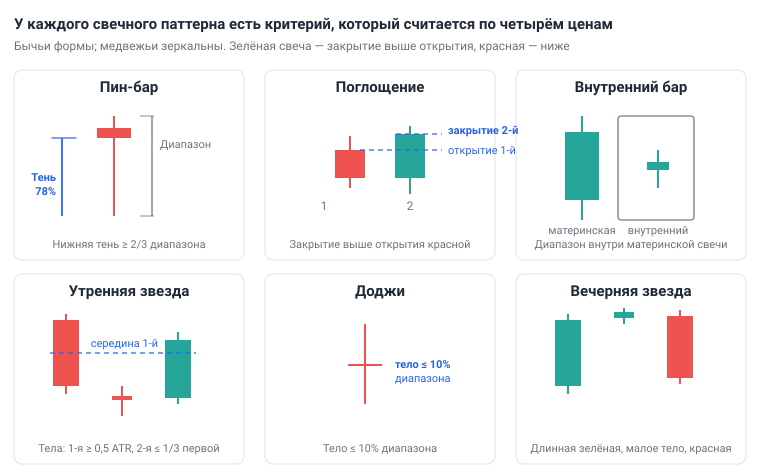
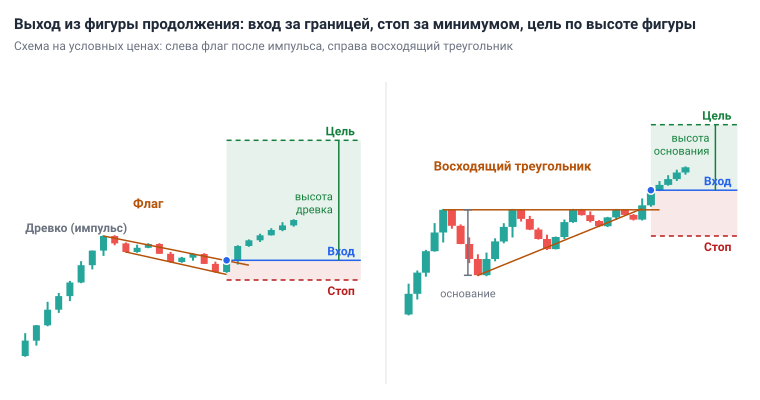
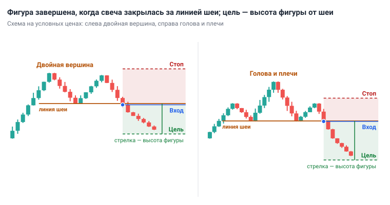
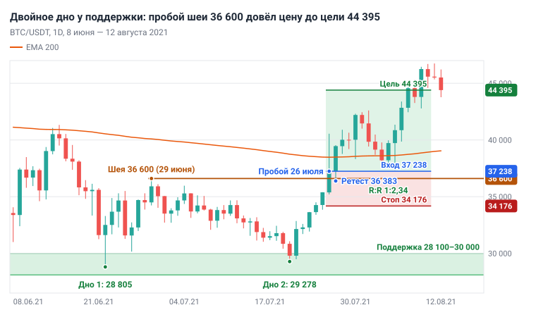

# Глава 6. Паттерны

> После этой главы вы умеете: распознавать пять свечных паттернов по числовым критериям и семь графических фигур; находить для каждого вход, стоп и цель по измеренному ходу; проверять паттерн на истории и сравнивать результат с базовой долей; отличать пробой фигуры от ложного пробоя; использовать паттерн как триггер внутри готового сценария.

**Связь с курсом:** [ступень 01, урок 5 «Свечи и таймфреймы»](../01_Основы/05_Свечи_и_таймфреймы.md); [стратегия 1 «Тренд по EMA»](../04_Стратегии/01_Тренд_по_EMA.md); [стратегия 2 «Отскок от уровня»](../04_Стратегии/02_Отскок_от_уровня.md); [стратегия 3 «Пробой и ретест»](../04_Стратегии/03_Пробой_и_ретест.md); [стратегия 4 «Боковик»](../04_Стратегии/04_Боковик.md).

## 6.1. Что такое паттерн и чего от него ждать

**Паттерн** (pattern) — это повторяющаяся форма на графике, запись борьбы покупателей и продавцов на коротком отрезке. **Свечной паттерн** состоит из одной — трёх свечей. **Графический паттерн**, или фигура, складывается из десятков свечей и описывается линиями: границами, вершинами, основаниями.

Паттерн записывает то, что уже случилось: «цену толкнули под уровень и выкупили», «покупатели дважды не прошли одну цену». Вывод о будущем делает трейдер, и этот вывод зависит от трёх вопросов в строгом порядке.

1. Куда идёт старший таймфрейм? Тренд и его структура разобраны в [главе 4](04_Структура_рынка.md).
2. Где сейчас цена: у уровня из [главы 5](05_Уровни_и_зоны.md) или посреди пустого места?
3. Какая форма появилась? Только теперь очередь паттерна.

Место и направление важнее формы. Длинная нижняя тень на поддержке дневного графика означает, что в зоне, где покупали раньше, покупают снова. Та же тень посреди боковика (он же флэт, диапазон) не опирается ни на чьи ордера.

Формы встречаются слишком часто, чтобы служить сигналом. По критериям из раздела 6.2 на BTC/USDT, 1D хотя бы один свечной паттерн этой главы нашёлся на 1 528 свечах из 2 651 — в 57,6% дней. Входить в рынок через день по одной только форме значит торговать шум.

Исследования дают паттернам сдержанную оценку. Эндрю Ло, Гарри Мамайски и Цзян Ван (2000) заменили глаз аналитика алгоритмом, который сам находил «голову и плечи», двойное дно и другие фигуры на графиках американских акций за 1962–1996 годы. Их вывод: несколько технических индикаторов несут дополнительную информацию и могут иметь некоторую практическую ценность. Там же авторы замечают, что геометрические фигуры на графике часто существуют лишь в глазах смотрящего. Бен Маршалл (2005) проверил свечные стратегии на акциях из индекса Dow Jones за 1992–2002 годы и не нашёл свидетельств, что трейдер, который им следует, обыграл бы рынок.

Отсюда позиция учебника. Паттерн — это **триггер**: событие, которое запускает заранее подготовленную сделку. Причина сделки — направление и уровень, а триггер отвечает на вопрос «когда» и подсказывает, где стоп.

## 6.2. Свечные паттерны: критерии, смысл, вход и стоп

Свечной паттерн оценивают только после закрытия свечи ([глава 3](03_График_свечи_и_таймфреймы.md)): за минуту до закрытия будущий пин-бар ещё может стать полнотелой красной свечой. Шаблон сделки для всех форм один: вход после закрытия последней свечи паттерна, стоп за экстремумом паттерна с запасом 0,5 × ATR(14), цель — следующий уровень, R:R не меньше 1:2. **ATR** — средний размах свечи за 14 свечей, он разобран в [главе 7](07_Индикаторы_и_объём.md).



*Рис. 6.1. У каждого свечного паттерна есть критерий, который можно посчитать по четырём ценам свечи.*

**Пин-бар** (pin bar) — свеча с длинной тенью в одну сторону и маленьким телом у противоположного края. Критерий учебника: тень занимает не меньше 2/3 диапазона свечи. У бычьего пин-бара длинная тень нижняя, у медвежьего — верхняя; цвет тела значения не имеет.

```
Диапазон    = Максимум − Минимум
Нижняя тень = меньшее из (Открытие, Закрытие) − Минимум
Бычий пин-бар: Нижняя тень ≥ 2/3 × Диапазон
```

Бычий пин-бар означает: продавцы увели цену далеко вниз, но к закрытию покупатели вернули не меньше двух третей пути. Смысл он имеет на поддержке в восходящем тренде или у нижней границы боковика, когда тень прокалывает зону, а закрытие остаётся над ней. Это сбор стопов из главы 5, записанный одной свечой.

**Поглощение** (engulfing) — две свечи: тело второй противоположного цвета и полностью перекрывает тело первой. На крипторынке свеча открывается по цене закрытия предыдущей, поэтому критерий бычьего поглощения сводится к одному условию: зелёная свеча закрылась выше открытия предыдущей красной. Медвежье поглощение зеркально. Смысл: всё движение прошлой свечи отыграно за одну свечу.

**Внутренний бар** (inside bar) — свеча, у которой максимум ниже максимума предыдущей, а минимум выше её минимума. Предыдущую свечу называют материнской. Внутренний бар показывает паузу: диапазон сжался, никто не победил. Направления он не даёт, его берут из тренда.

**Утренняя звезда** (morning star) — три свечи: длинная красная, свеча с маленьким телом и зелёная, которая закрылась выше середины тела первой. Критерии учебника: тело первой свечи не меньше 0,5 ATR, тело второй не больше трети тела первой. **Вечерняя звезда** (evening star) — зеркальная форма на вершине. Смысл тот же, что у пин-бара, только разворот занял три свечи: если сложить их в одну, получится свеча с длинной тенью.

**Доджи** (doji) — свеча, у которой открытие и закрытие почти совпали. Критерий учебника: тело не больше 10% диапазона. Доджи говорит о равновесии и своего входа не даёт. У уровня после сильного движения он предупреждает, что импульс выдохся; решение принимают по следующей свече. Доджи с длинной тенью в одну сторону одновременно является пин-баром.

| Паттерн | Где имеет смысл | Вход | Стоп |
|---|---|---|---|
| Бычий пин-бар | Поддержка в восходящем тренде, низ боковика | По закрытию свечи | Под минимумом тени − 0,5 ATR |
| Бычье поглощение | Там же, после отката в зону | По закрытию второй свечи | Под минимумом двух свечей − 0,5 ATR |
| Внутренний бар | Пауза после импульса по тренду | По закрытию за границей материнской свечи в сторону тренда | За противоположной границей материнской свечи, запас 0,5 ATR |
| Утренняя звезда | Поддержка после падения в зону | По закрытию третьей свечи | Под минимумом трёх свечей − 0,5 ATR |
| Доджи | У уровня после сильного движения | Своего входа нет: ждать следующую свечу | — |

Для медвежьих форм всё зеркально: сопротивление, нисходящий тренд или верх боковика, стоп над максимумом паттерна + 0,5 ATR. В стратегиях курса эти формы названы одним словом — «свеча отбоя». В курсе свеча отбоя — длинная нижняя тень или зелёная свеча, закрывшаяся выше EMA; пин-бар и поглощение — два её формальных варианта.

## 6.3. Проверка на данных: бычий пин-бар на BTC/USDT, 1D

Бычий пин-бар сам по себе почти не меняет шансы: после него цена через 5 дней была выше в 55,6% случаев, а после любого дня — в 52,6%. Ниже — способ расчёта: им можно проверить любой другой паттерн.

1. **Определение.** Нижняя тень не меньше 2/3 диапазона свечи. Других условий нет: ни уровня, ни размера свечи.
2. **Данные.** Свечи Binance BTC/USDT, 1D с 1 января 2019 по 25 октября 2026. В расчёт вошла 2 651 свеча с 19 июля 2019 по 20 октября 2026: первые 199 свечей ушли на расчёт EMA 200, у последних пяти ещё нет исхода.
3. **Исход.** Закрытие через 5 свечей выше закрытия пин-бара.
4. **Фильтр тренда.** Закрытие пин-бара выше или ниже **EMA 200** — экспоненциальной скользящей средней за 200 свечей (глава 7). Цена выше EMA 200 на 1D в курсе служит признаком восходящего тренда.
5. **Базовая доля** (base rate) — тот же исход для всех свечей подряд. Без неё результат оценить нельзя: «выше через 5 дней» случалось чаще половины раз и без всяких паттернов.

| Выборка | Случаев | Через 5 свечей закрытие выше | Доля |
|---|---|---|---|
| Все свечи (базовая доля) | 2 651 | 1 395 | 52,6% |
| Все свечи выше EMA 200 | 1 656 | 854 | 51,6% |
| Все свечи ниже EMA 200 | 995 | 541 | 54,4% |
| Все бычьи пин-бары | 144 | 80 | 55,6% |
| Пин-бары выше EMA 200 | 93 | 56 | 60,2% |
| Пин-бары ниже EMA 200 | 51 | 24 | 47,1% |

Разницу нужно сравнить со случайным разбросом. Коридор ниже посчитан как базовая доля ± 1,96 стандартной ошибки доли. Если бы пин-бар не значил ничего и мы взяли 144 случайных дня, доля «выше» в 95 случаях из 100 попала бы примерно между 44% и 61%. Результат 55,6% лежит внутри этого коридора. Для 93 пин-баров выше EMA 200 коридор — от 41% до 62%, и 60,2% тоже внутри, хотя у самого края. Для 51 пин-бара ниже EMA 200 коридор — от 41% до 68%. Результат 47,1% хуже базовой доли для свечей ниже EMA 200 (54,4%) на 7,3 процентного пункта, но тоже лежит внутри коридора.

Дополнительные проверки тем же скриптом:

- ETH/USDT, 1D, тот же период: 145 пин-баров, выше закрылись 87 (60,0%) при базовой доле 52,7%. Выше EMA 200 — 48 из 82 (58,5%), ниже EMA 200 — 39 из 63 (61,9%). Фильтр тренда на ETH ничего не дал.
- BTC/USDT, 4H: 1 026 пин-баров, через 5 свечей выше закрылись 515 (50,2%) при базовой доле 52,1%.
- BTC/USDT, 1D, исход через 10 свечей: 77 из 143 (53,8%) при базовой доле 53,7%.
- Пин-бары BTC на 10-дневном минимуме: 17 из 34 (50,0%).
- Бычье поглощение на BTC/USDT, 1D: 371 случай, выше закрылись 178 (48,0%) — ниже базовой доли.

Выводы.

1. Форма свечи без контекста не даёт преимущества, которое можно отличить от случайности. Ни одна из разниц в таблице не вышла за случайный коридор.
2. На BTC, 1D пин-бары по тренду выглядят лучше, чем против него: 60,2% и 47,1%. Это согласуется с правилом торговать по направлению 1D, но на ETH и на 4H не повторилось. Системой «покупаю каждый пин-бар выше EMA 200» это не делает.
3. «Закрытие выше через 5 свечей» — ещё не сделка. Здесь нет стопа, цели и комиссий. Даже 60% удачных исходов дают убыток, если средний проигрыш больше среднего выигрыша (матожидание — в [главе 11](11_Риск_менеджмент.md)).
4. Тест не проверял уровень из главы 5: его нельзя задать одной формулой. Грубая замена — 10-дневный минимум — результат не улучшила. Добавляют ли ваши уровни преимущество к пин-бару, покажет только бэктест полного сетапа на выборке от 100 сделок ([глава 13](13_Торговый_план_бэктест_журнал.md)).

## 6.4. Пин-бар у уровня: два разбора

Два пин-бара с одинаковой формой дали противоположный результат, и различались они направлением дневного тренда.

**Сработал.** BTC/USDT, 1D, ноябрь 2024 — январь 2025. Цена ходила в диапазоне. Нижняя граница — минимумы 26 ноября (90 791), 5 декабря (90 500), 30 декабря (91 530) и 9 января (91 204). Верхняя — максимум 17 декабря, 108 353. Цена держалась выше EMA 200 (78 613). 13 января свеча открылась на 94 545, опустилась до 89 257 и закрылась на 94 536; максимум — 95 940.

```
Диапазон    = 95 940 − 89 257 = 6 683
Нижняя тень = 94 536 − 89 257 = 5 279
Доля тени   = 5 279 / 6 683 = 79%  →  пин-бар
```

Тень ушла на 1 243 $ под минимум 5 декабря, а закрытие вернулось в диапазон. Вход по закрытию — 94 536. Стоп: 89 257 − 0,5 × 3 700 (ATR 1D) = 87 407, риск 7 129 $, или 7,5%. До верхней границы 108 353 остаётся 13 817 $: R:R 1:1,94. Это меньше 1:2, и по правилу учебника дневной вход здесь пропускают.

Тот же разворот на 4H даёт сделку. Свеча 4H, открывшаяся 13 января в 12:00 UTC, опустилась до 89 257 и закрылась на 92 124, над зоной поддержки. По критерию 2/3 это не пин-бар: тень заняла 41% диапазона. Триггером служит возврат в диапазон после прокола (раздел 6.8). Вход 92 124, стоп 89 257 − 0,5 × 1 508 (ATR 4H) = 88 503, риск 3 621 $ (3,9%), до 108 353 — 16 229 $: R:R 1:4,5. 20 января цена дошла до 109 588. Поэтому в учебной связке дневной график показывает место, а вход ищут на 4H ([глава 8](08_Таймфреймы_анализ_и_вход.md)).

**Не сработал.** BTC/USDT, 1D, 30 января 2026. Открытие 84 650, максимум 84 736, минимум 81 118, закрытие 84 260. Диапазон 3 618, нижняя тень 3 142 — 87%: форма чище, чем годом раньше. Рядом была поддержка — минимум 21 ноября 2025, 80 600. Но цена шла ниже EMA 200 (98 171), а накануне дневная свеча упала с 89 300 до 84 650. Вход по закрытию 84 260, стоп 81 118 − 0,5 × 2 697 = 79 770, риск 4 490 $ (5,3%). 31 января минимум дня — 75 720: стоп исполнен, результат −1R. Через 5 свечей цена закрылась на 73 166, на 13,2% ниже входа.

Сделайте то же на своём графике: перед оценкой формы запишите одной строкой направление 1D и ближайший уровень. Если хотя бы один пункт против покупки, бычий пин-бар для вас не сигнал.

## 6.5. Фигуры продолжения: флаг, вымпел, треугольник, прямоугольник

**Паттерн продолжения** — пауза внутри тренда: цена сжимается в узкой области, а затем выходит из неё в прежнюю сторону. Границы фигуры строят по значимым экстремумам (глава 4): каждая граница опирается минимум на две точки.

У всех фигур три общих правила.

- **Вход** — после закрытия свечи рабочего таймфрейма за границей фигуры или на ретесте, то есть при возврате цены к пробитой границе.
- **Стоп** — за последним экстремумом внутри фигуры или за экстремумом свечи пробоя, с запасом 0,5 × ATR. Если цена вернулась туда, пробой не состоялся.
- **Цель** — по измеренному ходу. **Измеренный ход** (measured move) — высота фигуры, отложенная от точки пробоя в сторону пробоя. Это ориентир, а не обещание: если сильный уровень лежит ближе, целью становится он.

**Флаг** (flag) — узкий наклонный канал после резкого импульса. Импульс называют древком. Канал наклонён против импульса: после роста он сползает вниз. Учебные критерии: откат не глубже половины древка, по два касания каждой границы.

**Вымпел** (pennant) — то же самое, но границы сходятся в маленький треугольник. Торгуют его так же, как флаг.

**Треугольник** (triangle) — фигура со сходящимися границами. У восходящего верхняя граница горизонтальна, а минимумы повышаются: покупатели каждый раз платят дороже. У нисходящего горизонтальна нижняя граница, а максимумы понижаются. У симметричного сходятся обе. Направление выхода заранее не выбирают: ждут закрытия свечи за границей.

**Прямоугольник** (rectangle) — боковик с горизонтальными границами, минимум по два касания каждой. Внутри него работает стратегия 4 «Боковик», после пробоя — стратегия 3 «Пробой и ретест».

| Фигура | Что измеряют | Откуда откладывают |
|---|---|---|
| Флаг, вымпел | Высоту древка | От точки пробоя |
| Треугольник | Высоту основания — самой широкой части | От точки пробоя |
| Прямоугольник | Высоту диапазона | От пробитой границы |
| Клин | Высоту основания | От точки пробоя |
| Двойная вершина, двойное дно | Расстояние от вершин до линии шеи | От линии шеи |
| Голова и плечи | Расстояние от головы до линии шеи | От точки пробоя шеи |



*Рис. 6.2. Вход — по закрытию свечи за границей, стоп — за последним минимумом фигуры, цель — высота древка или основания от точки пробоя.*

Пример расчёта на условных ценах BTC/USDT, 4H. Импульс с 60 000 до 66 000: древко 6 000. Цена три дня сползает в канале до 64 000 — откат 2 000, треть древка. Свеча 4H закрывается над верхней границей канала на 65 200.

```
Вход   = 65 200
Стоп   = 64 000 − 0,5 × 600 (ATR 4H) = 63 700
Риск   = 65 200 − 63 700 = 1 500 (2,3%)
Цель   = 65 200 + 6 000 = 71 200
R:R    = 6 000 / 1 500 = 1:4
Позиция при депозите 1 000 $ и риске 1% = 10 / 0,023 = 435 $
```

Если на 68 000 лежит дневное сопротивление, цель переносят на него: 2 800 / 1 500 — это R:R 1:1,9, и сделку пропускают.

## 6.6. Разворотные фигуры: двойная вершина, голова и плечи, клин

**Разворотный паттерн** появляется в конце движения и показывает, что структура тренда ломается. У всех разворотных фигур есть **линия шеи** (neckline) — граница, пробой которой завершает фигуру. До закрытия свечи за линией шеи фигуры нет: есть только диапазон внутри тренда.

**Двойная вершина** (double top) — два максимума примерно на одной цене и минимум между ними. Линия шеи идёт по этому минимуму. Учебный критерий: вторая вершина отличается от первой не больше чем на 0,5 ATR(14) таймфрейма, на котором вы строите фигуру. Смысл: покупатели дважды не прошли одну цену, а закрытие под шеей ставит минимум ниже предыдущего — это слом структуры из главы 4. **Двойное дно** (double bottom) — зеркальная фигура.

**Голова и плечи** (head and shoulders) — три максимума: средний, голова, выше двух крайних, плеч. Линию шеи проводят через два минимума между ними, она может быть наклонной. Правое плечо — это более низкий максимум (LH), пробой шеи — более низкий минимум (LL). Перевёрнутая голова и плечи — зеркальная форма на дне.

**Клин** (wedge) — обе границы наклонены в одну сторону и сходятся. В восходящем клине каждый новый максимум даётся всё меньшим приростом: рост выдыхается, и ждут пробоя нижней границы. Нисходящий клин зеркален. Торгуют только состоявшийся пробой.



*Рис. 6.3. Фигура завершена, когда свеча закрылась за линией шеи. Цель — высота фигуры, отложенная от шеи.*

Вход — по закрытию свечи за линией шеи или на ретесте шеи с обратной стороны. Стоп консервативно ставят за вторую вершину или за правое плечо с запасом 0,5 ATR. Если R:R при этом меньше 1:2, сделку берут только с ретеста: стоп за экстремумом ретеста с запасом 0,5 ATR.

Разворотная фигура на 1D направлена против дневного тренда. Новичок её не торгует ни до пробоя шеи, ни сразу после: правило учебника разрешает сделки только по направлению 1D, а пробой шеи — лишь первый признак разворота. Сделки в новую сторону начинаются, когда разворот подтвердили структура (глава 4) и положение цены относительно EMA 200. Полезнее другое применение: двойное дно на 4H у дневной поддержки в восходящем тренде 1D. Такая фигура отмечает конец отката и служит триггером сделки по тренду.

## 6.7. Разбор: двойное дно на BTC/USDT, июнь — август 2021

Двойное дно 2021 года показывает все шаги: два дна в зоне поддержки, пробой шеи закрытием, ретест и измеренный ход.



*Рис. 6.4. BTC/USDT, 1D, июнь — август 2021. Два дна у 28 805 и 29 278, шея 36 600, цель 44 395 достигнута 7 августа.*

1. **Место.** Зона 28 100–30 000: минимумы января 2021 (28 130, 28 850, 29 242) и 19 мая (30 000). Тренд 1D нисходящий, цена ниже EMA 200.
2. **Первое дно.** 22 июня, минимум 28 805.
3. **Линия шеи.** Максимум между днами: 29 июня, 36 600.
4. **Второе дно.** 20 июля, минимум 29 278 — на 473 $ выше первого, это 0,25 ATR. На следующий день — бычье поглощение: красная свеча 30 840 → 29 790 перекрыта зелёной 29 790 → 32 145.
5. **Пробой.** 26 июля день закрылся на 37 238, выше шеи. Это же закрытие сломало нисходящую структуру: цена закрылась выше последнего значимого максимума.
6. **Цель.** 36 600 − 28 805 = 7 795; 36 600 + 7 795 = 44 395.
7. **Сделка (учебный расчёт механики фигуры).** Вход 37 238. Стоп под минимумом свечи пробоя: 35 206 − 0,5 × 2 060 = 34 176. Риск 3 062 $ (8,2%), до цели 7 157 $, R:R 1:2,34. При депозите 1 000 $ и риске 1% позиция = 10 / 0,082 = 122 $.
8. **Ретест.** 27 июля цена опустилась до 36 383, на 217 $ под шею, и закрылась на 39 458. 3–5 августа она ещё раз спускалась до 37 333 и ни разу не закрылась ниже шеи. Лимитная покупка на 36 600 с тем же стопом: риск 2 424 $, R:R 1:3,22.
9. **Итог.** 7 августа максимум 44 700: цель достигнута, +2,34R, или 23,4 $ на депозит 1 000 $.

Четыре честные оговорки. Первая: по правилам учебника новичок эту сделку пропускает. В день пробоя цена закрылась ниже EMA 200 (37 238 против 38 480), то есть покупка шла против дневного тренда. Выше EMA 200 день впервые закрылся 27 июля на 39 458, но от этой цены до цели оставалось 4 937 $ при риске 5 282 $ — R:R 1:0,93, сделки нет. Разбор показывает, как строят фигуру и считают цель, а не сделку для повторения. Вторая: свеча пробоя была некрасивой: внутри дня цена доходила до 40 550 и к закрытию отдала 3 312 $, верхняя тень заняла 62% диапазона. Третья: стоп 8,2% широк, поэтому позиция в восемь раз меньше депозита. Четвёртая: измеренный ход исполняется не каждый раз. Вершины 17 декабря 2024 (108 353) и 20 января 2025 (109 588) с шеей на 89 257 образовали двойную вершину с целью 68 926. Шея была пробита закрытием 25 февраля 2025, в марте цена трижды закрывалась обратно над ней, а падение остановилось 7 апреля на 74 508: цена прошла 73% измеренного хода и развернулась.

## 6.8. Ложные пробои фигур

**Ложный пробой** (false breakout) — цена выходит за границу фигуры и возвращается обратно. Причина описана в главе 5: за границей стоят чужие стопы и ордера на пробой, и крупному участнику удобно исполнить о них свою заявку.

От ложного пробоя защищают два правила.

1. **Закрытие свечи.** Пробоем считают закрытие свечи рабочего таймфрейма за границей. Тень за границей — это прокол.
2. **Ретест.** После пробоя ждут возврата цены к пробитой границе и входят, когда она удержалась: свеча закрылась на правильной стороне.

Стратегия 3 курса добавляет третье условие — повышенный объём на свече пробоя; объём разобран в главе 7.

Пример: BTC/USDT, 1D, 20 января 2025. Максимум дня 109 588 — на 1 235 $ выше вершины 17 декабря (108 353). Закрытие 102 260, внутри диапазона. Верхняя тень заняла 7 328 $ из 10 038 $ диапазона, 73%: медвежий пин-бар у сопротивления. Стоп-ордер на покупку над 108 353 исполнился бы, а день закрылся на 6 093 $ ниже этой цены. Ни одна свеча 4H в этот день не закрылась выше 108 353, и правило закрытия сделку не открыло бы. Выше 109 588 цена не поднималась до мая 2025.

У обеих защит есть цена. Закрытие свечи даёт вход хуже, чем сам пробой: 26 июля 2021 шея была на 36 600, а день закрылся на 37 238. Ретеста может не случиться вовсе, и тогда движение уходит без вас. Курс отвечает на это прямо: цена ушла далеко без ретеста — не догонять. Пропущенная сделка ничего не стоит, а вход вдогонку ставит стоп далеко и ломает R:R.

Ложный пробой сам является паттерном. Возврат цены в диапазон после выхода за границу — сигнал в обратную сторону: 13 января 2025 прокол нижней границы закончился пин-баром и ростом до верхней. На этом построена модель «Ложный пробой» в [главе 10](10_Модели_входа.md).

## 6.9. Как пользоваться паттернами

Паттерн ищут только там, где сценарий уже написан: известны направление, зона и условие входа. Порядок действий такой.

1. На 1D определите направление (глава 4) и отметьте зоны (глава 5).
2. Запишите сценарий: «если цена придёт в зону 90 500–91 500 и свеча 4H закроется над ней пин-баром, поглощением или возвратом после прокола, покупаю». Как формулировать сценарии — в [главе 9](09_Алгоритм_анализа_сверху_вниз.md).
3. Ждите цену в зоне. Вне зоны паттерны не рассматривайте, какими бы красивыми они ни были.
4. После закрытия свечи 4H проверьте критерий расчётом: долю тени, перекрытие тела, закрытие за границей.
5. Посчитайте стоп, цель и R:R. Меньше 1:2 — сделки нет. Размер позиции — по формуле из главы 11.
6. Запишите в журнал тип паттерна и значение критерия. Через 100 сделок у вас будет своя статистика взамен чужих обещаний.

Минимальный набор для старта — пять форм. Свечные: пин-бар и поглощение, это две «свечи отбоя» из стратегий курса. Графические: прямоугольник, флаг, двойная вершина и двойное дно. Остальные фигуры достаточно узнавать, чтобы не открывать сделку против них.

## 6.10. Типичные ошибки

- **Торговать форму без места.** Пин-бар посреди диапазона или против тренда 1D. Чем заканчивается: в примере 30 января 2026 — стоп на следующий день.
- **Входить до закрытия свечи.** За час до закрытия пин-бар выглядит готовым, а закрывается полнотелой свечой.
- **Достраивать фигуру.** Видеть двойную вершину до пробоя шеи или проводить границу через одну точку. До пробоя это диапазон.
- **Считать измеренный ход обещанием.** Цель ставят на ближайший из двух ориентиров — измеренный ход или уровень — и проверяют R:R.
- **Ставить стоп вплотную к экстремуму паттерна.** Там стоят стопы всех, кто увидел ту же фигуру. Запас 0,5 ATR обязателен.
- **Искать паттерны на 1m–15m.** Форм там в десятки раз больше, а каждая значит меньше. Рабочие таймфреймы учебника — 1D и 4H.
- **Доказывать паттерн отобранными примерами.** Десять удачных картинок ничего не говорят без числа всех случаев и базовой доли.

## 6.11. Запомнить

- Паттерн — запись борьбы покупателей и продавцов. Порядок вопросов: направление, место, форма.
- Критерии считаются: пин-бар — тень не меньше 2/3 диапазона; поглощение — закрытие за открытием предыдущей свечи; внутренний бар — весь диапазон внутри предыдущей свечи; доджи — тело не больше 10% диапазона.
- На BTC/USDT, 1D после бычьего пин-бара цена через 5 свечей была выше в 55,6% случаев при базовой доле 52,6%. Разница не выходит за случайный разброс.
- Вход — после закрытия свечи, стоп — за экстремумом паттерна с запасом 0,5 × ATR, R:R не меньше 1:2.
- Фигура завершена только после закрытия свечи за её границей или линией шеи.
- Измеренный ход: высоту фигуры откладывают от точки пробоя. Это ориентир для цели, уровень на пути важнее.
- От ложного пробоя защищают закрытие свечи и ретест. Плата — худшая цена входа и пропущенные движения.
- Паттерн — триггер внутри сценария, а не причина сделки.

## 6.12. Практика на демосчёте

- [ ] На BTC/USDT, 1D за последние 12 месяцев найдите все бычьи пин-бары по критерию 2/3. Для каждого запишите дату, долю тени, положение относительно EMA 200, наличие зоны из вашей разметки и закрытие через 5 свечей. Посчитайте долю «выше» отдельно для пин-баров в зоне и вне зоны и сравните с базовой долей — долей всех дней отрезка, после которых закрытие через 5 свечей было выше.
- [ ] На ETH/USDT, 4H найдите три флага или прямоугольника. Для каждого начертите границы, запишите цену пробоя, стоп, цель по измеренному ходу и отметьте, достигнута ли цель раньше стопа.
- [ ] Найдите на истории BTC/USDT три ложных пробоя: тень за границей фигуры или уровня и закрытие внутри. Запишите, что случилось в следующие 5 свечей.
- [ ] Откройте на демосчёте пять сделок, в которых сценарий записан до появления паттерна, а паттерн на 4H служит только триггером. В журнале укажите критерий паттерна числом.

## 6.13. Вопросы для самопроверки

1. В каком порядке задают три вопроса перед оценкой паттерна и почему форма стоит последней?
2. Свеча: открытие 61 200, максимум 61 500, минимум 59 400, закрытие 61 050. Это бычий пин-бар по критерию учебника?
3. Что такое базовая доля и почему без неё нельзя оценить паттерн?
4. Что показала проверка пин-баров выше и ниже EMA 200 на BTC/USDT, 1D и почему из неё не следует система «покупать каждый пин-бар по тренду»?
5. Как торгуют внутренний бар и откуда берут направление?
6. Двойная вершина: максимумы 70 000 и 69 800, линия шеи 66 000. Свеча закрылась на 65 700, стоп 67 000. Посчитайте цель по измеренному ходу и R:R.
7. ETH/USDT, 4H: древко флага с 3 000 до 3 450, минимум флага 3 330, свеча закрылась над границей на 3 420, ATR 40. Посчитайте стоп, цель, R:R и размер позиции при депозите 10 000 $ и риске 1%.
8. В какой момент двойная вершина считается сформированной и чем она является до этого?
9. Какие два правила защищают от ложного пробоя и чем за них платят?

## 6.14. Ответы

1. Направление старшего таймфрейма, место (уровень), форма. Формы встречаются больше чем в половине дней, а смысл им придают ордера у уровня и тренд.
2. Диапазон 61 500 − 59 400 = 2 100. Нижняя тень 61 050 − 59 400 = 1 650. Доля 1 650 / 2 100 = 79%, это больше 2/3: да, пин-бар.
3. Доля того же исхода для всех свечей подряд. На растущем рынке «выше через 5 дней» случается чаще половины раз само по себе; паттерн полезен, только если заметно превышает эту долю.
4. Выше EMA 200 — 60,2% (56 из 93), ниже — 47,1% (24 из 51). Обе доли лежат внутри случайного разброса, на ETH и на 4H эффект не повторился, а исход «выше через 5 свечей» не учитывает стоп, цель и комиссии.
5. Ждут закрытия свечи за границей материнской свечи. Направление берут из тренда: в восходящем — выше максимума, в нисходящем — ниже минимума. Стоп — за противоположной границей материнской свечи с запасом 0,5 ATR.
6. Высота 70 000 − 66 000 = 4 000. Цель 66 000 − 4 000 = 62 000. Риск 67 000 − 65 700 = 1 300, до цели 65 700 − 62 000 = 3 700. R:R = 3 700 / 1 300 = 1:2,85.
7. Стоп 3 330 − 0,5 × 40 = 3 310. Риск 3 420 − 3 310 = 110, или 3,216% цены входа. Цель 3 420 + 450 = 3 870. R:R = 450 / 110 = 1:4,1. Позиция = 100 / 0,03216 = 3 109 $.
8. После закрытия свечи ниже линии шеи. До этого на графике диапазон внутри восходящего тренда.
9. Закрытие свечи за границей и ретест пробитой границы. Плата — худшая цена входа и сделки, которые ушли без ретеста.

## Источники

- Lo A. W., Mamaysky H., Wang J. Foundations of Technical Analysis: Computational Algorithms, Statistical Inference, and Empirical Implementation. Journal of Finance, 2000, vol. 55, no. 4, pp. 1705–1765. Аннотация: [NBER Working Paper 7613](https://www.nber.org/papers/w7613).
- Marshall B. R. Candlestick technical trading strategies: can they create value for investors? Докторская диссертация, Massey University, 2005. Аннотация: [Massey Research Online](https://mro.massey.ac.nz/handle/10179/1604).
- Marshall B. R., Young M. R., Rose L. C. Candlestick technical trading strategies: Can they create value for investors? Journal of Banking & Finance, 2006, vol. 30, no. 8, pp. 2303–2323. Запись: [RePEc](https://ideas.repec.org/a/eee/jbfina/v30y2006i8p2303-2323.html).
