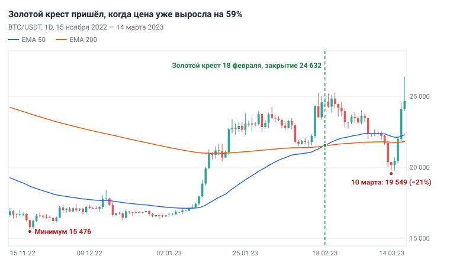
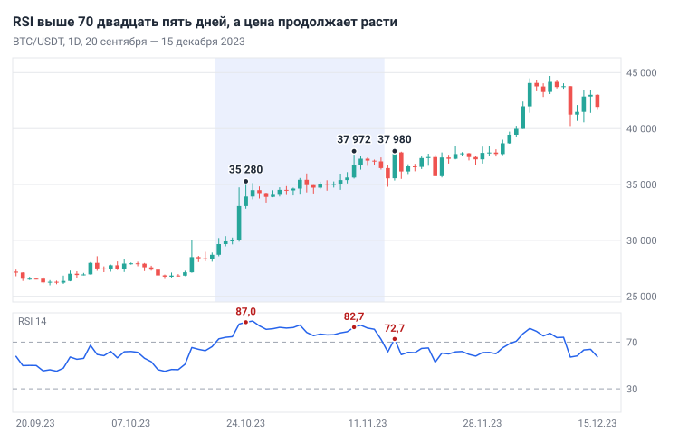
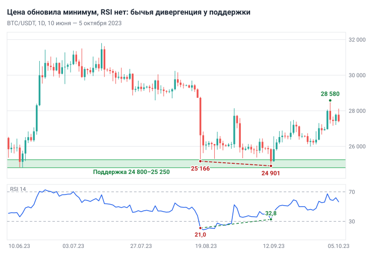
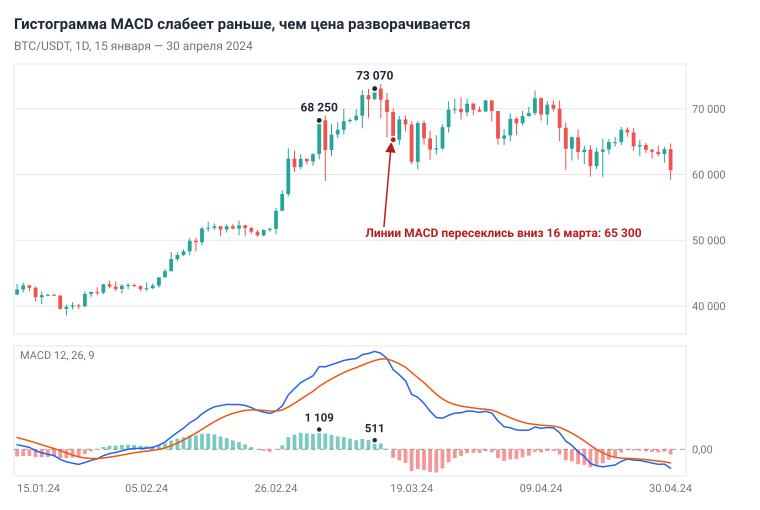
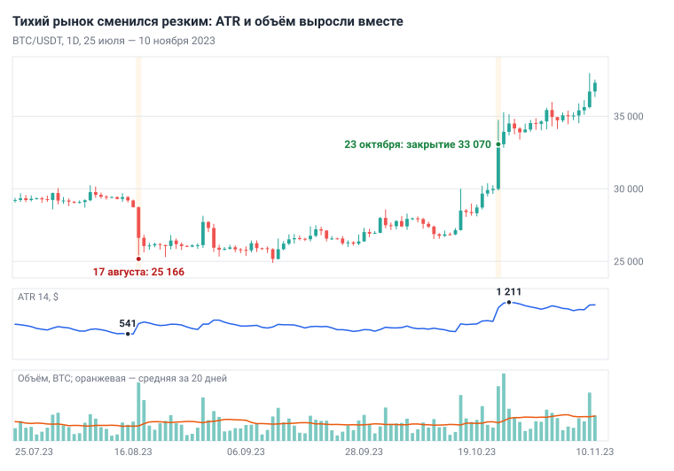

# Глава 7. Индикаторы и объём

> После этой главы вы умеете: объяснить, что считает каждый индикатор стартового набора и почему он запаздывает; читать EMA, RSI, MACD, ATR и объём на графиках 1D и 4H; находить дивергенцию RSI по шагам; снимать с ATR запас для стопа; проверять, что сделка понятна и без индикаторов.

**Связь с курсом:** [ступень 02, урок 3 «Объём»](../02_Анализ_графика/03_Объём.md), [урок 4 «Скользящие средние (EMA)»](../02_Анализ_графика/04_EMA_скользящие_средние.md), [урок 5 «RSI»](../02_Анализ_графика/05_RSI.md), [урок 6 «MACD»](../02_Анализ_графика/06_MACD.md); [ступень 04, стратегия 5 «Разворот по дивергенции RSI»](../04_Стратегии/05_RSI_дивергенция.md); [шпаргалка «Таймфреймы и индикаторы»](../07_Справочник/Таймфреймы_и_индикаторы.md); уровень профи: [урок 4 «Размер позиции для профи»](../09_Уровень_профи/04_Размер_позиции_для_профи.md) и [урок 6 «Режимы рынка и фильтры»](../09_Уровень_профи/06_Режимы_рынка_и_фильтры.md).

## 7.1. Что такое индикатор и почему он запаздывает

**Индикатор** (indicator) — это формула, которая берёт цены и объёмы уже закрытых свечей и рисует результат линией или столбиками. Новой информации в нём нет: всё, что он показывает, уже есть на графике. Индикатор сжимает десятки свечей в одно число, которое удобно сравнивать.

Отсюда главное свойство: индикатор запаздывает. Чтобы средняя за 50 свечей повернула вверх, цена должна сначала вырасти. Чем больше свечей в расчёте, тем ровнее линия и тем позже она реагирует. Индикатор подтверждает то, что уже произошло.

Индикаторы делят на четыре группы по вопросу, на который они отвечают.

| Группа | Вопрос | Инструменты главы |
|---|---|---|
| Тренд | Куда идёт цена в среднем? | EMA 20, 50, 200; линия MACD |
| Импульс | Движение ускоряется или слабеет? | RSI 14; гистограмма MACD |
| Волатильность | Какой размах свечи сейчас обычен? | ATR 14; полосы Боллинджера |
| Объём | Сколько торговли стоит за движением? | объём; VWAP; профиль объёма |

Два индикатора одной группы считают одно и то же разными формулами. Если RSI и MACD оба показывают рост импульса, это один довод, а не два. Из каждой группы достаточно одного инструмента.

Решение о сделке строится на структуре ([глава 4](04_Структура_рынка.md)), уровне ([глава 5](05_Уровни_и_зоны.md)) и триггере ([глава 6](06_Паттерны.md)). Индикатор в этой схеме работает как измерительный прибор: уточняет контекст и отсеивает слабые ситуации. Перед тем как добавить индикатор на график, назовите вопрос, на который он вам отвечает.

## 7.2. Скользящие средние: SMA и EMA

**Скользящая средняя** (moving average) — средняя цена закрытия за последние N свечей, пересчитанная на каждой новой свече. Линия сглаживает колебания и показывает направление.

**SMA** (simple moving average) — обычное среднее: сумма N закрытий, делённая на N. **EMA** (exponential moving average) даёт последним свечам больший вес и быстрее реагирует на свежее движение. Курс и учебник используют EMA.

```
k = 2 / (N + 1)
EMA сегодня = Закрытие сегодня × k + EMA вчера × (1 − k)
Первое значение EMA = SMA за первые N свечей
```

Расчёт EMA 3 на пяти закрытиях. Здесь k = 2 / (3 + 1) = 0,5.

| Свеча | Закрытие | Расчёт EMA 3 | EMA 3 | SMA 3 |
|---|---|---|---|---|
| 1 | 60 000 | — | — | — |
| 2 | 60 600 | — | — | — |
| 3 | 61 200 | (60 000 + 60 600 + 61 200) / 3 | 60 600 | 60 600 |
| 4 | 63 000 | 63 000 × 0,5 + 60 600 × 0,5 | 61 800 | 61 600 |
| 5 | 64 200 | 64 200 × 0,5 + 61 800 × 0,5 | 63 000 | 62 800 |

На четвёртой свече цена выросла на 1 800 $. EMA поднялась на 1 200 $, SMA — на 1 000 $. Обе линии остались ниже цены: средняя всегда догоняет.

У каждой из трёх EMA канона своя роль.

| EMA | Период на 1D | Что показывает | Как читать |
|---|---|---|---|
| 20 | около трёх недель | краткосрочный тренд | в сильном тренде цена откатывается к линии и идёт дальше |
| 50 | около семи недель | среднесрочный тренд | растёт несколько недель — тренд; плоская — боковик |
| 200 | больше полугода | главный тренд | цена выше — ищем только покупки; ниже — покупки не ищем |

На графике читают три вещи: с какой стороны от линии цена, куда линия наклонена и в каком порядке линии стоят. EMA 20 выше EMA 50, а EMA 50 выше EMA 200 — восходящий тренд на всех трёх горизонтах.

Правило про EMA 200 проверено на BTC/USDT, 1D, с июля 2019 по октябрь 2026. Цена закрывалась выше EMA 200 в 63% дней. Через 90 дней после такого дня она была выше в 59% случаев при медианном изменении +6,3%. После дня ниже EMA 200 — в 51% случаев при медиане +1,6%. Перевес есть, но небольшой: EMA 200 служит фильтром направления, а не сигналом.

В **боковике** (он же флэт, диапазон) средние бесполезны: цена ходит вокруг плоской линии и пересекает её без последствий. BTC/USDT, 1D, 15 марта — 15 октября 2024: цена начала отрезок на 69 500 и закончила на 67 070, а закрытие пересекло EMA 50 двадцать раз за 215 дней. Для сравнения: с 10 октября 2020 по 14 апреля 2021 цена выросла с 11 290 до 62 960 и за 187 дней ни разу не закрылась ниже EMA 50.

Действие: добавьте на 1D EMA 50 и EMA 200 и посчитайте, сколько раз за последние три месяца закрытие переходило через EMA 50. Больше пяти-шести раз при плоской линии — ориентир боковика, и сигналы средних в нём не используют. Откат к EMA 20 или EMA 50 как место входа в тренде разобран в [главе 10](10_Модели_входа.md).

## 7.3. Пересечение EMA 50 и EMA 200: проверка на истории

Пересечение двух средних сообщает о смене тренда, когда большая часть движения уже позади. **Золотой крест** (golden cross) — EMA 50 пересекает EMA 200 снизу вверх. Обратное пересечение называют **мёртвым крестом** (death cross). Курс называет золотой крест признаком смены тренда «с запаздыванием»; таблица показывает, насколько большим.

В таблице все пересечения на BTC/USDT, 1D, за период данных. Проценты — изменение цены закрытия от дня пересечения.

| Дата | Крест | Закрытие | Через 30 дней | Через 90 дней | До следующего креста |
|---|---|---|---|---|---|
| 4 декабря 2019 | мёртвый | 7 194 | +2,1% | +21,8% | +17,3% |
| 24 января 2020 | золотой | 8 439 | +17,7% | −11,3% | −40,4% |
| 16 марта 2020 | мёртвый | 5 029 | +31,7% | +85,8% | +73,5% |
| 10 мая 2020 | золотой | 8 723 | +12,0% | +34,8% | +286,1% |
| 23 июня 2021 | мёртвый | 33 678 | −0,1% | +21,0% | +39,8% |
| 14 августа 2021 | золотой | 47 069 | −4,5% | +36,2% | −11,1% |
| 10 января 2022 | мёртвый | 41 822 | +6,1% | +0,8% | −41,1% |
| 18 февраля 2023 | золотой | 24 632 | +12,5% | +9,1% | +6,6% |
| 24 сентября 2023 | мёртвый | 26 248 | +29,2% | +66,5% | +4,5% |
| 3 октября 2023 | золотой | 27 426 | +27,4% | +61,1% | +236,2% |
| 17 ноября 2025 | мёртвый | 92 215 | −6,5% | −25,4% | −16,2% |
| 12 сентября 2026 | золотой | 77 279 | +5,9% | нет данных | нет данных |

Что видно в таблице:

1. Запаздывание измеряется десятками процентов. Золотой крест 18 февраля 2023 появился через 89 дней после минимума 15 476 (21 ноября 2022), когда цена уже выросла на 59%. Мёртвый крест 23 июня 2021 появился через 70 дней после максимума 64 854, когда цена упала на 48%. Минимум того падения, 28 805, был накануне.
2. Мёртвый крест не был сигналом продажи: в пяти случаях из шести через 90 дней цена была выше.
3. После золотого креста цена через 90 дней была выше в четырёх случаях из пяти. Но BTC за эти годы вырос, и после произвольного дня цена через 90 дней была выше в 56% случаев. Пяти случаев мало, чтобы отличить сигнал от общего роста.
4. В боковике кресты идут парами. Мёртвый крест 24 сентября 2023 сменился золотым через 9 дней. Золотой крест 24 января 2020 закончился мёртвым 16 марта 2020 при цене на 40% ниже.
5. Даже удачный крест не даёт точку входа. После 18 февраля 2023 цена за три недели упала до 19 549 (10 марта 2023), на 21% ниже цены в день пересечения, и только потом пошла вверх.



*Рис. 7.1. BTC/USDT, 1D, 15 ноября 2022 — 14 марта 2023. К дню пересечения цена уже прошла 59% от минимума, а через три недели вернулась под обе средние.*

Крест полезен как состояние, а не как событие. «EMA 50 выше EMA 200» — фон, при котором ищут покупки; так это условие записано в стратегии 1 курса. Оба больших роста в таблице прошли в этом состоянии: +286% с мая 2020 по июнь 2021 и +236% с октября 2023 по ноябрь 2025. Момент входа дают уровень и триггер.

Расчёт EMA 200 зависит от начала истории, а наши данные начинаются 1 января 2019. На платформе с более длинной историей даты первых пересечений могут отличаться на несколько дней.

## 7.4. RSI: сила движения

**RSI** (Relative Strength Index, индекс относительной силы) сравнивает средний рост и среднее падение закрытий за последние свечи и выдаёт число от 0 до 100. Индикатор описал Дж. Уэллс Уайлдер в книге «New Concepts in Technical Trading Systems» (1978). Стандартный период — 14.

```
Рост сегодня    = Закрытие сегодня − Закрытие вчера, если разница положительная, иначе 0
Падение сегодня = Закрытие вчера − Закрытие сегодня, если разница положительная, иначе 0
Средний рост    = (Средний рост вчера × 13 + Рост сегодня) / 14
Среднее падение = (Среднее падение вчера × 13 + Падение сегодня) / 14
RS  = Средний рост / Среднее падение
RSI = 100 − 100 / (1 + RS)
```

Пример: средний рост 300 $, среднее падение 100 $. RS = 3, RSI = 100 − 100 / 4 = 75. При равных росте и падении RS = 1 и RSI = 50.

Традиционные границы — 70 и 30. RSI выше 70 называют **перекупленностью** (overbought): средний рост больше среднего падения в 2,3 раза и более. RSI ниже 30 — **перепроданность** (oversold): картина зеркальная. Оба слова описывают последние 14 свечей и ничего не обещают про следующие.

В сильном тренде RSI неделями стоит выше 70. Причина в формуле: пока дни роста крупнее и чаще дней падения, RS держится выше 2,3. BTC/USDT, 1D: с 20 октября по 13 ноября 2023 RSI был выше 70 двадцать пять дней подряд, а цена закрытия выросла с 29 670 до 36 460, на 23%. Шорт в первый день «перекупленности» через три недели был бы в убытке на 28%: 9 ноября цена доходила до 37 972.



*Рис. 7.2. BTC/USDT, 1D, 20 сентября — 15 декабря 2023. RSI выше 70 с 20 октября по 13 ноября. Максимумы цены 24 октября, 9 и 15 ноября растут, значения RSI на них падают: 87,0, 82,7, 72,7.*

За период данных RSI на BTC 1D поднимался выше 70 семьдесят четыре раза. Через 30 дней после первого дня такой серии цена была выше в 65% случаев при медиане +5,3%. Для произвольного дня — 55% и +1,7%. Перекупленность на дневном графике BTC чаще означала силу, чем скорый разворот.

Действие: читайте RSI только вместе с трендом и уровнем. RSI выше 70 — не причина продавать. RSI ниже 30 в нисходящем тренде — не причина покупать. Доводом RSI становится тогда, когда расходится с ценой у уровня.

## 7.5. Дивергенция RSI

**Дивергенция** (divergence) — расхождение цены и индикатора: цена обновляет экстремум, а RSI нет. **Бычья** дивергенция: цена сделала более низкий минимум, RSI — более высокий. **Медвежья**: цена сделала более высокий максимум, RSI — более низкий.

Расхождение означает, что второе движение к экстремуму было слабее первого. Цена дошла до новой отметки, но средний размер свечей в эту сторону уменьшился. У сильного уровня это довод в пользу разворота. В сильном тренде довод не работает: импульс замедляется с очень быстрого до быстрого, а цена идёт дальше. Справочник StockCharts формулирует это так: в сильном тренде дивергенции вводят в заблуждение.

Как искать бычью дивергенцию:

1. На 1D отметьте зону поддержки ([глава 5](05_Уровни_и_зоны.md)). Нет уровня — дивергенцию не ищете.
2. Найдите два значимых минимума цены подряд, второй ниже первого. Между ними от 5 до 60 свечей.
3. Запишите RSI на свече каждого минимума. Довод сильнее, если у первого минимума RSI был около 30 или ниже.
4. Если RSI у второго минимума выше, соедините минимумы линией на цене и на RSI. Линии расходятся — дивергенция есть.
5. Ждите подтверждения: разворотной свечи или пробоя локального максимума на 4H. До него это наблюдение.

Для медвежьей дивергенции всё зеркально: сопротивление, два максимума, RSI у второго ниже.

Пример. BTC/USDT, 1D, август — сентябрь 2023. Зона 24 800–25 250: в феврале 2023 здесь были максимумы (25 250), в июне — минимум (24 800). 17 августа цена упала до 25 166, RSI на закрытии был 21,0. 11 сентября цена обновила минимум, 24 901, а RSI был 32,8. Цена ниже на 265 $, RSI выше на 11,8 пункта. Июньский минимум при этом устоял. 12 сентября свеча закрылась ростом на 25 840 при объёме в 1,9 раза выше среднего. 2 октября цена доходила до 28 580, на 15% выше минимума.



*Рис. 7.3. BTC/USDT, 1D, 10 июня — 5 октября 2023. Минимум цены 11 сентября ниже минимума 17 августа, RSI выше: 32,8 против 21,0.*

Несработавший пример виден на рис. 7.2. 24 октября 2023: максимум 35 280, RSI 87,0. 9 ноября: максимум 37 972, RSI 82,7. 15 ноября: максимум 37 980, RSI 72,7. Три максимума всё выше, RSI всё ниже — медвежья дивергенция по определению. После 15 ноября цена не опускалась ниже 35 500, 24 ноября обновила максимум, а 5 декабря дошла до 44 488. Отличие от первого примера: дивергенция была против тренда 1D, а RSI неделями держался выше 70.

Проверка на всей истории BTC/USDT, 4H, 2019–2026. Скрипт отобрал дивергенции по шагам 2–4 без уровней и без фильтра тренда; RSI у первого экстремума — ниже 35 для бычьих и выше 65 для медвежьих. Исход считался от закрытия пятой свечи после второго экстремума. Бычьих нашлось 62; в 32 случаях (52%) цена прошла вверх 2 ATR раньше, чем обновила минимум. Медвежьих — 103, сработали 45 (44%). Средний результат обеих групп около нуля ещё до комиссий.

Вывод: дивергенция как единственный сигнал преимущества не даёт. Стратегия 5 курса поэтому требует сильный уровень 1D и подтверждающую свечу и запрещает вход против сильного тренда 1W. Вход и стоп дают модели из [главы 10](10_Модели_входа.md), дивергенция служит дополнительным доводом.

## 7.6. MACD

**MACD** (Moving Average Convergence Divergence) — разница двух EMA, вынесенная в отдельную панель. Индикатор создал Джеральд Аппель в конце 1970-х. Стандартные настройки — 12, 26, 9.

```
Линия MACD       = EMA 12 − EMA 26
Сигнальная линия = EMA 9 от линии MACD
Гистограмма      = Линия MACD − Сигнальная линия
```

Читают три вещи. Линия MACD выше нуля — EMA 12 выше EMA 26, краткосрочный тренд направлен вверх. Линия пересекла **сигнальную линию** снизу вверх — импульс к росту, сверху вниз — к падению. **Гистограмма** растёт — движение ускоряется, уменьшается — замедляется.

Пример. BTC/USDT, 1D, январь — апрель 2024:

- 29 января линия MACD пересекла сигнальную снизу вверх при закрытии 43 300.
- 23 февраля линии пересеклись вниз при 50 740, а через четыре дня обратно при 57 040, на 12% выше. Это ложный сигнал в середине тренда.
- 4 марта гистограмма достигла 1 109 при закрытии 68 250. 13 марта цена закрылась выше, на 73 070, а гистограмма была 511. Цена растёт, ускорение исчезло.
- 16 марта линии пересеклись вниз при 65 300. Максимум 73 777 был двумя днями раньше: сигнал пришёл на 11% ниже вершины.



*Рис. 7.4. BTC/USDT, 1D, 15 января — 30 апреля 2024. Столбики — гистограмма, синяя линия — MACD, оранжевая — сигнальная. Гистограмма 4 марта — 1 109, 13 марта при более высокой цене — 511.*

В боковике, который начался после, с 15 марта по 15 октября 2024, линии пересеклись 14 раз.

MACD в основном дублирует то, что уже есть на графике. Линия относительно нуля — это пересечение двух EMA, тот же трендовый вопрос. Пересечения с сигнальной и гистограмма измеряют импульс, как RSI. Добавляет MACD одно: гистограмма показывает замедление в тех трендах, где RSI упёрся в верхнюю часть шкалы. Курс называет MACD подтверждающим индикатором и не включает его в набор для старта. Действие: если MACD вам понятнее RSI, поставьте его вместо RSI, а не вместе с ним.

## 7.7. ATR и полосы Боллинджера: волатильность

**Волатильность** (volatility) — размах колебаний цены. **ATR** (Average True Range, средний истинный диапазон) показывает, сколько цена в среднем проходит за одну свечу, в долларах. ATR описал Уайлдер в той же книге 1978 года; период — 14.

```
TR  = наибольшее из трёх: High − Low;  |High − Закрытие вчера|;  |Low − Закрытие вчера|
ATR = (ATR вчера × 13 + TR сегодня) / 14
```

**Истинный диапазон** (true range, TR) — размах свечи с учётом разрыва от вчерашнего закрытия. Крипторынок торгуется без перерывов, разрывов почти нет, и TR обычно равен High − Low.

Пример. BTC/USDT, 1D, 17 августа 2023: High 28 783,48, Low 25 166,00, закрытие накануне 28 730,51. Три величины: 3 617,48; 52,97; 3 564,51. TR = 3 617,48. ATR накануне был 540,44.

```
ATR = (540,44 × 13 + 3 617,48) / 14 = 760,23
```

Одна свеча размером в 6,7 обычного диапазона подняла ATR на 41%.

Чтобы сравнивать разные годы и монеты, ATR переводят в проценты: ATR / Закрытие × 100.

| Дата, BTC/USDT 1D | Закрытие | ATR 14, $ | ATR 14, % |
|---|---|---|---|
| 15 августа 2023 | 29 200 | 541 | 1,85% |
| 25 октября 2023 | 34 496 | 1 211 | 3,51% |
| 23 мая 2021 | 34 655 | 5 251 | 15,15% |

Во второй и третьей строках цена почти одинаковая, а обычный дневной ход отличается в 4,3 раза. Медиана за весь период данных — 4,1%.

У ATR три применения:

- Запас для стопа. Стоп ставят за экстремум сетапа с запасом 0,5 × ATR(14) рабочего таймфрейма. На BTC 4H 12 сентября 2023 ATR был 339 $, запас — 170 $. 24 октября 2023 ATR был 851 $, запас — 425 $. Запас сентября в октябре стоял бы внутри обычного шума. Правила стопа — в [главе 12](12_Сопровождение_и_выход.md), размер позиции — в [главе 11](11_Риск_менеджмент.md).
- Оценка обычного хода. Цель в 3 000 $ за день при ATR 541 $ — это 5,5 дневного диапазона. За период данных дневной диапазон BTC превышал 2 ATR в 6% дней, а 3 ATR — в 2%.
- Режим волатильности. На BTC 1D в пятой части дней ATR ниже 3,0%, в пятой части — выше 5,6%. Когда ATR резко растёт и свечи в два-три раза больше обычных, стопы привычного размера выбивает; по уроку 6 уровня профи обычные сетапы в таком режиме не работают.

**Полосы Боллинджера** (Bollinger Bands) показывают ту же волатильность прямо на графике цены. Их предложил Джон Боллинджер в 1980-х.

```
Средняя линия  = SMA 20
Верхняя полоса = SMA 20 + 2 × σ
Нижняя полоса  = SMA 20 − 2 × σ        σ — стандартное отклонение закрытий за 20 свечей
Ширина, %      = (Верхняя − Нижняя) / Средняя × 100
```

Полосы сужаются в тихом рынке (**сжатие**) и расходятся в резком (расширение). 13–15 августа 2023 ширина полос на BTC 1D была 2,5–2,6% — минимум за период данных при медиане 16%. 17 августа цена за день упала с 28 730 до 25 166. Сжатие сообщает, что размах скоро вырастет, но не говорит, в какую сторону. В январе 2023 после такого же затишья (ATR 1,73%, минимум за период) цена за 19 дней выросла на 36%.

Закрытие за полосой — не сигнал разворота: на BTC 1D так закрывалась каждая восьмая свеча. Полосы и ATR измеряют одно и то же, и в наборе учебника остаётся ATR: для стопа нужно число в долларах.



*Рис. 7.5. BTC/USDT, 1D, 25 июля — 10 ноября 2023. ATR 15 августа — 541 $, 25 октября — 1 211 $. Объём 17 августа и 23 октября в три-четыре раза выше среднего за 20 предыдущих дней.*

## 7.8. Объём

**Объём** (volume) — количество монет, сменивших владельца за свечу. Он показывает, сколько торговли стоит за движением: рост на растущем объёме сильнее роста на падающем.

Объём читают относительно. Включите на панели объёма среднюю за 20 свечей и сравнивайте столбик с ней. «Втрое больше среднего» — информация, «93 000 BTC» — нет.

Основной приём — сопоставить **усилие и результат**. Объём — усилие, размер свечи и место закрытия — результат.

| Объём | Свеча | Чтение |
|---|---|---|
| высокий | длинное тело, закрытие у края | движение поддержано, вероятно продолжение |
| высокий | маленькое тело или длинная тень | усилие без результата: встречная сторона поглощает |
| низкий | длинное тело | движение без участия, легко откатывается |
| низкий | маленькое тело | рынок ждёт |

Два примера у одного уровня на BTC/USDT, 1D. 13 июля 2023 цена обновила максимум, 31 804, при объёме в 1,8 раза выше среднего, но закрылась на 31 454, всего на 22 $ выше июньского максимума. Закрытие следующего дня — 30 312. Усилие без результата. 23 октября 2023 цена закрылась на 33 070, на 1 270 $ выше уровня 31 804, при объёме втрое выше среднего. Усилие с результатом: пробой удержался (рис. 7.5).

Подтверждение пробоя объёмом работает слабее, чем принято думать. На BTC 1D за период данных было 37 пробоев 20-дневного максимума с объёмом от 1,5 среднего: через 5 дней цена держалась выше уровня в 70% случаев. Пробоев с меньшим объёмом было 68, удержались 60%.

**Кульминация** (climax) — всплеск объёма в несколько раз выше среднего в конце долгого движения. После падения её называют капитуляцией: последние продавцы выходят по любой цене. 12 и 13 марта 2020 объём BTC был в 4,4 и 5,7 раза выше среднего; минимум 13 марта, 3 782, с тех пор не обновлялся. Но покупатель первого всплеска, на закрытии 12 марта по 4 800, на следующий день видел цену на 21% ниже. А 9–12 мая 2022 объём четыре дня был в 2,8–3,8 раза выше среднего, минимум составил 26 700, и через пять недель цена стояла на 17 622. Кульминация — повод присмотреться к уровню, а не сигнал.

Ограничения объёма:

- Это данные одной биржи и одной пары. 21 марта 2023 объём BTC/USDT на Binance был 420 930 BTC, 24 марта — 86 242 BTC при почти той же цене. 22 марта биржа отменила нулевую комиссию на этой паре ([Investing.com](https://www.investing.com/news/cryptocurrency-news/binance-btcusdt-liquidity-falls-70-after-revoking-zerofee-trading-3037481)). Сравнивайте столбик с соседними, а не с прошлым годом.
- В выходные объём ниже: медиана субботы и воскресенья — 0,6 от среднего за 20 дней. На 4H свеча 12:00 UTC обычно на 30% больше средней, свеча 20:00 — на 30% меньше.
- Столбик не говорит, кто был настойчивее. В каждой сделке есть покупатель и продавец; направление читают по свече.

## 7.9. VWAP, профиль объёма, фандинг и открытый интерес

Эти четыре инструмента полезны, но в стартовый набор не входят.

**VWAP** (Volume Weighted Average Price) — средняя цена сессии, взвешенная по объёму.

```
VWAP = Сумма (Типичная цена × Объём) / Сумма объёмов
Типичная цена = (High + Low + Close) / 3
```

Расчёт начинается заново каждую сессию, обычно каждый день. Документация TradingView называет VWAP инструментом внутридневного анализа и уточняет, что он имеет смысл, только когда период расчёта больше таймфрейма графика. На 4H в сутках шесть свечей, усреднять нечего.

**Профиль объёма** (volume profile) показывает объём по ценам, а не по времени: горизонтальные столбики сбоку от графика. Уровень с наибольшим объёмом называют **POC** (point of control). Диапазон, в котором прошла заданная доля объёма, обычно 70%, называют зоной стоимости (value area).

Причин не брать их на старте три. Оба инструмента рассчитаны на внутридневную торговлю, а учебник работает на 1D и 4H. Зоны большого объёма решают ту же задачу, что уровни из главы 5, которые вы уже строите по цене. И каждая новая линия отнимает внимание у структуры.

На фьючерсах есть данные, которых нет в свечах. **Фандинг** (funding) — платёж между лонгами и шортами; его механика разобрана в [главе 2](02_Рынок_и_механика_торгов.md). **Открытый интерес** (open interest, OI) — число открытых контрактов. Вместе они показывают, на какой стороне стоит толпа с плечом. Фандинг в разы выше обычного — рынок перегружен лонгами, и вставать на их сторону поздно. Цена растёт вместе с OI — в движение заходят новые деньги; цена растёт при падающем OI — закрываются шорты, движение слабее. Это контекст, а не сигнал входа. Подробности — в [уроке 5 уровня профи «Микроструктура рынка и деривативы»](../09_Уровень_профи/05_Микроструктура_и_деривативы.md).

## 7.10. Минимальный рабочий набор

Рабочий набор новичка — четыре инструмента, по одному на группу.

| Инструмент | Где | Вопрос | Чего не делает |
|---|---|---|---|
| EMA 50 и EMA 200 | 1D и 4H | в какую сторону искать сделки | не даёт момент входа |
| RSI 14 | 4H и 1D | слабеет ли движение у уровня | не говорит «продавать» выше 70 |
| Объём со средней 20 | 1D и 4H | поддержано ли движение | не показывает направление |
| ATR 14 | рабочий таймфрейм | какой запас дать стопу | не даёт сигналов |

EMA 20 добавляют на 4H те, кто торгует откаты по стратегии 1 курса. MACD ставят вместо RSI, если он понятнее. Шпаргалка курса ограничивает набор двумя-тремя индикаторами и даёт правило: если индикаторы спорят друг с другом, сделки нет. ATR в этот счёт не входит: с него снимают одно число перед расстановкой стопа. Если платформа ограничивает число индикаторов на графике, оставьте EMA и объём, а RSI и ATR включайте по необходимости.

Проверка набора — убрать его. Перед сделкой скройте все индикаторы и ответьте по чистому графику на четыре вопроса:

1. Куда направлена структура 1D?
2. У какого уровня стоит цена?
3. Что служит триггером: какая свеча или какой пробой?
4. Где идея становится неверной?

Ответы есть — сделка понятна по структуре и уровню, индикаторы её только уточняют. Если без RSI или пересечения средних причина сделки исчезает, причины не было.

Пример — 12 сентября 2023 из раздела 7.5. Без индикаторов видно: зона поддержки 24 800–25 250, цена зашла под минимум 17 августа и вернулась, свеча закрылась ростом. Индикаторы добавили три уточнения: дивергенцию RSI, объём в 1,9 раза выше среднего и ATR 4H 339 $ для запаса стопа.

## 7.11. Типичные ошибки

- Каша из индикаторов. Пять панелей под графиком, из них три измеряют импульс. Согласие RSI, MACD и ещё одного осциллятора выглядит как три подтверждения, а является одним. Оставьте по одному инструменту на группу.
- Подгонка параметров. RSI 14 меняют на RSI 9, EMA 50 — на EMA 43, потому что на последних трёх месяцах «так точнее». Настройка, подобранная под прошлое, описывает прошлое. Берите стандартные значения; менять их можно только по результатам бэктеста не меньше чем на 100 сделках ([глава 13](13_Торговый_план_бэктест_журнал.md)).
- Вход по одному сигналу. Золотой крест, RSI ниже 30, дивергенция без уровня. Проверки этой главы показали результат около нуля для каждого из них.
- Шорт по перекупленности. RSI выше 70 в тренде 1D говорит о силе покупателей.
- Одинаковый стоп в долларах при разной волатильности. При ATR 541 $ и при ATR 5 251 $ шум отличается в десять раз. Запас считают от текущего ATR.

## 7.12. Запомнить

- Индикатор — формула от прошлых цен и объёмов. Он запаздывает и подтверждает, а не предсказывает.
- EMA 200 на 1D задаёт сторону, EMA 50 — среднесрочный тренд, EMA 20 — откаты. В боковике средние не работают.
- Крест EMA 50 и EMA 200 — состояние рынка, а не точка входа: на BTC он приходил через 70–89 дней после разворота.
- RSI выше 70 в тренде — признак силы. Доводом RSI становится при дивергенции у уровня 1D с подтверждением.
- MACD дублирует EMA и RSI. Используйте один из двух индикаторов импульса.
- ATR — линейка: запас стопа 0,5 × ATR(14) рабочего таймфрейма, оценка обычного хода, режим волатильности.
- Объём сравнивают со средним за 20 свечей и читают вместе со свечой: усилие и результат.
- Уберите индикаторы: сделка должна остаться понятной по структуре и уровню.

## 7.13. Практика на демосчёте

- [ ] Настройте BTC/USDT на 1D и 4H: EMA 50, EMA 200, RSI 14, объём со средней 20, ATR 14. Сохраните шаблон. Результат: два скриншота.
- [ ] Найдите на 1D два последних пересечения EMA 50 и EMA 200. Запишите дату, закрытие, расстояние в процентах от предыдущего экстремума и цену через 30 дней. Сравните с таблицей раздела 7.3.
- [ ] Посчитайте, сколько раз за последние три месяца закрытие 1D переходило через EMA 50. Запишите вывод: тренд или боковик.
- [ ] Найдите на 4H за последние три месяца три дивергенции RSI по шагам раздела 7.5. Для каждой запишите: был ли уровень 1D, было ли подтверждение, что случилось дальше.
- [ ] Выпишите ATR(14) на 4H в долларах и в процентах от цены. Посчитайте запас 0,5 × ATR.
- [ ] Найдите на 1D три свечи с объёмом от двух средних. Определите каждую по таблице «усилие и результат» и проверьте по пяти следующим свечам.
- [ ] Возьмите один сетап из журнала, скройте индикаторы и письменно ответьте на четыре вопроса раздела 7.10.

## 7.14. Вопросы для самопроверки

1. Почему любой индикатор запаздывает?
2. EMA 20 вчера была 60 000, сегодня свеча закрылась на 62 100. Чему равна EMA 20 сегодня?
3. Что показала проверка мёртвого креста EMA 50 и EMA 200 на BTC 1D?
4. Средний рост за 14 свечей — 300 $, среднее падение — 700 $. Чему равен RSI и как называют такое значение?
5. RSI на 1D третью неделю выше 70. Это сигнал к продаже?
6. Без каких условий бычью дивергенцию не рассматривают?
7. ATR вчера — 800 $. Сегодня High 61 900, Low 60 100, вчерашнее закрытие 60 500. Найдите TR, новый ATR и запас для стопа.
8. Цена пробила сопротивление, объём втрое выше среднего, но свеча закрылась с длинной верхней тенью у самого уровня. Как это читать?
9. Что MACD дублирует и что добавляет?
10. В чём состоит проверка «уберите индикаторы»?

## 7.15. Ответы

1. Он считается по уже закрытым свечам. Чтобы линия изменилась, цена должна сначала пройти движение; чем длиннее период, тем позже реакция.
2. k = 2 / 21 = 0,0952. EMA = 62 100 × 0,0952 + 60 000 × 0,9048 = 60 200.
3. В пяти случаях из шести через 90 дней после него цена была выше. Крест приходит, когда большая часть падения позади; как сигнал продажи он не работал.
4. RS = 300 / 700 = 0,43. RSI = 100 − 100 / 1,43 = 30. Это граница перепроданности.
5. Нет. В сильном тренде RSI держится выше 70 неделями: в октябре — ноябре 2023 так было 25 дней, и цена выросла на 23%.
6. Без зоны поддержки 1D, без подтверждающей свечи или пробоя локального максимума и против сильного тренда 1W.
7. TR = наибольшее из 1 800, 1 400 и 400 = 1 800 $. ATR = (800 × 13 + 1 800) / 14 = 871 $. Запас = 0,5 × 871 = 436 $.
8. Усилие без результата: большой объём не продвинул цену, встречные продажи поглотили покупки. Пробой не подтверждён, нужен повторный тест или закрытие выше уровня.
9. Дублирует: линия относительно нуля повторяет пересечение EMA, пересечения с сигнальной и гистограмма измеряют импульс, как RSI. Добавляет наглядное замедление движения на гистограмме.
10. Скрыть индикаторы и назвать по чистому графику направление структуры 1D, уровень, триггер и точку, где идея неверна. Если причина сделки исчезла вместе с индикаторами, сделки нет.

## Источники

- [Relative strength index — Wikipedia](https://en.wikipedia.org/wiki/Relative_strength_index): автор RSI, книга 1978 года, формула, период 14, уровни 70 и 30.
- [Relative Strength Index (RSI) — StockCharts ChartSchool](https://chartschool.stockcharts.com/table-of-contents/technical-indicators-and-overlays/technical-indicators/relative-strength-index-rsi): перекупленность в сильном тренде, дивергенции в сильном тренде.
- [Average true range — Wikipedia](https://en.wikipedia.org/wiki/Average_true_range) и [Average True Range (ATR) — StockCharts ChartSchool](https://chartschool.stockcharts.com/table-of-contents/technical-indicators-and-overlays/technical-indicators/average-true-range-atr-and-average-true-range-percent-atrp): автор ATR, истинный диапазон, формула сглаживания.
- [MACD — Wikipedia](https://en.wikipedia.org/wiki/MACD) и [MACD — StockCharts ChartSchool](https://chartschool.stockcharts.com/table-of-contents/technical-indicators-and-overlays/technical-indicators/macd-moving-average-convergence-divergence-oscillator): автор MACD, линия, сигнальная линия, гистограмма, настройки 12, 26, 9.
- [Bollinger Bands — Wikipedia](https://en.wikipedia.org/wiki/Bollinger_Bands) и [Bollinger Bands — сайт Джона Боллинджера](https://www.bollingerbands.com/bollinger-bands): автор, параметры 20 и 2, ширина полос.
- [Volume Weighted Average Price (VWAP) — TradingView](https://www.tradingview.com/support/solutions/43000502018-volume-weighted-average-price-vwap/): формула и назначение VWAP.
- [Volume profile indicators: basic concepts — TradingView](https://www.tradingview.com/support/solutions/43000502040-volume-profile): профиль объёма, POC, зона стоимости.
- [Binance BTC/USDT liquidity falls 70% after revoking zero-fee trading — Investing.com](https://www.investing.com/news/cryptocurrency-news/binance-btcusdt-liquidity-falls-70-after-revoking-zerofee-trading-3037481): отмена нулевой комиссии 22 марта 2023.
