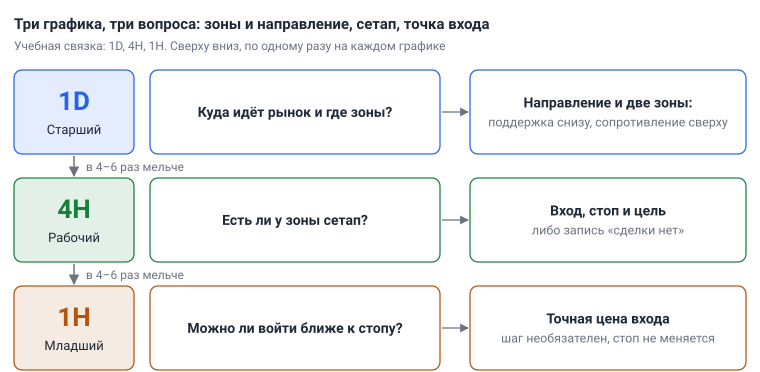
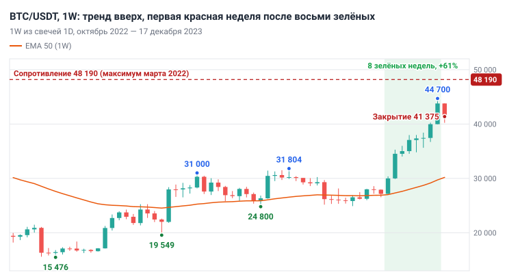
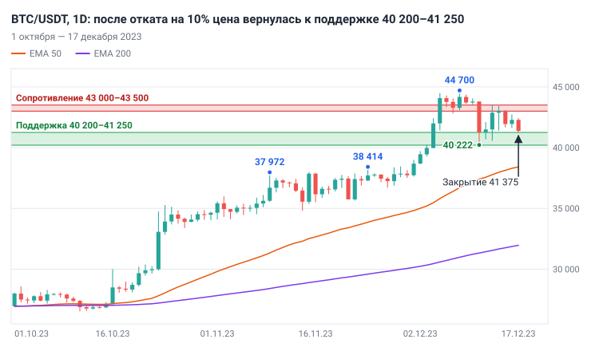
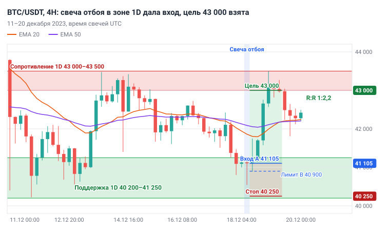

# Глава 8. Таймфреймы: где анализировать и где входить

> После этой главы вы умеете: назвать задачу старшего, рабочего и младшего таймфрейма и выбрать свой набор; по сочетанию 1D и 4H решить, искать сделку, ждать или пропустить; составить расписание проверок графика по закрытиям свечей в своём часовом поясе; посчитать, как более точный вход меняет стоп, размер позиции и R:R.

**Связь с курсом:** [ступень 01, урок 5 «Свечи и таймфреймы»](../01_Основы/05_Свечи_и_таймфреймы.md), [ступень 02, урок 7 «Анализ на нескольких таймфреймах»](../02_Анализ_графика/07_Несколько_таймфреймов.md), [шпаргалка «Таймфреймы и индикаторы»](../07_Справочник/Таймфреймы_и_индикаторы.md), [стратегия 1 «Тренд по EMA»](../04_Стратегии/01_Тренд_по_EMA.md), [уровень профи, урок 1 «Математическое ожидание»](../09_Уровень_профи/01_Математическое_ожидание.md).

## 8.1. Три таймфрейма — три вопроса

Анализируют на старшем таймфрейме, сетап ищут на рабочем, вход уточняют на младшем. У каждого графика одна задача, и результат работы на нём помещается в одну строку.

- **Старший таймфрейм** отвечает на вопрос «куда идёт рынок и где важные зоны». Результат: направление (вверх, вниз или боковик, он же флэт или диапазон) и две ближайшие зоны — поддержка снизу и сопротивление сверху.
- **Рабочий таймфрейм** отвечает на вопрос «есть ли у зоны сетап». **Сетап** — набор условий, при котором вы открываете сделку. Результат: цены входа, стопа и цели либо запись «сделки нет».
- **Младший таймфрейм** отвечает на вопрос «можно ли войти ближе к стопу». Результат: точная цена входа. Этот шаг необязателен.



*Рис. 8.1. Старший таймфрейм задаёт направление и зоны, рабочий показывает сетап, младший уточняет вход. В учебной связке это 1D, 4H и 1H.*

Три графика нужны потому, что крупное движение состоит из мелких. Откат на 1D выглядит на 4H как нисходящий тренд (вложенность структуры разобрана в [главе 4](04_Структура_рынка.md)). Кто смотрит только 4H, видит падение и продаёт прямо в поддержку старшего таймфрейма. Кто смотрит только 1D, видит тренд, но вынужден ставить стоп за дневную свечу. На BTC/USDT с января 2023 по октябрь 2026 медианный ATR(14) составил 3,37% цены на 1D и 1,25% на 4H: стоп по дневной свече почти втрое шире.

Соседние таймфреймы в наборе различаются в 4–6 раз. В свече 1D шесть свечей 4H, в свече 4H четыре свечи 1H. При меньшем шаге (4H и 2H) оба графика показывают одно и то же. При большем (1D и 5m) связь теряется: цена проводит в дневной зоне сотни свечей 5m, и сигнал «у зоны» перестаёт что-либо значить. Небольшие отклонения допустимы: между 1W и 1D шаг 7, между 15m и 5m — 3.

Подход описал Александр Элдер в системе «Три экрана» (Triple Screen), опубликованной в журнале Futures в 1986 году. Первый экран — трендовый индикатор на долгосрочном графике — задаёт направление, второй — осциллятор на графике помельче, третий определяет точную цену входа (ссылка — в разделе «Источники»). В учебнике роли экранов те же, но направление и место входа мы определяем по структуре и зонам, а индикаторы только подтверждают.

Три таймфрейма не повышают вероятность отдельного сигнала. Они убирают сделки против старшего тренда и сокращают стоп.

## 8.2. Наборы таймфреймов по стилям

Набор таймфреймов определяется тем, сколько длится ваша сделка. Четыре стиля торговли описаны в [главе 1](01_Что_такое_трейдинг.md); у каждого свой набор.

| Стиль | Старший | Рабочий | Младший | Сделка длится | Время у экрана |
|---|---|---|---|---|---|
| Скальпинг | 15m | 5m | 1m | минуты | часы подряд без отрыва |
| Внутри дня | 4H | 1H | 15m | часы | несколько часов в день |
| Свинг (учебная связка) | 1D | 4H | 1H | дни–недели | 30–60 минут в день |
| Позиционный | 1W | 1D | 4H | недели–месяцы | 1–2 часа в неделю |

Один и тот же график играет разные роли в разных наборах. 4H — старший для торговли внутри дня, рабочий для свинга и младший для позиционной торговли.

Новичку подходит третья строка: свечей мало, на решение есть часы, комиссия занимает малую долю риска. Причины с числами — в разделе 8.7.

## 8.3. Учебная связка: 1W, 1D, 4H и 1H

Учебная связка курса — 1D для тренда и зон, 4H для сетапа и входа. 1H подключается по желанию, 1W раз в неделю даёт общую картину.

| Таймфрейм | Когда смотреть | Что делать | Минут на монету | Что записать |
|---|---|---|---|---|
| 1W | раз в неделю, после закрытия недельной свечи | определить направление; отметить ближайшие недельные зоны сверху и снизу | 10 | одна строка: направление и две зоны |
| 1D | раз в день, после закрытия дневной свечи | структура (HH и HL или LH и LL); цена относительно EMA 50 и EMA 200; две ближайшие зоны; сценарий | 10–15 | направление, зоны с ценами, сценарий «если — то» |
| 4H | 2–3 раза в день, после закрытия свечи 4H | где цена относительно зон 1D; структура 4H; есть ли сигнал у зоны | около 5 на проверку; 15–20, если есть сигнал | «сетапа нет» или вход, стоп, цель, R:R |
| 1H | только когда на 4H уже есть сетап | найти вход ближе к стопу | 5–10 | цена лимитного ордера |

На 1W вы не торгуете. Недельный график предупреждает о том, что плохо видно на 1D: рядом крупная недельная зона или тренд прошёл большое расстояние без коррекции. Направление сделки задаёт 1D: сделка только по направлению 1D. Если 1W смотрит против 1D, рост на 1D — это коррекция внутри недельного снижения. Сделка разрешена, но цель ставится не дальше ближайшей недельной зоны.

На 1D работают инструменты предыдущих глав: структура ([глава 4](04_Структура_рынка.md)), зоны ([глава 5](05_Уровни_и_зоны.md)), EMA 50 и EMA 200 ([глава 7](07_Индикаторы_и_объём.md)). Итог анализа 1D — сценарий, записанный словами. Например: «1D вверх. Поддержка 40 200–41 250. Если цена войдёт в зону и на 4H появится сигнал — лонг, цель 43 000». Без сценария 4H открывать рано: вы будете смотреть на график, не зная, что на нём ищете.

На 4H вы проверяете одно: исполнилось ли условие сценария. Сигналы входа (триггеры) описаны в [главе 10](10_Модели_входа.md). Здесь используется самый простой — **свеча отбоя**: свеча с длинной нижней тенью у поддержки (у сопротивления — с длинной верхней). Свечу, после закрытия которой вы входите, называют **сигнальной**.

Для двух монет, BTC/USDT и ETH/USDT, весь цикл занимает 30–60 минут в день. Пошаговый порядок с бланком — в [главе 9](09_Алгоритм_анализа_сверху_вниз.md).

## 8.4. Где искать вход и зачем нужен младший таймфрейм

Вход ищут на рабочем таймфрейме и только там, где цена подошла к зоне старшего. В середине между зонами сделки нет: стопу негде встать, а цель слишком близко.

Порядок такой:

1. Цена вошла в зону 1D.
2. На 4H закрылась сигнальная свеча. Решение принимается только после закрытия.
3. Стоп — за экстремумом сигнальной свечи с запасом 0,5 × ATR(14) на 4H.
4. Цель — ближняя граница следующей зоны 1D.
5. Если до цели меньше двух расстояний до стопа, сделка пропускается.

Последний пункт — правило R:R. **R** — риск сделки: расстояние от входа до стопа, а в деньгах — сумма, которую вы теряете при срабатывании стопа. **R:R** — отношение риска к возможной прибыли; курс требует не меньше 1:2. Подробно — в [главе 11](11_Риск_менеджмент.md).

Младший таймфрейм нужен для одного: войти ближе к стопу. Уровень стопа при этом не меняется. Он стоит за экстремумом сетапа на 4H, потому что именно там идея становится неверной. Младший таймфрейм двигает вход, а не стоп.

Пример с круглыми числами. Депозит 10 000 $, риск 1%, то есть 100 $. Сигнальная свеча 4H закрылась на 60 000, стоп 58 500, цель 63 000. В варианте A вы покупаете сразу. В варианте B вы дождались отката на 1H и купили по 59 400 лимитным ордером — заявкой на покупку по заданной цене или лучше ([глава 2](02_Рынок_и_механика_торгов.md)).

| Параметр | A: вход по закрытию свечи 4H | B: точный вход |
|---|---|---|
| Вход | 60 000 | 59 400 |
| Стоп | 58 500 | 58 500 |
| Расстояние до стопа | 1 500 $ (2,5%) | 900 $ (1,5%) |
| До цели 63 000 | 3 000 $ | 3 600 $ |
| R:R | 1:2 | 1:4 |
| Размер позиции | 4 000 $ | 6 600 $ |
| Убыток по стопу | 100 $ | 100 $ |
| Прибыль на цели | 200 $ | 400 $ |

```
Размер позиции = (Депозит × Риск%) / Расстояние до стопа в %
A: 100 $ / 2,5%   = 4 000 $
B: 100 $ / 1,515% = 6 600 $
```

Вход сдвинулся на 600 $, то есть на 1% цены, а R:R вырос вдвое. Убыток по стопу остался прежним, потому что размер позиции считается от расстояния до стопа. У точного входа три цены.

- **Пропущенные сделки.** Цена может не вернуться к вашему ордеру и уйти к цели без вас.
- **Комиссия в R.** Комиссия берётся от размера позиции. При 0,1% за вход и 0,1% за выход она равна 0,08R в варианте A и 0,13R в варианте B. Правило курса: стоп не ближе десяти комиссий за круг. На споте при 0,1% за сделку это 2%, на фьючерсах при 0,05% — 1%; актуальные ставки смотрите на своей бирже. Стоп 1,5% на споте правило нарушает.
- **Крупная позиция.** 6 600 $ вместо 4 000 $: если стоп исполнится хуже заявленной цены, убыток в деньгах окажется больше.

Точный вход не повышает вероятность того, что зона устоит. Начинайте с варианта A: решений меньше, ошибок меньше. Младший таймфрейм добавляйте отдельным правилом в торговый план и проверяйте на истории, как любое изменение системы ([глава 13](13_Торговый_план_бэктест_журнал.md)).

## 8.5. Согласование таймфреймов

Расхождение 1D и 4H — обычное состояние рынка, а не поломка схемы. На BTC/USDT за 2019–2026 годы в восходящем тренде 1D 41% свечей 4H закрылись ниже EMA 50 на 4H. Коррекция на рабочем таймфрейме против старшего — источник входов.

Направление на каждом таймфрейме определяется одинаково: по структуре и EMA. Для 1D «вверх» — это HH и HL, цена выше EMA 200, EMA 50 выше EMA 200. «Вниз» — зеркально. Всё остальное — боковик.

| 1D | 4H | Что это | Действие |
|---|---|---|---|
| Вверх | Вниз | Коррекция в восходящем тренде | Ждать цену в зоне поддержки 1D. Лонг — после сигнала 4H у зоны |
| Вверх | Вверх | Тренд на обоих графиках, цена ушла от зоны | Не догонять. Оповещение перед ближайшей поддержкой, ждать отката |
| Вверх | Боковик | Пауза в тренде | Ждать отката к зоне 1D либо пробоя и ретеста (глава 10) |
| Боковик | Любой | Диапазон на 1D | В середине сделок нет. У границ — сделки от границ (стратегия 4 курса); новичку проще пропустить |
| Вниз | Вверх | Коррекция в нисходящем тренде | Лонги не искать. На фьючерсах без плеча — шорт от сопротивления 1D после сигнала 4H; на споте — вне рынка |
| Вниз | Вниз | Тренд вниз, цена ушла от зоны | Не догонять. Ждать отката к сопротивлению 1D или оставаться вне рынка |

Лучшее место для лонга даёт первая строка, хотя выглядит она тревожно: 4H падает. Вход получается у зоны, стоп короткий, до цели далеко. Во второй строке оба графика растут, но покупка там — это покупка на вершине импульса 4H: до поддержки далеко, и стоп либо длинный, либо стоит в случайном месте.

В первой строке вы входите, когда 4H формально ещё смотрит вниз. Ждать полного разворота 4H с новыми HH и HL не нужно: к этому моменту цена уйдёт от зоны, и R:R ухудшится. Сигнал у зоны — первый признак того, что коррекция заканчивается. Признак может оказаться ложным, и на этот случай стоит стоп.

Перед каждой проверкой 4H запишите, какая сейчас строка таблицы. Если действие — «ждать», график закрывается.

## 8.6. Расписание: закрытия свечей и оповещения

График открывают по расписанию закрытий свечей, а не когда нашлась свободная минута. Решения принимаются по закрытым свечам: незакрытая свеча за последние минуты может изменить форму ([глава 3](03_График_свечи_и_таймфреймы.md)).

На Binance, откуда взяты свечи учебника, свеча 1D закрывается в 00:00 UTC, свечи 4H — каждые четыре часа начиная с 00:00 UTC, свеча 1W — в понедельник в 00:00 UTC. Местное время получают, прибавив свой сдвиг.

| Событие | UTC | UTC+3 (Москва) | UTC+5 |
|---|---|---|---|
| Закрытие 1D | 00:00 | 03:00 | 05:00 |
| Закрытия 4H | 00:00, 04:00, 08:00, 12:00, 16:00, 20:00 | 03:00, 07:00, 11:00, 15:00, 19:00, 23:00 | 05:00, 09:00, 13:00, 17:00, 21:00, 01:00 |

Все шесть закрытий 4H смотреть не нужно. Достаточно двух-трёх, которые попадают в ваше свободное время. Пример распорядка для UTC+3 и двух монет:

| Время | Что делать | Минут |
|---|---|---|
| 07:00 | 1D: дневная свеча закрылась в 03:00 — обновить направление, зоны, сценарий. 4H: свеча, закрытая в 07:00. Поставить оповещения | 20–30 |
| 19:00 или 23:00 | 4H: исполнилось ли условие сценария | 10 |
| То же закрытие, если есть сигнал | Расчёт сделки и ордера | 15–20 |
| Понедельник, 07:00 | 1W: добавить к утренней проверке | 10 |

В UTC+5 те же действия удобно привязать к 09:00 и к 17:00 или 21:00. В обычный день выходит 30–40 минут, в день с сетапом — до часа.

**Оповещение** (alert) — уведомление, которое платформа присылает, когда цена достигает заданного уровня. Его ставят перед границей зоны 1D, обращённой к цене: чуть выше поддержки и чуть ниже сопротивления. Запас — 0,3–0,5 дневного ATR: цена нередко разворачивается, чуть не дойдя до границы, а запас даёт время открыть график до закрытия свечи ([глава 9](09_Алгоритм_анализа_сверху_вниз.md)). Пока оповещение молчит, между проверками на графике делать нечего. Когда оно сработало, дождитесь закрытия текущей свечи 4H. Оповещение означает «пора смотреть», а не «пора покупать».

Сигнальная свеча может закрыться ночью. Вариантов два: пропустить сделку или заранее выставить в зоне лимитный ордер со стопом и целью (способы входа — в [главе 10](10_Модели_входа.md)).

## 8.7. Почему не начинать с минутных графиков

На минутных графиках новичок платит в несколько раз больше комиссии на единицу риска и принимает в десятки раз больше решений. Навык при этом тот же.

Комиссия берётся от размера позиции, а риск задаёт расстояние до стопа. Чем ближе стоп, тем больше комиссия в R. Урок курса о математическом ожидании приводит числа для комиссии 0,1% за вход и 0,1% за выход: при стопе 0,5% она равна 0,40R, при 1% — 0,20R, при 2% — 0,10R, при 4% — 0,05R.

На 4H стоп в 1,5–2,5 ATR при медианном ATR 1,25% составляет 1,9–3,1% цены, и комиссия съедает 0,06–0,11R. На 1m и 5m свечи в разы меньше, стопы измеряются десятыми долями процента. При стопе 0,5% каждая сделка начинается с −0,40R. **Математическое ожидание** — средний результат системы на одну сделку в R ([глава 11](11_Риск_менеджмент.md)). Система с ожиданием +0,28R при таких стопах даёт −0,12R: на графике она прибыльна, на счёте убыточна.

Вторая причина — шум. **Шум** — движения цены, которые не меняют картину старшего таймфрейма. На BTC/USDT за 2019–2026 годы в дни, закрывшиеся ростом, 37% свечей 4H были красными. В сутках 6 свечей 4H, 288 свечей 5m и 1 440 свечей 1m. Каждая закрытая свеча — повод что-то сделать, и каждое лишнее действие оплачивается комиссией.

Навык дешевле нарабатывать на 4H: комиссия там около 0,1R, а на решение есть четыре часа.

## 8.8. Как выбрать свой набор

Набор выбирают по двум ограничениям: когда вы можете смотреть на график и как переносите открытую позицию.

1. **Время.** Выпишите часы, в которые вы каждый день можете уделить графику 10–15 минут, и сравните их с закрытиями свечей из раздела 8.6. Утро и вечер — это свинг или позиционная торговля. Торговля внутри дня требует нескольких часов подряд.
2. **Характер.** Если позиция, оставленная на ночь, мешает спать, уменьшите риск на сделку. Если за экраном вы не можете удержаться от лишних сделок, вам подходят старшие наборы: там график открывается по расписанию.
3. **Комиссия.** Проверьте типичный стоп набора по правилу десяти комиссий из раздела 8.4.
4. **Запись.** Внесите набор в торговый план одной строкой: «Старший 1D, рабочий 4H, младший 1H — только для уточнения входа».

Набор выбирается один раз и не меняется от сделки к сделке. Если в одной сделке направление взято с 1D, а в другой с 1H, в журнале смешаны две разные системы, и ни по одной статистика не набирается. Сменить набор можно, но как систему целиком: после разбора журнала и проверки на истории, а не посреди открытой сделки.

## 8.9. Разбор: BTC/USDT, 18 декабря 2023

Разбор показывает полный цикл на одной дате: 1W, 1D, 4H, сделка и два способа входа. Пример выбран задним числом как иллюстрация. Ниже — два случая, где тот же сценарий закончился иначе.

**1W, собран из свечей 1D, на закрытие 17 декабря.** Минимумы повышаются: 15 476 (ноябрь 2022), 19 549 (март 2023), 24 800 (июнь 2023). Максимумы тоже: 31 000, 31 804, 44 700. С 16 октября по 10 декабря — восемь зелёных недель подряд, рост на 61%. Неделя 11–17 декабря стала первой красной и закрылась на 41 375. Цена выше EMA 50 на 1W (30 182). Ближайшее недельное сопротивление — максимум марта 2022, 48 190: до него 16,5%. Запись: «1W вверх, сверху зона 48 190, после восьми недель роста коррекция ожидаема».



*Рис. 8.2. BTC/USDT, 1W (собран из 1D), октябрь 2022 — 17 декабря 2023. Недельный тренд вверх, до сопротивления 48 190 есть запас.*

**1D, на закрытие 17 декабря.** Закрытие 41 375, EMA 50 — 38 417, EMA 200 — 31 961. Максимумы растут: 37 972 (9 ноября), 38 414 (24 ноября), 44 700 (8 декабря). Минимумы тоже: 34 800, 35 632, 36 707. От 44 700 цена откатилась до 40 222 (11 декабря), на 10%. Зона поддержки — 40 200–41 250: дневные свечи 11, 12 и 13 декабря опускались в неё тенями (минимумы 40 222, 40 680, 40 555) и закрывались выше, самое низкое закрытие — 41 253. Зона сопротивления — 43 000–43 500: максимумы 13–15 декабря 43 475, 43 420 и 43 081, самое высокое закрытие — 43 022. Сценарий: «1D вверх, идёт коррекция. Если цена войдёт в зону 40 200–41 250 и на 4H закроется свеча отбоя — лонг до 43 000». Цена в 125 $ над зоной, условие может исполниться в ближайших свечах 4H.



*Рис. 8.3. BTC/USDT, 1D, 1 октября — 17 декабря 2023. Тренд вверх, коррекция на 10% привела цену к поддержке 40 200–41 250; сверху сопротивление 43 000–43 500.*

**4H, 18 декабря.** На 4H тренд вниз: максимумы снижаются — 43 475, 43 420, 42 724, 42 424, цена ниже EMA 20 и EMA 50. Это первая строка таблицы раздела 8.5. Свеча 08:00–12:00 UTC: открытие 41 126, максимум 41 270, минимум 40 543, закрытие 41 105. Нижняя тень — 562 $ из 727 $ диапазона, то есть 77%. Продавцы продавили цену вглубь зоны, покупатели вернули её к открытию. Свеча закрылась в 12:00 UTC: это 15:00 в UTC+3 и 17:00 в UTC+5.

Сделка при депозите 10 000 $ и риске 1%:

- стоп: 40 543 − 0,5 × 575 (ATR(14) на 4H) = 40 256, округляем до 40 250;
- цель: 43 000, ближняя граница сопротивления 1D;
- вариант A: покупка сразу после закрытия свечи по 41 105;
- вариант B: лимитный ордер на 40 900, у середины сигнальной свечи. На 1H вы искали бы то же самое — вход на откате внутрь сигнальной свечи.

| Параметр | A: по закрытию свечи 4H | B: лимитный ордер |
|---|---|---|
| Вход | 41 105 | 40 900 |
| Стоп | 40 250 | 40 250 |
| Расстояние до стопа | 855 $ (2,08%) | 650 $ (1,59%) |
| До цели | 1 895 $ | 2 100 $ |
| R:R | 1:2,2 | 1:3,2 |
| Размер позиции | 4 808 $ (0,117 BTC) | 6 292 $ (0,154 BTC) |
| Прибыль на цели | 222 $ | 323 $ |
| Комиссия 0,1% + 0,1% | 0,10R | 0,13R |



*Рис. 8.4. BTC/USDT, 4H, 11–20 декабря 2023. Коррекция дошла до зоны 1D, свеча отбоя 18 декабря дала вход; цель 43 000 достигнута через 12–16 часов.*

Следующая свеча опустилась до 40 888: ордер варианта B исполнился с запасом всего 12 $. Затем цена пошла вверх и в свече 00:00 UTC 19 декабря достигла 43 497. Цель взята через 12–16 часов после сигнала, стоп не задет. От 43 497 цена развернулась и в тот же день опускалась до 41 811: сопротивление сработало. Вариант B при том же риске 100 $ принёс на 46% больше. На споте он нарушает правило десяти комиссий: стоп 1,59% меньше 2%.

**26 ноября 2024: точный вход пропустил сделку.** 1D вверх, цена откатилась от 99 588 на 8,8% в зону 91 000–93 300, бывшее сопротивление середины ноября. Свеча 4H, открывшаяся в 20:00 UTC: минимум 90 791, закрытие 91 965, нижняя тень 57% диапазона. Вариант A: вход 91 965, стоп 89 900, цель 98 900, R:R 1:3,4; цель достигнута 4 декабря. Вариант B: лимитный ордер на середине свечи, 91 580, не исполнился. Минимум следующей свечи — 91 792, не хватило 212 $.

**19 декабря 2024: точный вход поймал убыток.** 1D вверх (закрытие 100 204 при EMA 50 на 91 607), цена упала от 108 353 в зону 99 200–100 000. Свеча 4H, открывшаяся в 00:00 UTC: минимум 98 802, закрытие 101 193, нижняя тень 56%. Стоп — 97 900. Вариант A: риск 3 293 $, до сопротивления 106 100 — 4 907 $, R:R 1:1,5. По правилу сделки нет. Вариант B: ордер на 100 050 даёт R:R 1:2,8. Он исполнился в свече 12:00 UTC, а в следующей свече цена упала до 96 251: стоп, −1R.

| Дата сигнала | A: вход по закрытию свечи 4H | B: точный вход |
|---|---|---|
| 18 декабря 2023 | +2,2R | +3,2R |
| 26 ноября 2024 | +3,4R | ордер не исполнен |
| 19 декабря 2024 | сделки нет, R:R 1:1,5 | −1R |
| Итого | +5,6R | +2,2R |

Три сделки ничего не доказывают: при другом подборе дат итог будет другим. Они показывают механизм. Лимитный ордер исполняется во всех сделках, которые идут к стопу, и пропускает часть тех, что сразу идут к цели. Какой способ входа лучше для вашей системы, решает проверка на истории ([глава 13](13_Торговый_план_бэктест_журнал.md)).

## 8.10. Типичные ошибки

- **Прыжки по таймфреймам в поисках подтверждения.** На 4H сигнала нет, и трейдер открывает 1H, 15m, 5m, пока не увидит что-то похожее. На мелком графике похожая свеча найдётся почти в любой момент и в любую сторону. Таймфреймы открываются сверху вниз и по одному разу; нет сигнала на рабочем — нет сделки.
- **Вход по младшему против старшего.** 1D падает, на 1H красивый разворот вверх, открыт лонг. Это покупка коррекции в нисходящем тренде: цель близко, а продавцы старшего таймфрейма ждут у ближайшего сопротивления.
- **Анализ снизу вверх.** Сигнал замечен на 15m, после этого открыты 4H и 1D, чтобы «проверить». Проверка превращается в поиск доводов за уже принятое решение ([глава 14](14_Психология.md)). Порядок один: 1W, 1D, 4H, затем 1H.
- **Смена набора внутри сделки.** Сделка по 4H идёт в минус, трейдер открывает 1D, «чтобы увидеть общую картину», и отодвигает стоп. Убыток в 1R становится убытком в несколько R. Двигать стоп дальше от цены запрещено при любом наборе.
- **Стоп по младшему таймфрейму.** Стоп переносят за минимум свечи 1H, чтобы увеличить позицию. Он оказывается внутри обычного колебания 4H и срабатывает до того, как идея проверена.

## 8.11. Запомнить

- Старший таймфрейм — направление и зоны, рабочий — сетап, младший — точка входа. Шаг между соседними — в 4–6 раз.
- Учебная связка: 1D, 4H и по желанию 1H; 1W — раз в неделю.
- Сделка только по направлению 1D и только у зоны 1D.
- 1D вверх и 4H вниз у зоны — место для лонга после сигнала. 1D вверх и 4H вверх — ждать отката.
- Младший таймфрейм двигает вход, а не стоп. Точный вход увеличивает R:R и позицию, но пропускает часть сделок и поднимает комиссию в R.
- Свечи 4H закрываются в 00, 04, 08, 12, 16 и 20 часов UTC, свеча 1D — в 00:00 UTC. Достаточно 2–3 проверок в день; между ними работают оповещения.
- Стоп 0,5% — комиссия 0,40R, стоп 2% — 0,10R. Поэтому старт — на 4H.
- Набор выбирается один раз и записывается в торговый план.

## 8.12. Практика на демосчёте

- [ ] Запишите в торговый план свой набор таймфреймов и местное время двух-трёх закрытий 4H, которые вы будете проверять каждый день.
- [ ] Откройте BTC/USDT на 1W, 1D и 4H по очереди. По каждому запишите результат из таблицы раздела 8.3. Уложитесь в 30 минут.
- [ ] Определите для BTC/USDT и ETH/USDT строку таблицы раздела 8.5 на сегодня и запишите действие.
- [ ] Поставьте по BTC/USDT два оповещения: над ближайшей поддержкой 1D и под ближайшим сопротивлением 1D, с запасом 0,3–0,5 дневного ATR.
- [ ] Найдите на истории BTC/USDT пять случаев: 1D вверх, цена в зоне поддержки 1D, на 4H закрылась свеча отбоя. Для каждого посчитайте варианты A и B (лимитный ордер на середине свечи) при депозите 10 000 $ и риске 1%: стоп, размер позиции, R:R, исход. Запишите, сколько раз ордер B не исполнился.
- [ ] Неделю открывайте график только по расписанию и по оповещениям. Каждое открытие вне расписания отмечайте в журнале.

## 8.13. Вопросы для самопроверки

1. На какой вопрос отвечает каждый из трёх таймфреймов и что записывается после работы на каждом?
2. Чем плох набор из 4H и 2H? Чем плох набор из 1D и 5m?
3. 1D в восходящем тренде, на 4H цена снижается к поддержке 1D. Что вы делаете и чего ждёте?
4. 1D вверх, 4H вверх, цена на 6% выше ближайшей поддержки. Почему это плохой момент для покупки?
5. 1D в нисходящем тренде, на 4H три зелёные свечи подряд и цена выше EMA 20. Ищете ли вы лонг?
6. Расчёт. Вы живёте в поясе UTC+5. В какое местное время закрывается свеча 4H, открывшаяся в 12:00 UTC? Во сколько закрывается дневная свеча?
7. Расчёт. ETH/USDT, депозит 10 000 $, риск 1%. Сигнальная свеча 4H закрылась на 3 000, стоп 2 910, цель 3 240. Найдите расстояние до стопа в процентах, R:R и размер позиции. Затем то же для лимитного входа на 2 960.
8. Расчёт. Комиссия на споте — 0,1% за сделку. Сколько R стоит круг при стопе 0,4%? Что останется от системы с ожиданием +0,28R? Проходит ли стоп из второй части вопроса 7 правило десяти комиссий?
9. Почему анализ снизу вверх приводит к плохим сделкам?
10. Почему набор таймфреймов нельзя менять от сделки к сделке?

## 8.14. Ответы

1. Старший: куда идёт рынок и где зоны; записываются направление и две зоны. Рабочий: есть ли у зоны сетап; записываются вход, стоп и цель либо «сделки нет». Младший: можно ли войти ближе к стопу; записывается цена входа.
2. У 4H и 2H шаг 2: второй график ничего не добавляет к первому. У 1D и 5m шаг 288: цена проводит в дневной зоне сотни свечей 5m, и сигнал на 5m не связан с зоной.
3. Это коррекция в восходящем тренде. Вы ставите оповещение над поддержкой, ждёте цену в зоне и закрытия сигнальной свечи 4H. До сигнала сделки нет.
4. Цена далеко от зоны: стоп за поддержкой длиннее 6%, а близкий стоп стоит в случайном месте. Вы ждёте отката.
5. Нет: сделка только по направлению 1D. На фьючерсах можно ждать сигнал для шорта у сопротивления 1D, на споте — оставаться вне рынка.
6. Свеча закрывается в 16:00 UTC, это 21:00 по местному времени. Дневная свеча закрывается в 00:00 UTC, то есть в 05:00.
7. Вход 3 000: до стопа 90 $, или 3,0%; до цели 240 $; R:R 1:2,7; позиция 100 $ / 3% = 3 333 $ (1,11 ETH). Вход 2 960: до стопа 50 $, или 1,69%; до цели 280 $; R:R 1:5,6; позиция 5 920 $ (2 ETH).
8. Круг стоит 0,2% позиции, при стопе 0,4% это 0,50R. От +0,28R остаётся −0,22R. Минимальный стоп на споте — 0,2% × 10 = 2%; стоп 1,69% правило не проходит, комиссия составит 0,12R.
9. Решение принимается на младшем графике, а старшие открываются уже для его подтверждения. Вы ищете доводы «за» и пропускаете главное: направление 1D и расстояние до зон.
10. Каждый набор — отдельная система со своими стопами и статистикой. При смешивании журнал не показывает, работает ли хоть одна из них, а переход на старший график внутри убыточной сделки обычно заканчивается переносом стопа.

## Источники

- DailyForex. The Elder Triple Screen Trading System — A Signal Confirmation Plan: https://dailyforex.com/forex-articles/2020/09/elder-triple-screen-system/151378 — авторство Александра Элдера, публикация в Futures Magazine в 1986 году, назначение трёх экранов.
