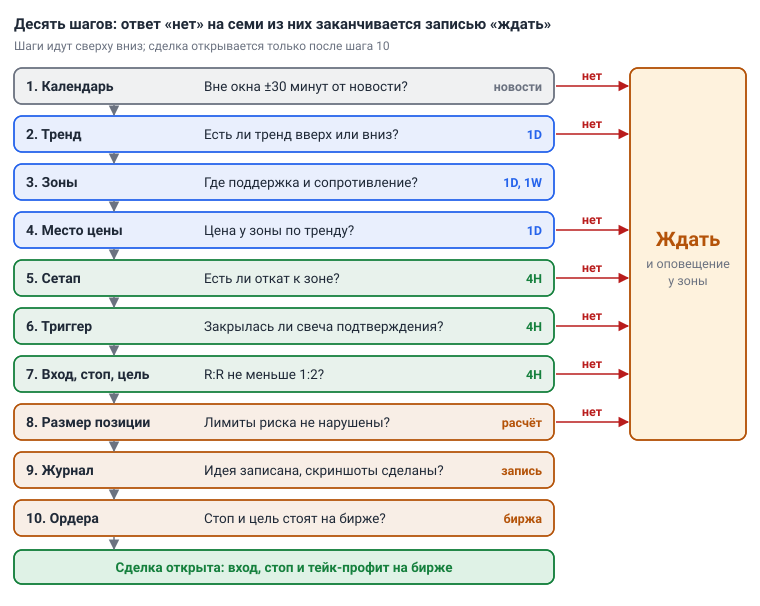
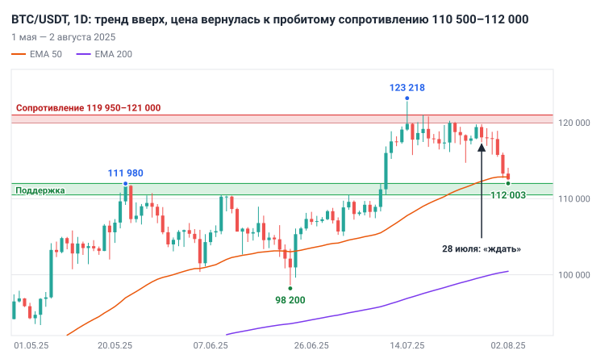
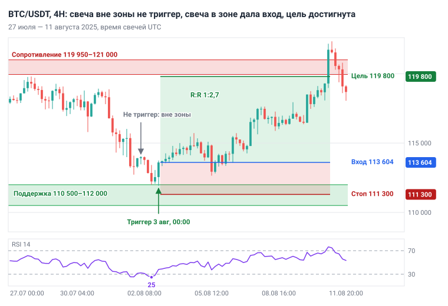
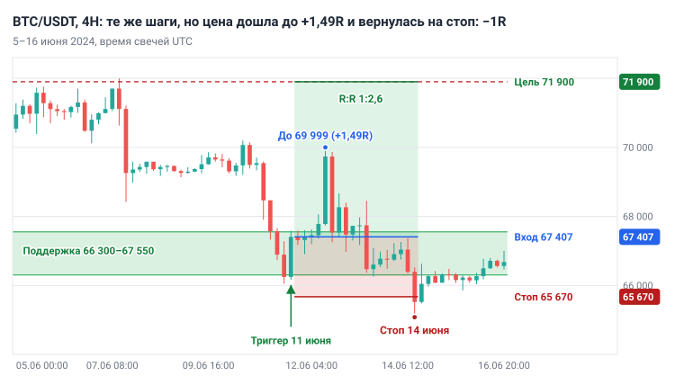

# Глава 9. Алгоритм анализа сверху вниз

> После этой главы вы умеете: пройти десять шагов анализа от календаря до ордера за 15–20 минут на монету; закончить анализ одной из трёх записей — «покупать при условии…», «продавать при условии…» или «ждать»; записать торговую идею одним абзацем со сценариями «если — то»; ждать цену у зоны по оповещениям, а не у экрана.

**Связь с курсом:** [ступень 02, урок 7 «Несколько таймфреймов»](../02_Анализ_графика/07_Несколько_таймфреймов.md), [чек-лист перед сделкой](../07_Справочник/Чек-лист_перед_сделкой.md), [стратегия 1 «Тренд по EMA»](../04_Стратегии/01_Тренд_по_EMA.md), [ступень 03, урок 4 «Размер позиции»](../03_Риск_менеджмент/04_Размер_позиции.md), [уровень профи, урок 6 «Режимы рынка и фильтры»](../09_Уровень_профи/06_Режимы_рынка_и_фильтры.md).

## 9.1. Один и тот же порядок каждый день

Анализ — это одна и та же последовательность шагов, которую вы проходите каждый день в одном порядке. **Анализ сверху вниз** (top-down analysis) начинается со старшего таймфрейма и спускается к младшему: 1D задаёт направление и зоны, 1W их проверяет, 4H показывает сетап и момент входа. Роли таймфреймов разобраны в [главе 8](08_Таймфреймы_анализ_и_вход.md); здесь они собраны в порядок действий.

Постоянный порядок нужен по двум причинам. Решение перестаёт зависеть от настроения: вы отвечаете на одни и те же вопросы и после прибыльной недели, и после убыточной. И ошибку можно найти: если сделка записана по шагам, в разборе видно, на каком шаге вы отступили от правил.

Результат анализа — одна из трёх записей:

- «покупать при условии…»;
- «продавать при условии…»;
- «ждать».

Четвёртого варианта нет: «посмотрю, как пойдёт» означает, что анализ не закончен. Запись «продавать» относится к шорту на фьючерсах без плеча; на споте при нисходящем тренде запись одна — «ждать». Она будет самой частой. Алгоритм устроен как цепочка фильтров, и большинство дней отсеивается на шагах 2–6.

| Шаг | Где | Вопрос | Когда запись «ждать» |
|---|---|---|---|
| 1. Календарь | новости | Вне окна ±30 минут от важной новости? | до новости или после неё меньше 30 минут |
| 2. Тренд | 1D | Есть ли тренд вверх или вниз? | тренда нет |
| 3. Зоны | 1D, 1W | Где поддержка и сопротивление? | шаг не останавливает |
| 4. Место цены | 1D | Цена у зоны по тренду? | цена между зонами |
| 5. Сетап | 4H | Есть ли откат к зоне? | сетапа нет |
| 6. Триггер | 4H | Закрылась ли свеча подтверждения? | свечи нет |
| 7. Вход, стоп, цель | 4H | R:R не меньше 1:2? | R:R меньше 1:2 |
| 8. Размер позиции | расчёт | Лимиты риска не нарушены? Сколько покупать при риске 1%? | лимит исчерпан |
| 9. Журнал | запись | Идея записана, скриншоты сделаны? | шаг не останавливает |
| 10. Ордера | биржа | Стоп и цель стоят на бирже? | шаг не останавливает |



*Рис. 9.1. Десять шагов анализа сверху вниз. Ответ «нет» на шагах 1, 2, 4, 5, 6, 7 и 8 заканчивается записью «ждать» и оповещением.*

Дальше каждый шаг описан одинаково: что смотреть, что записать, когда идти дальше и когда остановиться.

## 9.2. Шаг 1. Календарь и новости

Сначала вы проверяете, не выходит ли в ближайшие сутки новость, способная за минуты сдвинуть цену на величину вашего стопа. **Экономический календарь** — расписание публикаций статистики и решений центральных банков. Всплески волатильности на крипторынке дают три регулярных события из США.

| Событие | Что публикуют | Как часто | Время |
|---|---|---|---|
| Решение **FOMC** — комитета ФРС США по ставке | уровень ставки и заявление, затем пресс-конференция | восемь плановых заседаний в год [1] | заявление 30 июля 2025 вышло в 14:00 по Нью-Йорку [2] |
| **CPI** (Consumer Price Index) | индекс потребительских цен — показатель инфляции | ежемесячно; в августе 2025 — 12 августа [4] | 08:30 по Нью-Йорку [4] |
| Отчёт о занятости (Employment Situation), на рынке — **Nonfarm Payrolls** | число рабочих мест и безработица | ежемесячно, даты в расписании приходятся на пятницы [3] | 08:30 по Нью-Йорку [3] |

Время Нью-Йорка отстаёт от UTC на 4 часа летом и на 5 часов зимой. 08:30 — это 12:30 или 13:30 UTC, 14:00 — это 18:00 или 19:00 UTC.

Четвёртая группа — события самого крипторынка: решения регуляторов по биржевым фондам, взломы и остановки бирж, обновления сети монеты. Расписания у них нет, поэтому достаточно заголовков новостной ленты вашей биржи. Причину движения искать не нужно: вам нужно знать время, когда обычный стоп работает хуже.

**Что смотреть.** Официальные расписания ФРС и Бюро статистики труда США (ссылки в «Источниках») или любой экономический календарь с фильтром по стране и важности. Проверяйте их в начале недели.

**Что записать.** Дату и время UTC ближайшего события.

**Условие.** Событие не отменяет анализ, оно задаёт окно: за 30 минут до важной новости и 30 минут после неё сделки не открывают. В эти минуты спред расширяется, а стоп исполняется с проскальзыванием ([глава 2](02_Рынок_и_механика_торгов.md)). Если до события или после него меньше 30 минут — остановка до конца окна. Если событие выходит, пока позиция открыта, решение о ней принимают заранее ([глава 12](12_Сопровождение_и_выход.md)).

## 9.3. Шаги 2–4. Контекст на 1D: тренд, зоны, место цены

Шаги 2–4 отвечают на вопрос «в какую сторону и откуда»; пока на него нет ответа, график 4H не открывают.

**Шаг 2. Тренд на 1D.** Смотрите два признака. Первый — структура ([глава 4](04_Структура_рынка.md)): растущие максимумы и минимумы, HH и HL, при росте; падающие, LH и LL, при падении. Второй — EMA 50 и EMA 200 ([глава 7](07_Индикаторы_и_объём.md)): тренд восходящий, когда цена выше EMA 200 и EMA 50 выше EMA 200; нисходящий — зеркально.

Запишите направление и два последних экстремума с ценами. Если признаки согласны, направление сделок задано: при тренде вверх — только покупки, вниз — только продажи. Если структура и EMA расходятся или цена неделями пересекает EMA 50 туда и обратно, это боковик (он же флэт, диапазон). Система откатов по тренду в нём теряет, и запись — «ждать».

**Шаг 3. Зоны на 1D и 1W.** По правилам [главы 5](05_Уровни_и_зоны.md) отметьте ближайшую зону поддержки под ценой и ближайшую зону сопротивления над ценой. На 1W раз в неделю проверьте, нет ли между ними недельного экстремума: зона старшего таймфрейма сильнее. Запишите границы обеих зон. Заново разметку каждый день не рисуют: зоны живут неделями, вы проверяете только, не пробита ли одна из них закрытием 1D.

**Шаг 4. Место цены.** Сделку ищут только у зоны по тренду: в восходящем тренде — у поддержки, в нисходящем — у сопротивления. Измерьте расстояние от цены до обеих зон в долларах и в ATR(14) на 1D. Дальше идёте, когда цена внутри зоны или не дальше одного дневного ATR от её границы.

Цена между зонами — остановка. Причина арифметическая: стоп приходится ставить за дальнюю структуру, а цель упирается в ближнюю зону, и R:R оказывается меньше 1:2. В разборе раздела 9.8 он равен 0,73. Запись — «ждать» с условием: «покупать после отката в зону…».

## 9.4. Шаги 5–6. Сетап и триггер на 4H

На 4H вы ищете момент входа: направление задал шаг 2, место — шаг 4.

**Шаг 5. Сетап.** **Сетап** — заранее описанная ситуация на графике, в которой ваша система разрешает вход. В этой главе сетап один: откат к зоне по тренду. Остальные модели входа и оценка их качества — в [главе 10](10_Модели_входа.md). На 4H такой откат выглядит как серия падающих максимумов и минимумов, которая дошла до поддержки 1D.

Смотрите, коснулась ли цена зоны и где минимум отката. RSI 14 ниже 30 показывает, что падение было быстрым; это справка, а не сигнал. Запишите тип сетапа и минимум отката. Остановка: цена не дошла до зоны или свеча 1D закрылась ниже неё.

**Шаг 6. Триггер.** **Триггер** — событие, которое запускает подготовленную сделку ([глава 6](06_Паттерны.md)); в главе 8 такая свеча названа сигнальной. Здесь триггер один: зелёная свеча 4H, которая сама или вместе с предыдущей коснулась зоны и закрылась выше максимума предыдущей свечи. Она показывает, что от зоны пошли покупатели.

Главное слово — «закрытая». До закрытия свеча может развернуться и стереть сигнал ([глава 3](03_График_свечи_и_таймфреймы.md)). Свечи 4H закрываются в 00, 04, 08, 12, 16 и 20 часов UTC, и проверять график чаще незачем. Запишите время свечи и цену закрытия. Если свечи нет — «ждать следующего закрытия».

Таймфрейм 1H при желании уточняет вход уже после триггера. Здесь вход делается по закрытию свечи 4H.

## 9.5. Шаги 7–10. Числа, запись, ордера

После триггера решение принимает арифметика.

**Шаг 7. Вход, стоп, цель, R:R.** Вход — по цене закрытия триггерной свечи. Стоп — под минимумом отката с запасом 0,5 × ATR(14) на 4H: ниже этой цены идея «покупатели удержали зону» неверна. Цель — перед ближайшей зоной сопротивления 1D.

```
Риск      = Вход − Стоп
Потенциал = Цель − Вход
R:R       = Потенциал / Риск
```

Остановка: R:R меньше 1:2. Отодвигать цель, чтобы получить 1:2, нельзя: цель задаёт зона на графике. Вторая проверка — комиссия: стоп не ближе десяти комиссий за круг. На споте с комиссией 0,1% за сделку это 2%; ставки своей биржи проверьте сами.

**Шаг 8. Размер позиции.** Формула курса:

```
Размер позиции = (Депозит × Риск%) / Расстояние до стопа в %
```

Риск — 1% депозита. Перед расчётом проверьте лимиты из [главы 11](11_Риск_менеджмент.md): дневной лимит потерь 3% не достигнут, сегодня не было двух убыточных сделок подряд, общий открытый риск вместе с новой сделкой не больше 3%. BTC и ETH в одну сторону считаются одной позицией. Любой нарушенный лимит — остановка.

**Шаг 9. Запись и скриншот.** До ордера запишите в журнал идею (раздел 9.6), числа шагов 7–8 и сохраните два скриншота: 1D с зонами и 4H с триггером. Запись до сделки фиксирует план, пока результат неизвестен; после выхода память подгоняет причины под исход. Журнал описан в [главе 13](13_Торговый_план_бэктест_журнал.md).

**Шаг 10. Ордера.** Сделка — это три ордера: вход, стоп-лосс и тейк-профит; стоп и тейк-профит связаны OCO: исполнение одного отменяет другой ([глава 2](02_Рынок_и_механика_торгов.md)). Проверьте в списке ордеров цену и объём каждого. После этого анализ закончен, и график закрывают до следующего закрытия свечи 4H.

## 9.6. Торговая идея и сценарии «если — то»

**Торговая идея** — абзац, по которому другой человек поймёт, что вы делаете, почему и при каком условии откажетесь от плана. Шаблон:

```
[Пара], [дата]. Тренд 1D: [вверх / вниз], потому что [структура, EMA].
Цена у зоны [границы]: это [поддержка / сопротивление], потому что [касания].
Сетап на 4H: [какой]. Триггер: [свеча, время, цена закрытия].
Вход [цена], стоп [цена, почему там], цель [цена, что там].
R:R [число]. Риск [% и $], размер [$].
Отмена: [условие]. Календарь: [событие, дата].
```

**Сценарий** — заранее записанное «если — то». Их два. Основной описывает, что должно произойти, чтобы вы вошли. Отменяющий описывает, после чего идея снимается. Пример для покупки от поддержки 110 500–112 000:

- основной: «если свеча 4H коснётся зоны и закроется выше максимума предыдущей свечи — покупать»;
- отменяющий: «если свеча 1D закроется ниже 110 500 — зона пробита, идея снята, возвращаюсь к шагу 2».

Сценарии пишут до того, как цена пришла к зоне. В момент движения вы уже не решаете, а сверяете график с записью. Без отменяющего сценария идея превращается в надежду: цена ушла под зону, а вы продолжаете ждать разворот и ищете новые доводы за покупку. Отменяющий сценарий не заменяет стоп-лосс: стоп закрывает открытую позицию, а отмена убирает из списка идею, по которой входа ещё не было.

## 9.7. Список наблюдения, оповещения и бюджет времени

Запись «ждать» становится действием, когда к ней привязано оповещение. **Список наблюдения** (watchlist) — таблица монет с действующей записью анализа: направление, зона, условие входа, условие отмены. В первые месяцы в ней две строки: BTC/USDT и ETH/USDT.

**Оповещение** (alert) — уведомление платформы о том, что цена достигла заданного уровня. Базовое место — граница зоны, обращённая к цене ([глава 8](08_Таймфреймы_анализ_и_вход.md)). Цена нередко разворачивается, чуть не дойдя до границы, поэтому здесь оповещение стоит с запасом: на 0,3–0,5 дневного ATR раньше. Второе оповещение ставят на уровень отмены. Оповещение — не сигнал на вход. Это приглашение пройти шаги 5–10 к ближайшему закрытию свечи 4H.

На монету уходит 15–20 минут в день, и делятся они на два прохода.

| Проход | Когда | Шаги | Время на монету |
|---|---|---|---|
| Утренний | после закрытия свечи 1D в 00:00 UTC; удобно после закрытия 4H в 04:00 UTC (07:00 по Москве) | 1–4, обновление списка и оповещений | 10–15 минут |
| Вечерний | после закрытия 4H в 16:00 или 20:00 UTC (19:00 или 23:00 по Москве) | 5–6 там, где цена у зоны; при триггере 7–10 | 5 минут без триггера, 15–20 с триггером |
| По оповещению | к ближайшему закрытию 4H | 5–10 | 15–20 минут |

Если на монету уходит больше 20 минут, вы, скорее всего, ищете сделку там, где алгоритм уже ответил «ждать». Расписание закрытий для других часовых поясов — в главе 8.

## 9.8. Разбор 1. Утро 28 июля 2025: «ждать»

Частый исход анализа — остановка на шаге 4, и этот день её показывает. BTC/USDT, утренний проход 28 июля 2025; свеча 1D за 27 июля закрылась на 119 416.

**Шаг 1.** На неделе два события: решение FOMC 30 июля в 18:00 UTC [1][2] и отчёт о занятости 1 августа в 12:30 UTC [4]. Оба записаны, анализ продолжается.

**Шаг 2.** Структура 1D: минимум 7 апреля 74 508, максимум 22 мая 111 980, минимум 22 июня 98 200, максимум 14 июля 123 218. Максимумы и минимумы растут. Цена 119 416 выше EMA 200 (99 496), EMA 50 (112 059) выше EMA 200. Запись: «1D вверх, только покупки».

**Шаг 3.** Поддержка — 110 500–112 000. В эту область упирались максимумы 22 мая (111 980), 27 мая (110 718), 9 июня (110 530) и 3 июля (110 529). 10 июля день закрылся на 116 010, выше зоны, и сопротивление сменило роль. Сопротивление — 119 950–121 000: шесть дневных максимумов с 16 по 27 июля лежат между 119 767 и 120 999, самое высокое закрытие — 119 954. Над ним — максимум 123 218. На 1W неделя 7–13 июля закрылась на 119 087: пробой подтверждён и недельной свечой.

**Шаг 4.** Цена на 534 $ ниже сопротивления и на 7 416 $ выше поддержки, это 2,66 дневного ATR. Покупка отсюда выглядела бы так: стоп под минимумом 25 июля (114 723) с запасом — 114 250, риск 5 166 $; цель перед максимумом — 123 200, потенциал 3 784 $; R:R 0,73. Остановка.

Запись в списке наблюдения: «Ждать. Покупать при условии: откат в зону 110 500–112 000 и свеча подтверждения на 4H. Отмена: закрытие 1D ниже 110 500». Оповещение — на 113 000, в 1 000 $ над зоной (0,36 дневного ATR). На всё ушло около 15 минут.

## 9.9. Разбор 2. 1–11 августа 2025: десять шагов до результата

Оповещение на 113 000 сработало вечером 1 августа: свеча 4H, открывшаяся в 20:00 UTC, опустилась до 112 723. С этого момента график проверялся на каждом закрытии свечи 4H. Ниже — проход утром 3 августа.

**Шаг 1.** Ближайшее событие — CPI 12 августа в 12:30 UTC [4]. В ближайшие сутки событий нет.

**Шаг 2.** Свеча 1D за 2 августа закрылась на 112 546. EMA 50 — 112 850, EMA 200 — 100 450. Цена на 0,27% ниже EMA 50: откат дошёл до средней. Условия тренда выполнены: цена выше EMA 200, EMA 50 выше EMA 200, структура прежняя. «1D вверх».

**Шаг 3.** Зоны те же: поддержка 110 500–112 000 шириной 1 500 $ (0,54 дневного ATR), сопротивление 119 950–121 000.

**Шаг 4.** Минимум 2 августа — 112 003, в 3 $ от верхней границы поддержки; оповещение ровно на 112 000 в этот день промолчало бы. Цена у зоны по тренду, можно открывать 4H.



*Рис. 9.2. BTC/USDT, 1D, 1 мая — 2 августа 2025. Шаги 2–4: тренд вверх, цена вернулась к пробитому сопротивлению. 28 июля цена стояла под сопротивлением, и запись была «ждать». Минимум 7 апреля остался за левым краем.*

**Шаг 5.** На 4H цена за шесть дней откатилась от 119 800 (максимум 28 июля) к зоне, это −6,6%; RSI 14 опускался до 25. Сетап — откат к зоне по тренду.

**Шаг 6.** Три закрытия подряд:

| Свеча 4H, открытие UTC | Минимум | Закрытие | Максимум предыдущей | Триггер |
|---|---|---|---|---|
| 2 августа, 16:00 | 112 003 | 112 229, свеча красная | 113 787 | нет |
| 2 августа, 20:00 | 112 070 | 112 546 | 113 420 | нет: закрытие ниже максимума предыдущей |
| 3 августа, 00:00 | 111 920 | 113 604 | 113 059 | да |

Свеча 3 августа зашла в зону и в 04:00 UTC закрылась выше максимума предыдущей.

Днём раньше была похожая свеча. 2 августа свеча 04:00 UTC закрылась на 113 982, выше максимума предыдущей (113 922). Триггером она не была: откат к тому моменту остановился на 112 723, в 723 $ над зоной, и условие шага 5 не выполнялось. Вход по ней со стопом 112 107 был бы выбит в тот же день свечой 16:00 UTC: −1R.

**Шаг 7.** Вход 113 604. ATR(14) на 4H равен 1 222, стоп = 111 920 − 0,5 × 1 222 = 111 309, округлён до 111 300. Цель перед сопротивлением — 119 800.

```
Риск      = 113 604 − 111 300 = 2 304 $ (2,028%)
Потенциал = 119 800 − 113 604 = 6 196 $ (5,45%)
R:R       = 6 196 / 2 304 = 2,69
```

R:R больше 1:2. Стоп 2,03% не ближе десяти комиссий за круг на споте (2%).

**Шаг 8.** Депозит 1 000 $, риск 1% = 10 $.

```
Размер позиции  = 10 / 0,02028 = 493 $, это 0,00434 BTC
Убыток по стопу = 0,00434 × 2 304 = 10,0 $
Прибыль на цели = 0,00434 × 6 196 = 26,9 $
```

Сделок в этот день не было, открытых позиций нет, лимиты не затронуты.

**Шаг 9.** Запись в журнале:

> BTC/USDT, 3 августа 2025. Тренд 1D вверх: максимум 123 218 выше майского, минимум 98 200 выше апрельского, цена выше EMA 200. Цена в поддержке 110 500–112 000: бывшее сопротивление, четыре касания. Сетап 4H: откат к зоне. Триггер: свеча 00:00 UTC, закрытие 113 604 выше максимума предыдущей. Вход 113 604, стоп 111 300 (под минимумом отката 111 920 минус 0,5 ATR), цель 119 800 (перед сопротивлением 119 950–121 000). R:R 2,69. Риск 1% = 10 $, размер 493 $. Отмена: закрытие 1D ниже 110 500. Календарь: CPI 12 августа.

К записи приложены скриншоты 1D и 4H.

**Шаг 10.** Покупка 0,00434 BTC, стоп-лосс на 111 300 и тейк-профит на 119 800 в связке OCO. Вся позиция закрывается на цели, чтобы результат считался в R без поправок. Частичная фиксация из правил учебника — половина позиции на первой цели не ближе 2R, остаток трейлингом по структуре 4H — разобрана в [главе 12](12_Сопровождение_и_выход.md).

**Результат.** 5 августа цена опускалась до 112 650: это −0,41R, до стопа оставалось 1 350 $. 10 августа максимум составил 119 311, в 489 $ от цели. Свеча 4H, открывшаяся 11 августа в 00:00 UTC, прошла 119 800, и тейк-профит исполнился на восьмые сутки после входа. Итог +2,69R: +26,9 $ до комиссий, около +25,9 $ после комиссии спота.



*Рис. 9.3. BTC/USDT, 4H, 27 июля — 11 августа 2025. Шаги 5–7 и результат: свеча 2 августа вне зоны триггером не была, свеча 3 августа дала вход 113 604; цель 119 800 достигнута 11 августа.*

Алгоритм здесь сделал три вещи: 28 июля запретил покупку под сопротивлением, 2 августа не принял свечу вне зоны, 3 августа выдал все числа до входа. Результат он не предсказывал.

## 9.10. Те же шаги, убыточная сделка: июнь 2024

Один удачный разбор ничего не доказывает: тот же порядок шагов регулярно заканчивается стопом. BTC/USDT, 11 июня 2024.

**Шаги 2–3.** 10 июня день закрылся на 69 540, выше EMA 50 (66 973) и EMA 200 (56 854); с минимума 1 мая (56 553) цена поднялась до 71 997. Поддержка — 66 300–67 550 по минимумам 23–31 мая. Сопротивление — два максимума: 71 979 (21 мая) и 71 997 (7 июня).

**Шаги 4–6.** 11 июня цена упала в зону. Свеча 4H 12:00 UTC дала минимум 66 051, следующая закрылась на 67 407, выше её максимума 67 279.

**Шаги 7–8.** Вход 67 407. Стоп = 66 051 − 0,5 × 760 = 65 670. Цель — 71 900. Риск 1 737 $ (2,58%), R:R 2,59. Размер позиции = 10 / 0,02577 = 388 $.

**Результат.** 12 июня цена поднялась до 69 999 (+1,49R) и развернулась. 14 июня свеча 4H 16:00 UTC с минимумом 65 078 выбила стоп. Итог −1R, то есть −10 $.



*Рис. 9.4. BTC/USDT, 4H, 5–16 июня 2024. Откат в зону 66 300–67 550, триггер 11 июня, рост до +1,49R и стоп 14 июня.*

Все шаги выполнены, правила соблюдены, сделка убыточна. Это обычный исход, а не ошибка анализа. Для этой главы похожие ситуации грубо отобраны скриптом на BTC/USDT с августа 2019 по октябрь 2026: возврат к пробитому максимуму 1D, свеча подтверждения на 4H, цель на максимуме перед откатом, R:R от 1:2. Нашлось 38 случаев: 8 дошли до цели, 30 — до стопа, сумма −0,1R. Проверка с немного другими правилами (свеча 4H или предыдущая у пробитого максимума, стоп под минимумом этих двух свечей) дала 88 сделок: 21 цель, 67 стопов, сумма +24R, из них +19R принесла одна сделка сентября 2025. Без неё итог около +5R на 88 сделок. Результат такой выборки сильно зависит от мелких деталей правил и от одной-двух крупных сделок; три сделки из четырёх закрываются по стопу.

Вывод: алгоритм упорядочивает решение и ограничивает убыток одним R, но прибыльным его делает не порядок шагов. Преимущество дают отбор качества сетапов ([глава 10](10_Модели_входа.md)), сопровождение ([глава 12](12_Сопровождение_и_выход.md)) и проверка правил на 100 сделках истории ([глава 13](13_Торговый_план_бэктест_журнал.md)).

## 9.11. Бланк анализа

**Бланк анализа** — те же десять шагов в виде таблицы, которую вы заполняете каждый день по каждой монете. Ответ «нет» в графе условия заканчивает анализ, и в итог пишется «ждать». Справа — заполнение на 3 августа 2025.

| Шаг | Что записать | Условие перехода | BTC/USDT, 3 августа 2025 |
|---|---|---|---|
| 1. Календарь | ближайшее событие, время UTC | до события и после него больше 30 минут | CPI 12 августа, 12:30 |
| 2. Тренд 1D | направление; экстремумы; цена, EMA 50, EMA 200 | структура и EMA согласны | вверх; 123 218 и 98 200; 112 546, 112 850, 100 450 |
| 3. Зоны 1D, 1W | границы поддержки и сопротивления | нет | 110 500–112 000; 119 950–121 000 |
| 4. Место цены | расстояние до зон | цена у зоны по тренду | минимум 112 003, у поддержки |
| 5. Сетап 4H | тип, экстремум отката | сетап из плана | откат к зоне; 111 920 |
| 6. Триггер 4H | время и закрытие свечи | свеча закрыта | 00:00 UTC; 113 604 |
| 7. Вход, стоп, цель | три цены и R:R | R:R не меньше 1:2 | 113 604, 111 300, 119 800; 2,69 |
| 8. Размер | риск в $, размер позиции | лимиты не нарушены | 10 $; 493 $ |
| 9. Журнал | идея и два скриншота | запись сделана | да |
| 10. Ордера | вход, стоп, тейк-профит | стоп и тейк стоят на бирже | да, OCO |
| Итог | одна из трёх записей | нет | покупка открыта |

Бланк не заменяет [чек-лист перед сделкой](../07_Справочник/Чек-лист_перед_сделкой.md) из курса: чек-лист — последняя проверка между шагами 9 и 10, перед ордерами. Семь из восьми его вопросов повторяют шаги: тренд 1D — шаг 2, сетап из стратегии — шаги 5–6, место стопа и R:R — шаг 7, риск, размер и дневной лимит — шаг 8, запись в журнал — шаг 9. Восьмой вопрос, «я спокоен, не пытаюсь отыграться?», алгоритм не задаёт; о нём [глава 14](14_Психология.md). Любой ответ «нет» — сделки нет.

## 9.12. Типичные ошибки

- **Анализ снизу вверх.** Сначала замечена свеча на 4H, потом на 1D подбираются доводы в её пользу. Итог — сделки против дневного тренда и вне зон.
- **Покупка между зонами.** Шаг 4 пропущен, потому что «тренд же вверх». 28 июля 2025 такая покупка имела R:R 0,73.
- **Свеча вместо триггера.** Зелёная свеча вне зоны или вход до её закрытия. 2 августа 2025 это стоило бы −1R за несколько часов до настоящего триггера.
- **Подгонка цели.** Цель отодвинута за зону сопротивления, чтобы получить 1:2. Цена разворачивается у зоны, и сделка закрывается по стопу.
- **Идея без условия отмены.** Зона пробита, а монета остаётся в списке «на покупку», и каждый следующий отскок кажется входом.
- **Длинный список.** Десять монет по 20 минут — больше трёх часов в день. Анализ сокращается до взгляда на график, и шаги начинают выпадать.

## 9.13. Запомнить

- Анализ — десять шагов в одном порядке: календарь, тренд 1D, зоны, место цены, сетап 4H, триггер, числа, размер, запись, ордера.
- Результат — одна из трёх записей: «покупать при условии…», «продавать при условии…», «ждать».
- Любой ответ «нет» на шагах 1, 2, 4, 5, 6, 7 и 8 — остановка. «Ждать» — самый частый результат.
- Триггер — только закрытая свеча 4H, коснувшаяся зоны.
- R:R меньше 1:2 — сделки нет. Цель задаёт зона, а не желаемое соотношение.
- У каждой идеи два сценария: основной и отменяющий. Оба записаны до подхода цены к зоне.
- «Ждать» означает оповещение у зоны и закрытый график. На монету — 15–20 минут в день.
- Алгоритм не предсказывает исход: он ограничивает убыток одним R и делает ошибки видимыми.

## 9.14. Практика на демосчёте

- [ ] Семь дней подряд заполняйте бланк по BTC/USDT и ETH/USDT в утренний проход. Результат: 14 бланков, итог каждого — одна из трёх записей, время на монету не больше 20 минут.
- [ ] На BTC/USDT, 1D закройте всё правее 27 июля 2025 и отметьте зоны по шагу 3. Результат: ваша поддержка отличается от 110 500–112 000 не больше чем на 300 $.
- [ ] К каждой записи «ждать» поставьте два оповещения: перед зоной и на уровне отмены. Результат: в списке наблюдения у каждой монеты есть зона, условие входа, условие отмены и два оповещения.
- [ ] Найдите на истории BTC/USDT три дня, когда цена в восходящем тренде 1D стояла в поддержке, и пройдите шаги 5–8 по закрытиям свечей 4H. Результат: три бланка с результатом в R; среди них может не быть ни одной прибыльной сделки.
- [ ] Первую идею на демосчёте запишите по шаблону раздела 9.6 до ордера. Результат: по записи без графика восстанавливаются вход, стоп, цель и условие отмены.

## 9.15. Вопросы для самопроверки

1. Какими тремя записями может закончиться анализ?
2. Почему анализ начинают с 1D, а не с 4H?
3. На каких шагах алгоритм может остановиться и что вы тогда делаете?
4. Какие три события из США проверяют на шаге 1 и как часто они выходят?
5. Тренд 1D вверх, цена посередине между поддержкой и сопротивлением. Что записать и что поставить на графике?
6. Чем отменяющий сценарий отличается от стоп-лосса?
7. Оповещение у зоны сработало. Можно ли сразу покупать?
8. Расчёт. ETH/USDT: вход 3 000, стоп 2 925, цель 3 180, депозит 1 000 $, риск 1%. Найдите расстояние до стопа в процентах, R:R и размер позиции.
9. Расчёт. BTC/USDT, тренд 1D вверх. Триггер 4H закрылся на 84 000, минимум отката 82 600, ATR(14) на 4H равен 800, цель перед сопротивлением 1D — 87 000. Найдите стоп и R:R. Что записать?
10. Расчёт. В сделке из раздела 9.9 вход 113 604 и стоп 111 300. Представьте, что зона сопротивления начиналась бы ниже и цель стояла бы на 117 000. Прошла бы сделка шаг 7?

## 9.16. Ответы

1. «Покупать при условии…», «продавать при условии…», «ждать».
2. 1D задаёт направление и зоны. Свеча 4H без этого контекста — движение без известной стороны и места, и сделка по ней часто идёт против дневного тренда.
3. На шагах 1, 2, 4, 5, 6, 7 и 8. Запись «ждать», условие будущего входа, условие отмены и оповещение у зоны.
4. Решение FOMC по ставке — восемь плановых заседаний в год; CPI и отчёт о занятости — ежемесячно. Точные даты берут из официальных расписаний.
5. «Ждать. Покупать при условии: откат в зону поддержки и свеча подтверждения на 4H». Оповещения — перед зоной и на уровне отмены.
6. Стоп-лосс закрывает открытую позицию. Отменяющий сценарий снимает идею, по которой входа ещё не было, и возвращает к шагу 2.
7. Нет. Оповещение приглашает пройти шаги 5–10 к ближайшему закрытию свечи 4H. Покупка возможна после триггера и расчёта R:R.
8. Стоп: 75 / 3 000 = 2,5%. R:R = 180 / 75 = 2,4. Размер = 10 / 0,025 = 400 $, это 0,1333 ETH.
9. Стоп = 82 600 − 0,5 × 800 = 82 200. Риск 1 800 $ (2,14%), потенциал 3 000 $, R:R 1,67. Запись «ждать»: для 1:2 цель должна стоять на 87 600, а это уже за началом сопротивления.
10. Нет. Потенциал 117 000 − 113 604 = 3 396 $, риск 2 304 $, R:R 1,47. Это меньше 1:2, запись — «ждать».

## Источники

1. Federal Reserve Board. [Календарь заседаний FOMC](https://www.federalreserve.gov/monetarypolicy/fomccalendars.htm) — восемь плановых заседаний в год; заседание 29–30 июля 2025.
2. Federal Reserve Board. [Federal Reserve issues FOMC statement, 30 июля 2025](https://www.federalreserve.gov/newsevents/pressreleases/monetary20250730a.htm) — время публикации заявления: 14:00 по Нью-Йорку.
3. U.S. Bureau of Labor Statistics. [Schedule of Releases for the Employment Situation](https://www.bls.gov/schedule/news_release/empsit.htm) — ежемесячные даты отчёта о занятости, 08:30.
4. U.S. Bureau of Labor Statistics. [Расписание публикаций на август 2025](https://www.bls.gov/schedule/2025/08_sched.htm) — отчёт о занятости 1 августа и CPI 12 августа 2025, 08:30.
