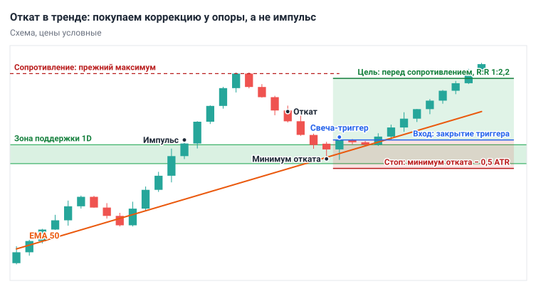
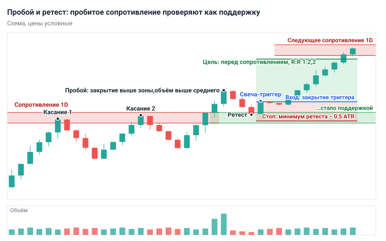
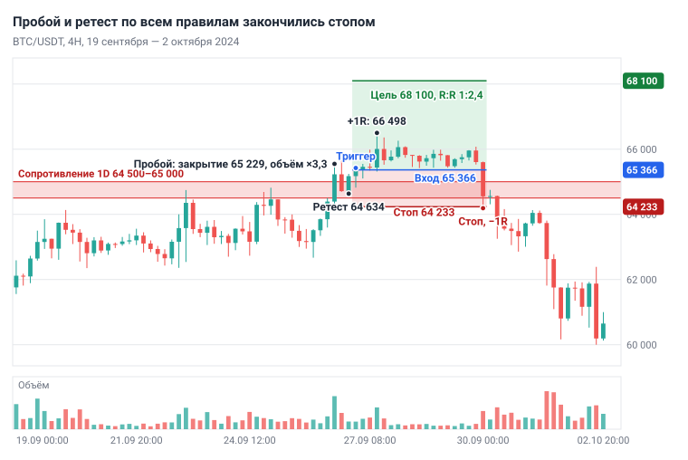
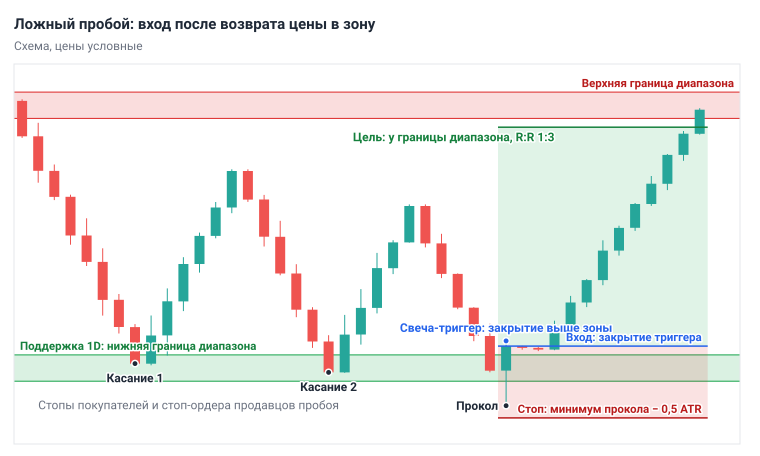
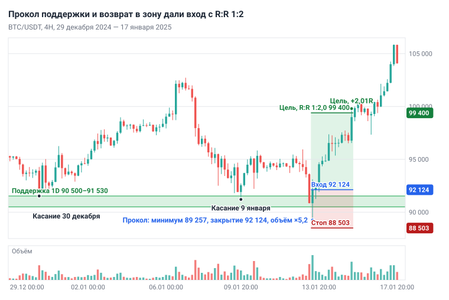

# Глава 10. Модели входа

> После этой главы вы умеете: записать вход семью пунктами — от условия на 1D до условий отмены; найти на графике три модели («Откат в тренде», «Пробой и ретест», «Ложный пробой») и посчитать для каждой вход, стоп, цель и R:R; выбрать способ входа и оценить качество сетапа до сделки.

**Связь с курсом:** [стратегия 1 «Тренд по EMA»](../04_Стратегии/01_Тренд_по_EMA.md), [стратегия 2 «Отскок от уровня»](../04_Стратегии/02_Отскок_от_уровня.md), [стратегия 3 «Пробой и ретест»](../04_Стратегии/03_Пробой_и_ретест.md), [стратегия 4 «Боковик»](../04_Стратегии/04_Боковик.md), [стратегия 5 «Дивергенция RSI»](../04_Стратегии/05_RSI_дивергенция.md), [шаблон разбора стратегии](../04_Стратегии/Шаблон_разбора_стратегии.md); [ступень 03, урок 2 «Где ставить стоп и тейк»](../03_Риск_менеджмент/02_Стоп_и_тейк.md) и [урок 3 «Риск к прибыли»](../03_Риск_менеджмент/03_Риск_к_прибыли.md); [уровень профи, урок 5 «Микроструктура и деривативы»](../09_Уровень_профи/05_Микроструктура_и_деривативы.md) и [урок 8 «Исполнение и безопасность»](../09_Уровень_профи/08_Исполнение_и_безопасность.md).

## 10.1. Модель входа: семь пунктов

**Модель входа** — полный набор правил одной сделки, записанный до того, как цена подошла к зоне. Алгоритм из [главы 9](09_Алгоритм_анализа_сверху_вниз.md) задаёт порядок проверки графика. Модель говорит, что именно должно произойти на графике, чтобы вы выставили ордер.

В модели семь пунктов. Если хоть один не записан, решение по нему придётся принимать при открытом графике, когда цена уже движется.

| № | Пункт | На какой вопрос отвечает |
|---|---|---|
| 1 | Условие на 1D | Разрешено ли направление сделки |
| 2 | Сетап на 4H | Пришла ли цена туда, где модель работает |
| 3 | Триггер | Какое событие запускает сделку |
| 4 | Тип ордера | Чем входить: по рынку, стоп-ордером или лимитным |
| 5 | Стоп | При какой цене идея неверна |
| 6 | Цель | Где ближайшее препятствие для цены |
| 7 | Условия отмены | Что снимает сделку до входа |

Сетап и триггер определены в главе 9: сетап — ситуация, в которой система разрешает вход, триггер — событие, которое его запускает. **Свеча-триггер** — закрытая свеча 4H, на которой это событие произошло. **Условия отмены** — события, после которых подготовленная сделка снимается: зона пробита закрытием свечи, R:R меньше 1:2, до важной новости меньше 30 минут.

Стоп во всех трёх моделях считается одинаково: за экстремумом сетапа с запасом 0,5 × ATR(14) на 4H. ATR — средний диапазон свечи за 14 периодов ([глава 7](07_Индикаторы_и_объём.md)). Цель ставится перед ближайшей зоной 1D, построенной по значимым экстремумам ([глава 5](05_Уровни_и_зоны.md)).

```
Стоп (лонг) = Экстремум сетапа − 0,5 × ATR(14)
Риск        = Вход − Стоп
Потенциал   = Цель − Вход
R:R         = Потенциал / Риск
```

Три модели учебника собраны из пяти стратегий курса.

| Модель | Что покупаем | Стратегии курса |
|---|---|---|
| 1. Откат в тренде | коррекцию у опоры в восходящем тренде | 1 «Тренд по EMA» и 2 «Отскок от уровня» по тренду |
| 2. Пробой и ретест | возврат цены к пробитому сопротивлению | 3 «Пробой и ретест» |
| 3. Ложный пробой | возврат цены в зону после прокола | новая; в боковике пересекается со стратегией 4 |

Стратегия 5 «Дивергенция RSI» отдельной моделью не стала: в главе 7 дивергенция как единственный сигнал преимущества не показала. Здесь она служит дополнительным доводом в моделях 1 и 3. Правила ниже записаны для лонга; шорт — в разделе 10.7.

Действие: выпишите семь пунктов на лист. Каждая модель ниже заполняет их своими условиями.

## 10.2. Модель 1. Откат в тренде

В восходящем тренде покупают коррекцию, а не импульс. После импульса часть покупателей фиксирует прибыль, цена возвращается к опоре, и там её встречают те, кто опоздал к росту. Стоп под минимумом отката близко, цель у прежнего максимума далеко — отсюда R:R. Модель перестаёт работать, когда тренд кончается: последний откат оказывается началом разворота, и заранее отличить его от обычного нельзя.

1. **Условие на 1D.** Закрытие выше EMA 200, EMA 50 выше EMA 200, максимумы и минимумы растут ([глава 4](04_Структура_рынка.md)).
2. **Сетап на 4H.** Цена откатилась к опоре: зоне поддержки 1D или EMA 50 на 4H (в сильном тренде — EMA 20). Лучший случай — зона и средняя совпали.
3. **Триггер.** Закрытая зелёная свеча 4H: минимум в зоне или у EMA, закрытие выше зоны и выше EMA 50. Сигнал сильнее, если нижняя тень длиннее тела или закрытие выше максимума предыдущей свечи.
4. **Ордер.** По рынку после закрытия свечи-триггера. Другие способы — в разделе 10.5.
5. **Стоп.** Минимум отката − 0,5 × ATR.
6. **Цель.** Перед ближайшей зоной сопротивления 1D. Чаще всего это максимум, с которого начался откат.
7. **Отмена.** Свеча 4H закрылась ниже зоны и ниже EMA 50; R:R меньше 1:2.



*Рис. 10.1. Модель 1. Импульс, откат к зоне и EMA 50, зелёная свеча-триггер. Стоп под минимумом отката с запасом 0,5 ATR, цель перед прежним максимумом.*

Когда не входить: цена «пилит» EMA в обе стороны, то есть на 4H боковик; цена входит в зону большими красными свечами на растущем объёме; зона тестируется четвёртый или пятый раз подряд. Модель сломана, когда свеча 1D закрылась ниже минимума предыдущего отката: структура тренда нарушена, и до нового тренда модель 1 выключена.

Две полные сделки по этой модели уже разобраны: прибыльная в разделе 9.9 и убыточная в разделе 9.10. Здесь третий исход — сетап, который правила не пропустили.

**Пример. BTC/USDT, 4H, 23 мая 2024.** На 1D тренд вверх: 22 мая день закрылся на 69 167, выше EMA 50 (64 569) и EMA 200 (54 314). 20 мая цена пробила максимумы 22 апреля — 19 мая, зону 67 100–67 700, и 21 мая дошла до 71 979. Опор две: пробитая зона и EMA 50 на 4H (67 651).

23 мая за три свечи 4H цена упала с 70 096 до 66 312. Свеча 20:00 UTC открылась на 67 200, показала минимум 66 312 и закрылась на 67 970 — выше зоны и выше EMA 50. Нижняя тень 888 $ длиннее тела 770 $. Триггер есть.

```
Вход      = 67 970
Стоп      = 66 312 − 0,5 × 1 124 = 65 750
Риск      = 67 970 − 65 750 = 2 220 $ (3,27%)
Цель      = 71 900 (перед максимумом 71 979)
Потенциал = 71 900 − 67 970 = 3 930 $
R:R       = 3 930 / 2 220 = 1,77
```

R:R меньше 1:2, и сделка по рынку пропущена. Дальше цена дважды опускалась к 66 600–66 670, стоп 65 750 не задела и 7 июня дошла до 71 997. Вошедший против правила получил бы +1,77R за две недели. К этому сетапу глава вернётся дважды: раздел 10.5 покажет, что меняет способ входа, раздел 10.8 — как оценивать пропуск.

Действие: найдите на 4H последний откат к EMA 50 при восходящем тренде 1D и посчитайте стоп, цель и R:R по закрытию первой зелёной свечи.

## 10.3. Модель 2. Пробой и ретест

Пробитое сопротивление становится поддержкой, и модель покупает первую проверку этой поддержки. **Ретест** — возврат цены к пробитому уровню с другой стороны. Причина смены ролей описана в главе 5: продавцы, стоявшие в зоне, закрывают убыточные позиции покупкой, а опоздавшие покупатели ждут возврата. Модель не работает, когда пробой был сбором стопов: цена возвращается под зону, и покупатели пробоя остаются с убытком. Из этого случая сделана модель 3.

1. **Условие на 1D.** Тренд не нисходящий. Над ценой зона сопротивления с двумя и более касаниями.
2. **Сетап на 4H.** Свеча 4H закрылась выше верхней границы зоны при объёме выше среднего за 20 свечей. Пробой тенью без закрытия не считается.
3. **Триггер.** Цена вернулась в зону или к её верхней границе, и зелёная свеча 4H закрылась выше зоны и выше максимума предыдущей свечи.
4. **Ордер.** По рынку после закрытия триггера или лимитный ордер у верхней границы зоны.
5. **Стоп.** Минимум ретеста − 0,5 × ATR.
6. **Цель.** Перед следующей зоной сопротивления 1D. Если выше истории нет, цель — 2R, а остаток позиции ведут по правилам [главы 12](12_Сопровождение_и_выход.md).
7. **Отмена.** Свеча 4H закрылась ниже нижней границы зоны; цена ушла без ретеста.



*Рис. 10.2. Модель 2. Закрытие свечи выше зоны на большом объёме, возврат к зоне на малом, свеча-триггер. Стоп под минимумом ретеста, цель перед следующим сопротивлением.*

Когда не входить: пробой на объёме ниже среднего; ретест идёт большими красными свечами; цена ушла от уровня и не вернулась — догонять нельзя. Модель сломана, когда свеча 4H закрылась под зоной: пробой оказался ложным.

Ретеста часто не бывает. Для этой главы скрипт отобрал на BTC/USDT и ETH/USDT с августа 2019 по октябрь 2026 все случаи, когда свеча 4H закрылась выше значимого максимума 1D: 135 пробоев. В 32 случаях цена за пять суток к уровню не вернулась. В 45 она закрылась под уровнем раньше, чем появился триггер. Вход дали 58 пробоев — меньше половины.

**Пример. BTC/USDT, 4H, 26–30 сентября 2024: убыток по правилам.** На 1D зона сопротивления 64 500–65 000: в неё упёрлись максимумы 23–26 августа (64 955, 64 494, 65 000, 64 481) и 23–25 сентября (64 746, 64 688, 64 818). 25 сентября день закрылся на 63 152, выше EMA 50 (60 576) и EMA 200 (59 596).

26 сентября свеча 12:00 UTC закрылась на 65 229 при объёме в 3,3 раза выше среднего: пробой. Следующая свеча вернулась в зону и закрылась на 64 711, свеча 20:00 показала минимум 64 634 и закрылась на 65 174. Объём на ретесте — около 0,7 среднего. Свеча 00:00 UTC 27 сентября закрылась на 65 366, выше зоны и выше максимума предыдущей свечи (65 244). Это триггер.

```
Вход      = 65 366
Стоп      = 64 634 − 0,5 × 801 = 64 233
Риск      = 65 366 − 64 233 = 1 133 $ (1,73%)
Цель      = 68 100 (перед максимумами 22 и 26 июля, 68 200–68 475)
Потенциал = 68 100 − 65 366 = 2 734 $
R:R       = 2 734 / 1 133 = 2,41
```

Глава 9 добавляет проверку комиссией: стоп не ближе десяти комиссий за круг. На споте при 0,1% за сделку порог равен 2%, и стоп 1,73% его не проходит. На фьючерсах при 0,05% порог 1%. Сделка разобрана для фьючерсов с плечом 1x; на споте её пропускают.

27 сентября цена поднялась до 66 498, это +1,0R. Выходные она простояла между 65 400 и 66 300. 30 сентября свеча 00:00 UTC упала до 64 190 и закрылась на 64 554, под зоной: стоп исполнен, итог −1R. При депозите 10 000 $ и риске 1% это −100 $ и около 6 $ комиссии. К 3 октября цена опустилась до 59 828.



*Рис. 10.3. BTC/USDT, 4H, 19 сентября — 2 октября 2024. Пробой 26 сентября на объёме, ретест, вход 65 366, рост до +1R и стоп 64 233 в первой свече 30 сентября.*

Все семь пунктов выполнены, сделка убыточна. Ошибки в ней нет: это цена, которую модель платит за ложные пробои.

Действие: найдите на 1D зону, пробитую за последние три месяца, и проверьте на 4H, был ли ретест и чем он закончился.

## 10.4. Модель 3. Ложный пробой

Цена выходит за границу зоны, не находит продолжения и возвращается, а модель входит в сторону возврата. **Ложный пробой** определён в главе 6. Его короткий вариант, когда за зону вышла тень или одна-две свечи, — **прокол**, или сбор стопов, из раздела 5.9. Механика там же: под поддержкой стоят стопы покупателей и стоп-ордера продавцов пробоя. Когда цена их исполнила, продавать ниже зоны становится некому. Продавцы пробоя оказываются в убытке и закрываются покупкой, что ускоряет возврат.

Модель не работает, когда пробой настоящий. Тогда возврат в зону оказывается ретестом снизу, и цена уходит дальше вниз. По одной свече эти случаи не различить, поэтому стоп стоит за минимумом прокола.

1. **Условие на 1D.** Диапазон или восходящий тренд. Зона поддержки с двумя и более касаниями: граница диапазона или значимый минимум.
2. **Сетап на 4H.** Цена опустилась ниже нижней границы зоны.
3. **Триггер.** Свеча 4H закрылась обратно выше зоны: та же, что сделала прокол, или одна из двух следующих. Лучший вид — зелёная свеча с длинной нижней тенью на объёме выше среднего.
4. **Ордер.** По рынку после закрытия триггера.
5. **Стоп.** Минимум прокола − 0,5 × ATR.
6. **Цель.** В диапазоне — его середина или противоположная граница. В тренде — перед ближайшим сопротивлением 1D.
7. **Отмена.** Три свечи 4H подряд закрылись под зоной; R:R меньше 1:2.



*Рис. 10.4. Модель 3. Цена собирает стопы под зоной и закрывается обратно выше неё. Стоп под минимумом прокола, цель у противоположной границы диапазона.*

Когда не входить: тренд 1D нисходящий; свеча закрылась внутри зоны, а не выше; свеча возврата так велика, что стоп шире половины расстояния до цели. Модель сломана, когда после возврата свеча 4H снова закрылась под зоной: пробой состоялся.

**Пример. BTC/USDT, 4H, 13–15 января 2025: прибыль.** С конца ноября 2024 цена на 1D ходила в диапазоне. Нижняя граница — зона 90 500–91 530 по минимумам 26 ноября (90 791), 5 декабря (90 500), 30 декабря (91 530) и 9 января (91 204). Верхняя граница — максимум 17 декабря, 108 353. 12 января день закрылся на 94 545, выше EMA 50 (94 396) и EMA 200 (78 453).

13 января свеча 08:00 UTC закрылась в зоне, на 90 851. Свеча 12:00 показала минимум 89 257, на 1 243 $ ниже зоны, и закрылась на 92 124 — выше её верхней границы. Объём в 5,2 раза выше среднего. Дневную свечу этого дня раздел 6.4 разбирает как пин-бар.

```
Вход      = 92 124
Стоп      = 89 257 − 0,5 × 1 508 = 88 503
Риск      = 92 124 − 88 503 = 3 621 $ (3,93%)
Цель      = 99 400 (середина диапазона 99 427; сразу выше — максимумы 21–26 декабря, 99 488–99 964)
Потенциал = 99 400 − 92 124 = 7 276 $
R:R       = 7 276 / 3 621 = 2,01
```

После входа цена ниже 91 250 не опускалась. 15 января свеча 12:00 UTC дошла до 99 800: цель исполнена, +2,01R за двое суток. При депозите 10 000 $ и риске 1% размер позиции 2 544 $, прибыль 201 $; расчёт размера — в [главе 11](11_Риск_менеджмент.md). Раздел 6.4 считал ту же сделку до верхней границы 108 353, R:R 4,48; цена дошла туда 20 января. Здесь цель стоит у ближайшего препятствия, как в остальных моделях.

Фильтр R:R сделка прошла на пределе. Закройся свеча-триггер на 40 $ выше, R:R был бы 1,98, и сделку пришлось бы пропустить. Цель при этом не двигают: её задаёт график.



*Рис. 10.5. BTC/USDT, 4H, 29 декабря 2024 — 17 января 2025. Прокол 13 января до 89 257, закрытие 92 124, стоп 88 503, цель 99 400 достигнута 15 января.*

Действие: отметьте на 1D границы последнего диапазона и найдите на 4H свечи, которые выходили за них и закрывались обратно.

## 10.5. Три способа входа

Один и тот же триггер исполняют тремя способами, и R:R у них разный. Стоп при этом один: цена, при которой идея неверна, от способа входа не зависит.

- **По рынку после закрытия свечи-триггера.** Рыночный ордер сразу после закрытия. Сделка открыта в любом случае.
- **Стоп-ордером на пробой экстремума триггера.** **Стоп-ордер на покупку** (buy stop) — стоп-маркет выше текущей цены: он становится рыночным ордером, когда цена до него поднимается ([глава 2](02_Рынок_и_механика_торгов.md)). Его ставят чуть выше максимума свечи-триггера: сделка откроется, только если покупатели продолжат движение.
- **Лимитным ордером на ретесте.** Заявку ставят ниже закрытия триггера — на середине свечи-триггера или у границы зоны — и ждут возврата цены.

Рыночный и стоп-ордер забирают заявки из стакана, и вы платите комиссию тейкера. Лимитный ордер ждёт в стакане, это комиссия мейкера. В таблице три способа применены к сетапу 23 мая 2024 из раздела 10.2: максимум свечи-триггера 68 366, её середина 67 340.

| Параметр | По рынку после закрытия | Стоп-ордер над максимумом триггера | Лимитный на ретесте |
|---|---|---|---|
| Цена входа | закрытие триггера | худшая: выше максимума триггера | лучшая: внутри свечи-триггера |
| Риск пропустить сделку | нет | есть: без продолжения ордер не исполнится | наибольший: цена может не вернуться |
| Размер стопа | средний | наибольший | наименьший |
| Мейкер или тейкер | тейкер | тейкер | мейкер |
| Вход в примере | 67 970 | 68 400 | 67 340 |
| Риск до стопа 65 750 | 2 220 $ (3,27%) | 2 650 $ (3,87%) | 1 590 $ (2,36%) |
| R:R до цели 71 900 | 1,77 | 1,32 | 2,87 |
| Когда исполнен | 24 мая, 00:00 UTC | 24 мая, свеча 12:00 UTC | 24 мая, свеча 04:00 UTC |

Лимитный ордер превратил пропуск в сделку с R:R 2,87: 24 мая цена опускалась до 66 600 и ордер исполнила. Стоп-ордер дал подтверждение ценой R:R: три свечи подряд не смогли обновить максимум триггера, четвёртая обновила.

У лимитного входа есть цена. В грубой проверке из раздела 10.6 лимитный ордер на середине свечи-триггера исполнялся за шесть следующих свечей в 54 случаях из 68. Каждая пятая сделка ушла бы без вас, и заранее неизвестно, какая.

Цену лимитного ордера под нужный R:R считают от цели и стопа:

```
Вход для R:R 1:2 = (Цель + 2 × Стоп) / 3
(71 900 + 2 × 65 750) / 3 = 67 800
```

Как выбирать. Начинайте с входа по рынку: решений меньше. Стоп-ордер подходит, когда свеча-триггер маленькая и нужно подтверждение. Лимитный ордер подходит, когда сетап качественный, а R:R по рынку меньше 1:2; курс формулирует это так: вход лимитным ордером, если сетап позволяет ждать, стоп — рыночный. Условие отмены лимитного ордера запишите заранее, например: снять через шесть свечей 4H или когда цена прошла без него половину пути до цели.

Способ входа записан в модели заранее. Переставлять лимитный ордер выше вслед за уходящей ценой — это вход вдогонку: стоп остаётся на месте, риск растёт, R:R падает.

Действие: для сетапа, найденного в разделе 10.2, посчитайте R:R тремя способами входа и цену лимитного ордера для 1:2.

## 10.6. Качество сетапа

Форма модели сама по себе преимущества почти не даёт. Скрипт отобрал на BTC/USDT и ETH/USDT (4H, август 2019 — октябрь 2026) все случаи, формально похожие на три модели, без оценки качества. Вход — по закрытию свечи-триггера, стоп — за экстремумом с запасом 0,5 ATR.

| Модель | Что отбирал скрипт | Сделок | Цель | Стоп | Сумма |
|---|---|---|---|---|---|
| 1 | откат к EMA 50 на 4H при тренде 1D вверх; цель — максимум перед откатом | 68 | 35 | 33 | +8,9R |
| 2 | ретест пробитого максимума 1D; цель 2R | 55 | 23 | 32 | +14R |
| 3 | прокол минимума 1D с возвратом; цель 2R | 91 | 26 | 65 | −13R |

Всего 214 сделок и +9,9R: около +0,05R на сделку до комиссий. Комиссия на споте при стопе 3–4% забирает 0,05–0,07R, и остаётся ноль. Это не оценка моделей: скрипт не видит ни силу зоны, ни чистоту отката, а BTC и ETH движутся вместе, так что независимых случаев меньше, чем строк. Вывод другой: шаблон без отбора не зарабатывает, и отбирать приходится вам.

**Качество сетапа** — насколько ситуация совпадает с лучшими условиями модели. Его оценивают по шести признакам до входа.

| Признак | Берём | Пропускаем |
|---|---|---|
| Тренд 1D | цена выше EMA 200, EMA 50 выше EMA 200, структура цела | EMA переплетены, структура сломана, сделка против 1D |
| Сила зоны | не меньше двух касаний на 1D, рядом EMA или круглое число | одно касание; для модели 1 — четвёртый-пятый тест подряд |
| Чистота коррекции | откат или ретест небольшими свечами, объём падает | вход в зону большими свечами на растущем объёме |
| Свеча-триггер | закрытие за зоной, тень в сторону зоны длиннее тела | доджи, закрытие внутри зоны, длинная тень против сделки |
| Объём | выше среднего на пробое и на триггере | пробой или триггер на объёме ниже среднего |
| Запас хода | до ближайшей зоны 1D не меньше 2R | меньше 2R |

**Запас хода** — расстояние от входа до ближайшего препятствия, выраженное в R. Рабочее правило учебника: тренд 1D и запас хода обязательны, из остальных четырёх признаков нужно не меньше трёх. Сетап берут при пяти или шести признаках из шести. Это гипотеза, пока вы не проверили её на своих сделках ([глава 13](13_Торговый_план_бэктест_журнал.md)).

Три примера главы по этой таблице:

- 23 мая 2024, модель 1: четыре из шести. Нет запаса хода (1,77R), и откат шёл тремя большими свечами. Пропуск.
- 27 сентября 2024, модель 2: шесть из шести. Сделка взята и закрыта по стопу.
- 13 января 2025, модель 3: пять из шести. Цена вошла в зону большой красной свечой на объёме в 3,8 раза выше среднего. Сделка взята и дошла до цели.

Шесть признаков закончились стопом, пять — целью. Оценка качества сдвигает результат серии сделок и не предсказывает исход одной.

Действие: оцените последний найденный сетап по шести признакам, закрыв правую часть графика, и только потом посмотрите результат.

## 10.7. Шорт: зеркальные правила и три отличия

Шорт строится по тем же семи пунктам, отражённым по вертикали. Расчёт тоже зеркальный: риск = стоп − вход, потенциал = вход − цель.

| Пункт | Лонг | Шорт |
|---|---|---|
| Условие на 1D | цена выше EMA 200, EMA 50 выше EMA 200 | цена ниже EMA 200, EMA 50 ниже EMA 200 |
| Модель 1 | откат вниз к поддержке или EMA 50 | откат вверх к сопротивлению или EMA 50 |
| Модель 2 | пробой сопротивления, ретест сверху | пробой поддержки, ретест снизу |
| Модель 3 | прокол поддержки и возврат | прокол сопротивления и возврат |
| Триггер | зелёная свеча, закрытие выше зоны | красная свеча, закрытие ниже зоны |
| Стоп | минимум сетапа − 0,5 ATR | максимум сетапа + 0,5 ATR |
| Цель | перед сопротивлением 1D | перед поддержкой 1D |

Зеркальный пример модели 3 есть в главе 6: 20 января 2025 цена вышла над максимумом 108 353 до 109 588 и вернулась под него.

**Отличие 1. Только фьючерсы.** На споте продать можно лишь то, что у вас есть. Шорт открывают на бессрочных фьючерсах (глава 2), в учебном режиме — с плечом 1x.

**Отличие 2. Фандинг.** Фандинг — периодический платёж между держателями лонгов и шортов (глава 2). При положительной ставке шорт его получает, при отрицательной — платит. Сделка на 4H живёт несколько дней, поэтому до входа посмотрите ставку и умножьте её на число выплат.

**Отличие 3. Скорость.** В свечах учебника с 2019 по октябрь 2026 крупных падений не больше, чем крупных ростов: у BTC 34 дня с падением на 8% и сильнее против 55 дней с таким же ростом. Но самые резкие движения направлены вниз: худший день BTC −39,5%, лучший +19,5%; худшая свеча 4H −20,5%, лучшая +14,7%.

Из скорости следуют три правила шорта. Не продавайте после вертикального падения: стоп над последним максимумом далеко, и R:R плохой; входите на откате вверх или на ретесте снизу. Тейк-профит выставляйте лимитным ордером заранее: цель может быть пройдена за одну свечу. Стоп-маркет ставьте сразу после входа: свеча 4H против шорта бывает двузначной в процентах.

Действие: первые 20 сделок делайте в лонг. Шорт добавляйте отдельной строкой торгового плана, когда лонги по той же модели разобраны.

## 10.8. Три разбора: прибыль, убыток, пропуск

Сделку оценивают по решению, а не по результату. В таблице три примера главы записаны так, как они выглядят в журнале.

| Параметр | Прибыльная | Убыточная | Пропущенная |
|---|---|---|---|
| Модель | 3 «Ложный пробой» | 2 «Пробой и ретест» | 1 «Откат в тренде» |
| Свеча-триггер | 13 января 2025, 12:00 UTC | 27 сентября 2024, 00:00 UTC | 23 мая 2024, 20:00 UTC |
| Вход | 92 124 | 65 366 | 67 970, не открыт |
| Стоп | 88 503 | 64 233 | 65 750 |
| Цель | 99 400 | 68 100 | 71 900 |
| R:R по плану | 2,01 | 2,41 | 1,77 |
| Признаков качества | 5 из 6 | 6 из 6 | 4 из 6 |
| Результат | +2,01R | −1R | 0R |
| Правила соблюдены | да | да | да |

**Прибыльная.** План записан до входа, цель стояла на середине диапазона и не сдвигалась. Вопрос разбора — что в сделке было слабым. R:R на пределе и резкое падение в зону. Одна прибыль не доказывает, что модель 3 работает: в проверке из раздела 10.6 проколы без отбора дали минус.

**Убыточная.** Пробой на объёме, спокойный ретест, триггер, R:R 2,41 — и стоп. Вопрос разбора — был ли пункт, нарушенный при входе. Не было. В журнал идёт запись «убыток по правилам», правила не меняются. Ошибкой было бы другое: отодвинуть стоп утром 30 сентября или сразу войти снова, чтобы отыграться.

**Пропущенная.** Цена дошла до цели без вас, и это самое неприятное из трёх. Пропуск стоил 0R. Запишите его в журнал вместе с несостоявшимся результатом, +1,77R: через 100 записей станет видно, что на самом деле даёт фильтр 1:2. Правило оценивают по сотне случаев, а не по одному.

| Решение | Результат плюс | Результат минус |
|---|---|---|
| По правилам | норма | норма: плата за работу системы |
| Против правил | опасный случай: нарушение закрепляется | урок, оплаченный деньгами |

Три примера дали +2,01 − 1 + 0 = +1,01R. Этот итог ничего не значит: о системе говорит серия от 100 сделок.

Действие: разберите по таблице одну свою сделку на демосчёте — семь пунктов плана, признаки качества, результат в R, соблюдены ли правила.

## 10.9. С чего начать: одна модель и 20 сделок

Начинают с одной модели, одного направления и одного способа входа. Три модели сразу дают три набора ошибок, и по журналу не понять, какая из них теряет.

1. Возьмите модель 1 «Откат в тренде», лонг, BTC/USDT и ETH/USDT, вход по рынку после закрытия свечи-триггера.
2. Найдите на истории и разметьте 10 примеров: зона, триггер, вход, стоп, цель, результат в R.
3. Сделайте 20 сделок на демосчёте строго по семи пунктам, риск 1% на сделку.
4. Заполните [шаблон разбора стратегии](../04_Стратегии/Шаблон_разбора_стратегии.md).

Пример заполненного шаблона: 20 сделок, 8 прибыльных и 12 убыточных, винрейт 40%, средний R:R 1:2,2, итог 8 × 2,2 − 12 = +5,6R, сделок с нарушением правил — 3. Первый вопрос разбора относится к последней строке: какие правила нарушены и почему. После разбора меняйте не больше одного правила за раз.

Сетапы на 4H редки. Скрипт из раздела 10.6 нашёл по трём моделям 214 случаев за 87 месяцев на двух парах — два-три в месяц, и это только лонги. 20 сделок по одной модели займут месяцы. Опыт быстрее набирается ручным бэктестом на истории (глава 13), а не переходом на минутные графики.

20 сделок проверяют исполнение: умеете ли вы ждать триггер, ставить стоп по формуле и пропускать сетап с R:R 1,77. Преимущество модели они не доказывают; для этого нужно не меньше 100 сделок. Вторую модель добавляйте после разбора первой.

## 10.10. Типичные ошибки

- **Вход до закрытия свечи-триггера.** Свеча с длинной нижней тенью за час до закрытия может закрыться на минимуме. Сигнала ещё нет, а позиция уже открыта.
- **Вход вдогонку.** Ретеста не было, цена ушла, покупка сделана далеко от уровня. Стоп остаётся под зоной, и R:R становится меньше 1:1.
- **Цель подогнана под 1:2.** Цель отодвинута за зону сопротивления, чтобы сделка прошла фильтр. Цена разворачивается от зоны, не дойдя до тейк-профита.
- **Стоп подтянут ради R:R.** Стоп перенесён ближе, внутрь зоны. Обычное колебание выбивает его, после чего цена идёт к цели.
- **Пробой тенью принят за пробой.** Покупка сделана на проколе сопротивления. Это вход в сторону, противоположную модели 3.
- **Условие на 1D пропущено.** Лонг от поддержки взят при нисходящем тренде 1D. Отскок оказывается коррекцией, и стоп срабатывает на следующем импульсе вниз.
- **Три модели сразу.** Через месяц в журнале по пять сделок на модель, и ни один вывод сделать нельзя.
- **Смена модели после двух стопов.** Два убытка подряд — обычная серия для винрейта 40%. Модель оценивают после 20 сделок, а не после двух.

## 10.11. Запомнить

- Модель входа — семь пунктов: условие на 1D, сетап на 4H, триггер, тип ордера, стоп, цель, условия отмены.
- Модель 1 покупает откат к опоре в тренде, модель 2 — ретест пробитой зоны, модель 3 — возврат в зону после прокола.
- Стоп = экстремум сетапа ∓ 0,5 × ATR(14) на 4H. Цель — перед ближайшей зоной 1D. Цель и стоп не двигают ради R:R.
- R:R меньше 1:2 — пропуск. Пропуск стоит 0R.
- Вход по рынку — без пропусков, лимитный ордер — лучший R:R и пропущенные сделки, стоп-ордер — подтверждение и худший R:R.
- Сетап берут при пяти-шести признаках качества из шести; тренд 1D и запас хода обязательны.
- Шорт зеркален лонгу, открывается только на фьючерсах и требует учёта фандинга.
- Убыток по правилам — норма. Прибыль против правил — опасный случай.
- Начало: одна модель, 20 сделок на демосчёте, разбор по шаблону курса.

## 10.12. Практика на демосчёте

- [ ] Запишите модель 1 семью пунктами своими словами и сверьте с разделом 10.2. Результат: карточка модели на одной странице.
- [ ] Найдите на истории BTC/USDT и ETH/USDT по 10 примеров модели 1 на 4H. Для каждого запишите вход, стоп, цель, R:R и результат в R. Результат: таблица из 20 строк с суммой в R.
- [ ] Найдите три пробоя зон 1D за последний год и отметьте: был ли ретест, появился ли триггер, чем закончилось. Результат: три скриншота с подписями.
- [ ] Найдите два прокола границ диапазона на 4H и посчитайте для каждого сделку по модели 3. Результат: два расчёта R:R.
- [ ] Для одного сетапа посчитайте R:R тремя способами входа и цену лимитного ордера для 1:2. Результат: таблица как в разделе 10.5.
- [ ] Совершите 20 сделок на демосчёте по модели 1 и заполните шаблон разбора. Результат: шесть показателей и ответы на пять вопросов шаблона.

## 10.13. Вопросы для самопроверки

1. Назовите семь пунктов модели входа.
2. Чем сетап отличается от триггера и почему решение принимают только по закрытой свече?
3. Какие стратегии курса вошли в модель 1 и почему дивергенция RSI не стала отдельной моделью?
4. ETH/USDT, модель 1. Свеча-триггер закрылась на 3 000, минимум отката 2 940, ATR(14) на 4H равен 60, цель 3 240. Найдите стоп, риск в процентах, R:R и размер позиции при депозите 1 000 $ и риске 1%. Входить ли?
5. Сопротивление пробито тенью свечи 4H, закрытие осталось под зоной. Что делает модель 2 и какая модель может здесь сработать?
6. Свеча-триггер закрылась на 60 000, стоп 58 800, цель 62 100. Каков R:R при входе по рынку? На какой цене лимитный ордер даст 1:2?
7. Сравните три способа входа по цене входа и риску пропустить сделку.
8. Какие два признака качества обязательны и сколько нужно из остальных четырёх?
9. Шорт ETH/USDT. Вход 2 500, максимум сетапа 2 560, ATR(14) на 4H равен 50, цель 2 300. Найдите стоп, риск и R:R.
10. Сделка по всем правилам закрылась по стопу. Что записать в журнал и что менять в правилах?

## 10.14. Ответы

1. Условие на 1D, сетап на 4H, триггер, тип ордера, стоп, цель, условия отмены.
2. Сетап — ситуация, в которой вход разрешён: цена у зоны по тренду. Триггер — событие, которое запускает сделку: закрытая свеча нужного вида. До закрытия свеча может развернуться и стереть сигнал.
3. Стратегия 1 «Тренд по EMA» и стратегия 2 «Отскок от уровня» в варианте по тренду. Дивергенция в главе 7 как единственный сигнал преимущества не показала, поэтому она осталась дополнительным доводом в моделях 1 и 3.
4. Стоп = 2 940 − 0,5 × 60 = 2 910. Риск = 90 $, или 3,0%. Потенциал = 240 $, R:R = 240 / 90 = 2,67. Размер позиции = 10 $ / 0,03 = 333 $. Входить можно: R:R больше 1:2, стоп дальше 2%.
5. Модель 2 сетапа не видит: пробоем считается закрытие свечи выше зоны. Прокол сопротивления с возвратом — зеркальная модель 3 в шорт, если её допускает условие на 1D.
6. Риск 1 200 $, потенциал 2 100 $, R:R = 1,75: по рынку сделка пропускается. Лимитный ордер: (62 100 + 2 × 58 800) / 3 = 59 900. Проверка: риск 1 100 $, потенциал 2 200 $.
7. По рынку — цена закрытия триггера, пропусков нет. Стоп-ордер — худшая цена, сделки без продолжения не откроются. Лимитный ордер — лучшая цена и наибольший риск пропуска: в проверке главы не исполнилась каждая пятая заявка.
8. Обязательны тренд 1D и запас хода не меньше 2R. Из остальных четырёх (сила зоны, чистота коррекции, свеча-триггер, объём) нужно не меньше трёх.
9. Стоп = 2 560 + 0,5 × 50 = 2 585. Риск = 2 585 − 2 500 = 85 $, или 3,4%. Потенциал = 2 500 − 2 300 = 200 $. R:R = 200 / 85 = 2,35.
10. Записать «убыток по правилам», результат −1R, признаки качества и скриншоты. Правила не менять: решение об изменении принимают по разбору 20 сделок и меняют одно правило за раз.
