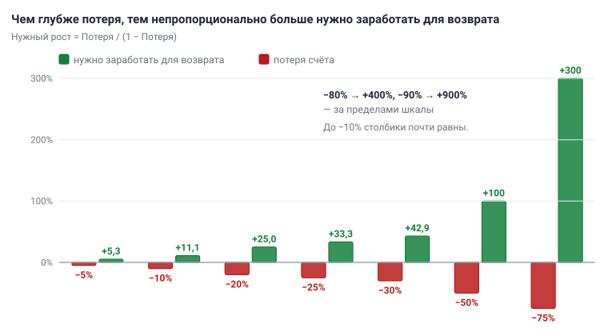
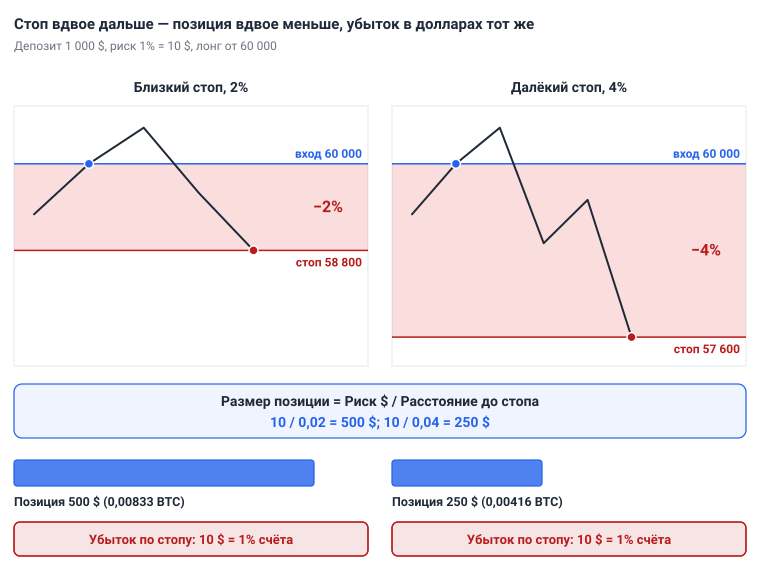
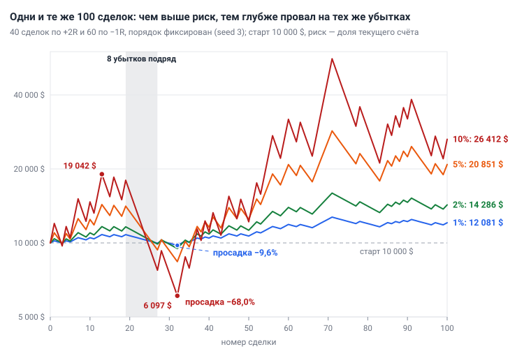
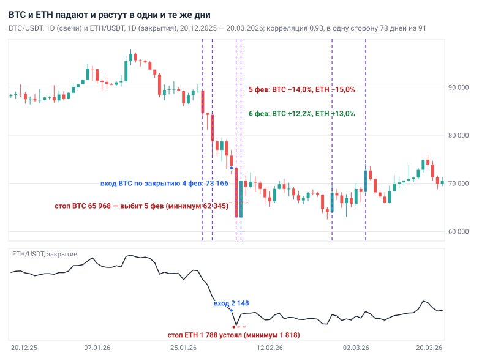

# Глава 11. Риск-менеджмент

> После этой главы вы умеете: считать размер позиции для спота и фьючерсов с учётом шага лота и комиссии; оценивать систему через R, R:R и математическое ожидание; заранее знать длину серий убытков и глубину просадки при своём риске; ставить дневной, недельный и общий лимит и проверять, что стоп стоит намного раньше цены ликвидации.

**Связь с курсом:** ступень 03 — [риск на сделку](../03_Риск_менеджмент/01_Риск_на_сделку.md), [стоп и тейк](../03_Риск_менеджмент/02_Стоп_и_тейк.md), [R:R](../03_Риск_менеджмент/03_Риск_к_прибыли.md), [размер позиции](../03_Риск_менеджмент/04_Размер_позиции.md), [плечо и ликвидация](../03_Риск_менеджмент/05_Плечо_и_ликвидация.md); ступень 05 — [эмоции и правила](../05_Психология/02_Эмоции_и_правила.md); уровень профи — [математическое ожидание](../09_Уровень_профи/01_Математическое_ожидание.md), [просадка и Монте-Карло](../09_Уровень_профи/03_Просадка_и_Монте-Карло.md), [размер позиции для профи](../09_Уровень_профи/04_Размер_позиции_для_профи.md), [портфель и корреляция](../09_Уровень_профи/07_Портфель_и_корреляция.md).

## 11.1. Почему риск считают раньше прибыли

Потерю вернуть труднее, чем получить: после убытка тот же процент прибыли считается от меньшей суммы. Счёт 10 000 $ после потери 50% равен 5 000 $. Чтобы вернуться к 10 000 $, остаток нужно удвоить, то есть заработать 100%.

```
Нужный рост = Потеря / (1 − Потеря)
```

| Потеря счёта | Сколько нужно заработать для возврата |
|---|---|
| −5% | +5,3% |
| −10% | +11,1% |
| −20% | +25,0% |
| −25% | +33,3% |
| −30% | +42,9% |
| −50% | +100% |
| −75% | +300% |
| −80% | +400% |
| −90% | +900% |



*Рис. 11.1. Потеря счёта и рост, который возвращает счёт к исходной сумме. До −10% столбики почти равны, после −30% разрыв растёт всё быстрее.*

Прибыль сделки от вас не зависит: цена пойдёт туда, куда пойдёт. Размер убытка вы задаёте сами — стопом и размером позиции. Поэтому расчёт сделки начинается с вопроса «сколько я потеряю, если ошибся», и только потом — «сколько заработаю».

Задача трейдера в первые годы — остаться в игре: сохранить счёт до момента, когда появятся опыт и статистика. Все правила этой главы держат потери в верхних строках таблицы, где возврат почти равен потере.

## 11.2. Риск на сделку: 1% счёта

**Риск на сделку** — сумма, которую вы теряете, если срабатывает стоп-лосс. Это не размер позиции и не залог: позиция может стоить 500 $, а риск по ней — 10 $. Стандарт учебника — 1% текущего счёта, потолок — 2%, на первом реальном счёте в первые месяцы — 0,5–1%.

Процент выбирают по худшей серии, которую счёт должен пережить. Десять убытков подряд рано или поздно случаются, раздел 11.6 покажет вероятность. Риск считается от текущего счёта, поэтому каждый следующий убыток чуть меньше предыдущего: при 1% от 10 000 $ это 100 $, затем 99 $, затем 98,01 $.

```
Остаток после n убытков подряд = Счёт × (1 − Риск)^n
```

| Риск на сделку | Осталось от 10 000 $ после 10 убытков подряд | Потеря | Нужно для возврата |
|---|---|---|---|
| 0,5% | 9 511 $ | −4,9% | +5,1% |
| 1% | 9 044 $ | −9,6% | +10,6% |
| 2% | 8 171 $ | −18,3% | +22,4% |
| 5% | 5 987 $ | −40,1% | +67,0% |
| 10% | 3 487 $ | −65,1% | +186,8% |
| 20% | 1 074 $ | −89,3% | +831% |

При 1% серия оставляет счёт там, где возврат почти равен потере. При 2% она стоит 18,3% — это терпимо, но уже заметно, поэтому 2% и названы потолком. При 5% серия забирает 40% счёта, при 10% — две трети. При риске 20% хватает трёх убытков подряд, чтобы потерять 48,8%.

Что меняют 0,5% и 2%:

- 0,5% вдвое уменьшает и прибыль, и глубину провалов счёта. Это риск для первых месяцев на реальном счёте и для периода, когда счёт снизился больше чем на 10% от максимума (раздел 11.8).
- 2% примерно вдвое ускоряет рост и углубляет провалы. Он допустим после 100 сделок по плану с положительным итогом.

Риск меняют на месячном разборе, а не посреди серии. Повышают его после очередной сотни сделок с положительным результатом. После убытков риск не повышают никогда.

Действие: запишите в торговый план строку «риск на сделку — 1% текущего счёта» и перед каждой сделкой переводите его в доллары.

## 11.3. Размер позиции

Размер позиции выводят из риска и расстояния до стопа, его не выбирают на глаз.

```
Размер позиции = (Депозит × Риск%) / Расстояние до стопа в %
```

Порядок расчёта:

1. Риск в долларах: депозит × риск%.
2. Расстояние до стопа: разница между ценой входа и ценой стопа, делённая на цену входа. Место стопа задаёт график; правила его постановки — в [главе 12](12_Сопровождение_и_выход.md).
3. Размер позиции в долларах: риск, делённый на расстояние.
4. Количество монет: размер, делённый на цену входа.
5. Округление вниз до **шага лота** — наименьшего шага количества, который биржа принимает по этой паре. Он указан в правилах торговли парой.

**Пример 1. Спот BTC/USDT.** Депозит 1 000 $, риск 1% = 10 $. Вход 60 000, стоп 58 800: расстояние 1 200 / 60 000 = 2%. Позиция = 10 / 0,02 = 500 $, или 0,008333 BTC. При шаге лота 0,00001 BTC округляем вниз до 0,00833 BTC на 499,80 $. Убыток по стопу: 0,00833 × 1 200 = 10,00 $.

**Пример 2. Спот ETH/USDT, стоп дальше.** Тот же депозит, риск 10 $. Вход 3 000, стоп 2 880: расстояние 4%. Позиция = 10 / 0,04 = 250 $, или 0,0833 ETH при шаге 0,0001. Стоп вдвое дальше — позиция вдвое меньше. Убыток тот же: 0,0833 × 120 = 10,00 $.

**Пример 3. Фьючерс, шорт BTC/USDT.** Депозит 10 000 $, риск 1% = 100 $. Вход 60 000, стоп 61 200, на 2% выше входа. Позиция = 100 / 0,02 = 5 000 $, или 0,0833 BTC; при шаге 0,001 BTC это 0,083 BTC на 4 980 $. Убыток по стопу: 0,083 × 1 200 = 99,60 $. Плечо в формулу не входит. Оно меняет только залог: при 1x биржа заблокирует 4 980 $, при 5x — 996 $, при 10x — 498 $. Убыток по стопу во всех трёх случаях равен 99,60 $.



*Рис. 11.2. Депозит 1 000 $, риск 1%, вход 60 000. Стоп в 2% даёт позицию 500 $, стоп в 4% — позицию 250 $. В обоих случаях стоп забирает 10 $.*

После расчёта — три проверки:

- **Округление только вниз.** Округление вверх превышает риск.
- **Минимальный ордер.** У каждой биржи есть минимальная сумма ордера. Если позиция по формуле меньше, сделку пропускают; риск ради неё не поднимают.
- **Позиция больше счёта.** Риск 1% при стопе 0,8% даёт позицию 12 500 $ на счёте 10 000 $. На споте берут позицию не больше счёта, и риск выходит меньше 1%.

Комиссия и **проскальзывание** (исполнение по цене хуже ожидаемой, [глава 2](02_Рынок_и_механика_торгов.md)) прибавляются к убытку. В примере 1 при комиссии спота 0,1% вход стоит 0,50 $, выход по стопу — 0,49 $. Полный убыток — 10,99 $, на десятую часть больше плана. Чтобы уложиться в риск, издержки прибавляют к расстоянию до стопа:

```
Размер позиции = (Депозит × Риск%) / (Расстояние до стопа в % + Издержки в %)
```

Издержки — комиссия за вход и выход плюс запас на проскальзывание. При комиссии 0,2% за круг позиция равна 10 / (0,02 + 0,002) = 454,55 $. С запасом 0,1% на проскальзывание — 10 / 0,023 = 434,78 $. Ставки здесь — ориентир, актуальные смотрите на своей бирже.

Отсюда правило: стоп не ближе десяти комиссий за круг. При 0,2% за круг это 2%, на фьючерсах при 0,1% за круг — 1%. При более близком стопе издержки забирают больше десятой части риска в каждой сделке.

## 11.4. R, R:R и безубыточный винрейт

**R** — риск одной сделки, принятый за единицу измерения. При риске 10 $ прибыль 20 $ записывают как +2R, убыток по стопу — как −1R, убыток с комиссией 10,99 $ — как −1,1R. В R сравнимы сделки с любым счётом и любым стопом, поэтому журнал и статистику ведут в R.

**R:R** (risk/reward) — отношение расстояния до стопа к расстоянию до цели. Вход 60 000, стоп 58 800, цель 62 400: риск 1 200, потенциал 2 400, R:R 1:2. Правило курса: если до цели меньше 1:2, в сделку не входят. Цель берут с графика, по ближайшему сильному уровню. Подгонять её под нужное соотношение нельзя.

R:R задаёт **безубыточный винрейт** — долю прибыльных сделок, при которой система выходит в ноль. **Винрейт** (win rate) — доля прибыльных сделок среди всех.

```
Безубыточный винрейт = (1 + c) / (1 + W)
Издержки в R: c = Издержки за круг в % / Расстояние до стопа в %
```

W — прибыль в R (для 1:2 это 2), c — издержки одной сделки в R. Комиссия 0,2% за круг при стопе 2% равна 0,1R, при стопе 1% — 0,2R, при стопе 0,5% — 0,4R.

| R:R | Без издержек | Издержки 0,1R | Издержки 0,2R |
|---|---|---|---|
| 1:1 | 50,0% | 55,0% | 60,0% |
| 1:1,5 | 40,0% | 44,0% | 48,0% |
| 1:2 | 33,3% | 36,7% | 40,0% |
| 1:3 | 25,0% | 27,5% | 30,0% |
| 1:4 | 20,0% | 22,0% | 24,0% |

При 1:2 можно ошибаться в двух сделках из трёх и оставаться в нуле; издержки 0,1R поднимают планку с 33,3% до 36,7%. Высокий R:R не бесплатен: чем дальше цель, тем реже цена до неё доходит. Соотношение 1:5 при винрейте 10% убыточно, как и 1:1 при винрейте 45%. Поэтому R:R оценивают только вместе с винрейтом.

## 11.5. Математическое ожидание

**Математическое ожидание** (expectancy) — средний результат одной сделки в R на длинной дистанции. Оно соединяет винрейт и R:R в одно число.

```
E = p × W − (1 − p) × L
```

Здесь p — винрейт, W — средняя прибыль прибыльной сделки в R, L — средний убыток убыточной сделки в R.

Положительная система из урока курса: p = 0,40, W = 2,2R, L = 1R. E = 0,40 × 2,2 − 0,60 × 1 = +0,28R. Она ошибается в шести сделках из десяти и зарабатывает.

Отрицательная система: p = 0,60, W = 0,6R, L = 1R. E = 0,60 × 0,6 − 0,40 × 1 = −0,04R. Так выглядит торговля с ранней фиксацией прибыли: трейдер прав в 60% сделок и теряет. С издержками 0,1R на сделку результат хуже: 0,60 × 0,5 − 0,40 × 1,1 = −0,14R.

Перевод в проценты счёта:

```
Ожидаемый итог ≈ E × Число сделок × Риск%
```

Первая система за 50 сделок даёт в среднем 0,28 × 50 = +14R. При риске 1% это около +14% счёта, при 0,5% — около +7%. Слова «в среднем» здесь главные. Точный расчёт для этой системы с W = 2,2R: за 20 сделок она заканчивает в нуле или в минусе в 25% случаев, за 50 сделок — в 10%, за 100 — в 4%. У системы из [главы 1](01_Что_такое_трейдинг.md) с W = 2R запас меньше, и за 100 сделок она в минусе в 9% случаев. Убыточный месяц у прибыльной системы — обычное событие.

Значения p, W и L берут из журнала или бэктеста не меньше чем на 100 сделок ([глава 13](13_Торговый_план_бэктест_журнал.md)). Издержки вычитают до расчёта. Та же система со стопами 0,5% и издержками 0,4R имеет E = 0,40 × 1,8 − 0,60 × 1,4 = −0,12R: на графике она прибыльна, на счёте убыточна.

## 11.6. Серии убытков и просадка

Серия убытков подряд — норма для любой системы, и её длину считают заранее. При винрейте 40% убыток случается в шести сделках из десяти, поэтому убытки неизбежно собираются в полосы.

Таблица показывает вероятность того, что за 100 сделок встретится хотя бы одна серия не короче заданной. Расчёт точный, для независимых сделок с постоянным винрейтом. Симуляция на 100 000 прогонов с фиксированным начальным значением генератора (seed 11) расходится с ним не больше чем на 0,3 процентного пункта.

| Серия не короче | Винрейт 60% | Винрейт 50% | Винрейт 40% |
|---|---|---|---|
| 4 убытков подряд | 80,1% | 97,3% | 99,9% |
| 5 | 45,9% | 81,0% | 97,6% |
| 6 | 21,2% | 54,6% | 87,3% |
| 7 | 8,9% | 31,8% | 68,9% |
| 8 | 3,6% | 17,0% | 49,0% |
| 9 | 1,4% | 8,8% | 32,4% |
| 10 | 0,6% | 4,4% | 20,5% |
| 12 | 0,1% | 1,1% | 7,7% |

При винрейте 40% серия из 8 убытков случается в каждой второй сотне сделок, из 10 — в каждой пятой. [Урок 3 уровня профи](../09_Уровень_профи/03_Просадка_и_Монте-Карло.md) даёт ориентир самой длинной серии на 100 сделок: 5 при винрейте 60%, 7 при 50%, 9 при 40%. По таблице серия такой длины или длиннее встречается в 46%, 32% и 32% сотен. Средняя длина самой длинной серии немного меньше — 4,6, 6,0 и 7,9. Ориентир урока чуть выше среднего, но это не предел: серия на единицу длиннее ориентира (6, 8 и 10 убытков) встречается в 21%, 17% и 20% сотен.

В жизни сделки не вполне независимы. Трендовая система в боковике (он же флэт, диапазон) даёт убытки пачками, поэтому реальные серии бывают длиннее расчётных.

**Просадка** (drawdown) — снижение счёта от последнего максимума до следующего за ним минимума, в процентах от максимума. **Максимальная просадка** — самая глубокая за период. Счёт вырос с 10 000 $ до 10 815 $ и опустился до 9 772 $: просадка равна (10 815 − 9 772) / 10 815 = 9,6%.

Просадка глубже самой длинной серии, потому что редкие прибыли внутри неё не возвращают счёт к максимуму. Это видно в следующем разделе: серия длиной 8, а просадка — 10R.

Действие: найдите в таблице столбец со своим винрейтом и строку с вероятностью около 20–30%. Это серия, которую план обязан выдерживать без изменения правил.

## 11.7. Одна серия сделок при риске 1%, 2%, 5% и 10%

Один и тот же набор сделок даёт разные счета при разном риске, и разница не сводится к умножению. Возьмём 100 сделок системы с винрейтом 40% и R:R 1:2: 40 сделок по +2R и 60 по −1R, в сумме +20R. Порядок перемешан генератором случайных чисел с фиксированным начальным значением (seed 3), чтобы расчёт можно было повторить. Стартовый счёт 10 000 $, риск — доля текущего счёта.

В этой последовательности самая длинная серия — 8 убытков подряд, сделки с 20-й по 27-ю. Максимум перед просадкой достигнут после 13-й сделки, дно — после 32-й: за 19 сделок 16 убытков и 3 прибыли, минус 10R.

| Риск | Итог счёта | Макс. просадка в этой серии | Просадка в худших 5% перестановок | Итог при 35 прибыльных из 100 |
|---|---|---|---|---|
| 1% | 12 081 $ (+20,8%) | 9,6% | 14,2% | +4,1% |
| 2% | 14 286 $ (+42,9%) | 18,6% | 26,9% | +6,1% |
| 5% | 20 851 $ (+108,5%) | 41,4% | 56,3% | +0,2% |
| 10% | 26 412 $ (+164,1%) | 68,0% | 83,1% | −37,3% |



*Рис. 11.3. Кривые капитала одной последовательности из 100 сделок при риске 1%, 2%, 5% и 10%. Шкала логарифмическая: равное расстояние по вертикали означает равное изменение в процентах.*

Второй столбец соблазняет: риск 10% принёс больше всех. Остальные столбцы объясняют, почему так не торгуют.

Третий столбец — цена этого результата. При риске 10% счёт упал с 19 042 $ до 6 097 $ за 19 сделок. Чтобы получить итог из таблицы, нужно было продолжать торговать тем же размером, потеряв две трети счёта.

Четвёртый столбец получен методом **Монте-Карло** из урока курса: те же 100 результатов перемешаны 10 000 раз (seed 2011), и для каждого порядка посчитана максимальная просадка. В 5% худших порядков она не меньше указанной. Урок даёт правило: риск выбирают так, чтобы это число не превышало ваш предел просадки. При пределе 20% риск 1% проходит, 2% — уже нет.

Пятый столбец — что будет, если системе немного не повезло. Сделок по +2R оказалось 35 вместо 40, сумма +5R. При винрейте 40% такой или худший результат выпадает в 18% сотен. Риск 1% и 2% оставляет небольшой плюс. Риск 5% приводит в ноль, риск 10% — к потере 37% счёта при положительной сумме в R. Причина — асимметрия из раздела 11.1: каждая потеря 10% требует +11,1%, и крупный риск съедает преимущество системы.

Вывод: риск на сделку выбирают по просадке, которую вы переживёте, а не по желаемой доходности.

## 11.8. Лимиты: день, неделя, общий открытый риск

Лимиты останавливают торговлю раньше, чем это сделает счёт. Риск 1% защищает от одной ошибки, лимиты — от серии ошибок за короткое время.

| Лимит | Порог | Действие |
|---|---|---|
| Убытки подряд | 2 убыточные сделки подряд | стоп на день |
| День | −3% депозита | торговля закрыта до завтра |
| Новые сделки | 2–3 в день для системы на 4H | остальные сетапы пропустить |
| Неделя | −6% | пауза до понедельника и разбор журнала |
| Просадка | больше 10% от максимума счёта | риск 0,5%, пока счёт не обновит максимум |
| Общий открытый риск | 3% счёта (потолок курса — 5–6%) | новую позицию не открывать |

Два убытка по 1% — это −1,99%, шесть за неделю — −5,85%. Без лимитов пять дней по −3% дают −14,1% за неделю. Причины и психология этих правил — в [главе 14](14_Психология.md).

**Общий открытый риск** — сумма рисков всех открытых позиций, то есть потеря счёта, если все стопы сработают одновременно. Три позиции по 1% — это 3%. Новичку этого достаточно.

Сумму считают с поправкой на **корреляцию** — число от −1 до +1, которое показывает, насколько согласованно движутся два актива. При +1 они ходят строго вместе, при 0 — независимо. Считаем по дневным доходностям, то есть по изменению цены закрытия к предыдущему дню.

BTC/USDT и ETH/USDT, 1D, 27 октября 2023 — 25 октября 2026, 1 095 дней:

- корреляция дневных доходностей — 0,81;
- в 82% дней обе монеты закрылись в одну сторону;
- BTC падал за день на 5% и больше 23 раза. ETH закрылся в минусе во всех 23 случаях, в 18 из них упал сильнее BTC. Средний такой день: BTC −6,6%, ETH −8,0%.

За всю историю данных, со 2 января 2019, корреляция равна 0,82; по календарным годам — от 0,77 в 2021 до 0,91 в 2026. Связь не жёсткая. В скользящем окне 90 дней корреляция опускалась до 0,55 (окно до 4 января 2021), а 5 марта 2024 BTC потерял за день 6,6%, ETH — только 2,0%.

Проверка на сделках. Каждый день трёхлетнего периода покупаем по закрытию дня и BTC, и ETH. Стоп — 2 × ATR(14), цель — 2R; ATR — средний размах свечи за 14 периодов ([глава 7](07_Индикаторы_и_объём.md)). Исход смотрим по дневным свечам; если одна свеча задела и стоп, и цель, считаем стоп; сделку держим не дольше 60 дней, и в счёт идут 951 день, когда обе сделки за этот срок закрылись. Это измерение, а не торговая система. Из 581 дня, когда стоп выбил BTC, в 526 случаях стоп выбил и ETH: 90,5%. Обе сделки закрылись стопом в 55,3% дней; у независимых сделок было бы 40,5%.



*Рис. 11.4. BTC/USDT, 1D (свечи) и ETH/USDT, 1D (линия закрытий), 20 декабря 2025 — 20 марта 2026. Корреляция дневных доходностей в этом окне — 0,93. Пунктиром отмечены дни, когда BTC изменился на 5% и больше.*

Пример с рисунка — иллюстрация совместного движения, а не сетап. Лонг BTC по закрытию 4 февраля 2026, 73 166, стоп на 2 × ATR ниже, 65 968. Лонг ETH в тот же момент: вход 2 148, стоп 1 788. Депозит 10 000 $, риск по 1% на каждую сделку. 5 февраля BTC опустился до 62 345, стоп сработал: −100 $, если стоп исполнился без проскальзывания. ETH дошёл до 1 818, стоп уцелел, день закрылся на 1 827 с бумажным убытком 0,89R, или −89 $. За один день счёт потерял 1,9% при «риске 1% на сделку».

Правило: лонг BTC и лонг ETH — одна позиция. Риск 1% делят между ними, по 0,5%, или выбирают одну монету с лучшим сетапом. То же относится к двум шортам. [Урок 7 уровня профи](../09_Уровень_профи/07_Портфель_и_корреляция.md) допускает на всю коррелированную группу до 2–3% — это потолок для опытного трейдера; учебник держит новичка на 1% для пары. Корреляция меняется, поэтому раз в месяц её пересчитывают за последние 90 дней.

## 11.9. Плечо и ликвидация: стоп стоит раньше

Плечо не меняет риск сделки: риск задают стоп и размер позиции, а плечо определяет только залог. Но чем меньше залог, тем ближе цена **ликвидации**, при которой биржа принудительно закрывает позицию. Механику разбирает [глава 2](02_Рынок_и_механика_торгов.md); оттуда же формула: до ликвидации примерно 1 / плечо минус ставка поддерживающей маржи, в примере 0,4%.

Шорт из примера 3: позиция 5 000 $, вход 60 000, стоп 61 200 (+2%), риск 100 $. Последний столбец — число дней на BTC/USDT, 1D с 27 октября 2023 по 25 октября 2026, когда цена поднималась от открытия дня до максимума на расстояние до ликвидации или больше. Это оценка по спотовым свечам: биржа ликвидирует по маркировочной цене (mark price), она может немного отличаться.

| Плечо | Залог | Цена ликвидации | До ликвидации | В расстояниях до стопа | Дней с таким ростом из 1 095 |
|---|---|---|---|---|---|
| 1x | 5 000 $ | 119 760 | 99,6% | 49,8 | 0 |
| 5x | 1 000 $ | 71 760 | 19,6% | 9,8 | 0 |
| 10x | 500 $ | 65 760 | 9,6% | 4,8 | 7 |
| 20x | 250 $ | 62 760 | 4,6% | 2,3 | 87 |
| 50x | 100 $ | 60 960 | 1,6% | 0,8 | 446 |

Обычный дневной ход BTC за эти три года — медиана ATR(14) на 1D — 3,5% цены, в бурные периоды 5% и больше. При плече 50x ликвидация на 60 960 стоит ближе стопа: залог сгорит раньше, чем цена дойдёт до точки, где идея признана неверной. При 20x между стопом и ликвидацией остаётся 2,6%. Это меньше обычного дневного хода, а стоп на резком движении исполняется с проскальзыванием. Самый большой рост внутри дня за период — 6 февраля 2026, от 62 910 до 71 751, +14,1%.

Порядок действий на фьючерсах:

1. Посчитайте позицию по формуле раздела 11.3, без учёта плеча.
2. Возьмите наименьшее плечо, при котором хватает залога. Позиция 5 000 $ на счёте 10 000 $ плеча не требует. Позиция 12 500 $ из раздела 11.3 требует 2x.
3. Проверьте цену ликвидации: до входа — по формуле главы 2, после входа — в строке открытой позиции. Курс требует, чтобы стоп стоял намного раньше ликвидации, но точного порога не задаёт. Сравните оба расстояния с обычным дневным ходом: при стопе 2% и плече 10x до ликвидации почти пять расстояний до стопа и почти три дневных хода; при 20x — чуть больше двух стопов и меньше полутора дневных ходов, такой запас съедает один резкий день. Сомневаетесь — уменьшите плечо.

Чем кончается обратный порядок. Счёт 10 000 $, плечо 10x «на весь залог»: позиция 100 000 $. Движение на 2% против — минус 2 000 $, 20% счёта вместо 1%. Движение на 9,6% — ликвидация всего счёта. Счёт уничтожило не плечо, а позиция в двадцать раз больше расчётной. Первые месяцы торгуйте без плеча.

## 11.10. Стоп по ATR и размер через волатильность

Стоп в фиксированных процентах не учитывает, насколько подвижен рынок сейчас. [Урок 4 уровня профи](../09_Уровень_профи/04_Размер_позиции_для_профи.md) предлагает мерить стоп в ATR:

```
Стоп = вход ∓ k × ATR(14),   k = 1,5–2,5 на 4H и 1D
Размер позиции = (Депозит × Риск%) / (k × ATR / вход)
```

Это формула раздела 11.3, где расстояние до стопа выражено через ATR. Два момента на BTC/USDT, 4H: депозит 10 000 $, риск 1%, k = 2, лонг по закрытию свечи.

| Показатель | Спокойный рынок | Бурный рынок |
|---|---|---|
| Свеча 4H, открытие по UTC | 13 октября 2026, 12:00 | 6 февраля 2026, 00:00 |
| Цена закрытия | 83 435 | 64 168 |
| ATR(14) | 828, или 0,99% | 2 475, или 3,86% |
| Стоп = закрытие − 2 × ATR | 81 779 (−1,98%) | 59 219 (−7,71%) |
| Размер позиции | около 5 040 $ | около 1 300 $ |
| Убыток по стопу | 100 $ | 100 $ |

В бурном рынке позиция почти вчетверо меньше, а риск в долларах тот же. Фиксированный стоп 2% в первом случае стоит в двух ATR от входа, во втором — в половине ATR, и его выбивает обычное колебание одной свечи.

Основной способ учебника остаётся прежним: стоп за экстремумом сетапа с запасом 0,5 × ATR(14). Размер позиции в обоих способах считается одной формулой.

## 11.11. Запрещённые приёмы

Четыре приёма запрещены, потому что каждый убирает из сделки заранее известный убыток. Расчёт показывает, чем они заканчиваются.

**Усреднение против позиции** — докупка убыточной позиции, чтобы улучшить среднюю цену. План: лонг BTC на 500 $ от 60 000, стоп 58 800, риск 10 $. На 58 800 трейдер вместо выхода покупает ещё на 500 $. Теперь у него 0,016837 BTC со средней ценой 59 394 и без стопа. На 57 000 убыток равен 40 $, или 4R; на 54 000 — 91 $, или 9,1R. Бывает, что цена возвращается к средней и сделка закрывается около нуля. Такие случаи и закрепляют привычку, пока одно движение без возврата не заберёт результат десятков сделок.

**Мартингейл** — удвоение риска после каждого убытка. Ряд 1%, 2%, 4%, 8%, 16%, 32% от стартового счёта: шесть убытков подряд забирают 63%. На седьмую ставку нужно 64%, а осталось 37%. По таблице раздела 11.6 серия из шести убытков за 100 сделок встречается с вероятностью 87% при винрейте 40%, 55% при 50% и 21% при 60%.

**Перенос стопа дальше от цены.** Система с E = +0,28R: p = 0,40, W = 2,2R, L = 1R. Пусть в одной убыточной сделке из трёх стоп отодвинут и убыток равен 2,5R. Средний убыток: (1 + 1 + 2,5) / 3 = 1,5R. E = 0,40 × 2,2 − 0,60 × 1,5 = −0,02R. Прибыльная система стала убыточной: её порог — средний убыток 1,47R.

**Отыгрыш** — увеличение объёма, чтобы вернуть потерянное. День по правилам: два убытка по 1%, итог −1,99%, для возврата нужно +2,03%. День с отыгрышем: после двух убытков сделки с риском 2% и 4%, обе убыточные. Итог −7,8%, для возврата нужно +8,5%. Сделки отыгрыша открывают по желанию вернуть деньги, а не по сетапу, поэтому рассчитывать в них на винрейт системы нельзя.

Убрать стоп совсем — то же усреднение, только без докупки: убыток перестаёт быть известным заранее.

## 11.12. Калькулятор риска и порядок расчёта

Расчёт перед сделкой занимает минуту, если идти по одному порядку. В приложении курса в разделе «Риск» есть калькулятор с двумя вкладками. Вкладка «Размер позиции» принимает депозит, риск на сделку в процентах, цену входа, цену стопа и необязательную цену тейка. Она показывает размер позиции в долларах и монетах, риск в деньгах (1R), расстояние до стопа, направление, R:R и прибыль при тейке. При риске выше 2% и при R:R ниже 1:2 появляется предупреждение. Комиссию, проскальзывание и шаг лота калькулятор не учитывает — их добавляете вы. Вкладка «Монте-Карло» считает просадку по винрейту, средней прибыли и убытку в R, риску и числу сделок.

Порядок перед каждым ордером:

1. Баланс счёта и 1R в долларах.
2. Лимиты: нет двух убытков подряд сегодня, день выше −3%, неделя выше −6%, открытый риск с новой сделкой не больше 3%. BTC и ETH в одну сторону — одна позиция.
3. Вход, стоп и цель с графика.
4. R:R не меньше 1:2. Иначе пропуск.
5. Расстояние до стопа в процентах: не ближе десяти комиссий за круг.
6. Размер позиции с издержками, количество монет, округление вниз до шага лота.
7. На фьючерсах: наименьшее достаточное плечо, изолированная маржа (ликвидация забирает только залог позиции), до ликвидации намного дальше, чем до стопа, и дальше обычного дневного хода (раздел 11.9).
8. Запись в журнал до входа: 1R, размер, R:R.

## 11.13. Типичные ошибки

- **Одинаковая сумма во всех сделках.** Позиция 500 $ при стопе 2% рискует 10 $, при стопе 6% — 30 $. Постоянным должен быть риск, а не размер.
- **Стоп под размер.** Сначала выбран объём, потом стоп придвинут так, чтобы «потерять не больше». Стоп ставит график, размер считают под него.
- **Риск от залога.** На фьючерсах убыток считается от всей позиции, а не от залога.
- **Близкий стоп без учёта комиссии.** При стопе 0,5% и 0,2% за круг каждая сделка начинается с −0,4R.
- **Цель, подогнанная под 1:2.** Соотношение считают до реального уровня. Не хватает — сделки нет.
- **BTC и ETH как два независимых риска.** В измерении раздела 11.8 стоп по BTC в 90% случаев сопровождался стопом по ETH.
- **Оценка системы по 20 сделкам.** Система с E = +0,28R заканчивает 20 сделок без прибыли в каждом четвёртом случае.
- **Повышение риска после удачной недели.** Серия прибылей не меняет ожидание системы, а следующая просадка придётся на увеличенный размер.

## 11.14. Запомнить

- Потеря 10% требует +11,1%, потеря 50% — +100%. Сначала считают убыток, потом прибыль.
- Риск на сделку — 1% текущего счёта, потолок 2%. Десять убытков подряд при 1% — это −9,6%.
- Размер позиции = (Депозит × Риск%) / Расстояние до стопа в %. Дальше стоп — меньше позиция.
- Плечо меняет залог и цену ликвидации, но не риск. Стоп стоит намного раньше ликвидации.
- R:R не ниже 1:2; безубыточный винрейт при 1:2 — 33,3% без издержек.
- E = p × W − (1 − p) × L. Судить о системе можно после 100 сделок.
- При винрейте 40% серия из 8 убытков подряд случается в каждой второй сотне сделок.
- Лимиты: 2 убытка подряд — стоп на день; −3% за день; −6% за неделю; открытый риск до 3%.
- Лонг BTC и лонг ETH — одна позиция.
- Запрещено: усреднение против позиции, мартингейл, перенос и снятие стопа, отыгрыш.

## 11.15. Практика на демосчёте

- [ ] Запишите баланс демосчёта и 1R в долларах при риске 1%.
- [ ] Найдите в правилах торговли своей биржи шаг лота, минимальный ордер и комиссии для BTC/USDT и ETH/USDT. Запишите издержки за круг в процентах.
- [ ] Для трёх сетапов на BTC/USDT, 4H посчитайте размер позиции вручную и в калькуляторе приложения. Результаты должны совпасть до цента. Затем пересчитайте с издержками и округлите до шага лота.
- [ ] Откройте 10 сделок с размером по формуле. После каждой закрытой по стопу сравните фактический убыток с 1R: расхождение больше 0,15R означает ошибку в расчёте или слишком близкий стоп.
- [ ] Для одной из сделок посчитайте по формуле главы 2 цену ликвидации при плече 1x, 5x и 20x. Запишите, во сколько раз расстояние до ликвидации больше расстояния до стопа.
- [ ] В таблице посчитайте корреляцию дневных доходностей BTC и ETH за последние 90 дней (функция CORREL).
- [ ] Во вкладке «Монте-Карло» введите винрейт 40%, прибыль 2R, убыток 1R, 100 сделок. Запишите просадку в худших 5% случаев при риске 1% и 2% и сравните со своим пределом.
- [ ] Впишите в торговый план риск на сделку и все лимиты из раздела 11.8.

## 11.16. Вопросы для самопроверки

1. Счёт потерял 35%. Сколько процентов нужно заработать, чтобы вернуться к исходной сумме?
2. Депозит 2 000 $, риск 1%. Лонг ETH/USDT: вход 2 500, стоп 2 425, шаг лота 0,0001 ETH. Найдите размер позиции в долларах и количество монет.
3. Вход 60 000, стоп 59 100, цель 62 250. Какой R:R? Каков безубыточный винрейт без издержек и с издержками 0,1R?
4. Система: винрейт 45%, средняя прибыль 1,8R, средний убыток 1,05R. Найдите ожидание и средний итог 40 сделок при риске 1%.
5. Восемь убытков подряд при риске 2%. Сколько останется от 10 000 $ и сколько процентов нужно для возврата?
6. Винрейт 50%. С какой вероятностью за 100 сделок встретится серия из 8 убытков подряд или длиннее? Какой вывод для плана?
7. Открыт лонг BTC с риском 1%. Появился сетап на лонг ETH. Как поступить с риском и почему?
8. Лонг ETH/USDT: вход 3 000, стоп 2 910, плечо 20x, ставка поддерживающей маржи 0,5%. Где цена ликвидации и достаточно ли она далеко от стопа?
9. Депозит 10 000 $, риск 1%, стоп 2,5%, издержки за круг 0,2%. Каков размер позиции без учёта издержек и с учётом?
10. Сегодня два убытка подряд по 1%. Появился сильный сетап, и хочется войти двойным размером. Что говорит план и чем кончается обратное?

## 11.17. Ответы

1. 0,35 / (1 − 0,35) = 53,8%.
2. Риск 20 $, расстояние 75 / 2 500 = 3%. Позиция = 20 / 0,03 = 666,67 $, или 0,26667 ETH. Округление вниз: 0,2666 ETH на 666,50 $. Убыток по стопу: 0,2666 × 75 = 20,00 $.
3. Риск 900, потенциал 2 250: R:R 1:2,5. Безубыточный винрейт: 1 / 3,5 = 28,6%; с издержками 1,1 / 3,5 = 31,4%.
4. E = 0,45 × 1,8 − 0,55 × 1,05 = 0,81 − 0,5775 = +0,23R. За 40 сделок в среднем +9,3R, около +9,3% счёта.
5. 10 000 × 0,98^8 = 8 508 $, потеря 14,9%. Для возврата нужно +17,5%.
6. 17,0%, примерно в каждой шестой сотне сделок. План должен выдерживать такую серию без изменения правил: при риске 1% это −7,7% счёта.
7. Лонг BTC и лонг ETH считаются одной позицией: корреляция дневных доходностей около 0,8, и стоп по BTC в 90% случаев сопровождается стопом по ETH. Либо пропустить ETH, либо уменьшить риск так, чтобы на пару приходился 1%: по 0,5% на каждую.
8. 3 000 × (1 − 1/20 + 0,005) = 2 865. До ликвидации 4,5%, до стопа 3%: всего полтора расстояния до стопа, и ликвидация ближе обычного дневного хода ETH (около 5,5%, глава 2). Это не «намного раньше». При плече 5x ликвидация на 2 415, в 19,5% от входа.
9. Без издержек: 100 / 0,025 = 4 000 $; полный убыток по стопу тогда 108 $. С издержками: 100 / 0,027 = 3 703,70 $.
10. Два убытка подряд — стоп на день; сетап пропускается. Отыгрыш с риском 2% и 4% при двух новых убытках превращает −1,99% в −7,8%, и для возврата нужно уже +8,5%.
