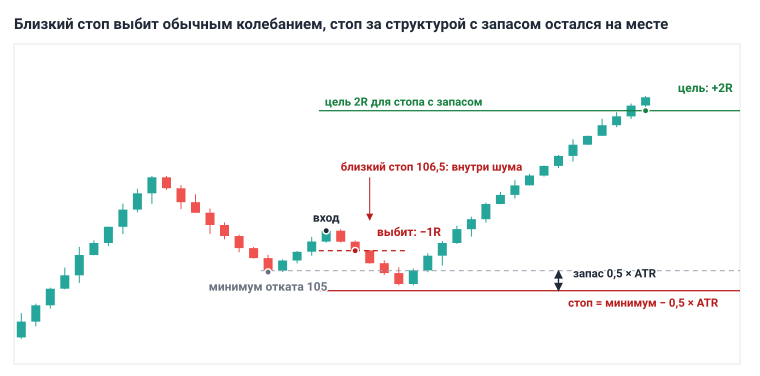
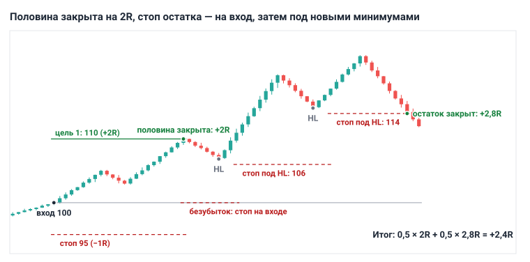
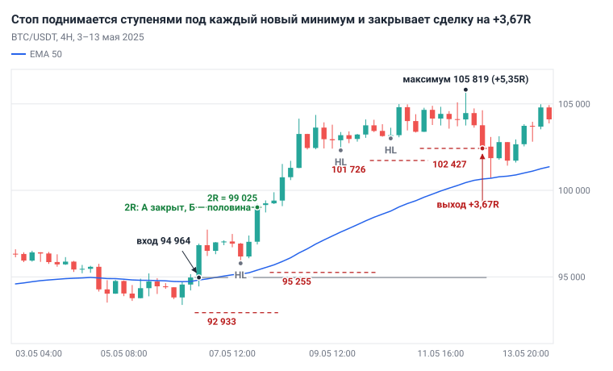
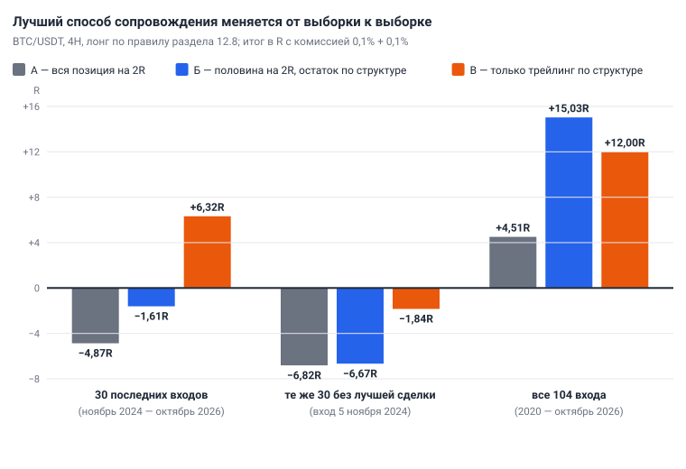

# Глава 12. Сопровождение сделки и выход

> После этой главы вы умеете: записать план выхода до входа; поставить стоп за структурой с запасом по ATR; посчитать в R исходы частичной фиксации; вести стоп по структуре; отличить допустимый досрочный выход от недопустимого; выставить и проверить ордера на выход.

**Связь с курсом:** [ступень 03, урок 2 «Где ставить стоп и тейк»](../03_Риск_менеджмент/02_Стоп_и_тейк.md), [ступень 03, урок 3 «Соотношение риска и прибыли»](../03_Риск_менеджмент/03_Риск_к_прибыли.md), [стратегия 1 «Тренд по EMA»](../04_Стратегии/01_Тренд_по_EMA.md), уровень профи: [урок 4](../09_Уровень_профи/04_Размер_позиции_для_профи.md), [урок 8](../09_Уровень_профи/08_Исполнение_и_безопасность.md), [урок 9](../09_Уровень_профи/09_Процесс_профессионала.md).

## 12.1. План выхода пишется до входа

Правила выхода записывают до того, как нажата кнопка «Купить», и после входа их только исполняют. **Сопровождение сделки** — всё, что вы делаете с позицией между входом и выходом: где стоит стоп, куда он переносится, какая часть закрывается на цели и при каких условиях сделка закрывается раньше.

До входа у вас нет позиции, и вы оцениваете график спокойно. После входа каждое движение цены меняет сумму на счёте, и решения начинают зависеть от неё ([глава 14](14_Психология.md)). Поэтому план сопровождения входит в сетап наравне с условиями входа ([глава 10](10_Модели_входа.md)): нет плана выхода — нет сделки.

Базовый план учебника для лонга умещается в шесть строк; для шорта всё зеркально.

```
Стоп:        за минимумом сетапа минус 0,5 × ATR(14) на 4H; стоп-маркет
Цель 1:      ближняя граница зоны 1D, не ближе 2R; закрыть половину позиции
После цели:  стоп остатка перенести на цену входа
Трейлинг:    под каждый новый подтверждённый HL на 4H минус 0,5 × ATR(14)
Досрочно:    свеча 4H закрылась ниже последнего HL; новость, не учтённая в плане
Запрещено:   двигать стоп дальше от цены, убирать стоп, усредняться
```

Действие: до первой сделки перепишите эти шесть строк в свой план и подставляйте в них цены перед каждым входом.

## 12.2. Стоп-лосс: за структурой и с запасом

Стоп ставится туда, где идея сделки становится неверной: за экстремум сетапа с запасом 0,5 × ATR(14) рабочего таймфрейма. Механика стоп-ордера разобрана в [главе 2](02_Рынок_и_механика_торгов.md).

Идея лонга на откате: откат закончился, тренд продолжается. Идея неверна, если цена ушла ниже минимума отката. Ровно на минимуме стоять нельзя: там стоят стопы большинства, и цена иногда прокалывает такой минимум и разворачивается ([глава 5](05_Уровни_и_зоны.md)). Запас в половину ATR ([глава 7](07_Индикаторы_и_объём.md)) отодвигает стоп за этот прокол.

Порядок действий:

1. Найдите минимум отката на 4H, от которого цена развернулась.
2. Прочитайте ATR(14) на 4H на закрытой сигнальной свече.
3. Стоп = минимум − 0,5 × ATR. Для шорта: максимум + 0,5 × ATR.
4. Посчитайте расстояние от входа до стопа в процентах. По нему считается размер позиции ([глава 11](11_Риск_менеджмент.md)).

Пример: BTC/USDT, 4H, 6 мая 2025. Свеча 16:00 UTC коснулась EMA 50 и закрылась выше, на 94 964. Минимум отката — 93 377, ATR(14) = 889. Стоп = 93 377 − 444 = 92 933. Вход по открытию следующей свечи, 94 964. Расстояние до стопа — 2 031 $, или 2,14%. Это 1R сделки. При депозите 10 000 $ и риске 1% позиция равна 100 $ / 2,14% = 4 676 $.

**Почему нельзя ближе.** Причин две: шум и комиссия.

Шум — обычные колебания цены, которые ничего не говорят об идее. В примере ATR равен 0,94% цены: столько цена в среднем проходит за одну свечу 4H. Стоп в 0,5% от входа стоит внутри хода одной обычной свечи, и его выбивает первое же колебание. Стоп из примера стоит в 2,3 ATR от входа.

Комиссия меряется в R, и чем короче стоп, тем она дороже. На споте вход и выход стоят около 0,1% + 0,1% = 0,2% позиции. Позиция при коротком стопе большая, поэтому те же 0,2% съедают заметную долю риска.

| Стоп от входа | Комиссия за круг | Убыток по стопу | Прибыль на цели 2R | Безубыточный винрейт |
|---|---|---|---|---|
| 0,5% | 0,40R | −1,40R | +1,60R | 46,7% |
| 1% | 0,20R | −1,20R | +1,80R | 40,0% |
| 2% | 0,10R | −1,10R | +1,90R | 36,7% |
| 5% | 0,04R | −1,04R | +1,96R | 34,7% |

Без комиссии при R:R 1:2 достаточно выигрывать 33,3% сделок. Со стопом 0,5% нужно уже 46,7%. Отсюда правило курса: стоп не ближе, чем комиссия за круг × 10. Для спота это 2%, для фьючерсов с комиссией тейкера 0,05% — 1%. Комиссии своей биржи проверьте сами.



*Рис. 12.1. Схема. Один вход, два стопа. Цена прокалывает минимум отката и идёт к цели: близкий стоп даёт −1R, стоп с запасом 0,5 × ATR — +2R.*

На истории: в 104 входах по правилу из раздела 12.8 цена пять раз уходила ниже минимума сетапа, не доставала до стопа с запасом и затем доходила до цели 2R. Без запаса это пять убытков вместо пяти прибылей. В остальных 66 случаях, когда цена уходила ниже минимума сетапа, запас не помог: сделка закрылась по стопу.

Слишком далёкий стоп тоже ошибка: цель 2R уходит за ближайшую зону.

Действие: на трёх последних откатах BTC/USDT на 4H отметьте минимум, прочитайте ATR(14) и запишите цену стопа и расстояние до него в процентах.

## 12.3. Стоп-маркет, стоп-лимит и цена срабатывания

Защитный стоп ставят ордером стоп-маркет. **Стоп-маркет** (stop market) при достижении цены срабатывания отправляет рыночный ордер: позиция закроется, но цена исполнения может оказаться хуже заданной. **Стоп-лимит** (stop limit) в той же точке выставляет лимитный ордер: цена исполнения ограничена, но при резком движении рынок проскакивает лимит, ордер остаётся неисполненным, и позиция остаётся без защиты.

Проскальзывание стоп-маркета записывают в журнал как есть: например, −1,1R вместо −1R.

На бессрочных фьючерсах у стопа есть вторая настройка: по какой цене он срабатывает. **Последняя цена** (last price) — цена последней сделки на бирже, её рисует график. **Маркировочная цена** (mark price) — расчётная цена, по которой биржа считает ликвидации ([глава 2](02_Рынок_и_механика_торгов.md)). На Binance Futures стоп-маркет по умолчанию срабатывает по маркировочной цене, и её можно сменить на последнюю ([справка Binance](https://www.binance.com/en/support/faq/what-is-stop-order-360036351051)). На других биржах настройка может стоять иначе.

Эти две цены расходятся в резких движениях. Тень свечи на графике может коснуться вашего уровня, а стоп по маркировочной цене не сработает; бывает и наоборот. Уровни вы размечали по графику последней цены, поэтому стоп по последней цене срабатывает там, где вы его нарисовали. Стоп по маркировочной цене не реагирует на короткий выброс на одной бирже. Выберите один вариант, запишите его в план и проверяйте в каждом ордере.

Действие: откройте форму стоп-ордера на демосчёте и найдите переключатель цены срабатывания (Trigger: Last / Mark).

## 12.4. Цель: зона, кратность R, измеренный ход

Цель ставят у ближайшей зоны старшего таймфрейма, и до неё должно быть не меньше 2R. Способов назначить цель три.

- **По зоне.** Для лонга — ближняя, нижняя граница ближайшего сопротивления на 1D ([глава 5](05_Уровни_и_зоны.md)). У зоны стоят продавцы, поэтому цель ставят чуть раньше границы, а не внутри зоны.
- **По кратности R.** Цель = вход + 2 × (вход − стоп). Способ не смотрит на график, зато даёт одинаковые сделки для статистики.
- **По измеренному ходу.** Высоту фигуры откладывают от точки пробоя ([глава 6](06_Паттерны.md)).

Порядок: сначала зона, затем проверка в R.

```
Расстояние до зоны в R = (граница зоны − вход) / (вход − стоп)
```

Если получилось меньше 2, по правилу курса сделки нет. Законных выходов два: пропустить сетап или поставить лимитный ордер ниже и ждать. Подтягивать стоп ближе, чтобы «получилось 1:2», нельзя: стоп окажется внутри шума (раздел 12.2).

Пример на той же сделке 6 мая 2025: вход 94 964, стоп 92 933, R = 2 031. Цель по кратности — 99 025. Ближайший максимум на 1D — 97 896 (2 мая 2025). До него (97 896 − 94 964) / 2 031 = 1,44R. Если считать этот максимум сопротивлением, сделка по плану пропускается. Вход, при котором до него ровно 2R:

```
Вход = (граница зоны + 2 × стоп) / 3 = (97 896 + 2 × 92 933) / 3 = 94 587
```

Лимитный ордер на 94 587 или ниже делает сделку допустимой. Он может не исполниться, и это нормальный исход.

В тот раз цена прошла 97 896 без остановки: фильтр по зоне отсеял бы прибыльную сделку. Он же отсеивает убыточные, и итог показывает только бэктест плана ([глава 13](13_Торговый_план_бэктест_журнал.md)).

Действие: для каждого сетапа записывайте расстояние до ближайшей зоны 1D в R раньше, чем считаете размер позиции.

## 12.5. Частичная фиксация: расчёт исходов в R

**Частичная фиксация** — закрытие части позиции на первой цели, пока остаток продолжает работать. Канон учебника: половина позиции закрывается на первой цели не ближе 2R, остаток ведётся трейлингом по структуре (раздел 12.7).

Результат сделки складывается из двух половин:

```
Результат = 0,5 × 2R + 0,5 × X,   где X — выход остатка в R
```

| Что произошло | Вся позиция на 2R | Половина на 2R, остаток по трейлингу | Только трейлинг |
|---|---|---|---|
| Стоп до цели | −1R | −1R | −1R или меньший убыток |
| Дошла до 2R и вернулась ко входу | +2R | +1R | около 0 |
| Остаток закрыт на +3R | +2R | +2,5R | +3R |
| Остаток закрыт на +6R | +2R | +4R | +6R |

Из формулы следует граница: частичная фиксация обгоняет простую цель 2R, только когда остаток в среднем закрывается выше +2R. Если остаток обычно возвращается ко входу, прибыльная сделка приносит +1R вместо +2R, и безубыточный винрейт поднимается с 33% до 50%.

Что частичная фиксация даёт: половина прибыли уже на счёте, и остаток легче держать по плану. Чего она стоит: в сильном тренде половина позиции продана рано.

Проверка на истории: из 104 входов по правилу раздела 12.8 до 2R дошли 38. Остаток закрылся в среднем на +2,55R, медиана +2,11R. В 19 сделках из 38 он закрылся ниже +2R, в 12 — выше +3R, худший — на +0,63R. Среднее выше границы держится на нескольких длинных сделках.



*Рис. 12.2. Схема. Вход 100, стоп 95, 1R = 5. Половина закрыта на 110 (+2R), остаток — на 114 (+2,8R). Итог: 0,5 × 2 + 0,5 × 2,8 = +2,4R.*

Действие: посчитайте для своей последней демо-сделки три результата в R — с целью 2R, с половиной на 2R и без цели.

## 12.6. Безубыток: когда переносить и сколько стоит спешка

**Безубыток** (breakeven) — перенос стопа на цену входа: после него сделка не может закрыться с убытком больше комиссии и проскальзывания. Канон учебника: стоп переносят на вход не раньше, чем выполнены два условия. Цена прошла +1R, и на рабочем таймфрейме появился новый экстремум в сторону сделки: для лонга — максимум выше того, с которого начался откат. В базовом плане перенос совпадает с частичной фиксацией на 2R: к этому моменту оба условия обычно выполнены.

У раннего переноса есть цена. Вход в откате находится в зоне, куда цена часто возвращается ещё раз. Стоп на входе выбивает из сделки на таком возврате, и дальше рынок идёт к цели без вас.

Проверка на тех же 104 входах: цель 2R на всю позицию, меняется только правило безубытка.

| Правило | Итог | Целей 2R | Полных стопов |
|---|---|---|---|
| Стоп не двигается | +4,51R | 38 | 66 |
| Ранний перенос: на вход при первом касании +1R | −3,86R | 25 | 48 |
| Перенос по канону: +1R и новый максимум | −0,48R | 28 | 51 |

Ранний перенос спас от полного стопа 18 сделок и отнял 13 целей. Спасённая сделка возвращает 1R, потерянная цель стоит 2R: 18 − 26 = −8R. Перенос по канону спас 15 сделок и отнял 10 целей. Выход по цене входа — это не ноль: в тесте он стоил от 0,02R до 0,10R комиссии.

На этом правиле и этих данных безубыток не добавил прибыли ни в одном варианте. Он сглаживает результат: при раннем переносе разброс исходов упал с 1,45R до 1,19R. Чем раньше перенос, тем дороже это спокойствие. На другой системе числа будут другими, поэтому правило безубытка проверяют бэктестом вместе со всем планом.

Действие: запишите в план точное условие переноса и не переносите стоп на вход раньше него.

## 12.7. Трейлинг-стоп: структура, EMA 20, ATR

**Трейлинг-стоп** (trailing stop) — стоп, который передвигают вслед за ценой и только в сторону сделки. Он заменяет фиксированную цель: сделка закрывается, когда рынок развернулся, а не когда он дошёл до заранее выбранной цены.

**По структуре.** В восходящем тренде каждый следующий минимум отката выше предыдущего (HL, [глава 4](04_Структура_рынка.md)). После каждого нового подтверждённого HL стоп переносят под него с запасом 0,5 × ATR(14). В проверках этой главы минимум считается подтверждённым, когда три свечи слева и три справа от него имеют минимумы выше. Значит, стоп переносится через три закрытые свечи после минимума, не раньше.

**По EMA 20.** Сделку закрывают по рынку, когда свеча 4H закрылась ниже EMA 20 после закрытий выше неё. Это не отложенный ордер: решение принимается на закрытии свечи, шесть раз в сутки. Начальный стоп остаётся на месте на случай резкого падения.

**По ATR.** Стоп = максимум цены с момента входа − 3 × ATR(14). Это вариант приёма Chandelier Exit («люстровый выход») Чарльза Ле Бо: в оригинале от максимума за 22 периода отнимают 3 × ATR(22) ([StockCharts ChartSchool](https://chartschool.stockcharts.com/table-of-contents/technical-indicators-and-overlays/technical-overlays/chandelier-exit)). В проверках ниже взят ATR(14), как во всём учебнике.

| Способ | Сильная сторона | Слабая сторона |
|---|---|---|
| По структуре | стоп стоит за видимым уровнем графика | в импульсе без откатов отстаёт от цены |
| По EMA 20 | простое правило; редко даёт полный стоп | в боковике частые ложные выходы; нужно быть у графика на закрытии свечи |
| По ATR | считается по формуле; подстраивается под волатильность | не знает об уровнях; множитель подбирается под рынок |

Любой трейлинг отдаёт часть хода от максимума до стопа. Это плата за участие в длинных движениях.

Действие: выберите один способ трейлинга и запишите его в план одной строкой с числами.

## 12.8. Одна сделка, три способа сопровождения

Одна и та же сделка даёт разный результат в зависимости от записанного заранее способа выхода. Вход взят по механическому правилу из раздела 13.7 [главы 13](13_Торговый_план_бэктест_журнал.md), только BTC/USDT и только лонг:

1. Последняя закрытая свеча 1D закрылась выше EMA 200.
2. Свеча 4H коснулась EMA 50 минимумом и закрылась выше EMA 50 и выше своего открытия.
3. Вход по открытию следующей свечи. Стоп — минимум шести последних свечей минус 0,5 × ATR(14). Стоп ближе 2% — пропуск.
4. Комиссия 0,1% за вход и 0,1% за выход вычтена.

Три способа сопровождения: **А** — вся позиция закрывается на 2R; **Б** — половина на 2R, стоп остатка на вход, дальше по структуре; **В** — только трейлинг по структуре с момента входа, без цели.

Сделка: BTC/USDT, 4H, 6 мая 2025; цель 2R — 99 025.

| Событие | Свеча 4H, UTC | Стоп после события | От входа |
|---|---|---|---|
| Вход по 94 964 | 6 мая, 20:00 | 92 933 | −1R |
| Цена дошла до 99 025 | 8 мая, 00:00 | способ Б: 94 964 | 0 |
| Подтверждён HL 95 785 | закрытие свечи 8 мая, 04:00 | 95 255 | +0,14R |
| Подтверждён HL 102 315 | закрытие свечи 10 мая, 04:00 | 101 726 | +3,33R |
| Подтверждён HL 103 005 | закрытие свечи 11 мая, 04:00 | 102 427 | +3,67R |
| Стоп исполнен по 102 427 | 12 мая, 12:00 | — | +3,67R |



*Рис. 12.3. BTC/USDT, 4H, 3–13 мая 2025. Вход 94 964, начальный стоп 92 933, ступени стопа 95 255, 101 726 и 102 427, выход 12 мая.*

Результат с комиссией при риске 100 $:

| Способ | Результат | В долларах |
|---|---|---|
| А. Вся позиция на 2R | +1,90R | +190 $ |
| Б. Половина на 2R, остаток по структуре | +2,74R | +274 $ |
| В. Только трейлинг по структуре | +3,58R | +358 $ |

С 8 по 10 мая цена поднялась выше 104 000, а стоп оставался на 95 255: в импульсе без откатов структурный стоп отстаёт. Максимум сделки — 105 819 (+5,35R) 12 мая; трейлинг закрыл её на +3,67R и отдал 1,67R.

Обратный случай — вход 27 ноября 2024 по 95 556, стоп 89 938, 2R = 106 792. Способ В поднял стоп под второй HL до 95 498, и 2 декабря откат закрыл сделку: −0,04R с комиссией. Цена после этого дошла до 106 792 16 декабря. Способ А дал +1,96R, способ Б — +1,59R.

По двум сделкам способ выбрать нельзя.

## 12.9. Та же проверка на 30 входах

На 30 последних входах по тому же правилу лучшим оказался трейлинг, но весь его результат дала одна сделка. Входы — с 1 ноября 2024 по 19 октября 2026; новый вход разрешён после закрытия предыдущей сделки по всем трём способам. Средний стоп — 4,0% от входа.

| Способ | Итог | Среднее | Медиана | Лучшая | Разброс (σ) | В плюсе |
|---|---|---|---|---|---|---|
| А. Вся позиция на 2R | −4,87R | −0,16R | −1,04R | +1,97R | 1,37R | 9 из 30 |
| Б. Половина на 2R + трейлинг | −1,61R | −0,05R | −1,04R | +5,06R | 1,66R | 9 из 30 |
| В. Только трейлинг | +6,32R | +0,21R | −0,37R | +8,16R | 1,90R | 12 из 30 |



*Рис. 12.4. Итог трёх способов в R: 30 последних входов, те же 30 без лучшей сделки и все 104 входа с 2020 года.*

**Трейлинг меняет форму результата.** Убытков больше 0,5R при способе В — 13, при способе А — 21: подтянутый стоп сокращает часть потерь. Плата — прибыльные сделки: из 9 сделок, дошедших до 2R, шесть принесли при способе В меньше, чем при способе А.

**Итог трейлинга держится на редких сделках.** Три лучшие сделки способа В дали +15,63R, остальные 27 — −9,31R. Лучшая из них — вход 5 ноября 2024: +8,16R. Без неё все три способа убыточны: А −6,82R, Б −6,67R, В −1,84R.

**На длинной истории порядок другой.** Все 104 входа с 20 января 2020 по 19 октября 2026:

| Год | Сделок | А | Б | В |
|---|---|---|---|---|
| 2020 | 21 | +10,87R | +13,86R | +7,59R |
| 2021 | 20 | −2,65R | −2,48R | −3,46R |
| 2022 | 1 | −1,03R | −1,03R | −0,52R |
| 2023 | 21 | −1,18R | −0,08R | +0,59R |
| 2024 | 16 | +4,13R | +9,86R | +8,60R |
| 2025 | 18 | −4,08R | −3,86R | −2,01R |
| 2026, до 25 октября | 7 | −1,55R | −1,24R | +1,22R |
| Все | 104 | +4,51R | +15,03R | +12,00R |

На всей истории первый — способ Б, по годам лидер меняется. Два других трейлинга на 104 входах дали: по EMA 20 — +8,00R при разбросе 1,05R, по ATR — +3,34R при разбросе 1,18R.

**Ограничения.** Это одно правило входа, одна монета и только лонг. Период выбран автором: 30 последних входов попали на слабый для правила отрезок. Тридцать сделок — малая выборка, и сто четыре тоже: разница между способами Б и А — 0,10R на сделку при разбросе около 1,5R, такую разницу 104 сделки не доказывают ([глава 13](13_Торговый_план_бэктест_журнал.md)). Проскальзывание не учтено. Параметры трейлинга (три свечи, 0,5 × ATR) не подбирались, но и не проверялись на устойчивость.

Вывод: данные не называют лучший способ, они показывают различия. Фиксированная цель даёт ровный результат и не участвует в длинных движениях. Трейлинг даёт много мелких исходов и редкие крупные, которых приходится ждать месяцами. Частичная фиксация стоит между ними, поэтому учебник берёт её за базовый план. Выберите один способ, запишите и не меняйте его внутри серии сделок.

## 12.10. Досрочный выход и выход по времени

Закрыть сделку раньше стопа и цели можно только по причине, которая записана в плане до входа.

- **Слом структуры на рабочем таймфрейме.** Свеча 4H закрылась ниже последнего HL: тренда, на который опиралась идея, больше нет ([глава 4](04_Структура_рынка.md)). Тень ниже HL при закрытии выше — не слом.
- **Неучтённая новость.** До выхода важных данных меньше получаса, а вы о них не знали при входе. Правило пишется заранее, например: сделка в плюсе меньше 1R закрывается, остальные остаются со стопом.
- **Выход по времени.** Сделка закрывается, если за N свечей не дошла ни до стопа, ни до цели. N берут из своей статистики, а не из терпения. В 104 входах этой главы убыточные сделки доходили до стопа за 15–16 свечей 4H по медиане, прибыльные до цели 2R — за 47, почти восемь суток. Лимит в 30 свечей закрыл бы досрочно 22 прибыльные сделки из 38.
- **Техническая ошибка.** Неверный размер или сторона ордера. Ошибку закрывают сразу.

Недопустимые причины: «тревожно», «цена стоит», «прибыль уже хорошая, жалко отдавать», чужое мнение, взгляд на сумму в долларах. Проверка одна: есть ли эта причина в плане, написанном до входа. Если нет, сделка остаётся.

Цена ранних выходов считается. В тесте до цели дошли 38 сделок из 104. При таком винрейте система в нуле, если средний выигрыш равен 66 / 38 = 1,74R. Кто закрывает прибыльные сделки на +1,5R «на всякий случай» и получает все стопы полностью, делает слабоположительную систему убыточной.

Действие: допишите в план свои допустимые причины досрочного выхода. Всё, чего в списке нет, причиной не считается.

## 12.11. Исполнение ордеров на выход

Ордера на выход стоят на бирже с первой минуты сделки и проверяются глазами. Две настройки из [главы 2](02_Рынок_и_механика_торгов.md) здесь обязательны. **OCO** (one cancels the other) связывает стоп и тейк: исполнение одного отменяет другой. **Reduce-only** на фьючерсах разрешает ордеру только уменьшать позицию. Без них забытый стоп после срабатывания тейка откроет встречную позицию, а на споте продаст монеты, которые вы не собирались продавать.

Базовый план с частичной фиксацией удобно ставить двумя наборами ордеров:

1. Первая половина: стоп-маркет и тейк-профит на 2R, связанные OCO.
2. Вторая половина: только стоп-маркет на той же цене. Его вы двигаете по плану.
3. После исполнения тейка: стоп второй половины переносится на вход.
4. После каждого нового HL: стоп переносится под него. Проверьте, что новый стоп принят биржей.
5. После закрытия сделки: в списке открытых ордеров по монете пусто.

Как именно связываются ордера, зависит от биржи. Отработайте порядок на демосчёте.

**Частичное исполнение лимитного входа.** Лимитный ордер может исполниться не целиком. Если из 0,05 BTC куплено 0,02, стоп и тейк должны стоять на 0,02. Остаток входа либо ждёт дальше, либо отменяется, когда цена ушла к цели; решение записано в плане.

Проверка после выставления ордеров:

- [ ] сторона стопа и тейка противоположна позиции;
- [ ] сумма объёмов стопов равна объёму позиции;
- [ ] цены совпадают с планом, тип стопа — стоп-маркет;
- [ ] на фьючерсах стоит reduce-only и выбрана цена срабатывания;
- [ ] стоп стоит намного ближе ко входу, чем цена ликвидации ([глава 11](11_Риск_менеджмент.md)).

## 12.12. Запись результата в журнал

После выхода в журнал идут два главных поля: результат в R и ответ на вопрос «правила соблюдены?». Результат считается по фактическим ценам и с комиссией:

```
Результат в R = (прибыль или убыток в долларах после комиссий) / (риск сделки в долларах)
```

Для частичной фиксации складывают обе половины. Сделка 6 мая 2025 по способу Б: +274 $ при риске 100 $ = +2,74R.

Второе поле важнее первого. Сделка, закрытая вручную на +1,2R из-за тревоги, записывается как «+1,2R, правила: нет». Сделка, закрытая по стопу на −1,08R строго по плану, — «правила: да», и ошибок в ней нет.

Ещё две пометки помогают разбору ([глава 13](13_Торговый_план_бэктест_журнал.md)): чем закрыта сделка (цель, стоп, трейлинг, досрочно по плану, досрочно без причины) и разница между ценой плана и ценой исполнения в R. По [уроку 8 уровня профи](../09_Уровень_профи/08_Исполнение_и_безопасность.md), утечка исполнения больше 0,05R в среднем — повод пересмотреть способ входа или выхода.

Действие: заполняйте оба поля в день закрытия сделки, пока помните, почему вышли.

## 12.13. Типичные ошибки

- **Стоп «на сколько не жалко».** Расстояние выбрано по деньгам, а не по графику, и стоп оказывается внутри шума.
- **Стоп ровно на минимуме или подтянутый ради R:R.** Прокол минимума выбивает из сделки перед разворотом.
- **Безубыток при первой же прибыли.** В тесте ранний перенос превратил +4,51R в −3,86R.
- **Стоп отодвинут от цены.** Убыток 1R превращается в убыток неизвестного размера.
- **Способ сопровождения меняется от сделки к сделке.** Статистику такой серии посчитать нельзя.
- **Досрочный выход по чувству.** Средний выигрыш падает ниже уровня, при котором система зарабатывает.
- **Забытые ордера и неверный объём.** Стоп без OCO и reduce-only остаётся на бирже после сделки; после частичной фиксации стоп стоит на старый объём.

## 12.14. Запомнить

- План выхода пишется до входа: стоп, цель, действия на цели, перенос стопа, причины досрочного выхода.
- Стоп = экстремум сетапа ∓ 0,5 × ATR(14), не ближе комиссии за круг × 10. Тип — стоп-маркет.
- Цель — у ближайшей зоны 1D и не ближе 2R. Меньше 2R — пропуск или лимитный вход ниже.
- Частичная фиксация: результат = 0,5 × 2R + 0,5 × X.
- Безубыток — после +1R и нового экстремума в сторону сделки. Ранний перенос стоит прибыли.
- Трейлинг по структуре: под каждый подтверждённый HL с запасом, только в сторону сделки.
- Досрочный выход — только по причине из плана. В журнал: результат в R и «правила соблюдены?».

## 12.15. Практика на демосчёте

- [ ] Перепишите план сопровождения из раздела 12.1 и подставьте цены для одного текущего сетапа на BTC/USDT, 4H.
- [ ] На истории BTC/USDT, 4H найдите пять откатов к EMA 50. Для каждого запишите минимум, ATR(14), стоп, вход, цель 2R и расстояние до ближайшей зоны 1D в R.
- [ ] Для тех же пяти входов пройдите график свеча за свечой и запишите результат в R тремя способами: цель 2R; половина на 2R и трейлинг; только трейлинг. Сравните суммы.
- [ ] Откройте сделку минимального размера, выставьте два набора ордеров из раздела 12.11 и пройдите проверку из пяти пунктов.
- [ ] Проведите 10 демо-сделок с одним способом сопровождения. В журнале у каждой — результат в R, чем закрыта и «правила соблюдены?». Посчитайте досрочные выходы без причины из плана.

## 12.16. Вопросы для самопроверки

1. Лонг по BTC/USDT: вход 60 000, минимум отката 58 900, ATR(14) на 4H = 600. Где стоп, чему равен 1R и где цель 2R?
2. В условиях вопроса 1 нижняя граница сопротивления 1D — 62 100. Сколько до неё в R? Какой вход делает сделку допустимой при том же стопе?
3. Стоп 0,5% от входа, комиссия 0,1% за вход и 0,1% за выход. Сколько стоит комиссия в R и какой винрейт нужен для нуля при цели 2R?
4. Половина позиции закрыта на +2R, остаток — на +3,5R. Результат в R и в долларах при риске 100 $? А если остаток закрылся на входе?
5. Чем стоп-маркет отличается от стоп-лимита и какой из них ставят защитным?
6. Тень свечи на графике фьючерса коснулась вашего стопа, а стоп не сработал. Назовите возможную причину.
7. Когда по канону учебника стоп переносят в безубыток? Чем плох перенос при первом касании +1R?
8. Какие причины досрочного выхода допустимы? Приведите две недопустимые.
9. Лимитный вход на 0,05 BTC исполнился на 0,02 BTC. Что нужно проверить?

## 12.17. Ответы

1. Стоп = 58 900 − 0,5 × 600 = 58 600. 1R = 60 000 − 58 600 = 1 400 $, или 2,33%. Цель 2R = 60 000 + 2 800 = 62 800.
2. (62 100 − 60 000) / 1 400 = 1,5R — меньше 2R, сделки нет. Допустимый вход = (62 100 + 2 × 58 600) / 3 = 59 767 или ниже.
3. 0,2% / 0,5% = 0,4R. Выигрыш 2 − 0,4 = 1,6R, проигрыш 1 + 0,4 = 1,4R. Винрейт для нуля = 1,4 / (1,4 + 1,6) = 46,7%.
4. 0,5 × 2 + 0,5 × 3,5 = +2,75R, или +275 $. Если остаток закрылся на входе: 0,5 × 2 + 0 = +1R, или +100 $ без учёта комиссии.
5. Стоп-маркет после срабатывания исполняется по рынку: позиция закрыта, цена может быть хуже. Стоп-лимит выставляет лимитный ордер, который при резком движении может не исполниться. Защитный стоп — стоп-маркет.
6. Стоп настроен на маркировочную цену, а график показывает последнюю. Маркировочная цена до уровня не дошла.
7. После +1R и нового экстремума в сторону сделки; в базовом плане — при частичной фиксации на 2R. Ранний перенос выбивает из сделки на возврате ко входу: в тесте он спас 18 стопов, отнял 13 целей и дал −3,86R вместо +4,51R.
8. Допустимы: закрытие свечи рабочего таймфрейма за последним HL, неучтённая важная новость, лимит времени из плана, техническая ошибка в ордере. Недопустимы: «тревожно», «цена стоит», «жалко отдавать прибыль».
9. Объём стопа и тейка должен быть 0,02 BTC. Остаток лимитного ордера на 0,03 BTC либо ждёт, либо отменён по правилу плана.

## Источники

- StockCharts ChartSchool: [Chandelier Exit](https://chartschool.stockcharts.com/table-of-contents/technical-indicators-and-overlays/technical-overlays/chandelier-exit) — автор приёма и стандартные параметры.
- Binance, справочный центр: [What Is Stop Order](https://www.binance.com/en/support/faq/what-is-stop-order-360036351051) — цена срабатывания стоп-маркета на фьючерсах; [маркировочная цена и индекс](https://www.binance.com/en/support/faq/360033525071).
- Расчёты на истории: свечи Binance 1D и 4H из приложения курса, BTC/USDT, 1 января 2019 — 25 октября 2026.
