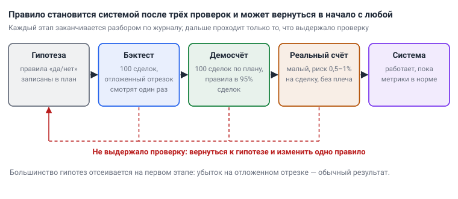
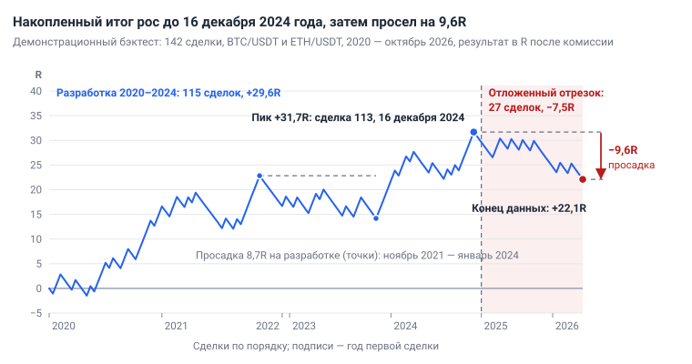
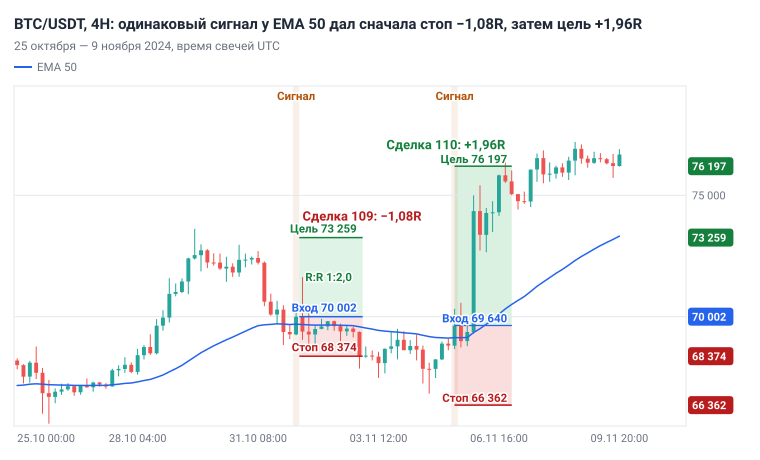

# Глава 13. Торговый план, бэктест, журнал

> После этой главы вы умеете: записать систему правилами, которые другой человек выполнит так же, как вы; заполнить торговый план и карточку сетапа; провести ручной бэктест и посчитать по нему метрики; вести журнал и воскресный разбор; решить, когда переходить на реальные деньги и когда останавливать систему.

**Связь с курсом:** ступень 06: [торговый план](../06_Своя_система/01_Торговый_план_шаблон.md), [журнал сделок](../06_Своя_система/02_Журнал_сделок_шаблон.md), [критерии перехода на реальные деньги](../06_Своя_система/03_Критерии_перехода_на_реальные_деньги.md); ступень 04: [стратегия 1 «Тренд по EMA»](../04_Стратегии/01_Тренд_по_EMA.md), [шаблон разбора стратегии](../04_Стратегии/Шаблон_разбора_стратегии.md); уровень профи: [урок 1 «Математическое ожидание»](../09_Уровень_профи/01_Математическое_ожидание.md), [урок 2 «Бэктест»](../09_Уровень_профи/02_Бэктест_и_переоптимизация.md), [урок 3 «Просадка и Монте-Карло»](../09_Уровень_профи/03_Просадка_и_Монте-Карло.md), [урок 7 «Портфель и корреляция»](../09_Уровень_профи/07_Портфель_и_корреляция.md), [урок 9 «Процесс профессионала»](../09_Уровень_профи/09_Процесс_профессионала.md).

## 13.1. Система — это правила, которые выполнит другой человек

**Торговая система** — это набор правил, по которым другой человек откроет и закроет те же сделки, что и вы. Если два человека смотрят на один график с одним листом правил и решают по-разному, на листе записано мнение.

Формальные правила нужны по двум причинам. Первая: без них нечего проверять. Сто сделок, открытых «по ситуации», — это сто разных опытов, и их средний результат ничего не говорит о сто первой. Вторая: память переписывает прошлое. Через месяц вход «на эмоциях» вспоминается как сделка по системе.

Формулировку проверяют так: каждое условие должно давать ответ «да» или «нет» по закрытой свече. Слова «сильный», «уверенный», «примерно» эту проверку не проходят.

| Размыто | Проверяемо |
|---|---|
| Тренд восходящий | Последняя закрытая свеча 1D выше EMA 200 |
| Цена откатилась к средней | Минимум свечи 4H коснулся EMA 50 |
| Появилась свеча отбоя | Свеча 4H закрылась выше открытия и выше EMA 50 |
| Стоп под минимумом с запасом | Стоп = минимум отката − 0,5 × ATR(14) на 4H |
| Цель у сопротивления | Цель = вход + 2 × расстояние до стопа |

Не всё сводится к числу. Зону поддержки или слом структуры два человека проведут немного по-разному. Такие условия остаются в правилах, но описываются примерами в карточке сетапа (раздел 13.3) и проверяются ручным бэктестом (раздел 13.4).

Правила, которые ещё не проверены, — это **гипотеза**. Системой она становится после трёх проверок: на истории, на демосчёте и на малом реальном счёте. Большинство гипотез не проходят уже первую проверку, и это нормальный результат работы.



*Рис. 13.1. Путь правила от гипотезы до системы. С любого этапа гипотеза может вернуться в начало; дальше проходит только то, что выдержало проверку.*

Действие: возьмите модель «Откат в тренде» из [главы 10](10_Модели_входа.md) и перепишите каждое её условие так, как в правом столбце таблицы.

## 13.2. Торговый план на одной странице

**Торговый план** — одна страница, на которой записано, что вы торгуете, когда входите, сколько рискуете, как выходите и когда не торгуете совсем. План пишется до сделки. Решение при открытой позиции принимает человек, которому страшно или жалко прибыли; этот разрыв разбирает [глава 14](14_Психология.md).

В [шаблоне курса](../06_Своя_система/01_Торговый_план_шаблон.md) восемь блоков: рынок, таймфреймы, стратегии, риск, правила входа, правила выхода, «когда не торгую», разбор. Числа блока риска объясняет [глава 11](11_Риск_менеджмент.md), блока выхода — [глава 12](12_Сопровождение_и_выход.md). Ниже план заполнен целиком.

> **Мой торговый план.** Версия 1 от 1 октября 2024.
>
> **Рынок:** BTC/USDT и ETH/USDT, спот, демосчёт 10 000 $.
>
> **Таймфреймы:** тренд — 1D, вход — 4H.
>
> **Стратегии:** 1) «Откат в тренде»; 2) нет. Вторую добавлю после 100 сделок по первой.
>
> **Риск**
> - риск на сделку: 1% (не больше 2%);
> - дневной лимит потерь: 3%; после 2 убыточных сделок подряд — стоп на день;
> - недельный лимит: −6%, после него пауза до понедельника;
> - минимальный R:R: 1:2;
> - максимум сделок в день: 2;
> - BTC и ETH в одну сторону — одна позиция; общий открытый риск не больше 3%.
>
> **Правила входа** (только лонг: на споте шорта нет)
> 1. Последняя закрытая свеча 1D выше EMA 200.
> 2. Минимум свечи 4H коснулся EMA 50.
> 3. Эта свеча закрылась бычьей и выше EMA 50. Вхожу рыночным ордером на открытии следующей свечи.
> 4. До ближайшего сопротивления 1D не меньше 2R. Стоп не ближе 2% от входа.
>
> **Правила выхода**
> - стоп: минимум отката − 0,5 × ATR(14) на 4H; дальше от цены не двигаю;
> - тейк: половина позиции на +2R, остаток веду стопом по минимумам 4H;
> - перенос в безубыток: после +1R и нового максимума на 4H.
>
> **Когда не торгую**
> - 30 минут до и 30 минут после важной новости;
> - цена на 4H ходит через EMA 50 туда и обратно (боковик);
> - устал, зол или хочу отыграться.
>
> **Разбор:** каждое воскресенье — разбор недели по журналу.

У плана три правила обращения. Он имеет дату и номер версии. Текст меняется только на воскресном разборе и только по одному правилу за раз (раздел 13.10). Сделка, которой нет в плане, не открывается, даже если она кажется очевидной.

Без плана каждое решение принимается заново в момент сделки. Размер позиции растёт после прибыли, стоп отодвигается после убытка, и такой результат нельзя ни повторить, ни проверить.

## 13.3. Плейбук: карточка сетапа

**Плейбук** (playbook) — папка карточек, по одной странице на каждый сетап. План перечисляет правила, карточка показывает, как они выглядят на графике, и хранит примеры. У новичка в плейбуке одна карточка.

| Поле карточки | «Откат в тренде», лонг |
|---|---|
| Режим, в котором сетап разрешён | 1D выше EMA 200; перед откатом цена на 4H шла выше EMA 50 |
| Условия входа | Минимум свечи 4H не выше EMA 50; закрытие выше EMA 50 и выше открытия; вход на открытии следующей свечи |
| Что делает идею неверной | Цена ниже минимума отката минус 0,5 × ATR(14): там стоит стоп |
| Управление | Половина на +2R; безубыток после +1R и нового максимума; остаток — по минимумам 4H |
| Примеры по правилам | Три скриншота, один из них убыточный. Например: BTC/USDT, 1 ноября 2024, −1,08R (рис. 13.3) |
| Сделки, которых не должно было быть | Три скриншота, на каждом подписано нарушенное правило |
| Типичные провалы | Вход до закрытия свечи; вход под самым сопротивлением 1D; третий вход подряд, пока цена ходит через EMA 50; стоп ближе 2% |

Среди примеров «по правилам» обязательно есть убыточная сделка. Убыток при выполненных условиях — обычный исход, и карточка об этом напоминает. Блок «сделки, которых не должно было быть» пополняется из журнала: каждое нарушение со скриншотом.

Без карточки система живёт только в памяти. Сверяйте карточку с журналом раз в месяц: повторяющийся провал — кандидат на новую строку блока «Когда не торгую».

## 13.4. Ручной бэктест по шагам

**Бэктест** (backtest) — проверка правил на истории: вы идёте по графику слева направо, свеча за свечой, и записываете сделки так, будто будущего не знаете. Ручной бэктест нужен там, где часть условий оценивается глазами. Заодно он тренирует глаз: за 100 сделок вы увидите сетап чаще, чем за полгода торговли.

Главная опасность бэктеста — видимая правая часть графика. Зная, что после отката был рост, вы найдёте сигнал. Зная, что было падение, найдёте причину его пропустить. Результат получится прибыльным при любых правилах.

В TradingView правую часть скрывает режим «Симулятор рынка» (Bar Replay). Его кнопка находится на верхней панели графика. Щёлкните по свече, с которой хотите начать, и дальше открывайте по одной свече кнопкой «Вперёд» или сочетанием Shift + →. Кнопка «К реальному времени» выключает режим. На 1D и старше в симуляторе доступна вся история графика; на внутридневных таймфреймах, включая 4H, глубина зависит от тарифа. Если истории на 4H не хватает, закройте правую половину экрана листом бумаги и сдвигайте график мышью на одну свечу.

Порядок работы:

1. Запишите правила и не меняйте их до конца теста.
2. Выберите период и разделите его. Первые 70% — отрезок разработки (in-sample). Последние 30% — **отложенный отрезок** (out-of-sample): его вы проходите один раз, в самом конце.
3. Откройте 4H с EMA 50 и ATR(14), на 1D добавьте EMA 200. Встаньте в начало периода.
4. Открывайте по одной свече. После закрытия каждой проверяйте условия входа.
5. Сигнал есть — сначала запишите дату, вход, стоп и цель. Только потом открывайте следующую свечу.
6. Двигайтесь до стопа или цели. Если одна свеча задела и стоп, и цель, записывайте стоп.
7. Запишите результат в R за вычетом комиссии и сохраните скриншот.
8. Повторяйте, пока не наберёте 100 сделок.

Четыре привычки защищают от подглядывания:

- начинайте с периода, который не помните, или с кнопки «Случайный бар» в симуляторе;
- дневной фильтр проверяйте по последней закрытой свече 1D: сегодняшняя ещё не закончилась;
- сначала запись, потом следующая свеча;
- не удаляйте сделки, которые не нравятся, и не добавляйте пропущенные задним числом.

Столбцы таблицы бэктеста те же, что в журнале (раздел 13.9), плюс длительность сделки в свечах. Последние 30 сделок из 100 сделайте на отложенном отрезке и сравните с первыми 70. Если результат там вдвое хуже или убыточен, идея не подтверждена. По оценке курса, 100 сделок в симуляторе занимают 10–20 часов.

[Урок 2 уровня профи](../09_Уровень_профи/02_Бэктест_и_переоптимизация.md) называет пять ошибок, из-за которых бэктест показывает прибыль там, где её нет.

| Ошибка | Как выглядит | Что делать |
|---|---|---|
| Заглядывание в будущее (look-ahead) | Сигнал посчитан по закрытию свечи, а вход записан по её открытию или по лучшей цене внутри неё | Сигнал по закрытию, вход на следующей свече |
| Ошибка выжившего | В тесте только монеты, которые существуют сегодня | Для BTC и ETH проблема мала, для альткоинов огромна |
| Тест без издержек | Не учтены комиссия, проскальзывание, фандинг | Вычитать издержки из каждой сделки в R |
| **Переоптимизация** (overfitting) | Перебрали много значений параметров и взяли лучшее | Не больше трёх параметров; соседние значения дают похожий результат |
| Подгонка под картинку | После каждого убытка добавлено «кроме случаев, когда…» | Каждое исключение — новый параметр; проверять его на отложенном отрезке |

## 13.5. Метрики: расчёт на 10 сделках

Метрики отвечают на три вопроса: зарабатывает ли система, сколько приносит одна сделка и какой ценой. Все считаются по столбцу «Результат (R)». Формулу матожидания выводит [глава 11](11_Риск_менеджмент.md); здесь она применяется к таблице.

Первые 10 сделок учебного бэктеста, результаты уже за вычетом комиссии:

| № | Результат, R | Накопленный итог, R |
|---|---|---|
| 1 | −1,0 | −1,0 |
| 2 | +2,0 | +1,0 |
| 3 | −1,1 | −0,1 |
| 4 | −1,0 | −1,1 |
| 5 | −1,1 | −2,2 |
| 6 | +1,9 | −0,3 |
| 7 | −1,0 | −1,3 |
| 8 | +2,2 | +0,9 |
| 9 | −1,1 | −0,2 |
| 10 | +1,5 | +1,3 |

```
Винрейт p               = 4 прибыльные / 10 = 40%
Средняя прибыль W       = (2,0 + 1,9 + 2,2 + 1,5) / 4 = 1,9R
Средний убыток L        = (1,0 + 1,1 + 1,0 + 1,1 + 1,0 + 1,1) / 6 = 1,05R
Матожидание E           = p × W − (1 − p) × L = 0,4 × 1,9 − 0,6 × 1,05 = +0,13R
Профит-фактор PF        = сумма прибылей / сумма убытков = 7,6 / 6,3 = 1,21
Максимальная просадка   = пик +1,0R (сделка 2) − дно −2,2R (сделка 5) = 3,2R
Серия убытков           = 3 подряд (сделки 3, 4, 5)
```

Что говорит каждое число:

- **Винрейт** без среднего выигрыша ничего не значит: 40% прибыльных сделок при W = 1,9R дают плюс, при W = 1,2R — минус.
- **Матожидание** E — средний результат одной сделки. Проверка: итог +1,3R, делённый на 10 сделок, даёт те же +0,13R.
- **Профит-фактор** (PF) ниже 1,0 означает, что система теряет. Курс называет рабочим диапазон 1,3–1,6; PF выше 2,0 чаще говорит о малой выборке или ошибке в учёте.
- **Максимальная просадка** — самое глубокое падение накопленного итога от пика до следующего дна. При риске 1% на сделку 3,2R — это около 3,2% счёта.
- **Самая длинная серия убытков** сравнивается с ожидаемой для вашего винрейта; таблица серий есть в главе 11.

Убыток −1,1R вместо −1,0R — это стоп плюс комиссия и проскальзывание. Если записывать «чистые» −1R и +2R, матожидание будет завышено в каждой сделке.

Действие: перенесите таблицу в электронную таблицу, постройте столбец накопленного итога и получите те же семь чисел формулами.

## 13.6. Сколько сделок нужно, чтобы верить результату

Матожидание по 10 сделкам — случайное число: одна лишняя прибыльная сделка меняет его знак. Чтобы среднему можно было верить, оно должно отстоять от нуля хотя бы на две свои погрешности. Из этого условия [урок 1 уровня профи](../09_Уровень_профи/01_Математическое_ожидание.md) получает формулу:

```
N ≈ (2 × σ / E)²
```

Здесь σ — стандартное отклонение результатов сделок в R, то есть их разброс вокруг среднего. Его считает любая электронная таблица по столбцу «Результат (R)».

Пример курса: σ = 1,5R, E = +0,28R, значит N ≈ (3 / 0,28)² ≈ 115 сделок. Для таблицы из раздела 13.5 σ = 1,53R и E = +0,13R, нужно около 550 сделок. Десять сделок не подтверждают ничего.

| E на сделку при σ = 1,5R | Сколько сделок нужно |
|---|---|
| +0,5R | 36 |
| +0,3R | 100 |
| +0,2R | 225 |
| +0,1R | 900 |

Чем слабее преимущество, тем больше сделок нужно, чтобы его увидеть. Систему с E = +0,1R вручную подтвердить почти невозможно. Отсюда минимум курса: 100 сделок в бэктесте и 100 на демо. Пока сделок меньше, вы предполагаете, что система прибыльна, но не знаете этого.

## 13.7. Демонстрационный бэктест на реальных свечах

Ниже одно правило прогнано скриптом по реальным свечам. Это демонстрация процедуры, а не рекомендованная система: торговать по этому правилу не нужно. Правило записано до запуска и после него не менялось.

1. Пары BTC/USDT и ETH/USDT, свечи Binance, только лонг.
2. Фильтр 1D: последняя закрытая дневная свеча закрылась выше EMA 200.
3. Сигнал 4H: минимум свечи не выше EMA 50, закрытие выше EMA 50 и выше открытия.
4. Вход: по цене открытия следующей свечи 4H.
5. Стоп: минимум сигнальной свечи и пяти свечей перед ней минус 0,5 × ATR(14). Если стоп ближе 2% от входа, сделка пропускается.
6. Цель: 2R, вся позиция сразу.
7. Одновременно открыта одна сделка на обе пары. Если свеча задела и стоп, и цель, засчитан стоп.
8. Комиссия 0,1% за вход и 0,1% за выход вычтена из каждой сделки.

Правило проще плана из раздела 13.2: в нём нет фильтра по сопротивлению, частичной фиксации и безубытка. Каждое такое отличие меняет результат, поэтому на демо проверяют ровно тот план, по которому собираются торговать.

Период теста — с 1 января 2020 по 25 октября 2026. Отрезок разработки — сделки, открытые в 2020–2024 годах. Отложенный отрезок — с 1 января 2025, это 27% периода.

| Отрезок | Сделок | Винрейт | Средняя прибыль | Средний убыток | E | Итог | PF | Макс. просадка | Серия убытков |
|---|---|---|---|---|---|---|---|---|---|
| Разработка, 2020–2024 | 115 | 43,5% | 1,95R | 1,05R | +0,26R | +29,6R | 1,44 | 8,7R | 7 |
| Отложенный, 2025 — октябрь 2026 | 27 | 25,9% | 1,94R | 1,05R | −0,28R | −7,5R | 0,64 | 8,3R | 6 |
| Весь период | 142 | 40,1% | 1,95R | 1,05R | +0,16R | +22,1R | 1,25 | 9,6R | 7 |

| Год | Сделок | Винрейт | Итог | E на сделку |
|---|---|---|---|---|
| 2020 | 30 | 53,3% | +16,61R | +0,55R |
| 2021 | 32 | 34,4% | +0,07R | 0,00R |
| 2022 | 2 | 50,0% | +0,85R | +0,43R |
| 2023 | 27 | 40,7% | +4,39R | +0,16R |
| 2024 | 24 | 45,8% | +7,71R | +0,32R |
| 2025 | 19 | 26,3% | −5,02R | −0,26R |
| 2026, до 25 октября | 8 | 25,0% | −2,51R | −0,31R |



*Рис. 13.2. Накопленный итог 142 сделок в R, 2020 — октябрь 2026. Максимальная просадка 9,6R началась после сделки 113 (16 декабря 2024) и к концу данных не закончилась.*

Что видно в этих числах.

**Отрезок разработки выглядит рабочим.** За пять лет +29,6R, профит-фактор 1,44. На этом месте многие останавливаются и открывают реальный счёт.

**Прибыль распределена неровно.** 2020 год дал +16,61R, больше половины итога разработки. В 2021 году 32 сделки принесли +0,07R, с мая по август шла серия из 7 убытков подряд. С ноября 2021 по январь 2024 счёт 26 месяцев не обновлял максимум, просадка достигала 8,7R. В 2022 году фильтр 1D почти не пускал в рынок: две сделки за год.

**Соседние параметры ведут себя по-разному.** На отрезке разработки EMA 40 вместо EMA 50 даёт E = +0,22R, а EMA 60 — только +0,05R. Рабочий параметр окружён похожими результатами; здесь результат зависит от длины средней, и это предупреждение.

**Отложенный отрезок убыточен.** 27 сделок, винрейт 25,9%, E = −0,28R, итог −7,5R. По правилу курса идея в таком виде не подтверждена. Двадцать семь сделок — малая выборка, и одна она ничего не доказывает. Решает совпадение трёх признаков: убыток на отложенном отрезке, неровная прибыль и зависимость от параметра.

**Сделок мало даже на всём периоде.** При σ = 1,48R и E = +0,156R формула из раздела 13.6 просит около 360 сделок, а их 142.

**Комиссия заметна.** Без неё итог был бы +29,0R; комиссия забрала 6,9R, почти четверть. Средний стоп в тесте — 5,5% от входа, поэтому круг стоил около 0,05R на сделку. При стопе 1% он стоил бы 0,2R.



*Рис. 13.3. BTC/USDT, 4H, 25 октября — 9 ноября 2024. Сделки 109 и 110 из бэктеста: одинаковый сигнал у EMA 50, разный исход.*

На рисунке 13.3 две соседние сделки. 1 ноября 2024 свеча 08:00 UTC коснулась EMA 50 (69 690) и закрылась на 70 002. Вход 70 002, стоп 68 374, цель 73 259. 3 ноября цена дошла до стопа: −1,08R с комиссией. 5 ноября сигнал повторился: вход 69 640, стоп 66 362, цель 76 197. Через сутки цель исполнена: +1,96R. По графику в момент входа отличить вторую сделку от первой нельзя, поэтому систему оценивают по сотне сделок, а не по одной.

Вывод из демонстрации: без отложенного отрезка и проверки соседних параметров правило с E = +0,26R ушло бы на реальный счёт. Процедура стоила нескольких часов и сберегла деньги.

## 13.8. Форвард-тест на демо и переход на реальные деньги

**Форвард-тест** (forward test) — торговля по плану в реальном времени на демосчёте. Он проверяет то, чего нет в бэктесте: вас. На истории свеча закрывается за секунду, сигнал не приходит в четыре утра, а после трёх убытков подряд не хочется пропустить следующий вход.

Минимум — 100 сделок на демо строго по плану, каждая записана в журнал. Частоту сделок вы знаете из бэктеста. Правило из раздела 13.7 давало около 21 сделки в год, и с ним одним 100 сделок заняли бы почти пять лет. Если сделок мало, срок форвард-теста считают заранее; его раскладывает по месяцам [глава 15](15_Дорожная_карта.md).

[Критерии курса](../06_Своя_система/03_Критерии_перехода_на_реальные_деньги.md) для перехода на реальные деньги выполняются все одновременно:

- пройдены ступени 01–05, все тесты на 80% и выше;
- минимум 100 сделок на демо по своему торговому плану;
- правила соблюдены минимум в 95% сделок;
- итог за последние 2 месяца положительный;
- ни одного нарушения дневного лимита за последний месяц.

Первый реальный счёт — малый: сумма, которую не жалко потерять полностью. Риск на сделку снижается вдвое, до 0,5–1%. Первый месяц правила те же, без плеча. Если правила начинают нарушаться, вы возвращаетесь на демо. Ждите на реальном счёте примерно половину матожидания из теста: лучший вариант из проверенных завышен.

## 13.9. Журнал сделок

**Журнал сделок** — таблица, в которую попадает каждая сделка: прибыльная, убыточная и открытая с нарушением. Без него нельзя посчитать ни одну метрику из раздела 13.5 и ни один критерий из раздела 13.8.

В [шаблоне курса](../06_Своя_система/02_Журнал_сделок_шаблон.md) 15 полей. Одиннадцать заполняются до входа: номер, дата, монета, направление, стратегия, вход, стоп, тейк, размер, R:R, «почему вошёл». Настроение по шкале от 1 (взвинчен) до 5 (спокоен) тоже ставится до входа. После выхода добавляются результат в R, «правила соблюдены?» и вывод. К каждой сделке прикладываются два скриншота: на входе и на выходе.

**Метка** — одно-два слова в поле «Вывод», по которым сделки потом фильтруются: «по плану», «FOMO», «отыгрыш», «ранний выход», «сдвинул стоп», «новость». Через 50 сделок метки покажут, какая ошибка стоит дороже всего.

Пример: три сделки на демосчёте 10 000 $, риск 1% = 100 $. Размер позиции посчитан по формуле главы 11: 100 $ / 2,33% = 4 299 $.

| № | Дата | Монета | Лонг/Шорт | Стратегия | Вход | Стоп | Тейк | Размер | R:R | Результат (R) | Правила соблюдены? | Настроение 1–5 | Почему вошёл | Вывод |
|---|---|---|---|---|---|---|---|---|---|---|---|---|---|---|
| 1 | 1 ноября 2024 | BTC | Лонг | Откат в тренде | 70 002 | 68 374 | 73 259 | 4 299 $ | 1:2 | −1,08 | Да | 4 | 1D выше EMA 200; свеча 4H коснулась EMA 50 и закрылась выше; до сопротивления 73 600 — 2,2R | По плану. Убыток по правилам, ошибок нет |
| 2 | 5 ноября 2024 | BTC | Лонг | Откат в тренде | 69 640 | 66 362 | 76 197 | 2 124 $ | 1:2 | +1,96 | Нет | 2 | Сигнал у EMA 50 был, но до сопротивления 73 600 только 1,2R. Хотел вернуть убыток | Отыгрыш. Прибыль с нарушением пункта 4 |
| 3 | 15 ноября 2024 | ETH | Лонг | Откат в тренде | 3 082 | 2 980 | 3 287 | 3 013 $ | 1:2 | +1,94 | Да | 4 | 1D выше EMA 200; свеча 4H коснулась EMA 50 и закрылась выше; до максимума 3 442 — 3,5R | По плану. Цена дважды возвращалась ко входу, стоп и цель не трогал |

Вторая сделка принесла больше всех и при этом она худшая из трёх. Механическое правило из раздела 13.7 её взяло, план из раздела 13.2 запрещает: до сопротивления меньше 2R. Прибыль с нарушением учит нарушать, поэтому в графе стоит «Нет», а в расчёт метрик системы сделка не входит. По правилам открыты две сделки из трёх, 67% при критерии 95%.

Действие: создайте таблицу с 15 полями и заполняйте первые одиннадцать до нажатия кнопки «Купить».

## 13.10. Разборы: неделя, месяц, остановка системы

Журнал работает только вместе с разбором: записи, которые никто не перечитывает, ничего не меняют. Разбор недели проходит каждое воскресенье и занимает около 30 минут.

1. Сверьте журнал с историей ордеров биржи: записаны все сделки.
2. Сравните каждую сделку с карточкой сетапа и проверьте графу «Правила соблюдены?».
3. Посчитайте за неделю число сделок, итог в R и долю сделок по правилам.
4. Письменно ответьте на вопросы [шаблона курса](../04_Стратегии/Шаблон_разбора_стратегии.md): в каких ситуациях стратегия работала лучше всего? Где я чаще всего ошибался? Какие правила нарушал и почему?
5. Запишите одну задачу на следующую неделю. Задача — про действие, а не про прибыль: «все входы только после закрытия свечи».

Раз в месяц пересчитываются метрики из раздела 13.5: по всем сделкам и отдельно по последним 50. [Урок 9 уровня профи](../09_Уровень_профи/09_Процесс_профессионала.md) задаёт пороги тревоги:

| Метрика | Тревога, если |
|---|---|
| E на последних 50 сделках | ниже 0,1R |
| Профит-фактор | ниже 1,2 |
| Винрейт | упал на 15 процентных пунктов от исторического |
| Максимальная просадка | больше 1,5 × просадки из теста |
| Доля сделок по правилам | ниже 95% |

Выводы делаются только по срезам от 30 сделок. Три убытка подряд на одной неделе — не срез и не повод менять правила.

**Одно изменение за раз.** Если вы одновременно сдвинули стоп и добавили фильтр, вы не узнаете, что из двух повлияло на результат. Изменение записывается в план с датой и новой версией, а метрики после него считаются отдельно.

**Когда останавливать систему.** [Урок 7 уровня профи](../09_Уровень_профи/07_Портфель_и_корреляция.md) даёт правило: система останавливается до разбора, если текущая просадка превысила 1,5 × максимальной просадки из теста или E на последних 50 сделках стало отрицательным. Примените его к разделу 13.7. Просадка на разработке — 8,7R, порог — около 13R; текущие 9,6R его не пробили. Но E последних 50 сделок равно −0,04R. Второе условие выполнено, торговля по правилу прекращается.

После остановки возможны три решения: оставить, доработать одним изменением, отказаться. От системы отказываются, когда разбор не находит причины, которую исправляет одно изменение, или когда после доработки система снова дошла до порога. Тогда вы возвращаетесь в начало цикла с рисунка 13.1.

## 13.11. Типичные ошибки

- **Правила со словами «сильный» и «примерно».** Их нельзя ни проверить, ни нарушить, поэтому любая сделка задним числом оказывается «по системе».
- **Бэктест с открытой правой частью графика.** Результат получается прибыльным и ничего не значит.
- **Вывод по 10–20 сделкам.** При E = +0,13R нужно около 550 сделок; двадцать сделок показывают удачу или неудачу.
- **Повторные прогоны на отложенном отрезке.** После второго взгляда он становится отрезком разработки, и честной проверки больше нет.
- **Результаты без комиссии.** В демонстрационном бэктесте комиссия забрала почти четверть итога при стопах 5,5%; при близких стопах она забирает всё.
- **Журнал только удачных сделок или журнал задним числом.** Метрики завышены, нарушения не видны.
- **Несколько изменений после серии убытков.** Серия из 7 убытков случилась в прибыльном 2021 году бэктеста; она не говорит о поломке правил.
- **Реальный счёт после удачной недели на демо.** Критерии перехода считаются по 100 сделкам и двум месяцам.

## 13.12. Запомнить

- Система — это правила «да/нет», которые другой человек выполнит так же, как вы. До проверки это гипотеза.
- Торговый план — одна страница с датой и версией. Меняется на воскресном разборе, по одному правилу за раз.
- В бэктесте сигнал считается по закрытию свечи, вход — на следующей; комиссия вычитается из каждой сделки.
- Семь метрик: винрейт, средняя прибыль, средний убыток, матожидание, профит-фактор, максимальная просадка, самая длинная серия убытков.
- Число сделок для проверки: `N ≈ (2 × σ / E)²`. Минимум — 100 в бэктесте и 100 на демо.
- Отложенный отрезок смотрят один раз. Убыток на нём — обычный результат: большинство идей не работают.
- Убыток по правилам — хорошая сделка. Прибыль с нарушением — плохая.

## 13.13. Практика на демосчёте

- [ ] Перепишите условия модели «Откат в тренде» в виде «да/нет». Через неделю разметьте по ним 60 свечей 4H, которые раньше не смотрели: каждое решение должно объясняться номером правила.
- [ ] Заполните торговый план по шаблону курса. Поставьте дату и версию.
- [ ] Сделайте карточку сетапа: три примера по правилам (один убыточный) и три примера нарушений.
- [ ] Проведите ручной бэктест на 100 сделок, последние 30 — на отложенном отрезке. Сравните E первых 70 и последних 30.
- [ ] Посчитайте по бэктесту семь метрик, σ и нужное число сделок N.
- [ ] Заведите журнал с 15 полями и запишите в него первые 10 сделок на демо со скриншотами входа и выхода.
- [ ] Проведите воскресный разбор: ответы на три вопроса и одна задача на неделю записаны.
- [ ] Допишите в план правило остановки системы с вашим числом просадки из бэктеста.

## 13.14. Вопросы для самопроверки

1. Чем система отличается от гипотезы?
2. Как проверить, что условие входа сформулировано формально?
3. Почему в бэктесте вход записывают по открытию свечи, следующей за сигнальной?
4. За 20 сделок 8 прибыльных со средним результатом +2,1R и 12 убыточных со средним −1,05R. Найдите винрейт, матожидание и профит-фактор.
5. Результаты восьми сделок в R: +2, −1, −1, −1, +2, −1, −1, +2. Найдите итог, максимальную просадку и самую длинную серию убытков.
6. По журналу σ = 1,4R и E = +0,2R. Сколько сделок нужно, чтобы верить этому матожиданию?
7. На отрезке разработки E = +0,26R, на отложенном отрезке E = −0,28R. Что это значит и что делать нельзя?
8. Сделка открыта с нарушением плана и принесла +1,96R. Как записать её в журнал?
9. Какие пять условий должны выполняться одновременно для перехода на реальные деньги?
10. Максимальная просадка в тесте — 8R. Сейчас просадка 11R, E на последних 50 сделках равно +0,05R. Останавливать ли систему?

## 13.15. Ответы

1. Гипотеза — правила, которые ещё не проверены. Системой они становятся после бэктеста, 100 сделок на демо и работы на малом реальном счёте.
2. Условие даёт ответ «да» или «нет» по закрытой свече, и другой человек по нему отмечает те же свечи, что и вы.
3. Сигнал известен только после закрытия свечи. Вход по её открытию или по цене внутри неё использует информацию из будущего и завышает результат.
4. Винрейт 8 / 20 = 40%. E = 0,4 × 2,1 − 0,6 × 1,05 = +0,21R. PF = (8 × 2,1) / (12 × 1,05) = 16,8 / 12,6 = 1,33.
5. Накопленный итог: +2, +1, 0, −1, +1, 0, −1, +1. Итог +1R. Максимальная просадка 3R: от пика +2R до дна −1R. Самая длинная серия — 3 убытка.
6. N ≈ (2 × 1,4 / 0,2)² = 14² = 196 сделок.
7. Идея в таком виде не подтверждена. Нельзя менять параметры и проверять их снова на том же отложенном отрезке: он уже перестал быть отложенным.
8. Со всеми полями, в графе «Правила соблюдены?» — «Нет», с меткой нарушения. В метрики системы сделка не входит, а долю сделок по правилам снижает.
9. Тесты ступеней 01–05 на 80% и выше; минимум 100 сделок на демо по плану; правила соблюдены в 95% сделок; итог за последние 2 месяца положительный; ни одного нарушения дневного лимита за последний месяц.
10. Порог остановки 1,5 × 8R = 12R не пробит, E положительное: правило остановки не сработало. Но E ниже 0,1R — это порог тревоги из ежемесячного разбора: система разбирается внимательно, риск не повышается.

## Источники

- TradingView, справочный центр: [«Симулятор рынка» (Bar Replay): кнопки, выбор точки начала, горячие клавиши](https://ru.tradingview.com/support/solutions/43000712747).
- TradingView, справочный центр: [How much data is available for Bar Replay?](https://www.tradingview.com/support/solutions/43000692816-how-much-data-is-available-for-bar-replay/) — глубина истории в симуляторе по таймфреймам и тарифам.
