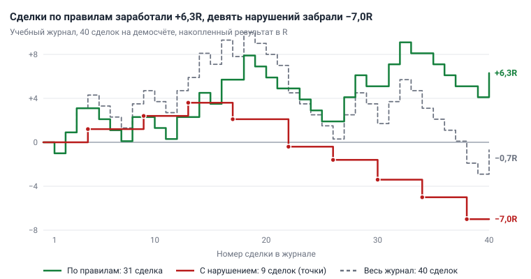
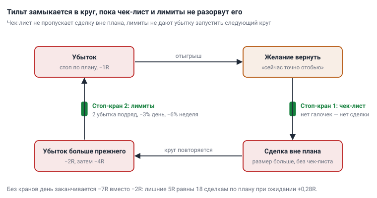

# Глава 14. Психология

> После этой главы вы умеете: измерять свою дисциплину двумя числами из журнала; узнавать девять искажений мышления в своих сделках и отвечать на каждое правилом; останавливать тильт стоп-кранами; действовать по протоколу в серии убытков и в серии прибылей; вести дневник состояния и находить связь настроения с результатом.

**Связь с курсом:** ступень 05 — [урок 1 «Почему новички сливают»](../05_Психология/01_Ошибки_новичков.md), [урок 2 «Эмоции и правила»](../05_Психология/02_Эмоции_и_правила.md), [практика](../05_Психология/Практика.md); ступень 06 — [«Когда можно переходить на реальные деньги»](../06_Своя_система/03_Критерии_перехода_на_реальные_деньги.md); уровень профи — [урок 3 «Просадка, серии убытков и Монте-Карло»](../09_Уровень_профи/03_Просадка_и_Монте-Карло.md), [урок 9 «Процесс профессионала»](../09_Уровень_профи/09_Процесс_профессионала.md).

## 14.1. Разрыв между планом и исполнением

Психология в трейдинге — это разница между тем, что записано в торговом плане, и тем, что вы сделали. План: вход по сетапу, стоп за экстремумом, риск 1%. Исполнение: вход раньше сигнала, стоп сдвинут, размер удвоен после убытка. Эту разницу измеряют по журналу.

В журнале курса ([глава 13](13_Торговый_план_бэктест_журнал.md)) есть столбец «Правила соблюдены?». Из него получаются два числа:

1. **Доля сделок по правилам** — какая часть сделок прошла по [чек-листу](../07_Справочник/Чек-лист_перед_сделкой.md) без отступлений. Норма курса — 95% и выше.
2. **Результат сделок с нарушением** — итог и среднее в R отдельно по сделкам с ответом «нет». R — риск одной сделки, единица измерения результата ([глава 11](11_Риск_менеджмент.md)).

Пример. Условный учебный журнал: 40 сделок на демосчёте, депозит 10 000 $, риск 1%, то есть 1R = 100 $.

| Группа сделок | Сделок | Прибыльных | Итог | В среднем на сделку |
|---|---|---|---|---|
| По правилам | 31 | 12 | +6,3R | +0,20R |
| С нарушением | 9 | 3 | −7,0R | −0,78R |
| Весь журнал | 40 | 15 | −0,7R | −0,02R |

Доля сделок по правилам — 31 из 40, то есть 77,5%. Система за период заработала 6,3R (+630 $). Девять нарушений забрали 7,0R (−700 $) и сделали период убыточным. Средний убыток в сделках с нарушением — 1,77R вместо 1R: стоп сдвигали, размер завышали.



*Рис. 14.1. Учебный журнал, 40 сделок, накопленный результат в R. Зелёная линия — сделки по правилам, красная — сделки с нарушением, пунктир — весь журнал.*

Этому трейдеру не нужна новая стратегия. Ему нужно перестать делать девять сделок из сорока. Пока журнал не разделён на две группы, непонятно, что чинить: систему или исполнение.

Три сделки с нарушением закрылись в плюс. Курс называет такую прибыль плохой: она учит нарушать. Убыток по правилам — хорошая сделка: вы сделали всё, что от вас зависело.

Посчитайте оба числа по своему журналу и пересчитывайте их на каждом воскресном разборе.

## 14.2. Почему человек нарушает собственный план

План нарушается по предсказуемым причинам: человек оценивает прибыль и убыток несимметрично. **Когнитивное искажение** — устойчивая ошибка мышления, которая повторяется у разных людей в одинаковых обстоятельствах. Знать о ней мало: в момент сделки она срабатывает раньше, чем вы успеваете подумать. Надёжнее правило, записанное до сделки.

Основу описали Даниэль Канеман и Амос Тверски в 1979 году в теории перспектив [1]. Человек оценивает изменение от точки отсчёта, а не итоговую сумму; для трейдера точка отсчёта — цена входа. Убыток при этом ощущается сильнее, чем прибыль того же размера. Это **неприятие потерь** (loss aversion). Второе следствие: в прибыли человек избегает риска и забирает «верное», в убытке идёт на риск, лишь бы не фиксировать потерю.

Отсюда **эффект диспозиции** (disposition effect) — склонность рано закрывать прибыльные позиции и долго держать убыточные. Название дали Херш Шефрин и Меир Статман в 1985 году [2]. Терранс Одеан проверил эффект на 10 000 счетов клиентов американского брокера за 1987–1993 годы [3]. В дни продаж из позиций в плюсе инвесторы продавали 14,8%, из позиций в минусе — 9,8%: прибыль фиксировали в полтора раза охотнее. Проданные прибыльные акции за следующий год обогнали оставленные убыточные на 3,4 процентного пункта. Надежда «убыточная отрастёт» в среднем не оправдалась.

Это данные об акциях и частных инвесторах, не о криптотрейдерах. На графике BTC/USDT то же поведение выглядит так: сделка в плюсе на 1R закрыта «пока дают», сделка у стопа получает «ещё немного места».

Цена такого поведения считается через ожидание на сделку ([глава 11](11_Риск_менеджмент.md)). Система из урока курса: винрейт 40%, средняя прибыль 2,2R, средний убыток 1R.

```
E = 0,40 × 2,2 − 0,60 × 1,0 = +0,28R
```

Трейдер закрывает прибыль на +1R и сдвигает стопы до −1,5R. Прибыльных сделок становится больше, допустим 55%:

```
E = 0,55 × 1,0 − 0,45 × 1,5 = −0,125R
```

Винрейт вырос с 40% до 55%, а система стала убыточной: −12,5R на 100 сделок вместо +28R. Ощущение «я чаще прав» при этом усилилось. Поэтому дисциплину проверяют по журналу, а не по ощущениям.

## 14.3. Девять искажений и правило против каждого

Каждое искажение проявляется в сделке одним и тем же способом, поэтому правило против него записывают заранее. Таблица — справочник: найдите свои строки по журналу и перенесите правила в торговый план.

| Искажение | Как проявляется в сделке | Чем заканчивается | Правило-противоядие |
|---|---|---|---|
| **Неприятие потерь**: убыток ощущается сильнее равной прибыли | Цена идёт к стопу, вы сдвигаете стоп дальше или убираете его | Убыток 2–3R вместо 1R; одна сделка стирает неделю работы | Стоп выставлен ордером при входе и двигается только в сторону прибыли ([глава 12](12_Сопровождение_и_выход.md)) |
| **Эффект диспозиции**: прибыль фиксируют рано, убыток держат | Закрываете сделку на +0,5R «пока дают», убыточную держите до стопа и дальше | Средняя прибыль меньше среднего убытка, ожидание уходит в минус | Выход только по плану: стоп, цель, трейлинг. Досрочный выход — по условиям, записанным до входа |
| **Самоуверенность** после серии прибылей | После 4–5 плюсов подряд увеличиваете размер и берёте сетапы «почти по правилам» | Самая крупная позиция приходится на первый же убыток и съедает серию | Риск на сделку меняется только на месячном разборе |
| **Эффект недавнего**: последние сделки кажутся важнее всей статистики | После трёх стопов «стратегия сломалась», после трёх тейков «нашёл грааль» | Смена стратегии каждую неделю, ни одна не проверена | Решения о системе — раз в месяц и по выборке от 30 сделок |
| **Ошибка игрока**: вера, что после серии убытков «пора» быть прибыли | Удваиваете размер пятой сделки, потому что четыре стопа подряд «не могут продолжиться» | Вероятность не изменилась, убыток удвоился | Размер считается по одной формуле; прошлые результаты в неё не входят |
| **Невозвратные затраты**: жаль уже вложенных денег и времени | Усредняете убыточную позицию или держите её, потому что «столько уже просидел» | Позиция растёт против вас, убыток выходит за лимиты | Вопрос: «Открыл бы я эту сделку сейчас, с нуля?» Нет — выход. Усреднение против позиции запрещено |
| **Предвзятость подтверждения**: поиск доводов только за свою идею | Открыв лонг, читаете только прогнозы роста и не замечаете сигналов против | Держите сделку, когда график уже отменил идею | До входа запишите, что сделает идею неверной ([глава 9](09_Алгоритм_анализа_сверху_вниз.md)); это и есть стоп |
| **FOMO** — страх упустить движение | Цена ушла без вас, вы входите рыночным ордером на длинной свече | Вход далеко от уровня: стоп широкий или не по структуре, R:R хуже 1:2 | Вход только в зоне сетапа. Цена ушла — ждёте отката в зону или следующего сетапа |
| **Отыгрыш**: желание сразу вернуть убыток | Сразу после стопа новая сделка: размер больше, чек-лист пропущен | Дневной убыток в разы больше планового; так начинается тильт (раздел 14.4) | После 2 убытков подряд — стоп на день. Размер после убытка не увеличивается |

Эффект недавнего и ошибка игрока тянут в разные стороны. Первый говорит «так будет и дальше», вторая — «сейчас всё развернётся». Оба неверны по одной причине: сделки одной системы близки к независимым событиям. При винрейте 40% вероятность убытка в следующей сделке — 60%, в том числе после четырёх убытков подряд.

Правило работает, когда оно записано до сделки и стоит в чек-листе. В момент сделки вы не спорите с собой, а читаете строку плана.

## 14.4. Тильт: признаки и стоп-краны

**Тильт** — состояние, в котором решения принимает эмоция, а план перестаёт исполняться. Он начинается с отыгрыша и идёт по кругу: убыток, желание вернуть, сделка вне плана, убыток больше прежнего, желание ещё сильнее.

Пример одного вечера. Депозит 10 000 $, 1R = 100 $. Сделка по плану: −1R. Через десять минут вторая, без чек-листа и вдвое крупнее: −2R. Третья, «теперь точно», ещё вдвое крупнее: −4R. Итог дня: −7R, или −7% депозита. По правилам день закончился бы на −2R. Лишние 5R при ожидании +0,28R на сделку — это 18 сделок работы по плану.

Признаки тильта из [урока 9 уровня профи](../09_Уровень_профи/09_Процесс_профессионала.md):

- размер позиции «чуть больше обычного»;
- вход без чек-листа;
- сделка сразу после стопа;
- мысль «сейчас точно отобью»;
- пять сделок за час на системе, которая торгует по 4H.

**Стоп-кран** — правило, которое останавливает торговлю по заранее записанному условию и не обсуждается в моменте.

| Стоп-кран | Условие | Действие |
|---|---|---|
| Серия | 2 убыточные сделки подряд | Новых сделок сегодня нет |
| Дневной лимит | Потери за день достигли 3% депозита | Торговля закрыта до завтра |
| Недельный лимит | Потери за неделю достигли 6% депозита | Пауза до понедельника, разбор журнала |
| Признак тильта | Любой пункт из списка выше | Закрыть окно биржи, запись в журнал, разбор на неделе |



*Рис. 14.2. Петля тильта. Чек-лист не пропускает сделку вне плана, лимиты не дают убытку запустить следующий круг.*

При риске 1% кран серии срабатывает на −2%, раньше дневного лимита. Дневной лимит страхует остальные случаи: риск на сделку выше 1%, две позиции закрылись по стопу одновременно, сделка закрылась хуже стопа из-за проскальзывания. Недельный лимит ловит медленную серию: шесть убытков по 1% за несколько дней.

Кран запрещает новые сделки. Открытые позиции остаются под своими стопами и ведутся по плану. В уроке уровня профи кран серии стоит на трёх убытках: это для трейдера с проверенной системой. Новичку учебник оставляет два, как в ступени 05.

Стоп-кран не работает, если его можно обсудить: «сегодня особый случай». Выпишите правила на лист, повесьте у монитора и задайте технически всё, что позволяет биржа (раздел 14.6).

## 14.5. Цели по процессу вместо целей по деньгам

Цель в деньгах вы не контролируете, и она толкает к риску. Возьмём цель «+10% в месяц». Рынок не обязан дать нужное число сетапов к 30-му числу. Если к 20-му счёт в плюсе на 2%, цель требует либо брать слабые сетапы, либо поднимать риск. Оба пути — нарушения плана.

**Цель по процессу** зависит только от вас и проверяется по журналу:

- 95% сделок и больше — по чек-листу;
- ни одного нарушения дневного и недельного лимита;
- каждая сделка записана в журнал в день закрытия, оценка настроения поставлена до входа;
- разбор проведён каждое воскресенье.

Результат в деньгах — следствие. День оценивайте вопросом «я исполнил план?», а не «я заработал?». День с двумя убытками по правилам и остановкой — цель выполнена. День с прибылью на удвоенном размере — цель провалена.

## 14.6. Среда и распорядок

Дисциплина держится на среде, а не на силе воли: уберите возможность нарушить, и нарушений станет меньше.

**До сессии, 10–15 минут.** Анализ сделан заранее по алгоритму из [главы 9](09_Алгоритм_анализа_сверху_вниз.md): уровни размечены, сценарии записаны. Перед сессией проверьте четыре вещи:

1. Состояние: оценка от 1 до 5 (раздел 14.11).
2. Сколько осталось до дневного и недельного лимита.
3. Календарь: нет ли важной новости в ближайшие часы.
4. Оповещения стоят на всех уровнях из сценариев.

**Оповещения вместо экрана.** Система на 4H принимает решения по закрытию свечи 4H, шесть раз в сутки ([глава 8](08_Таймфреймы_анализ_и_вход.md)). Между закрытиями экран не даёт системе новой информации, зато даёт поводы для импульсивных сделок. **Оповещение** (alert) — уведомление, которое платформа присылает, когда выполнено заданное условие. В TradingView оповещение ставится на цену, индикатор или нарисованную линию и приходит в приложение, всплывающим окном или на почту [4]. Поставьте оповещения на границы зон и закройте график. К экрану возвращайтесь по оповещению или к закрытию свечи.

**Настройки на бирже.** Всё, что можно задать заранее, задайте заранее:

- стоп выставляется ордером сразу при входе, а не «в уме»;
- плечо в настройках фьючерсов — 1x;
- на торговом счёте лежит только торговый депозит;
- приложение биржи в телефоне — для экстренного закрытия, а не для торговли;
- если биржа позволяет, включайте принудительную паузу после стоп-крана. Пример: на Binance для фьючерсов есть функция Cooling Period, она отключает торговлю на срок от одного дня и досрочно не снимается [5]. Условия проверьте на своей бирже.

**Состояние.** Курс запрещает торговать уставшим, злым и после алкоголя. Добавьте недосып, болезнь, спешку и сильные события вне рынка: ссору, плохую новость, большую радость.

**Когда не торговать.** В шаблоне торгового плана есть раздел «Когда не торгую». Заполните его:

- оценка состояния 1 или 2;
- сработал любой стоп-кран;
- нет 15 минут на чек-лист и запись в журнал;
- за 30 минут до и 30 минут после важной новости;
- нет сетапа из плана.

Пропустить сделку — нормально: рынок будет и завтра.

## 14.7. Серия убытков: что нормально и что делать

Серия убытков — обычная часть работы прибыльной системы, и её длину оценивают заранее. [Урок 3 уровня профи](../09_Уровень_профи/03_Просадка_и_Монте-Карло.md) даёт ориентир самой длинной серии на 100 сделок: при винрейте 60% — 5 убытков подряд, при 50% — 7, при 40% — 9, при 30% — 13. Расчёт серий и просадки разобран в [главе 11](11_Риск_менеджмент.md).

Расчёт для 100 независимых сделок при винрейте 40%: серия из 5 убытков подряд случается почти наверняка (98%), из 7 — в двух случаях из трёх (69%), из 9 — в каждом третьем (32%). При риске 1% девять убытков подряд — это −8,6% счёта.

Первый вопрос в серии: убытки были по правилам или с нарушением? Ответ лежит в столбце «Правила соблюдены?». Дальше — протокол:

1. **Стоп-краны действуют как обычно.** День закрыт после двух убытков подряд, неделя — после −6%.
2. **Убытки по правилам, серия не длиннее ориентира.** Систему не меняете, размер не увеличиваете, торгуете дальше.
3. **Просадка от максимума счёта больше 10%.** Риск на сделку вдвое меньше, 0,5% вместо 1%, пока счёт не обновит максимум.
4. **Серия длиннее ориентира или ожидание на последних 50 сделках ниже 0,1R.** Разбор: сравните сделки серии с плейбуком и бэктестом ([глава 13](13_Торговый_план_бэктест_журнал.md)). Проверьте рынок: трендовая система в боковике даёт серии. Меняйте один параметр за раз и только после проверки на истории.
5. **В серии есть нарушения.** Проблема в исполнении, а не в системе. С реального счёта возвращайтесь на демо. Обратно — когда на демо снова 95% сделок по правилам и месяц без нарушений дневного лимита.

В серии нельзя увеличивать размер, отключать стоп, менять стратегию после трёх стопов и добавлять фильтры на ходу.

## 14.8. Серия прибылей

Серия прибылей проверяет дисциплину не слабее серии убытков: кажется, что правила можно ослабить. Появляется вера в чутьё, размер растёт, чек-лист сокращается. Самая крупная и самая небрежная сделка приходится на конец серии.

Серия прибылей — такая же случайность, как серия убытков. При винрейте 40% серия из 4 прибыльных сделок подряд за 100 сделок случается в 80% случаев, из 5 — в 46%. О мастерстве она ничего не говорит.

Протокол:

1. Риск на сделку внутри серии не меняется. Пересмотр — на месячном разборе по правилам [главы 11](11_Риск_менеджмент.md).
2. Чек-лист заполняется полностью для каждой сделки, включая «очевидные».
3. После 4 прибылей подряд запишите в журнал, какой сейчас рынок. Серия часто объясняется сильным трендом, а не вашими решениями, и закончится вместе с ним.
4. Капитал на реальном счёте увеличивают ступенями и по критериям ([глава 15](15_Дорожная_карта.md)), а не после удачной недели.

## 14.9. Давление денег

Торговать можно только на деньги, потерю которых вы переживёте без последствий для жизни. Курс говорит: «сумма, которую не жалко потерять полностью». Если на счёте деньги на аренду, платёж по кредиту или заёмные, стоп угрожает уже не счёту, а быту. Неприятие потерь усиливается, стоп сдвигается, убыток «пережидается».

Второй вид давления — срок. На счёте 2 000 $, к концу месяца нужно 500 $, то есть +25%. Система из раздела 14.2 при 20 сделках в месяц приносит в среднем 5,6R. Чтобы 5,6R стали 25% счёта, риск на сделку должен быть около 4,5% — более чем вдвое выше потолка курса в 2%. Серия из 5 убытков подряд при таком риске снимает 21% счёта. За 20 сделок при винрейте 40% она случается почти в половине случаев (48%). И 5,6R — среднее за много месяцев, а не обещание на этот.

Рынок не знает о ваших сроках. Правила:

- на торговом счёте только свободные деньги, обязательные платежи от него не зависят;
- целей «к дате» нет: система не выдаёт результат по расписанию;
- доход от торговли не закладывается в бюджет;
- после увеличения счёта первый месяц риск вдвое меньше: новая сумма меняет эмоции при тех же правилах.

## 14.10. Чужие сигналы, чаты, соцсети

Чужой сигнал — это сделка без вашей идеи, вашего стопа и вашей статистики. Вы не знаете, где автор признаёт идею неверной, какой у него размер и какая доля его сигналов прибыльна. Когда цена пойдёт против, у вас не будет причины ни держать позицию, ни закрыть её. Решение примет эмоция.

Ленты и чаты искажают картину тремя способами:

- показывают прибыльные сделки чаще убыточных, и вы видите отобранную выборку;
- создают FOMO: «все уже в сделке»;
- кормят предвзятость подтверждения: под любую позицию найдётся чат, где с вами согласны.

Правила:

1. Во время сессии чаты и ленты закрыты.
2. Чужая идея — повод открыть график и пройти свой алгоритм анализа. Нет сетапа из вашего плана — нет сделки.
3. Размер, плечо и стоп не копируются: они считаются от вашего депозита и вашего стопа.
4. Открытые позиции не публикуйте. Публичное заявление труднее отменить, даже когда график отменил идею.
5. Сравнивайте себя только со своим журналом.

## 14.11. Дневник состояния

Дневник состояния — это столбец «Настроение 1–5» в журнале курса, заполненный до входа в сделку. После сделки оценка уже зависит от результата и ничего не объясняет. Шкала измеряет готовность следовать плану, а не радость:

| Оценка | Состояние |
|---|---|
| 1 | Злость, желание отыграться, сильная усталость |
| 2 | Раздражение, тревога, недосып, спешка, возбуждение после крупной прибыли |
| 3 | Ровное, без заметных эмоций |
| 4 | Спокоен и собран |
| 5 | Спокоен, выспался, никуда не спешу |

Рядом с оценкой пишите причину одним-двумя словами: «недосып», «после стопа», «спешу».

Связь с результатом ищут группировкой. Разделите сделки по оценке и посчитайте для каждой группы число сделок, долю сделок по правилам, итог и среднее в R. Тот же учебный журнал из раздела 14.1:

| Настроение | Сделок | По правилам | Итог | В среднем на сделку |
|---|---|---|---|---|
| 1–2 | 8 | 3 из 8 (38%) | −6,6R | −0,83R |
| 3 | 14 | 11 из 14 (79%) | −0,7R | −0,05R |
| 4–5 | 18 | 17 из 18 (94%) | +6,6R | +0,37R |

Пять из девяти нарушений сделаны при оценке 1–2. Без этих восьми сделок период закрылся бы на +5,9R вместо −0,7R.

Восемь сделок — мало для вывода: курс принимает решения по срезам от 30 сделок, а оценка субъективна. Пересчитывайте таблицу по мере роста журнала. Правило «при оценке 1–2 не торгую» статистики не ждёт: запрет торговать уставшим и злым уже стоит в курсе.

Посмотрите и на причины низких оценок. Если чаще всего это «после стопа», ваш главный инструмент — кран серии. Если «недосып» — меняйте время сессии.

## 14.12. Типичные ошибки

- Искать новую стратегию, не разделив журнал на сделки по правилам и сделки с нарушением.
- Считать прибыльную сделку с нарушением удачей, а не ошибкой.
- Обсуждать стоп-кран в момент срабатывания.
- Ставить цель в деньгах или к дате.
- Сидеть у экрана между закрытиями свечей.
- Увеличивать размер после серии прибылей или чтобы отыграться.
- Ставить оценку настроения после сделки.
- Входить по чужому сигналу без своего анализа и своего стопа.

## 14.13. Запомнить

- Психология — разрыв между планом и исполнением. Он измеряется долей сделок по правилам и результатом сделок с нарушением.
- Убыток по правилам — хорошая сделка. Прибыль с нарушением — плохая.
- Одного знания об искажении мало. Нужно правило, записанное до сделки.
- Стоп-краны: 2 убытка подряд — стоп на день; −3% за день — закрыто до завтра; −6% за неделю — пауза до понедельника.
- Цели — по процессу: 95% сделок по чек-листу, ноль нарушений лимитов, журнал, воскресный разбор.
- При винрейте 40–50% серия из 5–7 убытков подряд на 100 сделок — норма. В серии сначала проверяют исполнение, потом систему.
- Оценка состояния ставится до сделки. При оценке 1–2 сделок нет.

## 14.14. Практика на демосчёте

Это упражнения на самонаблюдение: наблюдайте за собой, как за графиком, и записывайте.

- [ ] Выпишите на один лист стоп-краны и список «Когда не торгую». Повесьте лист у монитора и перенесите оба списка в торговый план.
- [ ] Посчитайте по журналу долю сделок по правилам и отдельно итог и среднее в R для сделок с нарушением. Запишите оба числа с датой.
- [ ] Неделю перед каждой сделкой ставьте оценку настроения 1–5 и причину. Через неделю сгруппируйте сделки по оценке, как в разделе 14.11.
- [ ] Пауза после стопа. Неделю после каждого убытка ставьте таймер на 10 минут и записывайте, что хочется сделать сейчас. В конце недели посчитайте, сколько раз из скольких это была новая сделка.
- [ ] Журнал импульсов. Неделю записывайте каждое желание войти вне плана: время, что увидели, что почувствовали, вошли или нет. Посчитайте импульсы и найдите самый частый повод.
- [ ] Один день работайте только по оповещениям, другой — с открытым графиком. Сравните число импульсов.
- [ ] Отметьте в последних 20 сделках с нарушением или с досрочным выходом, какое искажение из таблицы 14.3 сработало. Правило против самого частого внесите в чек-лист.

## 14.15. Вопросы для самопроверки

1. Какими двумя числами измеряют разрыв между планом и исполнением и откуда их берут?
2. В журнале 50 сделок: 44 по правилам с итогом +11R и 6 с нарушением с итогом −5,4R. Посчитайте долю сделок по правилам, среднее на сделку в каждой группе и общий итог. Выполнен ли критерий дисциплины для перехода на реальный счёт?
3. Система по плану: винрейт 40%, средняя прибыль 2,2R, средний убыток 1R. Трейдер начал закрывать прибыль раньше и сдвигать стопы: винрейт 60%, средняя прибыль 0,8R, средний убыток 1,3R. Посчитайте ожидание до и после. Какое искажение сработало?
4. После четырёх стопов подряд трейдер удваивает размер пятой сделки: «пятый убыток подряд почти невозможен». Как называется искажение и какова вероятность убытка в пятой сделке при винрейте 40%?
5. Депозит 10 000 $, риск 1%. За день трейдер закрыл три сделки: −1R, −1R, −2R (в третьей удвоил размер). Какие стоп-краны нарушены и каков итог дня? Каким он был бы по правилам?
6. К пятнице результат недели −5%. Первая сделка пятницы закрылась по стопу: −1R при риске 1%. Что делать дальше?
7. Почему цель «+10% в месяц» вредна и чем её заменить?
8. Винрейт системы 50%. На 100 сделках случилась серия из 7 убытков подряд, все сделки по правилам, риск 1%. Что это значит и что вы делаете?
9. Перед сделкой вы поставили настроение 2 с причиной «после стопа». Сетап полностью по плану. Ваши действия?
10. В чате опубликовали сигнал на лонг ETH/USDT с плечом 10x. Что вы делаете с этой информацией?

## 14.16. Ответы

1. Доля сделок по правилам и результат сделок с нарушением. Оба числа считают по столбцу «Правила соблюдены?» в журнале.
2. Доля: 44 из 50, то есть 88%. По правилам: +11R / 44 = +0,25R на сделку. С нарушением: −5,4R / 6 = −0,90R на сделку. Общий итог: +5,6R, или +0,11R на сделку. Критерий не выполнен: нужно 95% и больше.
3. До: 0,40 × 2,2 − 0,60 × 1,0 = +0,28R. После: 0,60 × 0,8 − 0,40 × 1,3 = −0,04R. Сработал эффект диспозиции: винрейт вырос, система стала убыточной.
4. Ошибка игрока. Вероятность убытка — 60%, как в любой сделке этой системы: прошлые результаты её не меняют.
5. Третья сделка открыта после двух убытков подряд: нарушен кран серии. Размер увеличен после убытка: это отыгрыш. Итог дня −4R, то есть −400 $ и −4% депозита: превышен дневной лимит 3%. По правилам день закончился бы после второй сделки на −2R, то есть −200 $.
6. Результат недели стал −6%: сработал недельный лимит. Новых сделок нет до понедельника, в выходные — разбор журнала.
7. Результат в деньгах вы не контролируете, и такая цель толкает брать слабые сетапы и поднимать риск. Замена — цели по процессу: 95% сделок по чек-листу, ноль нарушений лимитов, журнал, воскресный разбор.
8. Это норма: ориентир курса для винрейта 50% на 100 сделок — как раз 7 убытков подряд. Просадка около −6,8%, меньше 10%, поэтому риск остаётся 1%. Систему не меняете, размер не увеличиваете, стоп-краны действуют как обычно.
9. Сделки нет: оценка 1–2 стоит в списке «Когда не торгую». Причина «после стопа» — признак отыгрыша. Ставите оповещение и возвращаетесь к графику к следующему закрытию свечи 4H, если состояние изменилось.
10. Не копируете. Открываете график и проходите свой алгоритм анализа. Есть сетап из вашего плана — входите со своим стопом, риском 1% и без плеча. Сетапа нет — сделки нет.

## Источники

1. Kahneman D., Tversky A. Prospect Theory: An Analysis of Decision under Risk. Econometrica, 1979, т. 47, № 2. [Страница статьи на сайте Econometric Society](https://www.econometricsociety.org/publications/econometrica/1979/03/01/prospect-theory-analysis-decision-under-risk).
2. Shefrin H., Statman M. The Disposition to Sell Winners Too Early and Ride Losers Too Long: Theory and Evidence. The Journal of Finance, 1985, т. 40, с. 777–790. Авторство термина и выходные данные приведены по статье [3].
3. Odean T. Are Investors Reluctant to Realize Their Losses? The Journal of Finance, 1998, т. 53, № 5, с. 1775–1798. [Текст на сайте автора](https://faculty.haas.berkeley.edu/odean/papers%20current%20versions/areinvestorsreluctant.pdf).
4. TradingView. [About TradingView alerts](https://www.tradingview.com/support/solutions/43000520149).
5. Binance. [What Is the Cooling Period Function and How to Use It?](https://www.binance.com/en/support/faq/what-is-the-cooling-period-function-and-how-to-use-it-ad7fd07f63a64954a6d6e9257d16adcc)
