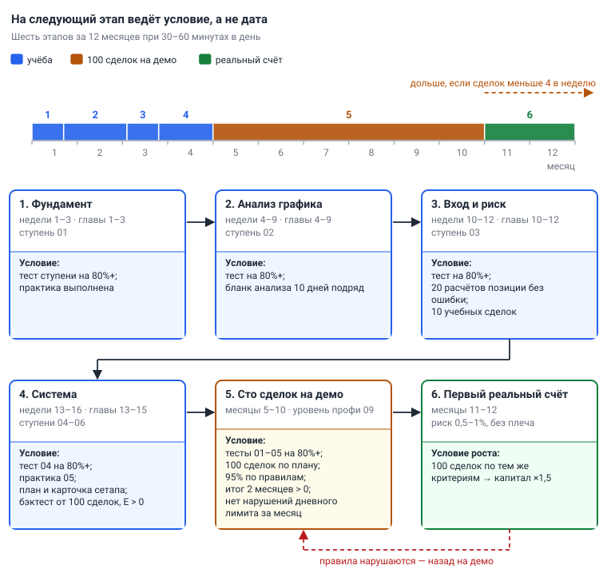

# Глава 15. Дорожная карта на 12 месяцев

> После этой главы вы умеете: разложить обучение на шесть этапов и проверить условие перехода на каждом; вести торговый день и неделю по закрытиям свечей 4H; пройти чек-лист перед сделкой и чек-листы недельного и месячного разбора; открыть первый реальный счёт по критериям курса и вернуться на демо, когда правила нарушаются.

**Связь с курсом:** [порядок прохождения и сроки](../README.md), [шаблон торгового плана](../06_Своя_система/01_Торговый_план_шаблон.md), [критерии перехода на реальные деньги](../06_Своя_система/03_Критерии_перехода_на_реальные_деньги.md), [чек-лист перед сделкой](../07_Справочник/Чек-лист_перед_сделкой.md), [уровень профи, урок 8 «Исполнение и безопасность»](../09_Уровень_профи/08_Исполнение_и_безопасность.md), [урок 9 «Процесс профессионала»](../09_Уровень_профи/09_Процесс_профессионала.md), [приложение курса](../app/README.md).

## 15.1. Шесть этапов: переход по условию, а не по дате

Год обучения делится на шесть этапов, и на следующий вы переходите, когда выполнено проверяемое условие, а не когда закончился месяц. Сроки в карте — ориентир при 30–60 минутах в день. Этап, пройденный без условия, придётся проходить заново, уже на реальных деньгах.

| Этап | Срок | Главы | Курс | Условие перехода |
|---|---|---|---|---|
| 1. Фундамент | недели 1–3 | 1–3 | ступень 01 | тест ступени на 80%+, практика выполнена |
| 2. Анализ графика | недели 4–9 | 4–9 | ступень 02 | тест на 80%+; бланк анализа из главы 9 заполнен 10 дней подряд по BTC и ETH |
| 3. Вход и риск | недели 10–12 | 10–12 | ступень 03 | тест на 80%+; 20 расчётов размера позиции подряд без ошибки; 10 учебных сделок на демо с чек-листом и записью в журнал |
| 4. Система | недели 13–16 | 13–15 | ступени 04, 05 и 06 | тест ступени 04 на 80%+; практика ступени 05 выполнена; торговый план на одной странице; карточка сетапа; бэктест от 100 сделок с положительным ожиданием после комиссий |
| 5. Сто сделок на демо | месяцы 5–10 | повтор по журналу | уровень профи 09 | пять критериев курса (раздел 15.4) |
| 6. Первый реальный счёт | месяцы 11–12 | — | уровень профи 09, уроки 8–9 | 100 сделок на реальном счёте с теми же критериями — тогда первая ступень роста капитала |



*Рис. 15.1. Шесть этапов года. Под каждым этапом — условие, без которого следующий не начинается. Этап 5 занимает половину года и может длиться дольше.*

Порядок ступеней курса жёсткий: следующая открывается после теста на 80% и выполненной практики. Поэтому ступень 04 вы проходите на этапе 4, после ступени 03, хотя глава 10 читается раньше. Практика стратегий, на которую курс отводит 2–3 месяца, — это учебные сделки этапов 3–4 и начало этапа 5.

Действие: найдите первый этап, условие которого у вас не выполнено. Вы находитесь на нём, сколько бы месяцев ни прошло.

## 15.2. Этапы 1–4: шестнадцать недель учёбы

Первые четыре этапа идут в темпе «глава в неделю»: 15 глав и запасная неделя на бэктест, всего 16 недель, или 3,7 месяца.

Реальных денег на этих этапах нет. Сделки на демо начинаются на этапе 3 и остаются учебными: их задача — научиться проходить чек-лист и считать размер позиции, а не заработать. Расчёты сверяйте с калькулятором риска в приложении курса.

На этапе 4 появляются три документа из [главы 13](13_Торговый_план_бэктест_журнал.md): торговый план, карточка сетапа и таблица бэктеста. Дату первой версии плана запишите: с неё начинается счёт ста сделок. Если бэктест дал отрицательное ожидание, вы меняете одно правило и повторяете проверку. Этап 5 с убыточным на истории планом не начинают.

## 15.3. Неделя занятий: 30–60 минут в день

Занятие каждый день по 30–60 минут даёт больше, чем один длинный день в неделю: навык чтения графика набирается повторением. План ниже занимает 305 минут, около пяти часов в неделю.

| День | Минут | Что делаете |
|---|---|---|
| Понедельник | 40 | первая половина главы; новые термины — в тетрадь своими словами |
| Вторник | 40 | вторая половина главы; вопросы для самопроверки письменно, затем ответы |
| Среда | 45 | уроки курса из строки «Связь с курсом» |
| Четверг | 45 | практика главы на графике BTC/USDT: сначала 1D, затем 4H |
| Пятница | 45 | то же на ETH/USDT; задания практики ступени на демосчёте |
| Суббота | 30 | тест ступени, если уроки и практика закончены; иначе — работа над ошибками |
| Воскресенье | 60 | итог недели: что не получилось, одна задача на следующую неделю; с этапа 3 — разбор журнала |

Если тест сдан ниже 80%, неделя повторяется с той же главой.

## 15.4. Этап 5: сто сделок на демо

Этап 5 измеряется сделками, а не месяцами: нужно 100 сделок на демосчёте по своему торговому плану, в реальном времени. Его срок считается заранее.

```
Срок этапа 5 (недель) = 100 / Среднее число сделок в неделю
```

Частоту берите из своего бэктеста: число сделок делите на число недель истории.

| Сделок в неделю | Срок, недель | Срок, месяцев |
|---|---|---|
| 4 | 25 | 5,7 |
| 3 | 33 | 7,7 |
| 2 | 50 | 11,5 |
| 1 | 100 | 23 |

Шесть месяцев из карты, 26 недель, требуют около четырёх сделок в неделю. Для системы на 4H с одной моделью входа это много. Одно правило из демонстрационного бэктеста [главы 13](13_Торговый_план_бэктест_журнал.md) дало 142 сделки за 6,8 года, около 21 в год; с ним одним этап занял бы 4,8 года.

Частоту повышают три вещи: две монеты, обе стороны рынка (шорт на фьючерсах 1x) и вторая-третья модель входа из [главы 10](10_Модели_входа.md), каждая со своей карточкой и бэктестом. Младший таймфрейм и слабые сетапы в этот список не входят. Если после этого выходит две сделки в неделю, ваша карта длиннее года. Критерий не снижается, сдвигается календарь.

Параллельно вы проходите [уровень профи](../09_Уровень_профи/01_Математическое_ожидание.md): он рассчитан на тех, кто уже торгует по системе и ведёт журнал. Уроки 1–3 — в первые два месяца этапа, 4–7 — в середине, 8–9 и тест — перед реальным счётом.

Критерии перехода на реальные деньги взяты из курса без изменений и выполняются все одновременно.

| Критерий курса | Как проверить по журналу |
|---|---|
| Пройдены ступени 01–05, все тесты на 80%+ | результаты тестов записаны |
| Минимум 100 сделок на демо по своему плану | 100 строк журнала после даты первой версии плана |
| Правила соблюдены минимум в 95% сделок | в графе «Правила соблюдены?» не больше 5 «нет» на 100 сделок |
| Итог за последние 2 месяца положительный | сумма результатов в R за два последних месяца больше нуля |
| Ни одного нарушения дневного лимита за последний месяц | нет дня с потерей больше 3% депозита и нет сделки, открытой после достижения лимита |

Правило, изменённое посреди этапа, удлиняет его: метрики после изменения считаются отдельно (глава 13).

## 15.5. Торговый день и недельный цикл

Система на 4H требует двух подходов к графику в день, привязанных к закрытиям свечей. Пример для UTC+3; расписание для других часовых поясов — в [главе 8](08_Таймфреймы_анализ_и_вход.md).

| Когда | Что делаете | Минут |
|---|---|---|
| 07:00, после закрытия свечи 4H | шаги 1–4 алгоритма [главы 9](09_Алгоритм_анализа_сверху_вниз.md) по BTC и ETH: календарь, тренд и зоны 1D, место цены; оповещения; проверка открытых позиций и ордеров | 20–30 |
| 19:00 или 23:00, после закрытия свечи 4H | шаги 5–6 там, где цена у зоны: сетап и свеча подтверждения | 10 |
| То же закрытие, если есть триггер | чек-лист из раздела 15.6, расчёт, ордера, запись в журнал | 15–20 |
| После вечерней проверки | итог дня в журнале: нарушения, ошибки исполнения, настроение от 1 до 5. Не результат | 5 |

Обычный день занимает 35–45 минут, день с сетапом — около часа. Между подходами график закрыт, работают оповещения ([глава 14](14_Психология.md)).

| День | Что добавляется к распорядку дня |
|---|---|
| Понедельник | свеча 1W закрылась в 03:00: обновить общую картину и зоны 1W, записать сценарии недели |
| Вторник — суббота | ничего; рынок работает без выходных, суббота — обычный торговый день |
| Воскресенье | разбор недели по журналу, 30 минут; календарь новостей на следующую неделю |
| Первое воскресенье месяца | месячный разбор, около 2 часов |

Действие: поставьте в календарь телефона три повторяющихся события — утреннюю проверку, вечернюю проверку и воскресный разбор.

## 15.6. Чек-лист перед сделкой

Перед каждой сделкой вы отвечаете на 11 вопросов, и любой ответ «нет» означает, что сделки нет. Восемь вопросов — [чек-лист курса](../07_Справочник/Чек-лист_перед_сделкой.md) дословно, три добавляет учебник. Порядок совпадает с шагами алгоритма главы 9.

- [ ] До важной новости больше 30 минут, и после неё прошло больше 30 минут? (учебник, глава 9)
- [ ] Тренд на старшем таймфрейме (1D) за меня? (курс)
- [ ] Цена стоит у зоны 1D по тренду, а до встречной зоны 1D хватает места для R:R 1:2? (учебник, [глава 5](05_Уровни_и_зоны.md))
- [ ] Это сетап из моей стратегии, а не «просто кажется»? (курс)
- [ ] Стоп стоит там, где идея становится неверной? (курс)
- [ ] У стопа есть запас 0,5 × ATR(14) на 4H за экстремумом сетапа? (учебник, [глава 12](12_Сопровождение_и_выход.md))
- [ ] R:R не меньше 1:2? (курс)
- [ ] Риск не больше 1–2% депозита, размер посчитан по формуле? (курс)
- [ ] Дневной лимит потерь не достигнут? (курс)
- [ ] Я спокоен, не пытаюсь отыграться? (курс)
- [ ] Сделка записана в журнал с причиной входа? (курс)

Пример шестого пункта: минимум сетапа — 60 000, ATR(14) на 4H равен 600 $. Запас — 0,5 × 600 = 300 $, стоп лонга стоит на 59 700. Стоп ровно на 60 000 — ответ «нет».

Сразу после входа проверьте, что стоп и цель стоят ордерами на бирже.

Действие: распечатайте список и отмечайте пункты письменно. Сделка без отметок записывается в журнал как нарушение, даже прибыльная.

## 15.7. Чек-листы разбора: неделя и месяц

Разбор отвечает на вопрос «исполнял ли я план», а не «заработал ли я». Порядок разбора и пороги метрик объяснены в [главе 13](13_Торговый_план_бэктест_журнал.md); здесь они собраны в списки.

Каждое воскресенье, 30 минут:

- [ ] Журнал сверен с историей ордеров биржи: записаны все сделки.
- [ ] Каждая сделка сравнена с карточкой сетапа, графа «Правила соблюдены?» заполнена.
- [ ] Посчитаны число сделок, итог в R и доля сделок по правилам.
- [ ] Проверены лимиты: день не хуже −3%, неделя не хуже −6%.
- [ ] Отмечены признаки тильта из главы 14.
- [ ] Обновлён счётчик этапа: сколько сделок из 100, сколько нарушений.
- [ ] Записана одна задача на неделю — про действие, а не про прибыль.

Раз в месяц, около 2 часов:

- [ ] История сделок выгружена с биржи и сохранена.
- [ ] Метрики пересчитаны по всем сделкам и по последним 50: ожидание E, профит-фактор, винрейт, максимальная просадка, доля сделок по правилам.
- [ ] Метрики сверены с порогами тревоги; выводы — только по срезам от 30 сделок.
- [ ] Корреляция BTC и ETH пересчитана за последние 90 дней.
- [ ] Риск пересмотрен: при просадке больше 10% размер вдвое меньше до нового максимума счёта.
- [ ] Заполнена таблица критериев из раздела 15.4.
- [ ] Принято не больше одного изменения плана, с датой и номером версии.

Раз в квартал по каждой системе принимается одно из трёх решений: оставить, изменить один параметр, отставить.

## 15.8. Этап 6: первый реальный счёт

Первый реальный счёт проверяет вас, а не систему: правила те же, меняются только эмоции. Поэтому всё, что можно уменьшить, уменьшается.

**Сумма.** Курс задаёт одно условие: сумма, которую не жалко потерять полностью. Не кредит, не резерв и не деньги на жильё. Нижнюю границу задаёт биржа: позиция при риске 0,5% должна проходить её минимальный размер ордера.

**Риск.** Курс снижает риск вдвое по сравнению с обычными 1–2%: на реальном счёте 0,5–1% на сделку. Начинайте с нижней границы, 0,5%. Первый месяц — те же правила и никакого плеча. Пример: счёт 1 000 $, риск 0,5% = 5 $. Стоп в 2,5% от входа даёт позицию 5 / 0,025 = 200 $. Комиссия за вход и выход на споте — 0,2% от 200 $, то есть 0,40 $, или 0,08R. Дневной лимит 3% — это 30 $.

**До пополнения.** Настройте защиту из [урока 8 уровня профи](../09_Уровень_профи/08_Исполнение_и_безопасность.md): двухфакторный вход через приложение, белый список адресов вывода, отдельную почту и уникальный пароль ([глава 2](02_Рынок_и_механика_торгов.md)).

**Возврат на демо.** Курс формулирует правило так: если правила начинают нарушаться — назад на демо. Учебник делает его проверяемым. Возврат наступает в любом из трёх случаев:

- нарушен дневной лимит потерь;
- применён запрещённый приём: стоп сдвинут дальше от цены или убран, позиция усреднена против движения, объём увеличен ради отыгрыша;
- в последних 20 сделках два нарушения и больше, то есть доля сделок по правилам упала до 90% и ниже.

На демо вы делаете 20 сделок подряд по правилам и возвращаетесь с риском 0,5%. Возврат — предусмотренный шаг карты, а не провал.

## 15.9. Рост капитала, учёт и налоги

Капитал увеличивают ступенями, и поводом служит выполненный критерий, а не удачный месяц. Правило [урока 9 уровня профи](../09_Уровень_профи/09_Процесс_профессионала.md): ступень, например ×1,5, — только когда за 100 сделок выполнены критерии допуска. После каждого увеличения первый месяц риск вдвое меньше: новая сумма меняет эмоции при тех же правилах.

| Ступень | Капитал | Риск в первый месяц, 0,5% | Риск дальше, 1% |
|---|---|---|---|
| Старт | 1 000 $ | 5 $ | 10 $ |
| 1 | 1 500 $ | 7,50 $ | 15 $ |
| 2 | 2 250 $ | 11,25 $ | 22,50 $ |

Между ступенями — не меньше 100 сделок, при двух сделках в неделю это почти год.

**Учёт.** Каждый месяц выгружайте историю сделок с биржи и храните файл отдельно от неё. Во многих странах прибыль от торговли криптовалютой облагается налогом, а вести учёт обязаны вы сами. Правила различаются, поэтому выясните требования своей страны у специалиста до первой реальной сделки. Учебник налоговых советов не даёт.

## 15.10. Четыре тупика и выход из каждого

Тупик — это занятие, которое выглядит как работа над торговлей и не приближает ни к одному условию из карты.

| Тупик | Признак | Почему это тупик | Выход |
|---|---|---|---|
| Смена системы каждую неделю | в журнале нет 30 сделок по одной версии плана | вывод по 5–10 сделкам — шум: в бэктесте главы 13 серия из 7 убытков случилась на отрезке с ожиданием +0,26R | версия плана с датой; одно изменение на месячном разборе по срезу от 30 сделок |
| Поиск «грааля» | новые индикаторы, платные сигналы, подбор параметров до гладкой кривой | системы без убыточных серий нет; подгонка под историю разваливается на новых данных ([урок 2 уровня профи](../09_Уровень_профи/02_Бэктест_и_переоптимизация.md)) | одна модель входа, отложенный отрезок истории, расчёт E и просадки |
| Уход в минутные таймфреймы | после убытков открыт 5m, «чтобы сделок было больше» | стоп становится соизмерим с комиссией: при стопе 0,5% комиссия 0,2% за круг съедает 0,4R с каждой сделки | вернуться на 4H; частоту набирать второй монетой и второй моделью |
| Плечо | «с 1 000 $ много не заработать» — и позиция в несколько раз больше счёта | плечо не увеличивает преимущество, оно приближает ликвидацию и умножает цену ошибки ([глава 11](11_Риск_менеджмент.md)) | размер по формуле, плечо 1x; малый счёт растёт ступенями |

Правило курса: стоп не ближе десяти комиссий за круг, на споте это 2% от цены входа. Расчёты — в разделе 8.7.

У всех четырёх тупиков одна причина: желание сократить этап 5. Сто сделок по одному плану не сокращаются.

## 15.11. Что значит «профессиональный трейдер»

Профессионала отличает процесс, который находит ошибки раньше, чем они становятся дорогими, а не доля угаданных сделок. Слово не означает жизнь на доход от торговли, и карта её не обещает. Проверяется оно четырьмя признаками.

1. **Процесс.** Расписание по закрытиям свечей, карточка на каждый сетап, стоп-краны и ритм разборов: день, неделя, месяц, квартал.
2. **Метрики.** Панель пересчитывается раз в месяц. Решения принимаются по срезам от 30 сделок, а не после каждой сделки.
3. **Учёт.** Журнал сходится с историей биржи, история выгружена. Измеряется **утечка исполнения** — разница между ценой по плану и ценой фактического исполнения, выраженная в R; порог тревоги курса — больше 0,05R в среднем.
4. **Управление риском.** Риск на сделку фиксирован, лимиты записаны заранее и срабатывают без исключений, капитал растёт ступенями.

Проверка: отдайте план и журнал другому человеку. Если он по записям восстановит, почему открыта каждая сделка и где она нарушала правила, процесс у вас есть.

## 15.12. Что читать дальше

Читайте по одной книге на тему, которая в журнале проседает сильнее всего. Названия даны так, как они проверены по каталогам [1], [2]; переводы на русский ищите по фамилии автора.

| Автор и книга | Зачем |
|---|---|
| John J. Murphy. Technical Analysis of the Financial Markets [1] | справочник по темам глав 4–7: тренд, уровни, паттерны, индикаторы |
| Стив Нисон. «Японские свечи. Графический анализ финансовых рынков» [2] | свечные паттерны из главы 6 в подробном изложении |
| Александр Элдер. «Как играть и выигрывать на бирже: Психология. Технический анализ. Контроль над капиталом» [2] | три опоры торговли в одной книге от автора системы «Три экрана» (глава 8) |
| Van K. Tharp. Trade Your Way to Financial Freedom [1] | размер позиции, R и ожидание системы — продолжение глав 11 и 13 |
| Mark Douglas. Trading in the Zone [1] | мышление вероятностями и исполнение правил — к главе 14 |
| Brett N. Steenbarger. The Daily Trading Coach [1] | упражнения для работы над собой: трейдер как собственный тренер |
| Jack D. Schwager. Market Wizards [1] | интервью с трейдерами: методы у всех разные, контроль риска — общий |
| Daniel Kahneman. Thinking, Fast and Slow [1] | откуда берутся искажения мышления из главы 14 |
| Nassim Nicholas Taleb. Fooled by Randomness [1] | роль случайности: почему серия прибылей не доказывает умение |

До конца этапа 5 хватит двух-трёх книг.

## 15.13. Типичные ошибки

- **Переход по календарю.** «Прошло полгода, пора на реальный счёт». Проверяются критерии, а не срок.
- **Сделки без плана в счёте ста.** Сделка засчитывается, если открыта после даты первой версии плана и записана до входа.
- **Чек-лист в уме.** Пункт, который не отмечен письменно, пропускается первым именно тогда, когда он нужен.
- **Разбор только после убытка.** Разбор идёт каждое воскресенье, и прибыльная неделя с нарушениями хуже убыточной по правилам.
- **Отложенный возврат на демо.** Нарушения продолжаются уже на реальных деньгах.

## 15.14. Запомнить

- Этапов шесть; на следующий ведёт условие, а не дата.
- Срок этапа 5 равен 100, делённым на число сделок в неделю. Критерий не снижается.
- На реальные деньги — только при всех пяти критериях курса одновременно.
- День: два подхода к графику после закрытий 4H и пять минут на итог. Неделя: 1W в понедельник, разбор в воскресенье.
- Перед сделкой — 11 вопросов письменно; одно «нет» отменяет сделку.
- Первый счёт: сумма, которую не жалко потерять, риск 0,5–1%, без плеча; при нарушениях — назад на демо.
- Капитал растёт ступенями ×1,5 после 100 сделок по критериям; первый месяц после ступени риск вдвое меньше.

## 15.15. Практика на демосчёте

- [ ] Определите свой этап по таблице раздела 15.1. Запишите в журнал дату, этап и его условие перехода.
- [ ] Посчитайте по своему бэктесту среднее число сделок в неделю и срок этапа 5. Запишите ожидаемую дату сотой сделки.
- [ ] Перенесите 11 вопросов раздела 15.6 в свой шаблон и пройдите их письменно перед пятью сделками на демо.
- [ ] Заполните таблицу критериев раздела 15.4 по текущему журналу: напротив каждого критерия — «да» или «нет» и число.
- [ ] Запишите в торговый план три условия возврата на демо из раздела 15.8.

## 15.16. Вопросы для самопроверки

1. Что определяет переход на следующий этап дорожной карты?
2. Бэктест показал в среднем 3 сделки в неделю. Сколько недель и месяцев займёт этап 5?
3. Назовите пять критериев перехода на реальные деньги.
4. В журнале 40 сделок, 37 из них по правилам. Какова доля сделок по правилам и проходит ли она критерий?
5. Какие три вопроса учебник добавляет к чек-листу курса?
6. Реальный счёт 2 000 $, риск 0,5%, стоп в 4% от входа, торговля на споте. Найдите риск в долларах, размер позиции и комиссию за круг в долларах и в R.
7. В каких трёх случаях вы возвращаетесь с реального счёта на демо?
8. Капитал увеличен с 1 000 $ до 1 500 $, обычный риск — 1%. Какой риск в долларах в первый месяц и после него?
9. Почему нельзя менять систему после пяти убыточных сделок подряд?

## 15.17. Ответы

1. Выполненное условие перехода: тест, число сделок, доля сделок по правилам. Срок в карте — ориентир.
2. 100 / 3 = 33,3 недели, около 7,7 месяца.
3. Тесты ступеней 01–05 на 80%+; 100 сделок на демо по своему плану; правила соблюдены в 95% сделок; итог за последние 2 месяца положительный; ни одного нарушения дневного лимита за последний месяц.
4. 37 / 40 = 92,5%. Это ниже 95%: критерий не выполнен, и сделок пока меньше ста. На разборе ищут нарушение, которое повторяется.
5. О новости за 30 минут до и после, о зоне 1D с местом для R:R 1:2, о запасе стопа 0,5 × ATR(14).
6. Риск 2 000 × 0,005 = 10 $. Позиция 10 / 0,04 = 250 $. Комиссия 250 × 0,002 = 0,50 $, это 0,05R.
7. Нарушен дневной лимит; применён запрещённый приём; два нарушения и больше в последних 20 сделках.
8. Первый месяц — 0,5% от 1 500 $, то есть 7,50 $. Дальше — 1%, 15 $.
9. Пять сделок — не срез: выводы делают от 30 сделок, а серия из семи убытков была и на отрезке с положительным ожиданием в бэктесте главы 13. Сменив систему, вы не узнаёте, работала ли прежняя.

## 15.18. Последняя страница: три шага на завтра

Учебник заканчивается действием, которое занимает меньше часа.

1. **Определите этап.** Откройте таблицу раздела 15.1 и запишите первой строкой журнала: дата, номер этапа, условие перехода.
2. **Поставьте три напоминания.** Утренний подход после закрытия свечи 4H, вечерний подход, воскресный разбор. На этапах 1–4 утренний подход — это занятие из раздела 15.3.
3. **Сделайте первое действие этапа.** Этапы 1–4: прочитайте половину текущей главы и выполните одно задание её практики. Этапы 5–6: пройдите утренний подход по BTC и ETH и запишите по каждой монете один из трёх итогов — «покупать при условии…», «продавать при условии…», «ждать».

Послезавтра повторите третий шаг. Дорожная карта состоит из таких дней.

## Источники

1. Open Library, каталог книг: [результаты поиска по восьми названиям](https://openlibrary.org/search.json?q=title%3A(%22Technical+Analysis+of+the+Financial+Markets%22+OR+%22The+New+Trading+for+a+Living%22+OR+%22Trade+Your+Way+to+Financial+Freedom%22+OR+%22Trading+in+the+Zone%22+OR+%22The+Daily+Trading+Coach%22+OR+%22Market+Wizards%22+OR+%22Thinking%2C+Fast+and+Slow%22+OR+%22Fooled+by+Randomness%22)&fields=title,author_name,first_publish_year&limit=40) — авторы и названия книг на английском.
2. Альпина Паблишер, каталог «Книги по трейдингу»: https://alpinabook.ru/catalog/books-investments-stock/ — русские издания Александра Элдера и Стива Нисона.
